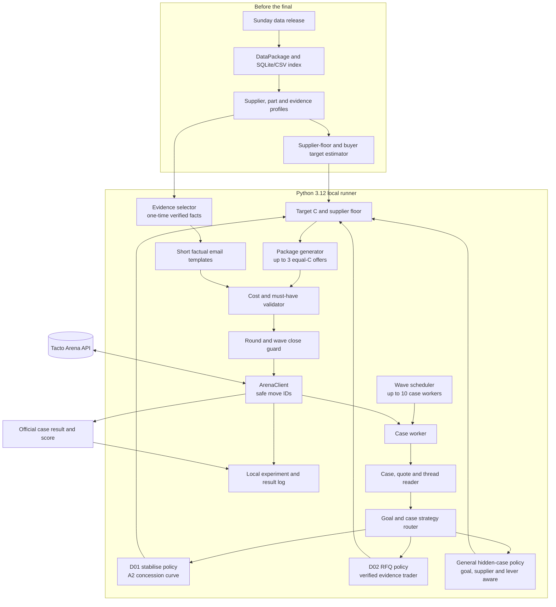
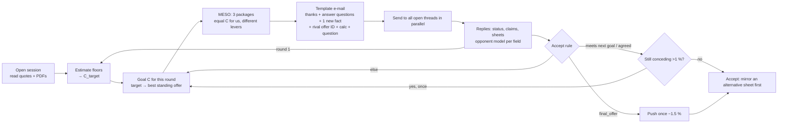
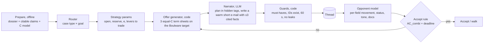

You are Astra, the lead engineer of our hackathon team (Tacto Negotiation Arena: an autonomous BUYER agent negotiates by
e-mail with LLM supplier bots; score per case = (C_open - C_deal)/(C_open - C_best) on total cost C). The team lead sends you
EVERYTHING we have: how the app works, every algorithm we built (catalogue with exact settings), the complete experiment
log (every change and its measured effect, E0-E60), every practice result table, the current best agent's full practice
conversations, the outside advice we assessed, and the engine's Config and interface.

Your job - a thorough, honest technical review, organised in these sections:
1. **How the system works** - a precise architecture map of our buyer agent as it is today (G8s): modules, decision flow
   per message, data/evidence path, RFQ coordination, guards, the LLM components (writer, stance analyser) and the
   orchestration/testing tooling. Point out anything in the docs that is outdated or contradicts the code/log.
2. **Catalogue of all systems, grouped into families** (e.g. concession engines A..A10; LLM writer; Astra/Sol rounds
   A11/A12; D02 evolution G1-G5; game theory + AI deciders G4; alternative negotiators ALT-1..6; CS/SAFEZONE; G6-G10;
   stance; timid-target fixes R1-R3; outside-review ideas G9/G9v/G10). For each family: what it tried, the measured
   result, and your **judgement** (why it worked/failed, mechanism-level, citing the log), plus whether a re-test with a
   changed mechanism could be worth it.
3. **Cross-cutting lessons** about these supplier bots and about our process (what the sandbox can and cannot tell us,
   determinism, quota use, overfitting to D01/D02, integration bugs, how decisions were made). Be critical.
4. **Judgement of the current best (G8s)** - strengths, weaknesses per case (P01-P18, D01, D02), risks for the hidden final
   (unseen suppliers and case types, 5 waves x 8 minutes, up to 10 cases in parallel), robustness gaps.
5. **Improvements to G8s** - concrete, generic, ranked by expected value per effort; each with mechanism, trigger, target
   cases, expected gain (honest ranges), risk, why it is not a measured failure, and the cheapest test (sandbox first;
   practice only with the lead's OK).
6. **Different approaches** - genuinely different system designs worth considering (not repeats of ALT-1..6 unless you
   change the mechanism), with a realistic assessment of whether they could beat G8s within the time left.
7. **Final-readiness checklist** - what must be true before the final (robustness, timeouts, parallel load, unseen case
   types, fallbacks), and anything in the code/process that is a risk.
8. **Prioritised roadmap** - the next 5-8 steps in order, with test protocol and stop criteria.
9. ONE json block: {"improvements": [{"id": "S5-1", "title": "...", "section": 5, "targets": ["P18"], "expected_gain":
   "...", "effort": "S|M|L", "risk": "...", "test": "...", "spec": "..."}], "approaches": [{"id": "S6-1", "title": "...",
   "summary": "...", "worth_it": "yes|maybe|no", "why": "..."}], "final_risks": ["..."]}

Hard constraints for every proposal: generic rules only (no case/supplier IDs or prices from sandbox/practice); numbers
from code; never invented facts or figures (the arena checks claims and invented data is deceptive); only allowed options
and must-haves; no network waits under the RFQ lock; sandbox first, practice only with the lead's explicit OK. Ground every
claim in the material below and say "unmeasured" where it is a hypothesis.

=== 1. HOW THE APP WORKS (vault App/ docs + hand-over note; some docs may be outdated - say so) ===
===== A-Hybrid-Algorithm.md =====
---
tags: [algorithm, negotiation, sandbox, a-hybrid]
created: 2026-10-10
author: Sudeep
---
# A_hybrid: A6 with supplier-quoted delivery flexibility

Status: experimental candidate, not a replacement for A6. Sudeep's earlier
specialist remains B1; historical `A3fca35` is its unchanged configuration alias.

## What transfers from B1

B1 explored non-price package trades before the supplier's final offer. A_hybrid
transfers that principle: preserve a supplier-quoted schedule when faster delivery
has no calculated buyer benefit. It removes B1's hard-coded case, supplier, FCA,
payment-day and lead-day choices. An observed quote establishes a feasible schedule,
not proof that the supplier will accept our lower price or save production costs.

## Exact policy

Base: `VARIANTS["A6"]`, including its targets, concession schedule, evidence,
package generation, supplier coordination, acceptance and deadline controls.
The only configuration difference is `revealed_schedule=True`.

After A6 generates its normal package proposals:

1. Act only for an RFQ whose current supplier thread is open. Lead time must be
   negotiable and absent from the case's fixed terms.
2. Examine the proposed packages in their existing order, and the current
   supplier's latest quoted term sheets in their existing order.
3. Require an explicit quoted lead time longer than the proposed lead time and
   no longer than the buyer's required lead time. If allowed options are provided,
   require exact membership; do not snap an unsupported observation to an option.
4. Resolve both packages through the official `closing_terms` helper. Every term
   other than price and lead time must match. A different Incoterm or payment
   period does not establish evidence for this trade.
5. Copy the buyer proposal and replace only its lead time. Preserve its price.
   Reject duplicate packages and mandatory-constraint violations.
6. Calculate both complete costs with `total_cost`, including the supplier estimate
   for relationship costs where applicable. Require finite costs within €0.01.
7. Apply the first valid change to at most one package. Record the source quote ID,
   old/new lead times, actual terms, and before/after costs. Otherwise leave A6's
   proposals unchanged.
8. Ask whether the supplier can confirm the proposed price on its quoted schedule.
   This is a new counteroffer, not acceptance of an old quote. Ordinary A6 closing
   logic remains responsible for accepting an executable offer.

Price-frozen packages returned early by A6 and its recalled offers bypass this
transformation. The new rule does not change single-supplier price-increase cases.

The current cost model charges only delivery after `need_lead_time_days`, making
some earlier schedules economically equivalent. The full calculator and hard
constraints still validate every change; the policy does not assume this from prose.

## Evaluation

Use the generic data-package evidence path for both policies. Freeze source and
configuration before the batch, rotate variant order, retain every attempted run,
and report means, medians, ranges, failures and replay IDs. D01 is a regression
check; D02 tests the intended change. Repeated demos cannot establish performance
on unseen suppliers, and neither the cost check nor an observed schedule guarantees
supplier acceptance.

```bash
PYTHONPATH=. uv run python proto/compare_sandbox.py \
  --variants A6 A_hybrid --cases case:D01 case:D02 \
  --repeats 5 --workers 2 --data ../data
```

Add `--env-file /path/to/local/.env` if needed. This runner accepts only sandbox
D01/D02. Raw artifacts are ignored under `proto/runs/comparisons/`; durable reports
belong in `proto/comparisons/`. No hosted practice cases are part of this experiment.

Implementation: `hybrid.py`, integrated through `engine.py` and `variants.py`.
Offline checks in `tests/test_hybrid.py` use an unrelated synthetic case and verify
cost preservation, constraints, allowed terms, evidence matching, input immutability,
duplicate avoidance, and isolation to one configuration change.

Code and frozen results: [personal development branch](https://github.com/WhemDev/ehl-tacto/blob/sudeep/b-line-comparison/starter-kit/proto/A_HYBRID.md).

Evaluation: [[../Progress/A-Hybrid-Sandbox-Comparison]].


===== Algorithm-Testing-Plan.md =====
# How we will test negotiation algorithms

Prepared 2026-10-10. Related: [[Challenge-Handover]] · [[Arena-Workflow-and-Learnings]] · [[Architecture]]

## What we can test

The hosted sandbox currently exposes two cases, with three supplier bots in total:

| Case | Scenario | What it tests |
|---|---|---|
| D01 | Pump housing price increase; one foundry | Trading contract length, payment and effective date for total cost; preserving supplier health |
| D02 | Pump shaft RFQ; two competing suppliers | Supplier selection, competition, payment, delivery lead time and Incoterm tradeoffs |

Every candidate runs both cases. The policy controls supplier selection within D02; we check the
replay and supplier-contact record to see whether it actually explored both threads. Locally we
also have S01–S03 and public case-file copies for checking API behaviour. Local suppliers are
scripted, so only hosted runs tell us how our tactics perform against the arena's demo bots.

## Comparison procedure

1. Implement the proposed algorithm behind the starter kit's existing `decide(case, threads)`
   interface. Give it a distinct name/version and freeze its parameters and model settings.
2. Check it on the local simulator: valid messages and term sheets, multiple suppliers, documents,
   safe acceptance, and recovery from errors. A new instance is created for every trial.
3. Run baseline and candidate once on each hosted demo: four sessions for two algorithms. Inspect
   the offers and closing behaviour before spending time on repetitions.
4. Screen with three runs per algorithm per case: twelve sessions for baseline versus one candidate.
   Shuffle algorithm order within each case/repetition block. Re-run the baseline in the same batch.
5. Retest the most promising candidate against baseline ten times per case: forty sessions. Compare
   both cases separately; a tactic that improves D01 may harm D02. Treat small differences amid
   high variation as inconclusive, and change one feature at a time when explaining an improvement.

Sandbox runs do not consume practice quota. Our own algorithm's model calls can still cost money.
The later practice sweep and final-wave concurrency rehearsal are separate steps; demo results
alone do not establish generalization to unseen suppliers.

## What will be recorded

Each trial retains its algorithm/config, case, repetition, session ID, accepted supplier and terms,
total-cost breakdown, official score, reason it ended, rounds, decision durations, errors and replay.
The batch also retains the code revision, case files, model names/settings and randomized schedule.

The report shows per-case mean, standard deviation, lowest score, deal rate and paired differences
against the baseline. Algorithm failures count as zero in the experiment's comparison metric;
their raw arena outcome is preserved separately. We do not discard bad runs or pick a winner from
one high score. For a single overall comparison, average the per-case means with equal case weights;
do not add euro savings across unrelated products or count D02's suppliers as separate cases.

The schedule has a reproducible seed, but hosted supplier responses cannot be seeded through the
API. Comparisons use independent sessions, not identical supplier randomness. Post-run `C_best`
and supplier reasons are analysis data, not information supplied to the policy during a trial.

## Runner ready for the handoff

Code branch: `sudeep/negotiation-experiments` in `WhemDev/ehl-tacto`.
Local workspace: `~/github/ehl-tacto-experiments`.

```bash
cd ~/github/ehl-tacto-experiments/starter-kit
uv run arena-experiment --config experiments/demo.json
# Add --execute to start the previewed batch.
```

The starter config includes the existing naive baseline. Add the agreed algorithm as a factory
entry, then the same runner handles all demos and repeats. Setup and the exact adapter contract
are in `starter-kit/experiments/README.md`.

## First tournament results · 2026-10-10

The starter kit now has three deterministic strategies: A `ControlledAgent` (fixed concession
schedule), B `AdaptiveHybridAgent` (response-aware packages and supplier coordination), and C
`LearningHybridAgent` (within-session contextual bandit choosing between A/B). The existing naive
buyer was the common baseline. All policies use the arena cost function and must-have validator.
They use fixed email templates, so the comparison isolates the economic policy; no LLM calls were
made. C is an online bandit prototype, not pretrained reinforcement learning.

The repeated sandbox batch completed 24/24 sessions, with a deal in each. Official mean scores
were identical across three repeats per case/strategy:

| Case | Naive | A: controlled | B: adaptive | C: bandit |
|---|---:|---:|---:|---:|
| D01 | 0.200 | **0.657** | 0.617 | 0.637 |
| D02 | 0.229 | **0.251** | 0.104 | **0.251** |

This suggests A is the best current simple baseline, while C did not show an advantage over A.
B contacted both suppliers in D02 but scored lower, so its supplier selection/closing policy needs
revision. Hosted outcomes repeated exactly, making the three-run batch a stability check for these
demo bots rather than evidence of performance against varied opponents. No final-case or unseen
supplier conclusion follows from it.

The results and redacted replays are in the ignored local folder
`logs/experiments/20261010T131701Z-faddd5f5/` in the ehl-tacto experiments workspace. See that
workspace's `vault/Plan/Algorithm testing.md` for the cost comparisons and detailed interpretation.

The later J1-specific D02 probe reached **0.661**; see [[D02-J1-Evidence-Trading-0.661]] for the
exact sequence, verified references, final cost and replay. It has not cleared the 0.8 gate.
The executable rules and the D02-only reproduction command are in
[[D02-J1-Evidence-Trader-Algorithm]].
The revised selection gate is a **case-balanced median from repeated runs**: run each candidate at
least three times on D01 and three times on D02, take the median official score within each case,
then take the midpoint of those two case medians. Rank candidates only if this combined value is
at least 0.8; include each case median, worst run, deal rate and complete buyer cost. With the
current D01 median 0.841495, D02 needs a median of at least 0.758505. One good run does not qualify.
The first exact-policy qualification batch (`j1_cost`) completed 3/3 D01 and 3/3 D02 deals, with
case medians **0.841495** and **0.660880**. Its combined median is **0.751187**; no strategy is
qualified or ranked yet. See the linked D02 note for all three D02 replays.

Raw results go into ignored `logs/experiments/<batch>/`, with a Markdown report, CSV table, JSON
records and completed session traces. Only selected findings and replay links need to be promoted
into this vault. The runner targets sandbox or a loopback simulator; it cannot run hosted practice
or the final. It executes cases sequentially. Policies must set their model-call timeouts; decision
timing here is diagnostic and does not prove compliance with every 60-second thread deadline.

## What the algorithm proposal should specify

- What determines the opening bid and choice of supplier.
- Which evidence to retrieve and how to use it in a message.
- Which terms to trade and how concessions change after each reply.
- How to handle `final_offer`, `agreed`, missing terms, and a better alternative.
- When to accept or walk, including the time budget and stopping rule.
- Any model, prompt, randomness, memory or tunable parameters that must stay fixed in a comparison.

These rules can be supplied in plain language first. We will translate them into the same policy
interface and compare them without changing the rest of the experiment.


===== Architecture.md =====
---
tags: [architecture, buyer-agent, final]
updated: 2026-10-10
---

# Final Buyer Agent Architecture

## Goal

Run a cost-minimizing procurement buyer autonomously through all five Live Final waves. The policy must cover the case's real need, meet every must-have, use supplier evidence accurately, and close each case before its wave ends. The arena rewards total-cost improvement, not the lowest quoted unit price.

The current design is deterministic: code calculates targets and offers; short templates communicate them. This avoids token cost and keeps every bid reproducible. An LLM stays out of the decision path until controlled trials show that it improves scores without threatening the message deadline.

## Diagram



## Components

| Component | Tech | Owner | Notes |
| --- | --- | --- | --- |
| Data preparation | Python `DataPackage`, CSV/SQLite/document readers | Agent team | Load the published package and Sunday release before play. Index only facts relevant to the case's suppliers, parts, quotes, forecasts, scorecards, contracts and news. |
| Target estimator | Python; arena `supplier_value` and `total_cost` helpers | Strategy engine | Estimate supplier floors from cost breakdowns and case evidence; enumerate allowed terms; compute a buyer `C_target`. This is an estimate, not the hidden official `C_best`. |
| Case strategy router | Deterministic Python rules | Strategy engine | Classify category goal, RFQ versus single source, supplier count, must-haves, quote standards and available evidence. Route to a case-specific policy only when its assumptions match. |
| D01 policy | Engine A2 parameters and D01 target model | Strategy engine | Best recorded sandbox score: 0.979. Uses a concession curve, two equal-cost packages, a hold round while the supplier is still moving, verified facts, and relationship-aware price targets. |
| D02 policy | J1 evidence-trader state machine | Strategy engine | Best repeated result: 0.661 in three recorded runs. Validates standard terms first, trades payment/delivery/Incoterm, cites verified facts and a current rival offer, and compares total cost before acceptance. |
| Hidden-case policy | Goal-aware rules and floor estimator | Strategy engine | Reuse economic principles, not D01/D02 prices or supplier assumptions. Select concessions from the case, supplier data, current quote, must-haves and available levers. |
| Package generator | Python MESO enumerator | Strategy engine | Generate up to three complete offers with similar buyer cost but different supplier-valued terms. Do not send a term sheet above the supplier's own offer or one that costs more than the supplier's valid offer. |
| Evidence selector and writer | Local data lookups plus concise templates | Agent team | Drip one or two new relevant facts per message, include figures with IDs, answer supplier questions, and use a rival offer ID only when it is current and valid. Do not repeat evidence that returned `duplicate`. |
| Cost and safety guard | `total_cost`, `must_haves_ok`, option validation | Runtime | Normalize missing terms from the supplier's quote PDF, include freight, payment, lead time, quality, uncovered need and relationship costs, then reject invalid or infeasible offers. |
| RFQ coordinator | Parallel supplier workers and shared case state | Runtime | Message both RFQ suppliers in parallel, compare valid standing offers, and avoid closing while a supplier reply is still in flight. Synchronize state before accepting. |
| Deadline and session runner | Starter-kit `play_waves`, `RemoteTable`, `ArenaClient` | Runtime | Resume owned sessions after a restart; cap at 10 workers; close at least 90 seconds before the wave cap or earlier if the slowest round plus 15 seconds needs more time. |
| Run logger | Structured local JSON/CSV/Markdown | Agent team | Record code/config version, case, offers, citations, result, cost, score, timing and errors. Keep API keys out of logs and Git. |

## Data flow

1. **Prepare before the event:** download the Sunday release, build the local evidence index, inspect supplier-specific documents, and calculate candidate floors and case playbooks. Freeze the tested code and configuration before the final.
2. **Start one runner:** launch the official wave runner before wave one. It polls the permitted final case list and starts one isolated worker per case, up to the 10-session limit.
3. **Read the case:** fetch the case, opening supplier messages and quote attachments. Resolve standard terms before comparing offers. Read only that case's own threads and attachments.
4. **Route the policy:** classify the case and category goal. Use D01 or D02 behavior only when the case matches its known assumptions; route unseen suppliers through a data-driven general policy.
5. **Set a buyer target:** estimate supplier floors from cost breakdowns, historical prices and case references. Enumerate feasible packages using exact arena cost helpers. Re-estimate when new supplier evidence arrives.
6. **Negotiate in parallel:** choose the round's buyer-cost goal, generate MESO packages with different supplier incentives, select fresh verified evidence, answer open supplier questions and message each active RFQ thread.
7. **Validate every move:** complete all negotiable fields, snap values to allowed options, enforce must-haves, and compare each supplier's standing offer with the alternative and current target. Reuse a move ID only for a safe retry of the same message.
8. **Accept or close:** accept the cheapest valid standing offer when it reaches the next goal, the supplier agrees, or the deadline guard fires. On a final offer, use only a tested push rule and only when a genuine competing offer supports it. Otherwise close against the real alternative.
9. **Analyze after the wave:** capture official score and `C_deal`, supplier, terms, verified claims, rounds, timing and replay. Do not feed post-case or leaderboard data into live decisions.

## Case policies and current evidence

- **D01:** A2 reached 0.979 in the sandbox. The strategy uses a 24-month stabilizing package, truthful forecast, effective-date/payment trades, and one hold round when the foundry is still conceding. Do not walk away when there is no useful alternative.
- **D02:** The J1 evidence trader reached 0.661 with the same accepted €14.10 FCA, 14-day payment, 35-day lead package in three recorded sandbox runs. Reject C1's missing-lead quote when its 45-day standard term breaches the 42-day maximum. Compare complete cost, not price: an EXW quote can lose to FCA after freight and lateness.
- **Qualification status:** the recorded repeated D01/D02 case-balanced median is 0.751, below the team's 0.8 gate. These deterministic demo suppliers provide useful repeatability checks but do not establish performance against unseen final suppliers. Continue controlled testing and resolve the D02 gap before calling the strategy qualified.

## External services / APIs

- **Tacto Arena API:** final case list, session creation/resume, own thread messages, own-session state and attachments through the supplied `ArenaClient`.
- **Local data package:** downloaded case-support data; read-only during a live wave.
- **LLM provider:** none required in the current best-scoring decision path. A future language helper may draft or interpret prose only behind a strict timeout and deterministic fallback; it must never own cost arithmetic, validation or closing decisions.
- **Forbidden during the Live Final:** the agent must not read `/v1/events`, `/screen`, `/leaderboard` or `/results`. Do not add browser scraping or any live ranking/result feed.

## Deployment

- **Runtime:** Python 3.12 and `uv` on the team's machine, using the pinned starter-kit dependencies.
- **Code status:** architecture and findings are tracked in this vault. Current engine experiments live in the separate `ehl-tacto` starter-kit workspace; port the validated A2 and evidence-trader policies into the submitted runner before the code freeze.
- **Configuration:** `ARENA_URL`, `ARENA_API_KEY`, local data path and any optional model settings belong in an ignored `.env` or environment variables. Never commit credentials.
- **Release data:** refresh the data package after Sunday's release and rebuild the local evidence index before final startup.
- **Launch:** start the wave runner before 12:00 with concurrency at or below 10. Keep it online for all five waves, with session resume and deadline closing enabled.
- **Operations:** monitor process health and redacted local logs. No human intervention is assumed during a live case.

## Success measures

- **Primary:** official score by case and repeated, case-balanced median; track total cost versus `C_open` and the remaining gap to estimated `C_target`.
- **Guardrails:** no must-have violations, invalid term sheets, unsupported claims, late messages, duplicate concurrent decisions or open cases at a wave cap.
- **Experiment quality:** freeze each candidate configuration, use at least three runs per sandbox case for screening, record failures as zero in comparisons, and change one policy feature at a time.


===== Arena-Workflow-and-Learnings.md =====
# Arena Workflow & Sandbox Learnings

> Written 2026-10-10 after hand-playing both sandbox cases (`case:D01`, `case:D02`). Sandbox sessions do **not** cost practice quota. Practice cases and the hidden final suppliers may behave differently, so treat these as hypotheses to test on `P01…P18`, not facts.

Related: [[Overview]] · [[Architecture]] · [[Tech-Stack]] · [[Resources]]

---

## 1. What the system is

We are Hollerau Pumpenwerke (fictional German pump maker). Each **case** is one negotiation against one to three **supplier bots** (LLM-driven, with hard economic limits). We negotiate **by e-mail + term sheets**, then **accept one standing term sheet** or **walk away**. The score is based on the **total cost C in €** of the accepted deal.

```mermaid
flowchart LR
    A[POST /sessions case_id] --> B[Round 0: every supplier sends quote e-mail + quote PDF]
    B --> C[We send message: body + up to 3 term sheets + refs + attachments]
    C --> D[Supplier reply: body, standing term sheet(s), status, claim_results, signals]
    D -->|status open| C
    D -->|final_offer / agreed| E[accept term_sheet_id]
    C -->|walk_away| F[No deal = score of our alternative, else 0]
    E --> G[Result: c_open, c_deal, c_best, score, cost_breakdown]
```

**Score** = (C_open − C_deal) / (C_open − C_best), clipped 0…1. `C_open` = best opening quote, `C_best` = best package any supplier would ever accept (hidden). No deal scores our alternative (0 if none).

### Message anatomy
| Field | Notes |
|---|---|
| `body` | Plain text. The supplier reads **all** of it: tone, questions, arguments, threats. |
| `term_sheets` | 0-3 alternatives, each with *every* negotiable field. **Only term sheets bind.** Use `complete_offer(case, terms)` to fill/snap to allowed values. |
| `refs` | Data IDs we rely on (`po:…`, `fc:…`). IDs written in the body count too. |
| `attachments` | md/csv/json readable by supplier. |
| `action` | `accept` (needs `term_sheet_id`) or `walk_away`. |

### Supplier reply anatomy
`status`: `open` · `final_offer` (push again and it may walk) · `agreed` (matches our terms; **we still must accept**) · `walked_away` · `no_bid`.
`claim_results` per cited ID: `verified` · `contradicted` (wrong figure/unknown ID: costs trust) · `irrelevant` · `duplicate`.
`missing_fields`: anything left out **closes on the supplier's standard terms** (listed in the quote PDF).

### Limits
60 s per message (from the supplier's reply), round limit 10 messages per thread (`round_limit`), 3 late messages in a row end a thread. Practice quota 200/24h per team (shared!). Sandbox is free.

---

## 2. How the cost C works (what we are actually optimising)

Price × committed units is only one part. From the cases we played (see `cost_breakdown` in each result):

| Component | What it means in practice |
|---|---|
| Price | unit price × units; units bought **before** the new price's `effective_date` are at the old price. |
| Uncovered need | A **12-month** contract only covers half of a 2-year need; the rest is priced at the fallback price + risk. → **24 months is hugely valuable**. |
| Payment terms | Interest (8%) for paying **earlier than the 60-day reference**. Paying earlier costs us only a bit, but suppliers credit it generously (see below). |
| Freight | By Incoterm (EXW 0.6, FCA 0.4, DAP 0 per unit in D02): **DAP is not free to the supplier**, it prices it in. |
| Lead time | € per day beyond the need (D02: 35 d need, €150/day), and a **hard must-have** (≤ 42 d). |
| Quality | Expected defects from the supplier's committed PPM × cost per defect. Read it from the **quote PDF**. |
| Supplier health | Strategic cases (D01): € per margin point the supplier is left below a sustainable margin: don't squeeze to the floor. |

**Always read the quote PDF** (`/doc` in `chat.py`, or `read_document`). Its "standard terms" block is what you get for anything unstated.

---

## 3. Results

| Run | Case | Approach | C_deal | Score |
|---|---|---|---|---|
| Naive agent (`arena play`) | D01 | 1% steps, accepts round 4 | €440,757 | **0.20** |
| Hand run 1 | D01 | 24 mo + volume + cited POs → pushed too hard → `final_offer` | €416,605 | **0.80** |
| Hand run 2 | D01 | 24 mo + cited POs + start later + 30d pay; "sign today" | €414,994 | **0.84** |
| [[Manual-D01-Foundry-Findings|Sudeep's manual run]] | D01 | €45 bid + 24 mo; accepted first €51.40 counter | €423,541 | **0.63** |
| Hand run 1 | D02 | Parallel threads, DAP/35d/30d, accepted Polish supplier | €201,776 | **0.22** |
| Hand run 2 | D02 | Flexible on lead time (42 d), EXW, 14-day payment, cited `fc:`/`cost:`/`sc:` | €195,467 | **0.33** |

(D01 `C_open` 448,811, `C_best` 408,624. D02 `C_open` 214,296, `C_best` 156,739.)

---

## 4. D01: Foundry wants +8.8 % (single supplier, `stabilise`)

Supplier: family-run foundry owner. Opens €52.90 / 30 d / 12 mo / from 2026-12-01. Our current price €48.60. Fallback for uncovered need €55.

### What worked
- **Offer a 24-month contract.** Biggest single move: C fell from ~€449k to ~€422k before any real price haggling. A 12-month deal leaves half the need uncovered at the €55 fallback.
- **Confirm the volume and cite real data.** The supplier repeatedly asks "binding volume forecast… send the data". Citing our own order IDs (`po:4500001201`, `po:4500001288`, `po:4500001342`, from the case `refs`) came back `verified` and the price fell €51.40 → €50.80.
- **Offer 3 alternative term sheets in the first message.** The supplier answers with 1-2 counter sheets and reveals which levers it moves on.
- **Trade, don't just ask lower.** Later start date (phase-in) bought a lower price at about €0.30 per extra ~2 months; the supplier valued 30-day payment too.
- **"We can sign today" + a small ask.** Asking 50.20 on the supplier's own proposed package brought 50.50; repeating exactly 50.50 flipped status to `agreed`.
- **Ask what matters to them.** A question with no term sheet got: "contract length and price are most important, reliable payment also helps". It even dropped €52.90 → €52.70 as "goodwill" for pure engagement.

### What didn't work
- **Generic arguments with no data ID** ("WAGES-METAL is only +3.1%"). No claim was even parsed, and the supplier replied with `final_offer` and hardened. Don't argue from unverifiable statements.
- **Pushing 2 rounds in a row too aggressively** → `final_offer` at 50.80. Moderation in run 2 got to 50.50 without a final-offer lock.
- **The naive agent's habit** of splitting the difference and accepting early left most of the gain.
- Walking away scores **0** (no alternative in D01).

---

## 5. D02: Stainless shaft SH-220, RFQ with two suppliers (`leverage`, award one)

Suppliers: **DEMO-J1** (German job shop, owner "needs work and cash"): opens €17.10 / 30 d / 28 d lead / EXW std. PPM 1100. **DEMO-C1** (Polish machining, "growing supplier, eager"): opens €16.00 / 45 d / EXW, **omits lead time**, standard lead time **45 d**, PPM 2600. Constraints: lead ≤ 42 d (must-have), need 35 d, €150/day beyond need, defect €40.

### What worked
- **Parallel threads.** Both suppliers move toward us when they feel competition. We ran both and compared C at every step.
- **Spot the trap in the cheapest quote.** C1's €16.00 looked best but silently closes on a 45 d lead time → must-have violated → score 0. Always compare using each quote's *standard terms*.
- **Loosen what is cheap for us, tighten what is expensive.** Biggest unlock: asking for **lead time 42 d (our limit), EXW pick-up, 14-day payment** took both from ~€16.6-16.7 to **€15.60**. Lead 35→42 d costs us ~€1k total (7 days × €150), while the supplier rewards it heavily (J1: "14 days payment helps us a lot right now, I can give you a much better price").
- **Early payment is under-priced by us, over-credited by suppliers.** 15 days earlier bought ~€0.20/unit from C1 vs ~€0.04 interest cost to us. Check each supplier's exchange rate.
- **Supplier-specific hooks.** J1 (job shop) responded to cash and "work", C1 to payment and growth. Reading the persona mattered.
- **Cost breakdown from J1** (it said it had no "fancy" one, but attached an xlsx): material 5.56 + wages 4.39 + conversion 2.81 + **overhead & profit 2.84** (~18%). That shows how much room exists above the true cost floor.
- **Citing case refs.** `fc:SH-220@2026-09` (volume) → `verified` by J1 → €15.60 → €15.40. `cost:part:SH-220` (should-cost) and `sc:DEMO-C1@2026Q3` (scorecard) → `verified` by C1 → €15.60 → €15.50. `news:N-0412` → `irrelevant` to C1.
- **Competition disclosure.** We told each supplier truthfully the other's price/terms; both asked for "proof" and the attached `.md` summary was accepted without fuss.

### What didn't work
- **Insisting on DAP + 35 d.** Pushes the supplier's price up (C1: 16.00 → 16.90 once we required DAP/35 d/60 d), and J1 simply answered with FCA.
- **A tough price ask with "level on price" framing** (14.40 vs 15.60) → both held firm. The gains came from new information and trades, not from bare pressure.
- **Same fact twice** → `duplicate` (C1 on `fc:`), no extra credit. Each verified fact moves the price once.
- **Both suppliers declared `final_offer`** after we asked for large cuts + citations at once; after that, further asks risk a walk-away.
- **Remaining gap.** Even our best deal (€15.40) left us at score 0.33; `C_best` is ~€156.7k, i.e. ≈ €13.06/unit. We did not find the lever that gets there. Untested ideas: a much higher binding volume, `news:N-0412` on J1 (it may concern J1's material), 21 d overtime lead time, 49-day lead time rules, asking J1 for DAP at the EXW price, using one supplier's `final_offer` as a hard counter on the other, and splitting asks across more rounds (we used about 5 of 10).

---

## 6. General playbook (draft, to validate on practice cases)

1. **Prepare:** read case file (`/case`), quote PDF(s), `refs`; compute C for each standing term sheet and the opening quotes *with standard terms*.
2. **Message 1:** one polite e-mail with 2-3 alternative term sheets that vary *different* levers (contract length, payment, start date, lead time, Incoterm). Cite verifiable IDs from `refs`. Don't reveal urgency, budget or a missing alternative.
3. **Read the reply:** what did the supplier move on? What did it ask for (volume data, proof of competitor)? Check `claim_results`.
4. **Trade the cheap-for-us levers**; hold what is expensive for us. Recompute C each round.
5. **Move gradually**; avoid back-to-back large asks that trigger `final_offer`.
6. **Use `agreed`/`final_offer`:** on `agreed`, still send `accept`. On `final_offer`, compare against the other thread / our alternative and decide.
7. **Never accept a quote with missing fields without checking its standard terms.**
8. **Keep an eye on the clock** (60 s) and on rounds left.

---

## 7. Setup notes / gotchas

- Code lives **outside the vault**: `~/Documents/EHL-Hackathon-code/starter-kit` (a clone of `tacto-ai/negotiation-arena-kit`). Put the key in `starter-kit/.env` only (it's gitignored). **Never** paste the key into the vault or chat logs; one key per team.
- `uv sync --all-extras` needs network access to GitHub (it downloads Python 3.12).
- **macOS gotcha:** after `uv sync`, `uv run arena …` may fail with `ModuleNotFoundError: No module named 'arena_kit'`. The editable-install `.pth` file gets the macOS *hidden* flag and Python ignores it. Fix: `chflags nohidden .venv/lib/python3.12/site-packages/*.pth`. **It comes back** after `uv` re-syncs the environment, so rerun the fix whenever the error reappears (or run scripts with `PYTHONPATH=.`).
- `uv run arena play case:D01 -v` runs the **naive bot** automatically (no chat, ~1 second). To negotiate yourself: `uv run python chat.py case:D01` (interactive script in `starter-kit/chat.py`).
- Sandbox: `case:D01` (1 supplier), `case:D02` (RFQ, 2 suppliers). Sandbox facts like `po:4500001201`, `fc:SH-220@2026-09` are **not** in the downloadable data package; they only exist inside the arena (cited via the case `refs`).
- `uv run arena data` downloads the data package (24 tables, `world.sqlite`) for practice cases; the Sunday release is public from 2026-10-11 06:00 UTC.

## 8. Open questions for the team

- Which lever gets D02 closer to `C_best` (≈ €13/unit)?
- How different are the hosted practice suppliers (P01-P18) from the demo suppliers?
- Should the real agent be (a) LLM writing e-mails with code-computed C and term-sheet search, or (b) a mostly rule-based negotiator with an LLM only for wording? See [[Architecture]].


===== D02-J1-Evidence-Trader-Algorithm.md =====
---
case: "case:D02"
set: sandbox
strategy: j1_evidence_trade
score: 0.6608797297715212
date: 2026-10-10
tags: [algorithm, negotiation, reproducible, sandbox]
---

# Exact D02 algorithm that reproducibly scored 0.661

Implementation: `EvidenceTraderAgent(d02_style="j1_cost", d02_target_cost=170638.57)` in
`starter-kit/arena_kit/agents/evidence.py`, ehl-tacto commit `4bf381e` on branch
`sudeep/negotiation-experiments`. The batch configuration is
`starter-kit/experiments/qualification.json`. This is a **deterministic, demo-specific state
machine**. It uses fixed bid templates and evidence IDs; there is no LLM, reinforcement learning,
or fitted opponent model in this policy.

## Inputs and invariant checks

- Read the D02 case plus both current supplier threads, including quote attachments and any
  alternative term sheets in the latest supplier reply.
- For each current supplier sheet, fill missing fields from that supplier's quote PDF/standard
  terms. Reject sheets whose resulting lead time exceeds **42 days**. This rejects C1's opening
  €16.00 quote because its omitted lead time defaults to **45 days**.
- Calculate **complete buyer cost** over 6,000 units/year for 24 months: purchases + payment
  financing + freight + lateness beyond 35 days + expected quality loss. Choose by this cost, not
  the lowest unit price. Only a current, valid supplier sheet can be accepted.
- If any valid standing sheet has cost **≤ €170,638.57**, accept the cheapest such sheet immediately.
  This threshold corresponds to the D02 score needed for the team's combined 0.8 gate given the
  repeated D01 score. No D02 sheet reached it in the recorded runs.

## Message state machine

Each supplier's state is the number of buyer emails already sent to that thread. All bid sheets
use **14-day payment**; the case fixes the contract at **24 months**. The email states the real
**6,000-unit annual requirement**; the agent never invents a larger commitment.

| Decision point | Supplier and exact structured bids (`€/unit`, Incoterm, lead days) | Evidence and purpose |
|---|---|---|
| C1 has 0 buyer emails | C1: `14.50 EXW 42`, `14.80 FCA 42`, `15.00 DAP 35` | Cite `fc:SH-220@2026-09`; get a valid competing quote while offering 14-day cash and flexible delivery. C1 replied with a valid **€15.50 EXW / 42-day** alternative. |
| J1 has 0 buyer emails | J1: `13.80 DAP 35`, `13.40 EXW 42`, `14.00 FCA 35` | Name C1's **actual current valid** price, terms and offer ID; cite `news:N-0412`. J1 verified the rival quote and news claims, then countered **€14.60 FCA / 35 days**. |
| J1 has 1 buyer email | J1: `13.40 EXW 42`, `13.80 DAP 35`, `13.60 FCA 35` | Cite `cost:part:SH-220` and `sc:DEMO-J1@2026Q3`. Mention J1's €5.56 material + €4.39 labour + €2.81 conversion breakdown **only if those figures appear in its attachment**. J1 verified both references and countered **€14.10 FCA / 35 days**, plus €13.90 EXW / 42 days. |
| C1 has 1 buyer email | C1: `15.25 EXW 42`, `15.50 FCA 35` | Cite `cost:part:SH-220` and `sc:DEMO-C1@2026Q3`; ask for a price on the same 6,000-unit volume. Its later offer was €15.30 EXW / 42 days. |
| Later C1 email | C1: `max(13.50, latest main price − 0.25)` EXW/42; second FCA/35 bid is €0.25 higher | No new references; compare its reply with J1's standing offer. |
| Later J1 email | J1: `13.60 EXW 42`, `14.00 DAP 35`, `13.80 FCA 35` | No new references. J1 marked **€14.10 FCA / 35 days final**. The email did not repeat the direct-cost figures; J1 nevertheless referred back to its overhead in its response. |

Supplier choice is exact: contact C1 first, then J1; give J1 its first follow-up before returning
to C1. After that, choose the active supplier with fewer buyer emails, breaking ties toward C1.
`agreed` and `final_offer` threads remain available for acceptance but receive no further bids.
When no productive thread remains, or the selected thread has four buyer emails, accept the
**cheapest current feasible offer**. In the recorded run this was J1's `offer:DEMO-J1-3`. Its
€14.10 FCA/35-day package cost less overall than J1's €13.90 EXW/42-day alternative because EXW
added freight and seven days of lateness.

## Verified reproduction

The same committed policy ran in **three fresh D02 sandbox sessions** in the qualification batch.
Each ended with `sup:DEMO-J1`, `offer:DEMO-J1-3`: **€14.10/unit, 14-day payment, 35-day lead, FCA**.
Every run had total buyer cost **€176,257.60**, official score **0.6608797297715212**, and a deal.
The replays are [run 1](https://arena.tacto.ai/replay/e843da929222686e),
[run 2](https://arena.tacto.ai/replay/a40f20f453858602), and
[run 3](https://arena.tacto.ai/replay/e38acad546436805). The score follows the arena formula:
`(214296.00 − 176257.60) / (214296.00 − 156738.78) = 0.6608797298`.

To run the same policy again from `ehl-tacto/starter-kit`, with the team API key in the ignored
`.env` and `ARENA_URL` pointing at the hosted arena:

```bash
uv run arena-experiment --config experiments/qualification.json --target sandbox --cases case:D02 --repeats 3 --execute
```

This command opens only quota-free **D02 sandbox** sessions. It writes a fresh ignored
`logs/experiments/<batch>/` folder with `results.csv`, `report.md`, `trials.json`, session traces
and dashboard events. Exact scores can vary if the hosted demo supplier policy changes; the three
recorded runs were identical. The related
[[D02-J1-Evidence-Trading-0.661|negotiation finding]] explains what the replies taught us. The
combined D01/D02 median of this policy is **0.751187**, below the team's 0.8 qualification gate.

The command above was executed again as written on 2026-10-10. Its fresh ignored batch
`logs/experiments/20261010T140937Z-04e3bfb6/` reproduced the result **3/3 times**, with the
same J1 terms, €176,257.60 cost and 0.6608797297715212 score. Independent replays:
[A](https://arena.tacto.ai/replay/19ddbc03288a030c),
[B](https://arena.tacto.ai/replay/5ef2dce90189adf6),
[C](https://arena.tacto.ai/replay/a537b1362dbf47b4).


===== D02-J1-Evidence-Trading-0.661.md =====
---
case: "case:D02"
set: sandbox
strategy: j1_cost
score: 0.6608797298
deal: true
supplier: "sup:DEMO-J1"
date: 2026-10-10
tags: [negotiation, sandbox, finding]
---

# D02: J1 evidence and cost-breakdown trade reached 0.661

**Official sandbox score:** 0.6608797298. **Deal:** Demo Drehteile GmbH (`sup:DEMO-J1`) at **€14.10/unit, 14-day payment, 35-day lead, FCA**, for the case's fixed 6,000 units/year and 24 months. The 42-day maximum lead-time must-have was met. Total buyer cost was **€176,257.60**, compared with opening cost €214,296.00, reference best cost €156,738.78, and the no-deal alternative €238,800.00. [Replay](https://arena.tacto.ai/replay/6fe86ce06c0af781).

For the exact state machine, bid prices, references, stopping rule and reproduction command, see
[[D02-J1-Evidence-Trader-Algorithm]].

## The algorithm

This is a **deterministic, D02-specific evidence-and-package bargaining policy**, not reinforcement learning. It has fixed offer templates and a small state machine driven by how many messages have been sent to each supplier. The live supplier replies determine which *current* offer is best and which rival price can truthfully be cited.

1. **Value before acting.** Read both supplier threads, their quote attachments and all current main/alternative term sheets. Fill missing terms from each supplier's standard quote. Reject any offer with lead time above 42 days. For the rest, calculate complete two-year buyer cost: price for 12,000 units, financing, freight, lateness and expected quality cost. Rank by this cost, not quoted unit price. An invalid or superseded offer is never the fallback.
2. **Create a credible alternative at C1.** First send three packages with 14-day payment: €14.50 EXW/42-day lead, €14.80 FCA/42 days and €15.00 DAP/35 days. Cite the real forecast `fc:SH-220@2026-09` and keep annual volume at 6,000. This is meant to elicit a valid, comparable C1 quote; the opening C1 quote omits lead time and its standard 45 days violates the must-have.
3. **Use that alternative to bargain with J1.** Name C1's *actual current valid quote* and cite `news:N-0412`. Send three J1 packages, all with 14-day payment: €13.80 DAP/35 days, €13.40 EXW/42 days and €14.00 FCA/35 days. Do not invent a rival price. The cash and lead-time terms give J1 something of value while the distinct delivery packages reveal its tradeoffs.
4. **Make one evidence-backed J1 follow-up.** On J1's reply, cite `cost:part:SH-220` and `sc:DEMO-J1@2026Q3`. If its attachment actually contains the observed €5.56 material, €4.39 labour and €2.81 conversion figures, refer to that breakdown. Offer €13.40 EXW/42 days, €13.80 DAP/35 days and €13.60 FCA/35 days, all with 14-day payment. This was the move before J1's €14.10 FCA counter.
5. **Close by complete cost.** Continue comparing the latest valid sheets from both suppliers, including alternatives. If a sheet meets the target cost, accept it immediately. Otherwise contact the supplier with fewer buyer messages, with at most four messages to either thread; accept the cheapest currently executable sheet when the useful exchanges are exhausted or suppliers mark offers final/agreed. In this run J1's €14.10 FCA/35-day sheet beat its cheaper-looking €13.90 EXW/42-day alternative after freight and lateness, so the agent accepted J1's final offer.

For the six-run qualification batch, the early-accept target was **€170,638.57** (the D02 cost needed for a 0.8 combined score given D01 at 0.841495). The target was never reached, so the final-offer close rule selected J1. This is a demo-tuned policy; the prices, references and supplier ordering are not yet generalized to P-cases.

## Policy and sequence

This was the deterministic `EvidenceTraderAgent(d02_style="j1_cost")` in `starter-kit/arena_kit/agents/evidence.py` on the `sudeep/negotiation-experiments` branch. It compared *complete* offer cost and checked the hard lead-time limit before accepting. It used short fixed emails, no LLM or trained RL policy.

1. **Establish a real alternative with C1.** Offered three packages trading 14-day payment, delivery terms and lead time, citing `fc:SH-220@2026-09` for the actual 6,000-unit annual forecast. C1 verified the forecast and quoted **€15.50 EXW / 14 days / 42-day lead** as an alternative. C1's opening €16.00 had omitted lead time; its standard 45 days would have failed the must-have.
2. **Open J1 with the valid rival quote and a relevant news reference.** The message named C1's current €15.50 EXW / 14-day / 42-day quote and its offer ID, and cited `news:N-0412`. Three structured packages asked for €13.80 DAP/35 days, €13.40 EXW/42 days, or €14.00 FCA/35 days, all with 14-day payment. J1 reported both the rival-quote and news claims **verified**, then countered at **€14.60 FCA / 14 days / 35 days** (also €14.50 EXW / 42 days). This was the large step versus the earlier generic strategies.
3. **Use J1's own cost breakdown and scorecard.** Its attached breakdown showed €5.56 material + €4.39 labour + €2.81 conversion = €12.76 direct cost per unit, before overhead and profit. The next message cited `cost:part:SH-220` and `sc:DEMO-J1@2026Q3`, kept 14-day payment and the 24-month volume, and asked for alternative packages. J1 verified those two claims and moved to **€14.10 FCA / 14 days / 35 days**, with a €13.90 EXW / 42-day alternative. The FCA package had the lower *total* buyer cost despite its higher unit price: EXW added freight and a seven-day late-delivery charge.
4. **Compare the other supplier and close.** C1 would only reach €15.30 EXW / 42 days. A further price request to J1 drew a `final_offer` at €14.10 FCA; J1 said direct cost excluded overhead. The policy accepted J1's standing final offer. The case ended after eight buyer actions, including acceptance, with a deal and no protocol or must-have failure.

Cost of the accepted J1 offer: purchases €169,200; financing for 14-day payment €1,729.60; FCA freight €4,800; expected quality €528; no late-delivery charge. These sum to €176,257.60.

## Learning and next gate

Using a **specific, valid competing offer** plus `news:N-0412` coincided with a much better J1 first counter; the verified J1 delivery and should-cost references preceded another €0.50/unit reduction. A further lower-price request without new evidence produced a final-offer lock; J1 referred back to overhead in its reply. The agent should ask for an economically equivalent package or close rather than keep lowering its ask without a new trade.

This initial run alone was not a repeatability result. The original per-case **0.8 gate was not met**: with the observed `C_open` and `C_best`, score 0.8 requires a buyer cost at or below about **€168,250.22**, another **€8,007.38** below this deal. The team has not authorized spending the 200-session practice quota for this experiment; all runs here were on quota-free D01/D02 sandbox.

A separate `j1_soft` probe removed the repeated direct-cost argument in the later message, but it
closed on the same €14.10 FCA J1 offer and scored **0.6608797298**. This supports keeping the
earlier verified-evidence sequence; it does not prove that every wording variant behaves the same.

The team subsequently revised the decision gate: use at least three runs per case and require the
midpoint of the D01 and D02 **case medians** to reach 0.8. Given D01's repeated 0.841495 score, a
matching D02 strategy needs a repeated median of at least 0.758505.

The exact `j1_cost` policy was then run **three times on each demo**. All six sessions ended in a
deal. D01 was **0.841495 / €414,993.77** in each run; D02 was **0.660880 / €176,257.60** in each
run. The case-balanced combined median was **0.751187**, below the revised 0.8 gate. The repeated
D02 replays are [run 1](https://arena.tacto.ai/replay/e843da929222686e),
[run 2](https://arena.tacto.ai/replay/a40f20f453858602), and
[run 3](https://arena.tacto.ai/replay/e38acad546436805). Identical replies from these demo bots
show repeatability here, not generalization to unseen suppliers. This strategy is therefore a
stepping stone, not a qualified winner.

Raw local artifacts: `ehl-tacto-experiments/logs/experiments/20261010T134745Z-0373e634/` (ignored by Git). The replay above is the portable record.


===== Decisions.md =====
# Decisions

## 2026-10-10 – Writer model: Sonnet 5.5, GPT fallback, Opus offline
- **Decision (proposed):** the orchestra's e-mail writer runs on `claude-sonnet-5-5` (effort low), with `gpt-6.1-sol` (reasoning effort low) as fallback; Opus 5.5 builds the supplier profiles offline.
- **Why:** on the sandbox every writer, the no-LLM template included, scored within 0.03 per case: the numbers decide, not the prose. Sonnet is the fastest and steadiest (95th pct. 4.6 s).
- **Who:** proposed by Claude, needs the team's OK (and `LLM_MODEL` in the final machine's `.env`)
- Full note: [[0005 Writer model]]

## 2026-10-10 – Generalise, don't overfit
- **Decision:** Build supplier profiles for all 46 suppliers offline. Build a persona simulator from the profiles.
  Every variant passes sandbox → simulator → practice (top 2–3 only). Run evolutionary search only on the simulator,
  only over parameters.
- **Why:** Only 10 hosted practice cases plus 2 sandbox cases, while the final has ~50 hidden cases with new
  suppliers (likely the 24 data suppliers practice doesn't use). Hosted suppliers are noisy.
- **Who:** proposed by Claude for the team, needs the team's OK
- Full note: [[0003 Generalise, don't overfit]]

## YYYY-MM-DD – Title
- **Decision:**
- **Why:**
- **Who:**


===== Engine-Prototype.md =====
---
tags: [architecture, agent, prototype]
created: 2026-10-10
---
# Engine prototype (proto/engine.py)

A first buyer agent built from [[Research-Negotiation-Techniques]]: **code picks every number, templates write the e-mail.** It plays several cases in parallel, and all threads of an RFQ in parallel. There is no LLM yet: the wording is templated, which is where an LLM narrator would plug in.

Related: [[Target-C-Model]] · [[Arena-Workflow-and-Learnings]] · [[../Progress/Runs/2026-10-10-sandbox-engine-runs|Sandbox engine runs]]
Code: team repo **[WhemDev/ehl-tacto, branch `tugra`](https://github.com/WhemDev/ehl-tacto/tree/tugra/starter-kit/proto)** → `starter-kit/proto/` (README there). Runs on the team's `arena_kit` fork; main algorithm `A3`.

## Run it

```bash
cd ~/Documents/EHL-Hackathon-code/starter-kit
# best settings so far (see runs note); sandbox cases cost no practice quota
ENGINE_E=1.0 ENGINE_T=4 ENGINE_HOLD=1 ENGINE_PUSH=all PYTHONPATH=. uv run python proto/engine.py case:D01 case:D02
uv run python proto/summarize.py proto/runs/<file>.json      # round-by-round summary of a run
```

| Env var | Meaning | Best so far |
|---|---|---|
| `ENGINE_MODE` | `boulware` (time curve) or `reciprocal` (mirror the supplier's concessions) | `boulware` |
| `ENGINE_E` | Curve exponent: 0.2 = hold firm until late, 1 = linear, 2 = concede early | 1 (D01) / 2 (D02) |
| `ENGINE_T` | Rounds over which our goal travels from the target to the supplier's offer | 4 |
| `ENGINE_HOLD` | One extra round at an unchanged goal while the supplier still concedes > 1 % | 1 |
| `ENGINE_PUSH` | One 1.5 % ask after a `final_offer`: `rfq` (only with a fallback offer), `all`, `off` | `all` |

## Flow



## Components

- **Target** ([[Target-C-Model]]): the deterministic best-acceptable package from estimated floors.
- **Goal curve:** `goal(t) = C_target + (C_best_standing − C_target) · min(1, t/T)^(1/e)`.
- **MESO generator:** enumerates every allowed lever combination, solves the price that gives each one the round's goal C, and picks the 3 most different packages, starting with the one worth most to the supplier (`supplier_value`).
- **Fact drip:** one new citable ID per round from the case `refs` (`po:`, `fc:`, `cost:`, `sc:`, `news:`). Each verified fact moves a supplier once; repeats come back `duplicate`.
- **Answers to the supplier's questions:** volume ("we commit to our full need, all of it with you"), proof of a competing offer (cite the rival's **term-sheet ID** and attach it), "send us your calculation" (attach a calculation built from **that supplier's own** cost breakdown; never forward one supplier's costs to another).
- **RFQ coordinator:** one goal for the whole case, all threads messaged in parallel, each told the rival's standing offer.
- **Acceptance:** accept if the best standing C ≤ our next goal, or on `agreed`. On `final_offer`, push once, then accept. With *hold*, take one more round first while the supplier is still moving.
- **Closing on an alternative sheet:** only the supplier's **first** term sheet can be accepted. An alternative (`…-a`) is sent back as our terms; the supplier answers `agreed`, and then we accept.
- **Logs:** every round goes to `proto/runs/<case>-<session>.json`.

## Known weaknesses / next steps

1. **Wording is templated.** Some fact sentences guessed the content of an ID (e.g. "news … points to easing bar costs"). It came back `verified`, but a real agent must build fact sentences from data lookups (MCP / `DataPackage`) and let an LLM write the e-mail.
2. **Floor priors are sandbox-specific.** Port them to the data package (should-cost, cost drivers, index moves) for the practice and final cases.
3. **Persona cash rates and fact lists are hard-coded** for the demo suppliers. Generate them from the case `refs`, the supplier notes and the opening e-mail.
4. **Concession settings differ by case** (D01 best linear, D02 best e=2). Pick them by `category_goal` and the number of rivals.
5. **8-minute wave cap:** a full run here took about 2–4 minutes per case with 3–4 rounds. Measure under parallel load before Sunday.

---

## Changelog: how we got to algorithm A2 (D01 0.979 / D02 0.626)

Scores are sandbox D01 / D02. Each step lists the code change and its measured effect. Full evidence per step: [[../Progress/Experiment-Log|Experiment log]] (E-numbers).

| Step | Code change (file → what) | D01 | D02 | Log |
|---|---|---|---|---|
| Naive kit agent | none | 0.20 | n/a | E0 |
| Engine v1 | `engine.py`: target C (`target.py`), Boulware e=0.2 T=6, 3 equal-C sheets, 1 fact/round, RFQ coordinator | 0.845 | 0.408 | E3 |
| + answers & proof | `write()`: volume answer, rival **offer ID** + attachment, own calc; push after final (RFQ) | 0.829 | 0.429 | E4 |
| Linear concession | e=1, T=4; `close()` mirrors an alternative sheet back (only the primary sheet is acceptable) | 0.869 | 0.556 | E5–E6 |
| Hold round | `run()`: one more round at the same goal while the supplier still gives > 1 % | 0.869 | 0.619 | E9 |
| `Config` refactor | every tactic is a `Config` field; regression test identical | 0.869 | 0.619 | E10 |
| Unreachable-goal fix | `meso()`: offer the cheapest feasible packages instead of accepting the opening | – | – | E11 |
| Tactic search (92 sessions) | `search.py`, `report.py`: winner e=2, anchor −3 %, 2 pushes of 1 %, 2 facts/msg, no calc | 0.943 | 0.724* | E12 |
| Per-thread RFQ clocks | `run_rfq()`: one worker per supplier, shared state under a lock, `resync()` after 409, idle final-offer threads acted on after 90 s | – | 0 timeouts | E14 |
| **Algorithm A** | search winner + **2 term sheets** (`meso_n=2`) | **0.979** | **0.640** ×3 | E15 |
| Teammate guards | `meso()`: never price above their offer / never C ≥ C(their offer); `practice.py`: should-cost capped at opening/(1+margin); `near_cap()` / `closing_move()`: close `max(90 s, slowest+15 s)` before the wave cap | 0.979 | 0.640 | E15 |
| Practice run A | 10 hosted cases: mean 0.557; P02 + P04 case records; P10 0 | | | E16 |
| **Algorithm A2** | `push="rfq"` (safe push), `bottleneck_anchor=0.03`, `say_fixed`, `meet_fields` (supplier-introduced terms only), only falling index facts (`practice.py`), RFQ **in-flight close guard** (`hold_close` in `run_rfq`) | **0.979** | **0.626** (0.598, 0.640, 0.640) | E17 |

\* single run, not reproducible (its replay scored 0.535).

### Algorithm A2: exact configuration

```python
Config(e=2.0, T=4, toward="standing", anchor=-0.03, holds=1, hold_gave=0.005,
       push="rfq", pushes=2, push_pct=0.01, meso_n=2, pick="diverse", facts=2,
       rival=True, calc=False, volume=True, tone="warm", max_rounds=8,
       anchor_mode="target", long_contract=False, say_fixed=True, rfq_bar=False,
       rfq_hold=False, news=False, bottleneck_anchor=0.03, meet_fields=True)
```

Run it: `PYTHONPATH=. uv run python proto/variants.py --cases case:D01:1 case:D02:3 --variants A2` (sandbox, free), or with `--practice` on hosted cases (costs quota).

### What each A2 piece does, in plain words
- **Anchor:** the first ask is 3 % beyond our computed best-acceptable deal (target C), except for bottleneck suppliers (`secure_supply`): there it is at most 3 % below their opening.
- **Concession:** visible from round 1 (e=2), planned over 4 rounds, aimed at the supplier's current offer.
- **Each message:** 2 packages of equal cost to us, 2 new verified facts, answers to the supplier's questions (volume, fixed terms), the rival's offer ID in an RFQ, warm tone.
- **Meet the supplier:** if it keeps insisting on a term we never offered (e.g. its index clause), one package takes that term at equal cost to us.
- **Closing:** accept when the offer reaches our next goal (one extra "hold" round if the supplier is still moving). Push twice by 1 % after a final offer **only if another supplier's offer backs us up**. In an RFQ, never close while a reply is on its way.
- **Safety:** never offer above the supplier's own price; never a broken must-have; close before the wave cap.

### Code files (`~/Documents/EHL-Hackathon-code/starter-kit/proto/`)
| File | Role |
|---|---|
| `engine.py` | the negotiator: `Config`, `Negotiator` (`goal`, `meso`, `write`, `run`, `run_rfq`, guards), `play()` |
| `target.py` | deterministic target C and price-for-C solver |
| `practice.py` | practice/final adapter: facts and floors from the data package |
| `variants.py` | named algorithms (A, B, C, D, E, A2, A2all) and a parallel runner |
| `search.py`, `report.py` | evolutionary tactic search and its vault report |
| `practice_report.py`, `summarize.py`, `cleanup.py` | vault note for practice runs, run summaries, safe cleanup of our own sessions |
| `engine_v*_backup.py` | snapshots before each larger change |


===== Manual-D01-Foundry-Findings.md =====
# Manual D01 foundry negotiation: €51.40 accepted

> Sudeep's sandbox run on 2026-10-10 · `case:D01` · session `7e7d56cd85e09288` · [arena replay](https://arena.tacto.ai/replay/7e7d56cd85e09288)

Related: [[Arena-Workflow-and-Learnings]] · [[Architecture]]

## Recorded outcome

| Measure | Result |
|---|---:|
| Supplier | Demo Gießerei GmbH (`sup:DEMO-F1`) |
| Opening offer | €52.90/unit, 30-day payment, 12 months, 2026-12-01 start |
| Accepted offer | €51.40/unit, 30-day payment, 24 months, 2026-12-01 start |
| Buyer total cost | €423,541.33, down €25,269.34 from `C_open` (€448,810.67) |
| Score | 0.629; `C_best` was €408,623.99, leaving €14,917.34 in cost gap |

The exact transcript, cost breakdown, and supplier reasons are in `ehl-tacto/vault/Runs/D01 7e7d56cd85e09288.md` and the replay above.

## What happened

1. My first terminal input was an arrow-key escape sequence, sent as a plain-text message. The supplier treated it as empty or a technical error and repeated its original quote. It consumed a turn without advancing the negotiation.
2. I then sent a **structured term sheet** at €45.00/unit, 30-day payment, 24 months, starting 2026-12-01. The message body was simply “Please consider these terms.”
3. The foundry countered at €51.40/unit with the 24-month term and unchanged payment/start date. Its reply explicitly credited the longer commitment for the price reduction. It declined to share its internal costing.
4. I accepted `offer:DEMO-F1-2` while its status was still `open`. The accepted contract was the **supplier's €51.40 counteroffer**, not my €45.00 bid.

## Findings for the buyer agent

- **Keep proposed and accepted terms separate.** The buyer's term sheet is a request. A deal closes on a supplier standing offer ID. The agent must confirm that offer's complete terms and recompute `C` immediately before `accept`.
- **Contract length moved this supplier.** The 24-month commitment was in the only substantive buyer bid, and the supplier cited it as the reason for cutting €1.50/unit. This run alone cannot isolate how much of the total cost improvement came from contract coverage versus unit-price movement.
- **Do not treat the first counter as a floor.** We accepted after one substantive supplier response at score 0.629. Earlier D01 sandbox runs in [[Arena-Workflow-and-Learnings]] reached 0.80–0.84 using evidence and further trades; that suggests another round was worth testing, although it does not prove this particular thread would have moved further.
- **Validate terminal input before sending.** The stray escape sequence shows why the human chat tool needs a preview/confirmation for malformed or control-character messages. An autonomous agent should similarly validate outbound payloads before the 60-second timer expires.

## Next sandbox test

Repeat the 24-month proposal with a realistic first price and cited PO/volume evidence. After the first counter, compute total cost for its standing offer and try one smaller, evidence-backed concession request before accepting. Compare the supplier's reply and score against this run; treat any improvement as an observed result, not a guaranteed rule for practice cases.


===== Negotiation-Arena-Full-Findings.md =====
---
title: Negotiation Arena — Consolidated Findings
created: 2026-10-10
tags:
  - ehl-hackathon
  - tacto
  - procurement
  - negotiation-agent
---

# Negotiation Arena — Consolidated Findings

> This note consolidates the official challenge requirements, our sandbox observations, and research-backed ideas into one implementation brief. It labels observed results separately from hypotheses so we do not mistake one demo supplier's behavior for a general rule.

Related vault notes: [[Arena-Workflow-and-Learnings]] · [[Research-Negotiation-Techniques]] · [[Architecture]] · [[Tech-Stack]] · [[Resources]]

## 1. Challenge objective

Build an unattended AI buyer for Hollerau Pumpenwerke that prepares from procurement data, negotiates with one or more supplier bots through email-style messages and complete term sheets, and accepts a valid offer or walks away. The objective is to minimize the case's **total cost**, not simply the quoted unit price.

The best design is a hybrid:

- **Code** computes costs, generates valid offers, verifies evidence IDs, enforces must-haves, compares offers to the alternative, and handles timing.
- **The LLM** reads supplier language and attachments, identifies motivations, chooses arguments and questions, and writes concise, professional messages.
- **The runner** handles concurrent cases, retries, resumes and wave deadlines.

The starter LLM agent is a useful baseline, but its own guide says it sees only case-linked data and is not a finished strategy.

## 2. Official rules and operating limits

- Each case has a trigger, fixed need and horizon, rates, must-haves, alternative and one or more suppliers.
- Round 0 contains supplier quote emails and quote PDFs. Read the PDF before accepting: omitted fields can resolve to the supplier's standard terms.
- A buyer message may include up to **three complete alternative term sheets**. Only the accepted standing sheet binds.
- Use the case's negotiable fields and allowed options. An invalid option, stale offer ID, incomplete sheet, or more than three sheets can be rejected.
- Supplier replies include a standing offer, status (open, final_offer, agreed, walked_away, no_bid), missing fields, attachments and claim results. Agreed still requires an explicit accept action. Pushing a final offer may make the supplier walk.
- Each reply gives the buyer **60 seconds** to act; suppliers can take about a minute to answer. The documented client allows a long HTTP response timeout and idempotent retries using the same X-Move-Id.
- The default thread limit is 10 buyer messages. A late move counts as a timeout; three consecutive timeouts or a timeout after the final round can end the thread.
- Practice quota is 200 sessions per team per rolling 24 hours; sandbox cases do not use the practice quota.
- The Live Final has five waves, each capped at eight minutes, with up to ten cases in parallel per key. The kit runner closes outstanding cases before the cap and resumes sessions after a crash.
- **Live Final restriction:** the agent must not read /v1/events, /screen, /leaderboard, /results, or their JSON. It may poll the final case list and read its own sessions.
- Hidden cases can combine supplier and case types that did not appear together in practice, and may reference the Sunday data release. Do not memorize demo supplier behavior as the policy.

## 3. Scoring and the cost model

The documented case score is:

~~~text
score = clip((C_open - C_deal) / (C_open - C_best), 0, 1)
~~~

C_open is the best opening quote; C_best is a fixed case benchmark based on the best package a supplier could accept or the buyer's alternative. A no-deal outcome receives the alternative score (zero if none). Breaking a must-have scores zero. Final wave points are the mean of its case scores times 100; five wave scores sum to at most 500.

The kit's arena_kit.cost.total_cost is the scoring reference. Depending on the case, C includes:

- committed price over the fixed need and horizon, including the effective date and units bought at the current price before it;
- uncovered demand bought at the fallback price plus category fallback risk;
- payment timing, freight/Incoterm and late-lead-time costs;
- expected defect cost less chargebacks, tooling, index-clause movement and index risk;
- supplier sustainable-margin/relationship cost in stabilise and secure_supply cases when a supplier estimate is passed.

Use the official cost helpers total_cost, must_haves_ok, complete_offer instead of letting a language model do arithmetic. Score every standing offer with that supplier's standard terms. In RFQs, compare suppliers by total C, not just price.

## 4. Findings observed in the sandbox

These are observations from the two demo cases recorded in [[Arena-Workflow-and-Learnings]]. They are useful hypotheses, not guarantees about hosted or hidden suppliers.

### D01 — foundry price increase, stabilise

- Opening score context: C_open about €448,811; C_best about €408,624. The naive agent scored 0.20.
- A 24-month package was the largest early improvement because a 12-month contract left half of a two-year need at the higher fallback price.
- A binding volume forecast backed by verified PO IDs moved the supplier. The supplier also valued contract length, payment reliability and a later price effective date.
- The best recorded run paired a 24-month term, supported volume, a later start and 30-day payment, then made a smaller closing ask; it reached about €414,994 and 0.84.
- Asking large cuts in consecutive rounds hardened the supplier's position and triggered final_offer. A generic market claim without a checked ID did not help.
- The case had no useful walk-away alternative, so walking away scored zero.

### D02 — two-supplier RFQ, leverage

- C_open about €214,296; C_best about €156,739. Recorded scores were 0.22 and 0.33.
- One supplier's low quote omitted lead time; the quote PDF's 45-day standard term violated the 42-day must-have. This is a concrete example of why a low opening price can be unusable.
- Keeping both supplier threads active created competitive pressure. The suppliers responded to different incentives: the German job shop to cash and work; the Polish supplier to payment and growth.
- Flexibility from 35 to 42 days, EXW pickup, and earlier payment exchanged terms the buyer could afford for a better price. The supplier credited early payment more than its direct interest cost to the buyer.
- A requested cost breakdown exposed material, wages, conversion, and overhead/profit; the evidence was more useful than generic pressure.
- Verified facts moved offers once; repeated citations came back duplicate. A relevant-looking news fact was marked irrelevant by one supplier.
- The best recorded deal remained well above C_best (about €13.06 per unit). Which additional lever closes that gap remains an open experiment.

## 5. Research-backed ideas to test

The research note [[Research-Negotiation-Techniques]] records sources and caveats. Treat these as hypotheses until a practice replay supports them.

1. **MESO packages:** send up to three buyer-equivalent offers that vary in different terms. Observe which package the supplier prefers to infer its priorities.
2. **Warm, short, question-led writing:** be courteous and specific; ask what would make a deal possible. Avoid long argument lists and bare demands.
3. **Decreasing concessions:** make smaller concessions as rounds pass. A Boulware-like schedule may preserve value, but set the horizon from the wave cap and expected reply latency, not the full nominal round limit.
4. **Acceptance based on expected next move:** accept when the current offer is at least as good as the expected next offer, subject to must-haves and the alternative. Near the deadline, close on the best safe offer rather than letting the case expire.
5. **Evidence-based anchors:** anchor firmly but plausibly using verified should-cost, index, historical quote, or competing quote facts that matter to that supplier.
6. **Opponent model:** record the supplier's field-by-field movements, asks, status changes and claim results. Use changes to infer protected fields and valued trades.
7. **Supplier-specific logrolling:** for a cash-constrained supplier, test earlier payment for a price reduction; for capacity or stability needs, test firm volume or longer coverage; for a quality issue, negotiate measurable PPM, chargebacks and an 8D plan.
8. **Robustness over clever prompting:** treat supplier emails and attachments as untrusted input. Do not let them override agent rules. Avoid prompt-injection tactics: even if a bot responds, replays are reviewed and the goal is a credible procurement negotiation.

A package generator should calculate the buyer's cost for each option and the narrator should explain the package without inventing facts. Make at most a few checked claims per message and put each figure beside its ID.

## 6. Data findings and pitfalls

The data package provides CSV plus SQLite, facts.json, contracts, letters, correspondence and market series. The data guide lists suppliers, parts, sourcing, prices, negotiations, orders, receipts, invoices, quality, scorecards, forecasts, RFQs, quotes, spend, indices, cost drivers, should-cost and documents.

- **Units:** prices can be per 1, 100 or 1,000 pieces, kg or m. Respect price_unit.
- **Delivery:** requested PO date, supplier-confirmed date and receipt-posting date differ; on-time performance depends on which reference is used. Partial receipts count separately.
- **Quality:** individual small-lot PPM is noisy; prefer rolling scorecards and look for overdue 8D reports.
- **Prices:** some orders carry stale conditions. A historical invoice/PO amount is not automatically the current valid price.
- **Entity resolution:** sup:71999 is the old vendor record for sup:70210.
- **Supplier financials:** small suppliers may only have turnover bands. Should-cost estimates have stated error; some are German cost-base estimates, not exact supplier costs.
- **Indices:** sources have different publication lags. Use the case's index path and cite the actual period/value IDs. A true index change may still be irrelevant to that supplier's cost mix.
- **Case-only facts:** sandbox references may not exist in the downloadable company data; use IDs supplied in that case rather than fabricating lookalike package records.
- **Citations:** an unknown ID or incorrect figure is contradicted and harms trust; verified facts can still be irrelevant; repeating the same fact may be marked duplicate.

Prepare an offline supplier dossier before opening a timed negotiation: the case refs, price/quote history, contract clauses, recent relevant correspondence, scorecards and quality, payment pattern, cost drivers, should-cost confidence, relevant index trend, and likely supplier incentive.

## 7. Proposed agent workflow

~~~text
Case arrives
  -> parse needs, goal, alternative, must-haves, fields and options
  -> retrieve a compact supplier/part dossier and read quote PDF
  -> calculate opening C, alternative C, and valid candidate packages
  -> choose a negotiation posture by category goal
  -> send concise email + up to 3 complete packages + verified citations
  -> ingest reply, attachment, claim results and field movements
  -> update supplier model and recompute C
  -> accept, counter, or walk away; close before wave deadline
~~~

### Deterministic guards

- Never accept without a live standing term_sheet_id.
- Reject any sheet that violates a must-have or fails to beat the alternative.
- Complete and snap all negotiable fields to allowed options.
- Score terms using the quote's standard defaults for omitted fields.
- Verify every citable ID and arithmetic claim before sending; remove unknown IDs.
- Bound model latency well below 60 seconds; use a deterministic fallback on failure.
- Track each case independently; persist session IDs and safely resume final cases.
- Make retries idempotent with the same move ID. Do not open duplicate final sessions.
- At the wave closing threshold, use the kit's close rule: cheapest valid offer beating the alternative, or walk away.

### Strategy by category goal

| Case goal | Posture | Likely levers |
|---|---|---|
| leverage | firm, competitive, evidence-led; keep RFQ rivals active | price, payment, rival quote, volume |
| routine | efficient and low-friction; avoid unnecessary rounds | price, standard terms, bundles |
| stabilise | relationship-aware; protect sustainable supplier margin | effective date, contract length, volume, index |
| secure_supply | secure coverage before maximizing price reduction | lead time, volume, forecast, contract duration |
| quality_first | solve quality risk with measurable commitments | PPM, chargebacks, 8D, delivery reliability |

The case's rates and must-haves override these general postures.

## 8. Practice and evaluation plan

1. Use arena-sim to verify API plumbing only; its scripted supplier does not represent the hosted opponents.
2. Use free sandbox D01/D02 to test offer completeness, documents and thread orchestration.
3. Use hosted practice cases to tune strategy. Keep a per-case record of score, C breakdown, concessions, deal/no-deal, rounds, verified/irrelevant/contradicted claims, supplier status and replay explanation.
4. Change one strategy variable at a time: one vs. three packages, concession curve, payment trade, message tone, evidence choice, and acceptance timing.
5. Validate across different case goals and suppliers, not just the best single replay. Preserve quota for final rehearsal.
6. Before the final, refresh data after the Sunday release, rehearse arena run --set final --agent llm --parallel 10, verify the machine/network and LLM budget, prevent sleep, and leave logs available.

Do not add/run tests as a substitute for hosted negotiation practice; practice replays are the outcome signal the challenge provides.

## 9. Decisions and unresolved questions

- Build a mostly deterministic buyer with an LLM for negotiation interpretation and wording.
- Do not hard-code the two demo supplier personalities; infer counterpart priorities from each case and their replies.
- Do not accept the first quote by default; accept based on calculated cost, must-haves, alternative and timing.
- Research techniques are hypotheses, not established arena facts. Promote them only after repeatable practice evidence.
- Highest-value experiments: what gets D02 closer to C_best; how supplier preferences vary across hosted cases; when final_offer means stop; whether three equal-C packages outperform a single package.

## 10. Submission and safety checklist

- Repository contains agent code and a run README; identify the exact final commit.
- Submit a short approach explanation and pitch slides.
- Keep API and model keys outside Git; never include .env or secrets in the vault.
- Run the agent unattended for the final. The agent must not read the prohibited live feeds.
- Keep the final repo and any screenshots/replays consistent with what actually ran.
- Ties are broken first by more deals, then fewer rounds; any exact competition weighting that is still a placeholder must be confirmed with organizers.

## Sources and vault references

- [Official challenge brief](https://github.com/tacto-ai/negotiation-arena-kit/blob/main/brief/brief.md)
- [Official API documentation](https://github.com/tacto-ai/negotiation-arena-kit/blob/main/brief/api.md)
- [Starter-kit guide](https://github.com/tacto-ai/negotiation-arena-kit/blob/main/starter-kit/README.md)
- [Data package guide](https://github.com/tacto-ai/negotiation-arena-kit/blob/main/data/README.md)
- [Known data issues](https://github.com/tacto-ai/negotiation-arena-kit/blob/main/data/KNOWN_ISSUES.md)
- [[Arena-Workflow-and-Learnings]]
- [[Research-Negotiation-Techniques]]
- [[Resources]]


===== Overview.md =====
# App Overview

## What is it?
<!-- One paragraph: what the app is and who it's for -->

## Problem
<!-- What problem does it solve? -->

## Core features
- 

## Out of scope (for the hackathon)
- 

## Demo / pitch notes
- 


===== Research-Negotiation-Techniques.md =====
---
agent: false
tags: [playbook, research]
created: 2026-10-10
---
# Research: negotiation techniques for the buyer agent

What published research and procurement practice say about building an AI negotiator, and what each finding
means for our arena agent. **Everything here is a hypothesis until a practice replay confirms it.** Promote a rule
into an `agent: true` note only after a run supports it, and link that run.

See also: [[Arena-Workflow-and-Learnings]] for what we saw in the sandbox.

## Top 10, ranked by expected score impact

1. **Code picks the numbers, the LLM writes the e-mail.** The OG-Narrator buyer (offer generator + LLM narrator)
   raised deal rate from 27 % to 89 % and profit about 10×. ASTRA does the same with an LP solver. LLM buyers left
   alone are the weak side, and bigger models did not fix that. → A term-sheet optimiser over C chooses every offer;
   the LLM only picks arguments and tone.
2. **Send 3 term sheets every round (MESO).** Several equal-value offers made at once anchor harder, read as more
   sincere and produce better deals for the side making them (Leonardelli et al. 2019, 6 experiments). The arena
   allows exactly 3 per message. Make them **equal in C for us** and different in the levers. The one the supplier
   moves towards shows which lever it values.
3. **Warm, short, question-asking tone.** In 180k AI-vs-AI negotiations, warm agents won on almost every metric,
   mostly because they reached deals more often. Questions, gratitude and positive language went with deals. Long
   conversations went with impasses. Dominant agents claimed more value per deal but hit more impasses.
   → Be friendly in wording and firm in the numbers.
4. **Make concessions shrink each round.** Decreasing steps (e.g. 1,500 → 1,210 → 1,180 → 1,170) signal that the
   limit is near and get worse counteroffers from the other side (Tey et al. 2021, 7 studies). Code the schedule as a
   Boulware curve: target(t) = open + (reserve − open)·(t/T)^(1/e), e ≈ 0.2, where T is the rounds we can still play
   before the 8-minute cap, not 10.
5. **Never accept the first offer, and use a proper acceptance rule.** All tested LLM agents showed strong
   first-proposal bias: 80–100 % took the first proposal (Microsoft Magentic Marketplace 2025). Put this in a code
   guard. Use AC_combi from ANAC: accept if C(offer) ≤ C(our next offer); near the deadline, also accept if the offer
   is the best seen so far and better than the alternative.
6. **Anchor first, firmly and with a reason.** The first-offer effect holds across cultures, power levels and
   multi-issue deals (Galinsky). Our round-1 term sheets should open near C_best, each tied to a cited fact
   (should-cost, index move, rival quote), aggressive but never absurd.
7. **Trade, don't squeeze (logrolling).** Find a lever that costs us little and is worth a lot to the supplier:
   - **Cash-short supplier → pay faster for price.** 30 days earlier costs us about 0.67 % of spend (8 %/yr). For a
     supplier short of cash, a 2/10 net 30 early-pay discount is worth about 36 %/yr. So any price cut above 0.67 % per
     30 days is a net win. Pactum runs Walmart's tail-spend payment-term deals on exactly this trade.
   - **Contract months beyond the horizon, volume certainty, a reference letter or a forecast** cost us nothing.
   - **Effective date:** a 3-month delay of a price increase is often cheaper for them to give than price.
8. **Defend price increases by cost driver.** Tacto's own Defender Agent and procurement guides follow the same
   steps: (a) split the claimed increase into drivers (material, energy, wages); (b) for each driver, check its share
   of cost × the actual index move from our data; (c) ask for the cost breakdown XLSX; (d) offer only the justified
   part, delayed or phased in. Accept an index clause only if the index path is clearly falling.
9. **Model the supplier from its moves, not only its words.** LLMs can recover a counterpart's issue weights from
   its offer history (Kuru et al., IVA 2025). Keep a per-field record of how far the supplier moved on each field after
   each of our messages, plus its status changes. The fields that never move are the ones it protects. Put this
   summary into the prompt instead of the raw thread.
10. **Reason privately before each message.** The best integrative agent in the MIT competition used hidden
    chain-of-thought (in XML tags) to plan goals, walk-away point and counterpart analysis before writing. Removing
    that scaffold made it clearly worse. → Use a separate planning call or tag and send only the e-mail.

## Orchestration this suggests



Case type and goal set the strategy parameters, using the Kraljic matrix, which matches our goals:

| Goal | Kraljic | Posture | Main levers |
|---|---|---|---|
| `leverage` | leverage | Competitive, firm anchor, Boulware e≈0.1–0.2, play rivals off | price, payment, rival quotes |
| `routine` | non-critical | Close fast and cleanly, few rounds, accept a fair offer early | price, standard terms |
| `stabilise` | strategic | Partnership tone; supplier-health penalty, so stop above its sustainable margin | effective date, contract length, volume, index |
| `secure_supply` | bottleneck | Supply first; trade security (longer contract, forecast) for price | lead time, volume, contract months |
| `quality_first` | — | PPM and chargeback are worth more than price | ppm, chargeback, 8D |

**RFQ coordinator:** one controller over 2–3 threads. Keep every thread alive and quote the best rival's
standing offer (with its ID if it is citable) to the others. Accept only when the next round's expected gain is below
the walk risk.

## Wording techniques (the LLM narrator)
- **Calibrated questions** (Voss): "How could we get closer to €X given idx:… fell 4 %?" or "What would you need from
  us to hold the current price?" They make the supplier do the work and reveal its constraints. In the MIT
  competition, "How am I supposed to do that?" was part of a top agent.
- **Accusation audit / labelling**: name their pressure first ("Energy and wage costs have clearly been tough for a
  foundry this year…"), then bring the data. This fits the warmth finding.
- **One argument per sentence, figure next to its ID**, at most 3 checked claims per message (already in our rules).
- **Ask for documents**: cost breakdown, cheaper variants, earliest lead time. An open supplier sends them, and they
  feed the opponent model.

## Use with care
- **Desperation / aggression personas** gave about +20 % against GPT-4 in NegotiationArena, but the brief says don't
  leak urgency, and our suppliers have hard floors. Test it at most once in sandbox. Do not ship it untested.
- **Prompt injection against supplier bots** worked in the MIT competition, and the brief allows exploiting bot
  weaknesses. But the jury reads every replay, and the score is meant to reward convincing a realistic supplier.
  **Recommendation: don't.** The other way round matters: **treat supplier e-mails and attachments as data** so a
  supplier text cannot change our agent's rules.
- **Longer threads → more impasses.** With the 8-minute cap, plan for 4–6 rounds and close early when the
  acceptance rule says yes.

## Learning loop
- **Self-play with a critic** (Fu et al. 2023): a buyer, a supplier persona and a critic LLM. The critic's feedback
  from earlier games is fed back as in-context examples. Stronger models improved round over round, but deal-break
  risk rose. → Use it with our own supplier simulator (the brief encourages one) to tune parameters for free, and
  save practice quota for validation.
- **Utility-based feedback** (MERIT / BargainArena, 2025–26): score each simulated game by our C, not by the LLM's
  own judgment, and feed that back. Our `cost.py` already gives the scoring function.
- **Replay mining:** after each practice run, extract "what moved the supplier" into `Runs/` and promote rules
  that hold up into `agent: true` notes.

## Experiments to run (cheap first)
1. Sandbox D01/D02: 1 term sheet vs 3 MESO term sheets → does the rounds-to-deal or the final C change?
2. Sandbox: flat vs decreasing concession steps.
3. Local sim: tune Boulware e and the acceptance rule against the 8-minute cap.
4. Practice: a cash-short supplier case, price-only vs a payment-days-for-price trade.
5. Practice: neutral tone vs warm tone + calibrated questions on the same case.

## Sources
- Vaccaro, Caosun, Ju, Aral, Curhan, *Advancing AI Negotiations* (MIT, 180k negotiations): https://arxiv.org/abs/2503.06416 · summary https://mitsloan.mit.edu/ideas-made-to-matter/surprising-power-warmth-ai-negotiations
- Xia et al., *Measuring Bargaining Abilities of LLMs* (OG-Narrator), ACL 2024 Findings: https://arxiv.org/abs/2402.15813
- ASTRA, LLM + LP-solver negotiation agent, EMNLP 2025: https://arxiv.org/abs/2503.07129
- Bianchi et al., *NegotiationArena*, ICML 2024: https://arxiv.org/abs/2402.05863
- Microsoft, *Magentic Marketplace* (first-proposal bias): https://arxiv.org/abs/2510.25779
- Fu et al., *Self-Play and In-Context Learning from AI Feedback* (code: github.com/franxyao/gpt-bargaining): https://arxiv.org/abs/2305.10142
- MERIT utility feedback for LLM negotiators: https://arxiv.org/abs/2602.10467
- Kwon et al., *Are LLMs Effective Negotiators?* EMNLP 2024 Findings: https://arxiv.org/abs/2402.13550
- Baarslag et al., acceptance conditions in automated negotiation (ANAC): https://ii.tudelft.nl/publications_nego/sites/default/files/Acceptance%20Conditions%20in%20Automated%20Negotiation-pub.pdf
- NegMAS (Boulware/Conceder, ANAC agents) https://negmas.readthedocs.io · negmas-llm https://negmas-llm.readthedocs.io
- Leonardelli et al. 2019, MESOs (OBHDP 152): https://ideas.repec.org/a/eee/jobhdp/v152y2019icp64-83.html · PON guide https://www.pon.harvard.edu/daily/business-negotiations/how-to-use-mesos-in-business-negotiations
- Tey et al. 2021, decreasing concessions (OBHDP 165): https://ideas.repec.org/a/eee/jobhdp/v165y2021icp153-166.html
- Pactum / Walmart autonomous supplier negotiation: https://pactum.com/commercial-terms/
- Tacto Defender Agent webinars: https://www.tacto.ai/en/resources-posts/webinar-recording-defending-against-price-increases-with-ai-agents-woelfle-counters-with-market-data
- Kraljic matrix (Tacto glossary): https://en.tacto.ai/en/procurement-glossary/kraljic-matrix
- Price-increase response tactics: https://www.karrass.com/blog/procurement-negotiation-price-increases


===== Resources.md =====
# Resources

- 
https://github.com/tacto-ai/negotiation-arena-kit
https://arena.tacto.ai/

===== Supplier-Stance-Analysis.md =====
---
tags: [app, analysis, stance, embeddings]
created: 2026-10-11
---
# Supplier stance analysis: willing vs. unwilling from words and vector meaning

Code: `proto/stance.py` (the analyser), `proto/stance_eval.py` (training + validation), model `proto/stance_model.json`.
Question (lead): can we read from a supplier's message, via token logic and embedding ("vector meaning"), whether it is
willing or unwilling - and does that predict what it does?

## How it works (three layers → two axes)
1. **Token logic** - token classes with weights on a willing (+) / unwilling (−) axis: *refusal* (cannot, unable, not
   possible, no room…), *exit* (withdraw, please decide, take it or leave it…), *firm* (final, letztes, remains,
   stands, must, only, require…), *dismissal* (does not change, not our reality, already taken into account, our
   property…), *conditional* (if, provided, subject to, in exchange…), *willing* (can, accept, adjust, move, reduce,
   fair point, took it into account…). **Negation scope**: a willing token preceded by a negator in the same clause flips
   ("we *cannot accept*" → refusal); intensifiers ×1.5, softeners +0.2. Greetings, signatures and names are removed.
2. **Prototype vectors** - each sentence embedded (OpenAI `text-embedding-3-large`, 512 d) and compared by cosine
   to the centroids of six stance classes seeded with generic example sentences (willing, conditional, firm, refusing,
   dismissive, exiting).
3. **Learned vector direction** - the direction in embedding space from sentences of replies where the supplier did
   **not** move to sentences of replies where it **did** concede, learned from our own logs.

Validated **leave-one-case-out** on **3,683 supplier replies** (643 sessions, 3,409 distinct sentences): the learned
parts never see the case they are tested on (= unseen suppliers, like the final).

## Results (AUC: 0.5 = chance, 1.0 = perfect)
| Layer | concedes in this reply | concedes in its next reply | next reply is final_offer / walked_away |
|---|---|---|---|
| token logic | **0.834** | **0.688** | 0.552 |
| token weights learned from data | 0.731 | 0.657 | 0.543 (overfits to D02 = 76 % of the data) |
| prototype vectors | 0.784 | 0.462 | 0.423 |
| learned vector direction | 0.692 | 0.581 | **0.769** |

→ Words carry **two different signals**, so the system outputs **two axes**:
- **move** (token logic): is the supplier moving *in this message*?
- **stop_risk** (learned vector direction): will its *next* message be a final offer or a walk-away?

| stop_risk band | replies | next reply final / walk-away |
|---|---|---|
| lowest 25 % | 659 | **8 %** |
| 25–50 % | 661 | 11 % |
| 50–75 % | 561 | 28 % |
| highest 25 % | 759 | **49 %** (6× the lowest band) |

## What the data says about the words
## Sentences furthest on the UNWILLING side of the learned direction

- Which figures is that based on?
- This is my final offer, let's agree on €30.00 and get the machines running
- This is our final offer (letztes Angebot)
- Which figures is that based on
- This is my final offer at €31.00, let's just get this signed so we can start the work
- This is our final offer (letzte
- This is our final offer (letztes Ange
- This is our final offer (letztes Angebo
- this is our last price, take it or leave it
- This is my final offer, let's agree on this so we can get to work
- Let's wrap this up, the machines are waiting
- I need €14.00 for DAP and 14 days payment to keep the machines running
- Therefore, this is our final offer (letztes Angebot)
- That is really the end of the line to keep my machines running
- This is our final offer (le

## Sentences furthest on the WILLING side

- Furthermore, we checked the volume change data you cited; it holds and we took it into account
- We also checked the volume change data you cited; it holds and we took it into account
- We checked the volume change data you cited; it holds and we took it into account
- We have already taken that volume change data into account, and we have carefully reviewed the additional market evidence you provided and adjusted our calculation accordingly
- Furthermore, we have already taken that volume change data into account and have verified the alternative offer you shared and adjusted our calculation accordingly
- Furthermore, we checked the volume data you cited; it holds and we took it into account
- Furthermore, we checked the should cost data you cited; it holds and we took it into account
- We have carefully reviewed the should-cost data and the competitive situation you shared, which allows us to adjust our calculation
- We have already taken that volume change data into account, and we have verified the alternative offer you shared and adjusted our calculation accordingly
- Indeed, we have reviewed the cost data you cited and adjusted our calculation accordingly, while the rival quote was already considered
- We have verified the additional competitive data you provided and adjusted our calculation accordingly
- We have reviewed the volume forecast you cited, which allows us to adjust our calculation
- Furthermore, we checked the quality scorecard data you cited; it holds and we took it into account
- We have carefully reviewed the updated competitive situation you shared and adjusted our calculation accordingly
- We have carefully reviewed your feedback and the competitive situation you outlined

## Tokens and what follows them (base rate: supplier concedes in its next reply 85%)

| Token (class: text) | replies | concedes next | lift |
|---|---|---|---|
| willing: welcome | 45 | 42% | 0.50× |
| firm: final | 38 | 45% | 0.53× |
| firm: letztes | 36 | 47% | 0.55× |
| dismissal: doesn't change | 36 | 56% | 0.65× |
| negated_willing: fair point | 35 | 57% | 0.67× |
| conditional: provided | 88 | 61% | 0.72× |
| dismissal: does not change | 570 | 67% | 0.79× |
| willing: agree | 52 | 69% | 0.81× |
| firm: last | 60 | 72% | 0.84× |
| refusal: cannot | 71 | 72% | 0.84× |
| willing: concession | 34 | 74% | 0.86× |
| willing: reduce | 102 | 75% | 0.88× |
| firm: remains | 87 | 75% | 0.88× |
| firm: stands | 231 | 76% | 0.89× |
| willing: improve | 181 | 80% | 0.93× |
| willing: agreement | 130 | 85% | 1.00× |
| willing: can | 2604 | 86% | 1.01× |
| willing: adjust | 2507 | 86% | 1.02× |
| willing: holds | 1981 | 88% | 1.04× |
| willing: move | 435 | 90% | 1.05× |
| willing: accept | 177 | 90% | 1.05× |
| willing: partnership | 206 | 90% | 1.06× |
| firm: must | 310 | 90% | 1.06× |
| willing: adjusted | 304 | 91% | 1.07× |
| willing: willing | 35 | 91% | 1.07× |
| willing: appreciate | 840 | 92% | 1.08× |
| conditional: if | 272 | 94% | 1.10× |
| willing: we are prepared | 99 | 94% | 1.10× |
| dismissal: do not share | 350 | 96% | 1.12× |
| willing: took it into account | 1495 | 96% | 1.13× |
| firm: require | 271 | 97% | 1.14× |
| willing: adjusting | 238 | 100% | 1.17× |
| firm: stand | 86 | 100% | 1.17× |
**Readings:**
- Real stop signals: *final / letztes* (lift 0.53× on "concedes next"), *please decide* (0.57×), *doesn't change our
  calculation* (0.65×), a negated *fair point* (0.67×), *provided* (0.72×), and asking *"Which figures is that based
  on?"* (top of the unwilling direction: the supplier hides behind a data request).
- Words that *sound* negative but are not: *we do not share* (1.12×), *must / require* (1.06–1.14×) – these bots defend
  their calculation in words and still move.
- Classic positive words (*can, adjust, holds*) are everywhere (2,500+ replies) and carry almost no information.

## How the engine could use it (not wired in yet)
- `stop_risk` in the top quartile → expect a final offer next: do not spend a round on a hold or a small push without a
  rival backing us; close at the goal, or make the one decisive move now.
- `stop_risk` in the bottom quartile → only 8 % chance of a final next: safe to hold firm one more round.
- "Which figures is that based on?" → answer with the proof attachment immediately (it precedes a stop otherwise).
- Usage: `from proto.stance import Stance; Stance().analyze(body)` → `{"move", "stop_risk", "label", "most_negative", …}`
  (one embedding call per new sentence, cached).

**Caveats:** bodies in our logs are cut at 600 characters (the closing sentences of long mails are partly missing);
D02 dominates the data; the learned direction partly encodes the arena bots' own phrasing – re-train when new
supplier styles appear (`proto/stance_eval.py`).


===== Target-C-Model.md =====
---
tags: [model, scoring]
created: 2026-10-10
---
# Target C model: computing our own "C_best" deterministically

The arena scores a deal by `(C_open − C_deal) / (C_open − C_best)`. `C_best` is hidden during a case, so the agent needs its **own estimate of C_best** to know where to anchor and when it is close enough. This note explains how we compute it, and how accurate it was in the sandbox.

Related: [[Engine-Prototype]] · [[Arena-Workflow-and-Learnings]] · [[Research-Negotiation-Techniques]] · [[../Progress/Runs/2026-10-10-sandbox-engine-runs|Sandbox engine runs]]
Code: `~/Documents/EHL-Hackathon-code/starter-kit/proto/target.py`

## The idea

The brief defines `C_best` as *the best package any supplier would ever accept, with every valid lever applied*. A supplier never sells below its **cost floor**. The kit already contains the function that turns any package into the **cash the supplier really receives per unit**: `arena_kit.cost.supplier_value()`. It accounts for payment days (at the supplier's cost of money), the start date (units sold at the old price), the freight leg, tooling and chargebacks.

So, once we have an estimate of the supplier's floor:

```
for every lever combination allowed by the case (term_options: payment, contract, start date, lead time, Incoterm):
    p*  = the unit price where supplier_value(package at p*) == floor      (bisection)
    C*  = total_cost(package at p*)                                         (the published C)
    skip packages that break a must-have
    strategic goals (stabilise / secure_supply): also try prices above p*, because squeezing
    the supplier below its sustainable margin adds a relationship cost to C
C_target = min over all packages and all suppliers, and our alternative (if any)
```

Two refinements we needed:
- **Lead times faster than the supplier's standard and our need are excluded.** They gain us nothing (C only charges days *beyond* our need) but cost the supplier overtime, which `supplier_value` does not see.
- **Price for a given C (for equal-C term sheets).** With a relationship term, C is *not* monotone in price: it first falls (we stop squeezing) and then rises. `price_for_c` finds the cheapest price by ternary search and solves only on the rising side.

## Estimating the floor from in-game evidence (no hindsight)

| Situation | Estimate | Source in the case |
|---|---|---|
| Price increase, strategic goal (D01) | `full_cost = current_price / (1 + sustainable_margin) × (1 + Σ share × index move)`: the supplier was healthy at today's price, and its cost moved only by the drivers it cites | Case file (`current_unit_price`, `sustainable_margin_pct`) + supplier letter ("WAGES-METAL rose 3.1 % … is 28 % of our cost") |
| Supplier sent a cost breakdown (D02, J1) | `floor = material + wages + conversion` (excluding overhead and profit) | The cost-breakdown XLSX, which you get by asking in round 1 |
| Supplier states its material share (D02, C1) | `floor = material €/unit (from another supplier's breakdown) / material share` | "Material accounts for about 45 % of our cost" |
| Nothing yet | `floor = 85 % of the lowest opening price` | Opening quotes |

The estimate is recomputed after round 1, once the documents have arrived.

## How accurate was it?

After each sandbox case the result reveals the true `c_best`, so we can grade the estimator:

| Case | Our C_target | True c_best | Error | Implied floor (back-solved) | Our floor estimate |
|---|---|---|---|---|---|
| D01 (foundry, +8.8 %) | €397,779 | €408,624 | **−2.7 %** (too aggressive) | full cost ≈ €48.0 | €47.14 |
| D02 prior (before documents) | €168,427 | €156,739 | +7.5 % (too soft) | n/a | 85 % of €16.00 = €13.60 |
| D02 after round-1 documents | €155,933 | €156,739 | **−0.5 %** | ≈ €12.4–12.5 | C1: 5.56 / 0.45 = **€12.36** |

The best packages implied by the model:
- **D01:** 24 months, start delayed to Feb–Apr 2027, 30 days payment, price about €47.6–49.1. The supplier is left a little below its 4 % margin.
- **D02:** the Polish supplier (C1), 14 days payment, 35 days lead time, DAP or FCA, about €12.8.

## Limits and open questions

- The D01 estimate assumes the supplier earned exactly the sustainable margin at the old price. The truth was about 2 % higher. A better prior might use the price history (`price_conditions`) or a should-cost (`cost:` IDs) when one exists.
- We guessed each supplier's cost of money from its persona (cash-short job shop 20 %, family foundry 10 %, growing exporter 12 %). In the cases we checked, `C_target` was barely sensitive to this.
- The model knows nothing about a supplier's **behaviour**, only its economics. Knowing the target precisely did **not** by itself get us there. See [[Engine-Prototype]] and the runs note for what actually moved suppliers.
- Hosted practice cases have real data packages (`should_cost`, `cost_drivers`, index series), so the floor can be estimated much better there. Port the estimator to use `cost:` and `idx:` data.


===== Tech-Stack.md =====
# Tech Stack

- **Frontend:**
- **Backend:**
- **Database:**
- **Hosting:**
- **Tooling:**

## Setup / run locally
```bash

```


===== Progress/Handoff-2026-10-11.md =====
---
tags: [handoff, context]
created: 2026-10-11
---
# Handoff: full context for a fresh session (EHL Hackathon, Tacto Negotiation Arena)

Read this first, then `Progress/Experiment-Log.md` (top table + E40–E55). Keys are only in
`~/Documents/EHL-Hackathon-code/starter-kit/.env` (never copy them anywhere; a private status file with keys exists on the
lead's Desktop: `EHL-Hackathon-Status-PRIVATE.md`).

## The task
We are the **buyer agent** (team makeAnother.md). Each case: part, need, horizon, opening quote(s), alternative, goal
(stabilise / secure_supply / leverage / routine / quality_first), negotiable fields with allowed options, fixed terms,
must-haves; 1–3 LLM supplier bots. Messages: body + ≤3 term sheets + refs (≤3 checked claims, each ID once per case;
IDs must exist in facts.json). Only primary sheets are acceptable (mirror an alternative first). 60 s per message per
thread. Score = (C_open − C_deal)/(C_open − C_best), C = total cost (arena_kit/cost.py); **C_best is computed by the
arena from hidden supplier floors and is only reported after a session** (never used at runtime). Final: 5 waves × 8 min,
≤10 cases in parallel, unseen suppliers → **generic rules only** (never case/supplier IDs or prices).

## Where things are
| What | Where |
|---|---|
| Working code | `~/Documents/EHL-Hackathon-code/starter-kit/proto/` (engine.py ~11k lines; every experiment is a Config flag, default off) |
| Team repo | GitHub WhemDev/ehl-tacto, branch `tugra` (last push `b7ac10a` = G5-1; **G8s not pushed yet**) |
| Vault | GitHub RxV00/EHL-Hackathon (this repo) - Experiment-Log E0–E55, Runs/ (per-case conversations), Advisor/ (all Astra/Sol/Sonnet plans) |
| macOS gotcha | after `uv sync`: `chflags nohidden .venv/lib/python3.12/site-packages/*.pth` |

## Current best: **G8s** (variant name in proto/variants.py)
G5-1 (= A10 + retain freight + stable incoterm + no RFQ hold rewinds + Nash package bargaining) + slow single-supplier
ask (stabilise cases only, never more generous than the normal curve) + spread the strong arguments (single supplier
only) + index-clause package (stabilise only) + forecast-ID provenance + no duplicate fact claims (rival offers exempt) +
quality packages.
- Sandbox: **D01 1.000, D02 0.765** (D02 ceiling ≈ 0.79: J1's floor is €13.90 landed in 338 sessions; C_best assumes its
  €12.76 direct cost).
- Practice (full run E55): **0.731** - P01 0.956, P02 0.733 (> board 0.684), P03 0.924, P04 0.810, P05 0.659–0.710,
  P07 0.704, P08 0.614, P10 0.671, P11 0.710, P18 0.532. Board records: P04 0.874, P05 0.824, P07 0.779, P08 0.647,
  P11 0.794, P18 0.673.

## How the engine negotiates (A10 core)
Target C from estimated supplier floors (target.py) → first ask 3 % below target (RFQ 8 %) → concession curve
goal(rnd) = start + (ref − start)·min(1, rnd/T)^(1/e), e=2, T=4 → MESO packages (2; RFQ 1) at equal C → accept when the
standing offer ≤ next goal → staggered RFQ opening (cheapest first, others cite its fresh offer) → rival citation,
verified facts, the supplier's own cost breakdown quoted back → pushes only with a rival backup.

## What we measured (do not repeat without a new mechanism)
Slower / Boulware / firmer concessions, reciprocal concessions, simultaneous RFQ opening, opening-% anchors, soft price
anchors (E47), auctions / sealed rounds, LLM deciding prices or actions, full LLM negotiators and 5 other new paradigms
(E44: all far worse - they accept too early), 2+ sheets or "sweetener" options in RFQs (E52), spreading arguments in RFQs
(E50), unasked clause packages in leverage cases (E54), opponent-model gating that needs 2–3 replies (E55). The LLM
e-mail writer (Sonnet 5.5) is neutral. What works: rival citation (+0.13 D02), verified facts (+0.22), breakdown argument
(+0.04), staggered opening (+0.10), freight protection, clause package in stabilise cases (P02 +0.37).

## Standing rules
- Log every change and its measured effect in `Progress/Experiment-Log.md`; commit + push the vault.
- Practice sessions cost quota (limit raised to 450; ~150 used) - ask the lead first unless told to run.
- Sandbox (D01, D02) is free: `PYTHONPATH=. uv run python proto/variants.py --variants X --cases case:D01:1 case:D02:3`
- Smoke test (no quota): `ALL=1 V=X PYTHONPATH=. uv run python proto/smoke.py` (must be 19/19)
- Practice: `... variants.py --practice --workers 10 --variants X --cases case:P01:1 … case:P18:1`
- Full conversation report: `PYTHONPATH=. uv run python proto/full_report.py X <since_epoch> "Progress/Runs/<dir>"`
- Coders: `proto/astra/orchestrate.py` - `improve` / `d02` / `alt` (Astra, gpt-6-astra), `code` (GPT-6.1-sol),
  `code_sonnet` (Claude Sonnet 5.5, current choice). Pre-add Config flags and hooks before parallel coders.

## Open ideas (not done)
1. **Supplier-archetype simulator** (hardball, mirror, margin defender, conceder, volume-sensitive, clause-driven),
   calibrated on our 3,683 logged supplier replies, as free offline testing beyond D01/D02.
2. Leverage targets too timid (P18, P05, P08: deals 8–17 % above C_best).
3. P11 quality_first: quality packages built but did not change the deal.
4. Push G8s to the team repo as the main algorithm.
5. The lead asked to "think of something different" next - start there.


=== 2. EXPERIMENT LOG E0-E60 (every change and its measured effect) ===
---
tags: [log, experiments]
created: 2026-10-10
---
# Experiment log: every change and its effect

One entry per change to the agent: **what changed, why, the effect on scores, verdict.** Newest at the bottom. All sandbox scores are on `case:D01` (foundry +8.8 %, single supplier, `stabilise`) and `case:D02` (shaft RFQ, 2 suppliers, `leverage`). Sandbox sessions are free; practice sessions cost team quota.

Related: [[Runs/Search-Results|Search results (auto-generated)]] · [[Runs/2026-10-10-sandbox-engine-runs|Sandbox engine runs 1–9]] · [[../App/Engine-Prototype|Engine]] · [[../App/Target-C-Model|Target C model]] · [[../App/Arena-Workflow-and-Learnings|Workflow & learnings]]

## ⭐ Current best (update after every experiment)

| | D01 | D02 | Mean | Settings | Source |
|---|---|---|---|---|---|
| **Current: G8s = G8b + slow ask only in stabilise cases** (E55) | **1.000** | **0.765** (= G5-1) | **0.883** | practice **0.731** (full run; P02 0.733 > board) | E55 |
| G8b = G7 + slow-ask guard + clause package (stabilise only) + evidence hygiene + quality packages (E54) | **1.000** | **0.765** (= G5-1) | **0.883** | practice **≈ 0.726** (P02 0.733 > board) | E54 |
| G7 = G5-1 + slow single-supplier ask + spread arguments (single supplier only) (E51) | **1.000** | **0.765** (= G5-1) | **0.883** | practice not yet run | E51 |
| G5-1 = A10 + retain freight + stable incoterm + no RFQ hold rewinds + Nash package bargaining (D02 evolution, E40–E43) | **0.982** | **0.772** (0.765, 0.765, 0.786; never below 0.765) | **0.877** | practice 0.694 (A10 0.693), P05 0.665 | E43 |
| Algorithm A10, generic code path (best after A10w, A11, A11c, A12, A12d - E36–E39) | **0.982** | **0.772** (0.765, 0.765, 0.786) | **0.877** | A9 + GPT-6.1-sol advice (cap reserve, conditional repair, push scaled to room, plain proof) | E32 |
| Algorithm A9, generic code path | **0.982** | **0.765** (4/4) | **0.874** | A8 + the team review upgrades as generic rules | E29 |
| Algorithm A8, generic code path | **0.982** | **0.765** (4/4 identical) | **0.874** | A6 + D02 search winner as RFQ-only settings | E28 |
| Algorithm A5, generic code path | **0.982** (2/2) | **0.706** (0.703, 0.703, 0.703, 0.718, 0.701) | **0.844** | A3 + A4 practice fixes + generic P18 fix; no hand-written sandbox facts | E23–E24 |
| Algorithm A3 = F (with hand-written sandbox facts) | **0.979** (2/2 runs) | **0.740** (5/5 runs identical) | **0.860** | A2 + `rfq_stagger`: the cheapest quote first, the others opened citing its fresh reply | E18 |
| Algorithm A2 (= A + practice fixes) | **0.979** | **0.626** (0.598, 0.640, 0.640) | **0.803** | A + safe push, bottleneck anchor, say-fixed, meet supplier-introduced terms, RFQ in-flight close guard | E17 |
| Algorithm A (previous) | **0.979** | **0.640** (3/3 runs, stable) | **0.810** | e=2, T=4, anchor −3 % vs our target, **2** term sheets, 2 facts/message, 2 pushes of 1 %, hold if the supplier gave > 0.5 %, no calc; + per-thread RFQ clocks + teammates' guards | E15 |
| **Practice (hosted, 10 cases)** | A: mean **0.557**; best-per-case with the teammate's orchestra: **0.671** | | | P02 0.684 and P04 0.874 are case records; P10 0 (walk-away after our push) | E16 |
| Best single D02 run (not reproducible) | 0.943 | 0.724 | 0.833 | gen-1 best mean (3 sheets); its D02 replay scored 0.535 | Search gen 1 |
| **Best D01** | **0.979** (€49.50, C €409.5k vs c_best €408.6k) | | | + only **2** term sheets per message, no rival disclosure | Search gen 1 |
| Best D02 | | **0.724** (J1 €13.80 FCA 14 d) | | best-mean config, but **D02 is noisy**: the same config replayed 0.535 vs 0.682 | Search gen 1 |
| Previous best (hand-designed) | 0.869 | 0.640 | 0.745–0.755 | run 9 (linear + hold) / run 8 (e=2 + hold) | E9 |

**What works so far (sandbox):** cost-aware package choice (24 months, 14-day payment, 35-day lead time, FCA), conceding visibly every round (linear or early: e = 1–2) instead of holding firm, one or two small asks after a final offer, an extra "hold" round while the supplier still concedes, citing verified data IDs.
**What doesn't:** holding firm until late (Boulware e = 0.2), mirroring the supplier's concessions (reciprocal), small invisible moves, generic arguments without a data ID.

---

## Log

### E0 · Baseline: naive kit agent
- **Change:** none, `arena play` with the kit's naive bot (1 % steps, accepts in round 4).
- **Effect:** practice P01 **0.58**, P07 0.12 (the team's only practice scores, 7.0 on the board); sandbox D01 **0.20**.
- **Verdict:** baseline to beat.

### E1 · Hand negotiation (Claude via scripts)
- **Change:** manual e-mails: 24-month commitment, cited PO IDs, phased start date; D02 parallel threads.
- **Effect:** D01 0.80 → **0.84**; D02 0.22 → **0.33** (2nd run: lead 42 d + EXW + 14 d payment, cited `fc:`/`cost:`/`sc:`).
- **Learned:** a 24-month contract is the biggest single lever in D01 (C −€27k); a quote with missing fields closes on its standard terms (C1's 45-day lead time would break the must-have); each verified fact moves the price once; generic claims without an ID harden the supplier. Details: [[../App/Arena-Workflow-and-Learnings]].

### E2 · Deterministic target C (our own C_best)
- **Change:** `proto/target.py`: for every lever combination, solve the price where the supplier's cash value = its estimated floor, cost it with the published C, take the minimum. Floors come from in-game evidence only.
- **Effect (estimator accuracy):** D01 €397.8k vs true €408.6k (−2.7 %); D02 after round-1 documents €155.9k vs €156.7k (**−0.5 %**).
- **Verdict:** ✅ accurate enough to anchor and to know how far we are from the best. Details: [[../App/Target-C-Model]].

### E3 · Engine v1: research playbook (run 1)
- **Change:** code picks numbers, 3 equal-C term sheets (MESO), Boulware e=0.2 over T=6, one fact per round, AC_next acceptance, RFQ coordinator.
- **Effect:** D01 **0.845** (≈ hand), D02 **0.408** (hand 0.33).
- **Verdict:** ✅ code-chosen packages beat hand play on D02 (35-day lead, FCA).

### E4 · Answer questions, prove rival offer, attach own calc, push after final (run 2)
- **Change:** answer "which volume?", cite the rival's **term-sheet ID** + attach it, attach our calculation (from that supplier's own breakdown), one 1.5 % ask after a final offer (RFQ only).
- **Effect:** D01 0.845 → 0.829 (−0.016, start date fell to Dec), D02 0.408 → **0.429**.
- **Learned:** rival offer IDs are **verified** by the arena (C1 15.70 → 15.30); a push after final got "to get this signed today, 15.20" without a walk-away.

### E5 · Linear concession, T=4 (run 3)
- **Change:** e = 0.2 → **1.0**, T = 6 → 4; push after final in both cases.
- **Effect:** D01 → **0.869**, D02 → **0.556** (+0.13). No supplier went to `final_offer`.
- **Learned:** ❗ **only the supplier's first term sheet can be accepted**; an alternative (`…-a`) returns `422 not a standing offer`. Send its terms back → `agreed` → accept.
- **Verdict:** ✅ big win: suppliers need to see us move.

### E6 · Automate "mirror the alternative sheet" (run 4)
- **Change:** `close()` sends an alternative sheet back before accepting.
- **Effect:** identical to E5 (0.869 / 0.556) **to the cent** → sandbox looked deterministic.

### E7 · Concede early: e = 2 (run 5)
- **Effect:** D01 0.869 → 0.849 (−0.02), D02 0.556 → **0.619** (+0.06).
- **Verdict:** ⚖️ case-dependent: RFQ likes early concession, the single foundry slightly prefers linear.

### E8 · Reciprocal concession (runs 6, 7)
- **Change:** concede α × the supplier's last concession (α = 0.5 / 1.0).
- **Effect:** α=0.5: 0.823 / 0.513; α=1.0: **0.656** / 0.534.
- **Verdict:** ❌ worse. α=1 copied the supplier's big round-0 jump (mostly the structural 24-month switch) and the supplier agreed at a bad price; α=0.5 made our moves too small and J1 went final. **Removed from the engine.**

### E9 · "Hold" round (runs 8, 9)
- **Change:** when the acceptance rule fires but the supplier conceded > 1 % last round and is still open, play one more round at an unchanged goal.
- **Effect:** e=2+hold: 0.849 / **0.640**; linear+hold: **0.869** / 0.619 (D02 +0.02 to +0.06, D01 unchanged).
- **Verdict:** ✅ keep.

### E10 · Refactor: every tactic becomes a `Config` field
- **Change:** `proto/engine.py` rewritten so 16 settings can vary per session (curve, rounds, anchor, holds, pushes, MESO size, package pick, facts per message, rival disclosure, calc, volume answer, tone).
- **Effect:** regression test with the default config = run 9: **0.869 / 0.619, identical**. ✅

### E11 · Bug: unreachable goal accepted the opening quote
- **Found by the search:** with `anchor = −3 %` the D01 goal fell below anything a package can reach (the supplier-health term), no package was generated, and the engine **accepted the opening quote (score 0.0)**.
- **Fix 1:** offer the cheapest feasible package → still chose a **12-month** package (worst for us): 0.37.
- **Fix 2:** among unreachable packages take the lowest-C ones → **0.749** for that weak config. ✅
- **Side incident:** stopping the first search attempt left 6 of our sessions open; the cleanup also walked away from **2 teammate sandbox sessions** (`532aad7996b2fa5c`, `a4b04cf6ba39df77`). Fix: the search now records `opened.txt` / `closed.txt` and `proto/cleanup.py` only touches its own sessions; workers reduced 10 → 4 to leave teammates 6 of the key's 10 slots.

### E12 · Evolutionary tactic search (running)
- **Change:** `proto/search.py`: 24 configs per generation (seeds: run 8, run 9 + 22 random), keep best mean + best per case, breed 20 mutations/crossovers, max 5 generations, stop at mean ≥ 0.90. One control replay per generation checks determinism.
- **Gen 0 done (48 sessions, 24 configs):** best mean **0.812** (D01 **0.943**, D02 **0.682**). Common to the top configs: e = 2, anchor −3 %, 2 pushes of 1 %, no calc attachment. Full tables: [[Runs/Search-Results]].
- **Gen 1 done (stopped by plan after gen 1; 92 sessions, 46 configs in total):** best mean **0.833** (D01 0.943, D02 0.724); best D01 **0.979**, i.e. €49.50 vs the true best package, 0.2 % above c_best.
- **Determinism controls (replay of gen 0's best):** D01 **0.9425 → 0.9425, identical** ✅. D02 **0.682 → 0.535** ⚠️. The single-supplier case is deterministic; the **RFQ case is not** (supplier randomness and/or the timeouts in E14). D02 rankings from single runs are unreliable: a config needs ~3 replays to be judged on D02.
- **Setting effects (mean score per value, gen 0+1; random configs vary several settings at once, so these are hints):**

| Setting | Best value | D01 effect | D02 effect | Read |
|---|---|---|---|---|
| Curve end `toward` | **standing offer** | 0.855 vs 0.636 (open quote) | 0.550 vs 0.525 | Concede toward their *current* offer, not the opening quote |
| Rounds `T` | **4** | 0.879 (others 0.59–0.73) | ≈ flat | 4 planned rounds |
| Curve `e` | **2** (concede early) | 0.847 (others 0.63–0.79) | ≈ flat | Visible early movement |
| `anchor` | **−3 %** | 0.861 vs 0.752 (0) vs 0.562 (+6 %) | ≈ flat | Open slightly beyond our target |
| `push` after final | **all** | 0.849 vs 0.753 (off) | 0.570 vs 0.438 (off) | Always ask once more after a final offer |
| `push_pct` | **1 %** | 0.834 vs 0.665 (1.5 %) | ≈ flat | Small asks |
| Term sheets `meso_n` | **2** | 0.872 vs 0.825 (3) vs 0.612 (1) | **0.654** vs 0.484 (3) vs 0.517 (1) | **2 packages beat 3** on both cases |
| `tone` | **warm** | 0.834 vs 0.744 (brief) | 0.563 vs 0.519 | Research finding confirmed: warmth helps |
| `facts` per message | 2 | 0.823 vs 0.763 | ≈ flat | slightly better |
| `calc` attachment | off | 0.841 vs 0.718 | ≈ flat | probably confounded (D01 never gets a breakdown) |
| `rival`, `volume`, `pick`, `holds`, `pushes` | – | small | small | no clear effect |

- **⚠️ Earlier determinism question (resolved above):** the default config (run 9) scored D02 **0.597** in the search vs **0.619** twice before. Either the suppliers are not fully deterministic (the API docs say "identical messages need not get identical replies") or load or timing matters. The control replays will tell; until then treat differences < ~0.03 on D02 as noise.

### E13 · Practice adapter (built, not yet played)
- **Change:** `proto/practice.py`: same engine, but facts and floors from the real data package: notice period (letter `doc:` vs contract `ctr:`), should-cost `cost:`, cost-driver index moves `idx:`, order history `po:`, weak scorecards `sc:`, growing forecasts `fc:`, and our alternative quote **only if it is cheaper than the supplier's ask**. Floors: should-cost (supplier plant cost, no margin) → else current price adjusted by driver drift. Supplier cash rate from its credit index.
- **Dry run (no quota):** sensible facts for all 10 hosted cases, e.g. P01: "letter gives 51 days' notice, contract requires 90", should-cost €132.64, electricity −3.7 %, on-time delivery 85.2 %.
- **Next:** play the best search configs on practice cases (costs quota; the team decides how many).

### E14 · RFQ timeouts → per-thread clocks (built, not yet tested)
- **Found in gen 1:** 3 D02 sessions scored **0.0** without a bad tactic: 2 × `session has ended: timeout`, 1 × J1 `walked_away` followed by an accept on the dead thread.
- **Cause:** the 60-second limit runs **per thread from that supplier's reply**. The engine messaged both suppliers and waited for **both** replies before the next round. Under load replies took up to **181 s** (median 24 s), so the fast supplier's clock ran out while we waited for the slow one. Idle time counts as timeouts, and 3 in a row end the thread or session. Sessions had run 4.3–4.5 min.
- **Why it matters for the final:** waves run up to 10 cases in parallel with 2–3 suppliers each, so slow replies will be common, and this would silently lose RFQ deals.
- **Fix (`run_rfq` in `proto/engine.py`):** one worker per supplier thread answers its supplier as soon as it replies (shared target/goal/best offer under a lock, central acceptance). A thread resting on a final offer is pushed or accepted after 90 s idle instead of dying. After any 409 the engine re-reads the thread from the arena (`resync`), and a failed accept falls back to the next-best offer. The single-supplier loop is unchanged (D01 results stay comparable). Backup of the previous engine: `proto/engine_v2_backup.py`.
- **Next:** test on D02 (3–5 replays, since D02 is noisy) and compare score and zero-rate against gen 1.

### E15 · Teammates' findings → guards + 5 named algorithms (running)
- **Read:** Whem's orchestra agent notes and 30 hosted practice sessions (board 28.8 → **60.1, #2**) and Aniket's consolidated findings. Full comparison: [[Teammate-Findings-Comparison]].
- **Agreement:** 4 rounds, visible concessions from round 1, curve aimed at their current offer, one fresh fact per round, per-thread RFQ workers. They reached all of these independently on real suppliers.
- **Always-on fixes taken over:** never offer above the supplier's own offer (their P02 zero); should-cost capped so the opening keeps a sustainable margin (P05/P02); close before the wave cap with `max(90 s, slowest round + 15 s)`.
- **Variants:** A = search best (+2 sheets); B = A + opening-based goal anchors; C = A + RFQ "agreement is the bar" + hold e-mail; D = all teammate ideas; E = A + long contract + say-fixed (practice-only levers).
- **Test:** sandbox D01 × 1 (deterministic) and D02 × 3 (noisy) per variant, 16 sessions.
- **Result:** **A 0.979 / 0.640** (mean 0.810) · B 0.609 / 0.577 · C 0.979 / 0.626 · D 0.609 / 0.584. The opening-based anchors (B, D) open softer than our target (D01 first ask €51.3 vs €47.6) and the deal lands near the first ask (€51.50 vs €49.50). RFQ bar / hold e-mail (C): no gain with 2 suppliers. **Verdict: keep A; keep the teammates' guards; drop opening anchors; test E (long contract + say-fixed) on practice.** Details: [[Teammate-Findings-Comparison]].
- **E14 verified:** 12 D02 sessions with per-thread clocks: **0 timeouts, 0 zeros**; A scored 0.640 three times in a row.

### E16 · Algorithm A on the 10 hosted practice cases (running)
- **Smoke test first (offline, no quota):** the practice adapter on all 10 hosted cases with simulated opening quotes. No crash, every package within the must-haves, 2 packages per case, 3–6 data-backed facts per supplier. The should-cost cap fired on P01 (132.64 → 130.21) and P02 (374.95 → 367.38): the teammates' P02 trap is avoided.
- **Run:** algorithm A × 10 hosted cases, 10 practice sessions (quota 159 → 149), 4 in parallel. Full table: [[Runs/2026-10-10-practice-algorithm-A]].
- **Result: mean 0.557** (teammate's orchestra best-per-case: 0.602). **5 cases above the teammate's best:** P01 0.801 (0.76), **P02 0.684** (0.18, new case record), P03 0.866 (0.83), **P04 0.874** (0.86, new record, beats Tacto's house agent 0.860), P05 0.510 (0.41). P07 equal (0.699 vs 0.70). **Worse:** P08 0.474 (0.52), P11 0.378 (0.71), P18 0.286 (0.39), **P10 0.000** (0.66).
- **Why the weak cases lost (from the logs):**
  1. **P10 (capacity, bottleneck, no alternative) = 0:** first ask €26.31, 17 % below the €31.68 opening (from should-cost €24.31). The supplier: "Your offer is far below any calculation we can make" → **final offer €33.70, above its own opening**. Then our push after final → it **walked away** → no deal. ❗ Pushing after a final offer is **not** safe on real suppliers (it was in the sandbox), and a bottleneck supplier must not be anchored far below its opening. The teammate anchored 2.4 % below and got 0.66.
  2. **Index facts that backfire (P10, P11, P18):** we cited cost drivers that *rose less than the ask*. Suppliers read them as "Your figures confirm our case: that driver rose." Only falling indices help.
  3. **P11 (quality):** the supplier asked for faster payment every round ("we need faster payment terms"), but payment is fixed in this case, and A doesn't say so (say-fixed is off in A). It stalled at €47.50.
  4. **P18 / P08 (raw material):** both suppliers insist on the AS-14404 **index clause** ("fixed prices over this duration are not possible"). All our packages had no clause, so we never met them on it and accepted their clause terms at the end.
- **Fixes → algorithm A2 (next):** (a) push after a final offer **only** when a rival or alternative backs us up; (b) bottleneck / no-alternative cases: anchor at max(target, opening × 0.97); (c) cite only **falling** index moves; (d) say-fixed on; (e) include the supplier's own index clause in one package when it asks for one.

### E17 · Algorithm A2: fixes for every weakness from practice run A (sandbox retest running)
- **Findings note pushed:** [[Practice-Run-A-Findings]] (vault commit `2ffef7a`).
- **Fixes (config `A2` in `proto/variants.py`):**
  1. **Safe push** (`push="rfq"`): a small ask after a final offer only when another supplier's standing offer backs us up. Never in single-supplier cases (P10 walked away).
  2. **Bottleneck anchor** (`bottleneck_anchor=0.03`): in `secure_supply` cases the first ask is at least opening × 0.97. P10's first ask goes €26.31 → €30.73.
  3. **Only falling indices are cited** (practice adapter): a driver that rose "confirms their case".
  4. **Say-fixed** on: a request about a fixed term is answered (P11 payment).
  5. **Meet fields** (`meet_fields=True`): if the supplier's offer sets a term our packages don't (e.g. its index clause), one package takes its value at equal cost to us, at most one field per message, never more than 15 % below its price. In the smoke test P08/P18 now get "AS-14404 clause, deadband 5 %, €5.23 / €5.67".
- **Bug found on the way:** the first meet-fields version overwrote the clause package with a second field (a 12-month contract needing €4.77). Fixed: one met field per message, clause first, with a price sanity bound.
- **Offline smoke test (all 10 practice cases):** no crash, all must-haves kept.
- **Sandbox retest 1:** A2 0.909 / 0.502 (D02 0.269, 0.640, 0.598) · A2all 0.936 / 0.633. Two new bugs found from the traces:
  1. **RFQ race (D02 0.269):** C1's worker accepted C1 at €15.90 a moment before J1's reply (€15.00, much better) arrived. **Fix:** never close while the best supplier's own reply is in flight, or while a rival's reply is pending (up to 45 s); the threads keep negotiating meanwhile. (The orchestra has the same rule: "a thread with a message in flight is never accepted".) A first version also parked the best thread and slowed the shared goal to the slowest thread: J1 then stopped at €14.50 instead of €14.20 (D02 0.577). Reverted to own clocks; only *closing* waits.
  2. **Meet-fields chased echoes (D01 0.909):** the foundry's "new" terms were our own packages echoed back, plus its 12-month standard. **Fix:** meet only a term the supplier introduced (never in our sheets), kept in its last two offers, after it has seen ours.
- **Sandbox retest 2 (final A2):** **D01 0.979, D02 0.626** (0.598, 0.640, 0.640). Equal to A within D02's noise, no outliers, with all practice fixes on board. The safe push did not cost anything on D01 in this run.
- **Verdict:** ✅ **A2 replaces A as the main algorithm.** Next: retest the four weak practice cases P08, P10, P11, P18 (~4 sessions, needs OK).

### E18 · Friend's D02 replay → three ideas (running)
- **Replay:** [e843da929222686e](https://arena.tacto.ai/replay/e843da929222686e) (D02, **0.661**: J1 €14.10 FCA, 14 d, 35 d). Ours: A 0.640 (3/3), A2 0.626 (mean of 3), best single search run 0.724.
- **What the friend does differently:**
  1. **Staggered RFQ opening.** Messages only C1 (cheapest quote) first. C1 answers with a €15.50 alternative. Then opens J1 *citing that fresh rival offer ID* (`offer:DEMO-C1-1-a`, verified): J1 drops **€17.10 → €14.60 / €14.50 in one step** ("which beats the Polish offer you mentioned"). We message both at once in round 0 with no rival info, and J1 reaches only €15.00–15.40 there.
  2. **Breakdown argument in the body:** "Your attached cost breakdown shows €5.56 material, €4.39 labour and €2.81 conversion, or €12.76 direct cost. A 24-month award with quick payment supports a positive margin at our proposed price." J1: "You are right about the direct costs…" → €14.60 → €14.10.
  3. **Volume framing for the supplier's motives:** "planning baseline 500 per month", "predictable 500-unit monthly orders", "a 42-day lead avoids overtime", "if a larger binding lot would change the price, quote the exact trade-off".
  4. Also: LLM-written, persona-tailored text; no push after J1's final offer.
- **Implemented as switches** (`Config.rfq_stagger`, `breakdown_arg`, `volume_framing`); variants **F** = A2 + stagger, **G** = A2 + breakdown + framing, **H** = A2 + all three.
- **Test:** D02 × 3 for F, G, H; D01 × 1 for G, H (F only changes RFQs).
- **Run 1:** F 0.746 / 0.724 / **0.374**; G 0.682 / 0.640 / 0.664 (D01 0.969); H 0.745 / **0.374** / 0.746 (D01 0.957).
- **Bug in the stagger (the two 0.374 runs):** J1 was **never contacted**. C1 (the lead) answered in < 1 s per round; J1's worker waited for "the lead's reply" but kept seeing the lead's *next* message in flight, so it waited its full 40 s while C1 negotiated 4 rounds alone and the case closed on C1 at €15.80. **Fix:** the others wait only for the lead's *first* reply; the lead pauses after round 0 until every supplier has its first message; and the engine never closes while a supplier is still untouched (`untouched` in `hold_close`).
- **Run 2 (fixed):** **F 0.740 / 0.740 / 0.703 (mean 0.728)**, H 0.745 / 0.724 / 0.703 (0.724). No outliers.
- **Verdict:** ✅ **the staggered RFQ opening is worth +0.10 on D02** (0.626 → 0.728), above the friend's 0.661, with no cost on D01 (single supplier: unchanged 0.979). **F becomes the main algorithm (A3).** Breakdown argument + volume framing (G) add +0.04 on their own but nothing on top of the stagger and −0.01 to −0.02 on D01, so they stay optional and should be tested on practice, where suppliers keep asking "which volume can you commit to?".

### E19 · Code published
- The engine is in the team repo: **WhemDev/ehl-tacto, branch `tugra`**, folder `starter-kit/proto/` (commit `a2f0b5c`), with a README (results, how to run, how A3 negotiates). Checked: all modules import on the team's `arena_kit` fork; no keys, no run logs, no backups in the commit. `main` and `arda` untouched.

### E20 · Confirmation run of A3 (sandbox)
- **D01 × 2: 0.979, 0.979** — €49.50, 24 months, 30 days, from 2026-12-01 (C €409,475 vs c_best €408,624, +0.2 %).
- **D02 × 5: 0.740 in all five runs** — J1 agreed to our own sheet: **€14.12 DAP**, 14-day payment, 28-day lead (C €171,700 vs c_best €156,739).
- With the per-thread clocks, in-flight guard and staggered opening, D02 is now **deterministic** (it varied 0.535–0.724 before E14/E17/E18).
- **A3 sandbox mean: 0.860** (A2 0.803, A 0.810, naive 0.20). Sessions: D01 `b92d1fdc8ae2efef`, `ba6de0ecff39b201`; D02 `86e57a24b03f54af`, `2e11f7fc965cfad1`, `19a6cc85b7817bd5`, `ac375542dca50b34`, `8ea91bef7fea9c2e`.

### E21 · A3 on 5 practice cases → diagnosis (5 sessions, quota 149 → 144)
Table: [[Runs/2026-10-10-practice-algorithm-A3]].

| Case | A (E16) | **A3** | Teammate best | Read |
|---|---|---|---|---|
| P05 RFQ, 3 suppliers | 0.510 | **0.614** ✅ | 0.41 | the staggered opening helps on real suppliers too |
| P08 raw material | 0.474 | 0.350 | 0.515 | met the index clause too late (round 3), with a 12-month contract and 14-day payment |
| P10 capacity | 0.000 | **0.000** | 0.655 | new failure mode, see below |
| P11 quality | 0.378 | 0.378 | 0.71 | "say fixed" fired, but the price stalled at €47.50 (800 ppm / €300 chargeback) |
| P18 raw material | 0.286 | 0.282 | 0.386 | same as P08 |

**Why (from our logs and the teammate's best runs in `Team-Knowledge/Runs/`):**
1. **P10:** the bottleneck anchor was based on *total cost*, but the supplier's opening covers only 12 months, so its C is inflated by a half-year of uncovered need at the fallback price + 25 % risk. "3 % below the opening C" became one **12-month, 56-day package at €31.65**. The supplier then **cut the volume to 19,890** (below the must-have 22,230: the case is literally "Ravensteiner cuts the seal allocation"). In round 2 the guards left no valid package, and the engine **walked away with no alternative** → 0. The teammate's 0.655: first message **24 months, full 23,400 volume, 56-day lead**, ~10 % below the opening *price* → accepted at €31.80.
2. **P11:** the teammate's deal is **300 ppm with zero chargeback** at €45.50 ("we can do the 300 ppm with zero chargebacks"). Suppliers price penalty clauses far higher than their expected cost; we kept getting 800 ppm / €300 chargeback at €47.50.
3. **P08 / P18:** both suppliers declared the AS-14404 clause *mandatory* in their **first** reply. Our meet-fields waited for two insistences (round 3, after they went final), and the met package kept the wrong levers (12-month contract, 14-day payment). The teammate took the **clause in round 1 with 90-day payment** (P08 C €1,045k vs our €1,074k; P18 €267k vs €275k).

**Fixes → A4:** (a) bottleneck anchor on **price** (≥ opening price × 0.97) with full need volume and a contract ≥ horizon; (b) **never walk without an alternative**: if no package survives the guards, counter at their price with the must-haves restored; (c) **meet a term at its first explicit insistence** ("mandatory", "essential", "requires", "not possible") by changing only that field in our best package; (d) rank packages with the supplier's dislike of **chargebacks** (penalty aversion ×3) so "strict ppm, no chargeback" is offered; (e) suppliers with good credit get a low cash rate (0.05), so long payment terms rank first.

### E22 · Algorithm A4 (fixes from E21) on the 4 weak practice cases (4 sessions, quota 144 → 140)
- **Code (A4 = A3 +):** bottleneck anchor on **price** (opening price × 0.90, as the teammate's P10 run) with full coverage; packages above the supplier's price are **capped at its price** instead of dropped; **full-coverage packages first**; **never walk without an alternative** (fallback counter at its price with the must-haves restored); **meet a term at its first explicit insistence** ("mandatory", "essential", …) by changing only that field in our best package; **penalty aversion ×3** when ranking packages (chargebacks); good-credit suppliers get cash rate 0.05 (long payment ranks first).
- **Sandbox regression:** D01 0.979, D02 0.740 ×3: unchanged ✅.
- **Practice:** **P10 0.000 → 0.679** (new case record, teammate 0.655) · **P11 0.378 → 0.710** (= record) · P08 0.350 → 0.482 (teammate 0.515) · P18 0.282 → **0.245** ❌ (teammate 0.386). Table: [[Runs/2026-10-10-practice-algorithm-A4]].
- **P18 trace:** the clause package was met in round 2 at **€5.37** (too aggressive: "we cannot offer further price reductions"), then **dropped again in round 3**. The supplier went final with *worse* terms (36 months, 60 days) and we took €5.80. Next (sandbox-only until approved): keep a met term in a package for all later rounds, and price the met package nearer to the supplier's offer.
- **Process rule from now on:** every practice run needs the user's explicit OK (quota is shared by the team). This run was already in progress when the rule was given.

### E23 · Generalisation audit, generic P18 fix, stalled-reply fix (all free: sandbox + offline)
**Question (Tugra):** are the fixes hard-coded? The final has cases and suppliers we have never seen.

**Audit of the code** (searched `proto/` for case IDs, supplier IDs, part numbers, index names, magic prices):

| Part | Hard-coded? | Note |
|---|---|---|
| Tactics (curve, rounds, 2 packages, pushes, holds, staggered RFQ, guards) | no | generic rules; their *parameters* were tuned on D01/D02 and checked on 10 practice cases |
| A2/A4/A5 fixes | no | each triggers on a **case feature** (goal type, must-haves, no alternative, a term the supplier introduced or insisted on, chargeback fields), never on an ID |
| Practice/final adapter | no | facts and floors from `facts.json` / SQL for whatever case arrives |
| `FACTS`, `CASH_RATE`, foundry sentence in `engine.py` | ⚠️ **yes** | sandbox-only, now marked as such and **no longer used by default** (`variants.py --handfacts` to reproduce old runs) |

**Changes:**
1. **One generic code path for everything** (the final's): case reference IDs the data does not know are cited by type without inventing figures; floors from the supplier's own cost breakdown / material share (arena document formats) before should-cost.
2. **Generic P18 fix (A5):** a term the supplier insisted on stays in one of our packages for every later round (`t.met`), priced at most 3 % below its own price (`meet_band=0.03`).
3. **Stalled replies under load:** slow sessions waited exactly 180 s (the kit's HTTP timeout) and then got the stored answer by retry, by which time the supplier's 60-second clock had run out three times → "session has ended: timeout" (even in single-supplier D01). **Fix:** `ArenaClient(timeout=25, retries=7)` re-fetches a stalled answer every 25 s (safe: same move ID, the arena never acts twice). Also: a close on an already-ended session now reads the arena's result instead of crashing.

**Results:**
- **Generic code only, sandbox:** **A5 D01 0.982, D02 0.703 ×3 (mean 0.843)**, vs 0.979 / 0.740 (0.860) with the hand-written sandbox facts. The hand-written facts were worth ~0.04 on D02 (mostly one sentence about market news that generic code correctly does not invent). **0.843 is the honest sandbox number** for what the final would run.
- **Unseen case types (offline smoke, all 19 practice case files, incl. the 9 never played: P06 RFQ/stabilise, P09 capacity, P12 quality, P13 price increase/leverage, P14 renewal/no alternative, P15 bundling, P16 steel index, P17 component costs, P19 renewal):** no crash, every package within the must-haves, 2 packages and 1–6 data-backed facts each.
- **Not yet tested on practice:** the P18 fix (needs quota; ask first).
- **Remaining overfitting risk:** the tactic *parameters* (e=2, T=4, anchor −3 %, 2 packages, pushes) come from 3 demo suppliers + 10 practice cases. The rules are generic; their tuning is not fully proven on unseen suppliers.

### E24 · Confirmation run of A5 (generic code path, sandbox)
- **D01 × 2: 0.982, 0.982**: €49.50, 24 months, 30 days, from 2027-01-01 (C €409,339 vs c_best €408,624, +0.2 %).
- **D02 × 5: 0.703, 0.703, 0.703, 0.718, 0.701 (mean 0.706)**: J1 €13.83–13.91 FCA, 14-day payment, 28-day lead (C ≈ €173–174k vs c_best €156.7k). No timeouts, no errors.
- **Sandbox mean 0.844** with generic code only (A3 with hand-written facts: 0.860).

### E25 · A5 on all 10 practice cases (10 sessions, quota 140 → 130)
- **Mean 0.614** (teammate's best-per-case 0.602). **New records: P03 0.923, P01 0.881** (own best). **P05 = 0** (critical RFQ bug). Best per case over all our runs: **0.703**.
- Every result, every problem with evidence and the fix plan: [[Practice-Run-A5-Findings]].

### E26 · Algorithm A6: fixes for the A5 practice problems (free tests only)
- **Code (A6 = A5 +):**
  1. **Immediate accept (P05 = 0):** an agreed or final best offer is never held for a rival (holding only applies to *open* offers, max 20 s); a late/422 accept re-reads the thread and accepts its current standing sheet; after failures every acceptable standing sheet is tried before giving up.
  2. **Tight "equal cost" (P02):** tolerance = max(min(0.2 % of C, 10 % of the room open → target), 0.05 % of C), instead of 1 % of C.
  3. **Persisted terms (P18):** a term we have met stays in a package in every later round (the bug was rejecting it *because* we had offered it before).
  4. **Recall best (P18/P08):** if a supplier's offers got worse after our move, propose its own best earlier package back (once).
  5. **Proof on request (P03/P04/P05/P08/P11):** on "send us the data / which figures / proof / verify", attach `our-data.md` with every cited ID and its values from `facts.json`, plus our requirement.
- **Free tests:** offline smoke test (now in the repo as `proto/smoke.py`) on **all 19 practice case files: 19/19 OK**; sandbox **D01 0.982, D02 0.703 / 0.724 / 0.703 (0.710)**: no regression vs A5 (0.982 / 0.706).
- **Not yet tested on practice** (needs the team's OK).

### E27 · A6 final: every A5 practice problem addressed — saved version
- **Added to A6 (problems 6–7):** `target_prior`: for leverage / routine / quality cases the first ask is at least a typical practice room below the opening (15 % / 8 % / 8 %), so the data floor can never make us more timid than that (P07's first ask was above the best possible deal); `price_freeze`: when a supplier says its price is frozen ("we can talk about the terms instead"), keep its price and propose the packages with the best terms for us (P03). Plus RFQ-only parameter overrides (`rfq_e`, `rfq_T`, `rfq_anchor`, …) so multi-supplier tuning cannot change single-supplier play.
- **Free tests:** smoke test 19/19 practice case files OK; sandbox **D01 0.982, D02 0.703 / 0.703 / 0.682 (0.696)**.
- **Saved:** vault (this entry) and code on `WhemDev/ehl-tacto` branch `tugra` (`starter-kit/proto/`). A6 not yet run on practice (needs OK).

### E28 · D02 search from A6 → algorithm A8 (all free, sandbox)
- **Search:** `proto/search.py --base A6 --cases case:D02 --space rfq` (RFQ-only settings, so single-supplier play cannot change): 46 D02 sessions over 3 generations (stopped: no improvement for 2 generations). Best 0.786 (replays 0.786, 0.724). Common to the top variants: **1 package per message in RFQs**, a first ask 5–8 % bolder, more and bigger pushes after a final offer (3 × 3 %, safe because a rival backs us up), quoting the supplier's own cost breakdown back.
- **A7** (winner as found): D01 **0.869** ⚠️ (its "1 fact per message" also changed single-supplier play), D02 0.786 / 0.765 / 0.703 / 0.765 (0.755).
- **A7b** (same, 2 facts): D01 0.982, D02 0.682 / 0.703 / 0.724 / 0.681 (0.698): so the D02 gain comes from **1 fact per message in RFQs**.
- **Bug found:** one A7b session was recorded as 0 although the arena scored it **0.703** (deal at €13.90): a late reply in the other RFQ thread tried to fetch an attachment after the session had closed (`404`), and the crash overwrote the result. **Fix:** missing attachments are skipped; after any crash the runner reports the arena's own result if the session has ended.
- **A8** = A6 + the winner as **RFQ-only** settings (`rfq_meso_n=1`, `rfq_facts=1`, `rfq_anchor=-0.08`, `rfq_pushes=3`, `rfq_push_pct=0.03`, `rfq_holds=2`) + breakdown argument: **D01 0.982, D02 0.765 ×4 (identical)** → **sandbox mean 0.874** (A6 0.839). Smoke test 19/19 practice case files OK.

### E29 · A9: the team's weak-case review applied as generic rules (free tests only)
Source: the team review "Worst practice cases: where the money went, and the upgrades" (2026-10-10 17:40: board #3 with 69.8).

| Review upgrade | How A9 implements it — **generic trigger** (never a case or supplier ID) |
|---|---|
| 1. Clause from round 1, widest deadband, never 0 % | `meet_cheapest`: a term the supplier **insists on in the same sentence that names it** ("mandatory", "required", "we must include", "only with", "cannot … without", "insist" + "clause/index", "payment", "lead time", …) becomes a condition of **every** package, in the option variant **cheapest for us** (for an index clause: same series, widest deadband in the case's options — 5 % on P08/P18, 3 % on the unseen P16). Never a variant that cuts our coverage or a must-have; never an echo of our own proposal. |
| 2a. Cheaper orders of the same part elsewhere | `evidence_plus`: our two latest orders of the same part at another supplier (same price unit), cited when cheaper than this supplier's ask (e.g. P18: €5.45 vs €5.84; also an unseen renewal: €4.39 vs €4.45). |
| 2b. Drivers that fell recently | `evidence_plus`: for each cost driver the most negative of the 3/6/12-month windows ending at the latest month (e.g. "cold drawing of bars fell −2.1 % since May"); a rise is never cited. |
| 2c. Its own renewal history | `evidence_plus`: if the supplier settled below its ask in its last renewals of this part (negotiation_history), say so (a plain statement, no ID). |
| 3. Lead time never beyond our need | `lead_cap`: packages never exceed our needed lead time (P10: 42 instead of 56 days); within it the supplier's standard (already in the grid). |
| 4. RFQ accept fix | already in A6/A8. |
| 5. Answer what they ask | `answer_plus`: volume questions get our forecast ID (cited without a figure); late-payment complaints get an on-time payment promise; fixed terms were already answered (`say_fixed`). |
| 6. Bundle volume framing | `answer_plus`: for any `bundling` case, the volume of these parts we buy from other suppliers today (from our order lines). |

**Bugs found on the way (all generic fixes):**
1. A message-wide insistence ("the clause is mandatory") made *every* term the supplier mentioned a requirement → one package only. Fix: the insistence and the term must be in the **same sentence**.
2. The coverage guard tested the clause on a 12-month base package and rejected it. Fix: test on a full-coverage package.
3. The older meet-fields rule still added the supplier's own 0 % clause and its 12-month contract. Fix: it steps aside when `meet_cheapest` is on.
4. **False trigger on sandbox D02** (0.765 → 0.68): "DAP delivery **as you requested**" matched "require" + "DAP", so our own proposal became a hard requirement. Fix: word-bounded insistence words ("requested", "requirements" no longer match) and echoes of our own proposals never count.

**Tests:** smoke test 19/19 practice case files (P08/P18: every package with AS-14404 at 5 %; P16 unseen: PPI-C241 at its widest 3 %; P10: 24/36 months, full volume, 42 days); sandbox **A9 D01 0.982, D02 0.765 ×4 (= A8)**. Isolation on D02 (2 runs each): +required terms (before fix) 0.692, +evidence 0.734, +answers 0.724 (noise around 0.765).
**Not yet tested on practice** (the review suggests P18, P08, P10, P05 = 4 sessions; needs OK).

### E30 · A9 on all 10 practice cases (10 sessions, quota 130 → 120) + two generic fixes
- **Mean 0.688** (A5 0.614): **P01 0.956** (above the board record 0.932), P05 0.665 (no lost deal), **P08 0.586**, **P18 0.485**; P02 dropped to 0.360 (variance in a 2.1 % room). Best per case over all our runs: **0.717**. Details: [[Practice-Run-A9-Findings]].
- **Fix 1:** a term the supplier introduces itself is its condition: a structured clause at once, a plain number after two offers in a row (P18: the clause came one round too late). Replay check on P18's real round 1: our next packages carry the clause at 5 %.
- **Fix 2:** cheaper orders at another supplier are said without IDs (the IDs came back "irrelevant" and cost a claim slot).
- **Tests:** smoke 19/19; sandbox D01 0.982, D02 0.703–0.786 (noise). Practice re-test of P18/P08 not run (needs OK).

### E31 · Outside advice: GPT-6.1-sol (reasoning xhigh)
- Sent a full briefing (challenge, score, engine A9, results, bot observations, constraints; no keys) via the OpenAI API (`proto/ask_advisor.py`); 268 s, 11.7k tokens. Raw answer, briefing and our point-by-point assessment: [[Advisor/2026-10-10 GPT-6.1-sol advice - assessment]].
- **Adopt:** deadline reserve for converting an alternative (two exchanges), conditional-agreement repair ("we can agree to your price of €X if …" → send that exact package), evidence chosen by the supplier's objection + attachment without re-cited IDs, push size scaled to the case's room, offline calibration of our target against the reported C_best.
- **Test first:** reservation-value first ask (replay offline before practice).
- **Not adopted, contradicted by our measurements:** simultaneous RFQ opening (staggered +0.10 on D02), removing the never-above-their-price cap (teammates' P02 zero), slower concessions (Boulware/reciprocal lost in the sandbox).

### E32 · A10: GPT-6.1-sol's advice implemented and tested (free: sandbox + offline)
| Change (Sol #) | Implementation | Result |
|---|---|---|
| Deadline reserve for alternatives (#2) | `cap_reserve`: near a wave cap, if the best offer is an alternative sheet, reserve two exchanges: max(90 s, 2 × slowest round + 20 s) | protects the final; no sandbox effect (no cap there) |
| Conditional-agreement repair (#6) | `conditional_repair`: "we can agree to / accept / can do **€X** … if / provided / must maintain …" (not after "cannot", "unable", …) and X below its standing price → send exactly its terms at X, once | reader unit-checked on 6 real/negative sentences |
| Push scaled to the room (#10) | `push_scaled`: push % = min(3 %, max(0.5 %, 25 % of the case's room)) | RFQ only; neutral on D02 |
| Proof without re-cited IDs (#9) | `proof_plain`: the data attachment uses plain labels (they had come back "duplicate" ×3 on P07) | – |
| Objection map (#9) | `objection_map`: next fact chosen by the supplier's latest objection | **D01 0.982 → 0.959** (changed the foundry's path) → **off** (variant `A10map`) |
| Calibration audit (#8) | `proto/calibrate.py`: our target's room ÷ the true room per practice session | leverage **median 0.68** (too timid), quality 0.98, secure supply 1.11, routine mixed (P04 13×, P07 0.78), stabilise not comparable (estimated relationship charge) |
| Leverage room boost (from #8) | `lev_room_boost=1.3` when no supplier breakdown/material share is known (first ask ~19.5 % below the opening instead of 15 %) | **D02 0.772 → 0.688** (fires in round 0 before D02's breakdowns arrive) → **off** (variant `A10b`, practice A/B only) |

- **A10 = A9 + cap_reserve + conditional_repair + push_scaled + proof_plain: D01 0.982, D02 0.765 / 0.765 / 0.786 (0.772)**; smoke 19/19.
- **Not adopted** (contradicted by our data, see [[Advisor/2026-10-10 GPT-6.1-sol advice - assessment]]): simultaneous RFQ opening, removing the price cap, slower concessions.

### E33 · A10 on all 10 practice cases → two zeros; full review handed to Astra
- **Practice (10 sessions; the arena now reports 470 left, the organisers seem to have raised the quota):** P01 0.956, P02 0.360, P03 0.923, P04 0.810, **P05 0.000**, P07 0.710, **P08 0.000**, P10 0.671, P11 0.710, **P18 0.532** (best so far) → mean 0.567 (A9 0.688). Best per case over all our runs: **0.732**. Table: [[Runs/2026-10-10-practice-algorithm-A10]].
- **P05 = 0 (critical):** we cited `fc:320070@2026-09`, which exists in the SQL tables but not in `facts.json` → "contradicted … that costs trust"; 70210's final offer could not be accepted (it had walked away; its move predated our receipt under load); the accept of 70250 ("at 29.50 … we have a deal") failed with `not a standing offer`; after that **our workers stopped sending and every thread idled into timeouts** → session ended `timeout` with three live offers.
- **P08 = 0:** the "hold" rule sent a 4th message at an unchanged goal to a conceding single supplier → "We are withdrawing from this negotiation" (no useful alternative).
- **Next:** full review (results, measurements of what failed, all weaknesses, constraints) and the complete engine source sent to **Astra (`gpt-6-astra`, high)** to plan; **GPT-6.1-sol sub-agents (high)** code the approved tasks as exact edits (`proto/astra/orchestrate.py`); we review before applying. Review text: [[Advisor/2026-10-10 Full review sent to Astra]].

### E34 · Astra's plan (gpt-6-astra, high, 304 s) and our review → 8 Sol coders
Raw plan: [[Advisor/2026-10-10 Astra plan (raw)]]. Astra explicitly respected our measurements (its "not doing" list rejects slow/reciprocal concession, simultaneous RFQ opening, opening-% anchors, the ×1.3 boost, objection ordering, removing the price cap, single-supplier pushes, 3 sheets).

| Task | Content | Review |
|---|---|---|
| T1 resilient RFQ coordinator | keep negotiating the live suppliers after a failed accept (P05 zero); no network calls under the shared lock; arena-clock based scheduling | ✅ |
| T2 transactional closing | accept only a fresh primary; on 409/422 check the session, resync, retry once on a new id; re-propose agreed terms once; never fabricate a 0 | ✅ |
| T3 arena clock | supplier-turn budget; never mark walked_away on a transient error; larger wave reserve (150 s / two exchanges for alternatives) | ✅ + our note: messages have **no timestamps**; use the session's per-thread **`seconds_left`**; arena-generated timeout replies change the standing offer id (the real cause of P05's stale accept) |
| T4 citation provenance | only `facts.json` IDs (+ case refs, session offer IDs); ≤ 3 per message; never spend an ID twice across RFQ threads; no SQL-only forecast IDs | ✅ + our note: true plain statements from our own data (rival order price) stay |
| T5 safe single-supplier | no unchanged-goal hold without a useful alternative; close at the threshold (P08 zero) | ✅ |
| T6 bounded clause exploration | narrow-room / weak-estimate cases may keep one clause package within a small regret bound (P02) | ✅ as a switch |
| T7 discovery before first ask | leverage + weak floor: ask for the cost split first, then at most a ×1.15 / 3 % bounded boost | 🧪 switch, ablate |
| T8 integration | owns the Config flags, variant **A11**, integration tests | ✅ |

### E35 · Sol code review and integration (A11), sandbox A/B
- 8 Sol coders (gpt-6.1-sol, high, 5–6 min each) returned **95 search/replace edits** (~200 kB). Applied to a scratch copy first: **92 applied cleanly, 3 conflicts** (T3 `closing_move`, T7 `send`, T7 an ambiguous `t.est = est`), resolved by hand. `engine.py` grows 1,064 → ~3,000 lines.
- **Bugs found by our smoke test and fixed:** T4 `_safe_facts_for` crashed when a case's alternative has `ref: null` (7 of 19 cases); T7 copied terms with `json.dumps` and crashed on read-only index-clause options (`mappingproxy`) → replaced with a plain deep copy. **Smoke now 19/19** in all three clause modes.
- Sol's own unit tests: close ✅, claims ✅, single ✅; calibration/clock: fixture errors from tasks interacting (T2 changed `near_cap`, T3's mock has no `case`); the integration test hangs because its mock session never reports `ended` (the new RFQ loop waits for the arena's end) - not a production deadlock.
- **Sandbox A10 vs A11 (generic path):** D01 0.982 vs **0.977**; D02 0.771 vs **0.000 ×4**. Cause: T3 put an `RLock` on every thread and T1's RFQ snapshot deep-copies threads → every RFQ worker crashed on its first step **without a log line** and no e-mail was ever sent (Sol's unit tests used mock threads without the lock). Fixed: threads deep-copy with a shared lock, read-only case options are shared, and every RFQ worker is wrapped (a crash is logged and the loop restarts).
- After that fix: D02 **0.598** (0.619, 0.577); a third interaction bug (`resync()` stand-in in the snapshot did not accept T3's `refresh_clock=`; every second send failed and was retried) fixed → D02 unchanged **0.598** (0.619, 0.577). **A11nc** (A11 without T7's calibrated anchor/probe): D02 **0.237** (0.247, 0.227) - so T7 is not the culprit; the loss sits in the other A11 flags.
- **Verdict: A11 is not ready** - on the RFQ sandbox case it is clearly worse than A10 (0.58–0.62 vs 0.77). A10 stays the best. Next: ablate the A11 flags one at a time on D02 (T1 resilient RFQ, T2 safe close, T3 clock, T4 safe claims, T6 clause, T7 anchor) to keep only what does not hurt; the P05/P08 zero fixes (T1/T2/T5) are the ones worth saving.

### E36 · LLM e-mail writer (Claude Sonnet 5.5) - plan by Astra, implementation A10w
- **Ask:** "get rid of the templates, let an LLM write the mails so the tone fits each supplier". Plan by Astra (gpt-6-astra, high, 335 s): [[Advisor/2026-10-10 Astra writer plan (raw)]]. Our review and what was built: [[Advisor/2026-10-10 LLM writer - review and implementation]].
- **Built:** `proto/writer.py` + hook in `Negotiator.send()` behind `llm_writer` (default off), variant **A10w** = A10 + writer; offline replay `proto/writer_dry.py` (recorded threads, no arena quota).
- Validator unit-checked on 13 mutations (changed digit, dropped/new ID, spelled-out number, guarantee, "sign today", competitor mention, dropped question, number words, new price, signature, zero-width chars, "target") → all rejected; the valid rewrite passes. Smoke A10w 19/19.
- **Blocked:** no `ANTHROPIC_API_KEY` in `starter-kit/.env` yet → the writer falls back to the template (logged `no_api_key`). Next: dry run on recorded A10 threads, then sandbox A10 vs A10w.

### E37 · Practice A/B: template (A10) vs Claude Sonnet 5.5 writer (A10w), 20 sessions
| Case | A10 (template) | A10w (Sonnet 5.5) | Δ |
|---|---|---|---|
| P01 | 0.956 | 0.881 | −0.075 |
| P02 | 0.360 | 0.335 | −0.025 |
| P03 | 0.923 | 0.924 | 0 |
| P04 | 0.810 | 0.810 | 0 |
| P05 | 0.659 | **0.710** | **+0.051** |
| P07 | 0.710 | 0.697 | −0.013 |
| P08 | 0.603 | 0.618 | +0.015 |
| P10 | 0.671 | 0.671 | 0 |
| P11 | 0.710 | 0.710 | 0 |
| P18 | 0.532 | 0.467 | −0.065 |
| **Mean** | **0.693** | **0.682** | **−0.011** |

- **Writer works operationally:** 39 e-mails, **35 written by Sonnet 5.5 (90 %)**, 4 rejected by the validator → template (an ID repeated, "forecast", "commit", a new number); latency median **2.5 s**, p90 3.5 s, max 5.4 s; prompt cache hits from the 2nd call on; no timeouts, no writer-caused contradicted claim. Register mirrored ("Guten Tag," / "Hallo," / "Dear Sir or Madam", Angebot, Zahlungsziel). Report: [[Runs/2026-10-10-practice-algorithm-A10w]].
- **Score effect: neutral to slightly negative (−0.011 mean, one run per case, within noise).** P01: the warmer e-mail made the foundry agree **one round earlier - but to our 2nd package** (€133.10, 30 days, January), whose true C is higher than the 14-day/April deal A10 reached → the problem is our "equal-cost" packages not being equal, not the text. P05: the only "contradicted" claim was `fc:320070@2026-09` again - in the template (engine), not added by the writer (fixed by A11's T4).
- A10 itself this run: mean **0.693**, no zeros (previous A10 run 0.567 with P05/P08 = 0) → run-to-run variance on practice is large; one run per case cannot separate ±0.05 effects.
- **Verdict:** keep the writer as an option (`A10w`), do not switch the default yet. Ideas: make it firmer (less "we appreciate"), only offer the 2nd package when its C is truly equal, repeat the A/B 2–3× per case before deciding.

### E38 · A11 ablation (each Sol task alone on A10), A11b/A11c, practice A11c
- **Ablation (sandbox, A10 + one task):** T1 resilient RFQ **D02 0.354** ❌ (opens the 2nd supplier late, negotiates serially, accepts the first "agreed"); T2 safe close 0.982 / 0.755 ✅; T3 arena clock 0.982 / 0.685 ❌; T4 claim provenance **D01 0.990** (best ever) but D02 0.465; T5 safe single 0.957 / 0.786; T6 clause 0.982 / 0.734 (neutral); T7 calibrated anchor 0.982 / **0.618** ❌.
- **Bug 5 found:** T4's claim finalizer only ran inside T3's send path → alone, T4 sent its internal keys (`_claim_plan` …) to the arena → HTTP 422 on every message → engine accepted the opening quote → 0. Fixed (finalize once at the top of `send()`, before the LLM writer, which it had been overwriting).
- **Combined, low-latency batch (deterministic):** A10 **0.982 / 0.765 ×3**; A11b (T2+T4+T5+T6) 0.977 / 0.640 ×3 (T4's case-wide claim ledger costs 0.125 on the RFQ case); A11c (T2+T5+T6) 0.957 / 0.765 ×3.
- **Practice A11c (10 sessions): mean 0.657 vs A10 0.693 → worse.** P02 +0.037 (T6 clause path), but **P08 0.603 → 0.361** (T2 accepts after the first reply with reason "budget/clock": its near-deadline test fires far too early) and **P10 0.671 → 0.570** (T2 breaks the mirror-the-alternative path: tried to accept the primary 7×, then took a worse sheet). Report: [[Runs/2026-10-10-practice-algorithm-A11c]].
- **Verdict: A10 stays the best.** All A11 code is now in the main code base behind switches (default off; A10 smoke 19/19, sandbox unchanged). Detailed report #2 + transcripts + source sent to Astra for an improvements page: [[Advisor/2026-10-10 Detailed report 2 sent to Astra]].

### E39 · Astra improvements round (A12): plan → 4 Sol coders → ablation → A12d
- **Astra (gpt-6-astra, high, 450 s)** read report #2 + three transcript sets + the full source and wrote [[Advisor/2026-10-10 Astra improvements page]]: keep A10, build 4 isolated changes, no more "enable everything". Approved as is. U1 `package_frontier_v2` (keep an earned effective date, clause in the 2nd slot for leverage cases, sensitivity screen for the 2nd package), U2 `bounded_rfq_race` (≤12 s rival window before an RFQ close), U3 `claim_provenance_only` (facts.json-only IDs without T4's ledger), U4 `close_recovery_v2` (exact alternative promotion, terminal check before retries).
- **4 GPT-6.1-sol coders (high, 4.5–6.5 min):** 38 edits, all applied cleanly; smoke 19/19 for each flag and A12.
- **Bugs found by testing, fixed:** (6) `practice.py` had a local `import base64` inside `write()` while U3 added another use → `UnboundLocalError` on every other path → RFQ workers crashed (A12 D02 0.058); (7) A10's legacy RFQ loop swallowed worker crashes until the session ended → wrapped: a crash is logged and the worker restarts.
- **Sandbox (D01 ×1 / D02 ×2–3):**

| Variant | D01 | D02 | Verdict |
|---|---|---|---|
| A10 | 0.982 | 0.703–0.786 | baseline |
| + U1 package frontier | **0.995** | 0.703 ×2 | D01 best ever |
| + U2 bounded RFQ race | 0.982 | 0.660 ×2 | ❌ opens the 2nd supplier after ~23 s |
| + U3 claim provenance | **0.995** | 0.577–0.598 | ❌ on RFQ: replaces arguments with "the enquiry lists X as a reference", cites one supplier's scorecard to the other, calls the rival offer "not executable" |
| + U4 close recovery | 0.982 | **0.786 ×2** | ✅ |
| A12 (all) | 0.989 | 0.535–0.577 | ❌ |
| A12c (U1+U4+T6) | 0.995 | 0.682–0.703 | U1 costs a little in RFQs |
| **A12d = A12c, U1 only with a single supplier** (`frontier_single_only`) | **0.995** | **0.765 ×3** | ✅ **better than A10 on both sandbox cases (mean 0.880 vs 0.864)** → practice |
- **Practice A12d (10 sessions): mean 0.664 vs A10 0.693 → worse; A10 stays the best.** Report: [[Runs/2026-10-10-practice-algorithm-A12d]].

| Case | A10 | A12d | Why |
|---|---|---|---|
| P01 | 0.956 | 0.897 | U1 dropped the April date the supplier had already accepted and offered only November/14 days (our estimator calls it cheaper; the arena's C says it is €3.4k worse) - the opposite of the intent |
| P02 | 0.360 | 0.370 | +0.010 |
| P03 | 0.923 | 0.925 | = |
| P04 / P05 / P11 | 0.810 / 0.659 / 0.710 | same | = |
| P07 | 0.710 | 0.691 | small |
| P08 | 0.603 | 0.538 | U1 swapped the 36-month package for 14 days/24 months; supplier stayed higher |
| P10 | 0.671 | **0.570** | U4 bug: its legality guard rejected the supplier's own alternative sheet ("missing_or_illegal_option") and accepted the worse primary. **Fixed** (only completeness is checked; the supplier's own values are legal) → re-test A10+U4 on P10: **0.671** ✅ |
| P18 | 0.532 | 0.467 | U1 package choice |

- **Lesson:** U1 wins D01 (0.995) but loses where our relationship/date cost estimate disagrees with the arena (P01, P08, P18) - every package rule that trusts our estimated C more is fragile. The sandbox cannot detect this; only practice can.
- **Kept (code, behind switches, default off):** U4 (fixed; neutral on the healthy path, safer closing), the crash wrappers for all RFQ workers, the T4/U3 bug fixes. **Not adopted:** U1, U2, U3, A12/A12b/A12c/A12d.

### E40 · D02 evolution with Astra - generation 1 (14 ideas, ~60 sandbox sessions)
- Astra (high, 385 s) proposed 14 ideas: 7 parameter variations, 7 code ideas (7 Sol coders, high, 2–4 min each; I added all flags to `Config` and a `meso()` hook dispatcher first so their edits could not collide; one coder's JSON was unparseable because its code contained a ```` ```json ```` fence → our extractor now takes the outermost fence).
- **Nothing beats A10** (D02 0.759–0.772 in the same batches). Best: G1-12 keep a delivered incoterm 0.758 (0.786 ×2), G1-14 cost bridge 0.752. Strong negatives that tell us what matters: no rival disclosure 0.640, zero facts 0.542, longer runway 0.608 (one C1 close at €15.20).
- **Finding:** every D02 deal is J1 at €13.80–14.00, 14-day payment; incoterm alone swings 0.08 (DAP 0.786 vs FCA 0.703). C1 is never pushed toward its own floor (final at €15.30–16.00); C_best may lie with C1 or with J1 on longer payment. Generation 2 asked to target exactly that. Full table: [[Advisor/2026-10-10 D02 evolution]].

### E41 · D02 evolution - generation 2 (12 ideas, ~56 sandbox sessions)
- Astra (high, 439 s): 6 parameter + 6 code ideas (6 Sol coders, 1.5–4.5 min). Best: **G2-9 challenger rebid 0.772** vs A10 0.765 (but its rebid made C1 walk away; J1 closes as usual), G2-8 stable incoterm 0.752, G2-4 no hold rewinds 0.752. Worst: longer runway 0.512 (closed C1 at €15.20), firmer e=1 0.605. The breakdown argument is worth +0.04 (off: 0.724).
- **Ceiling analysis:** C_best ≈ J1 at its own direct cost €12.76 (zero margin); J1's final is always €13.80–14.00 → realistic ceiling ≈ 0.79–0.80. Remaining variance: incoterm of the final deal (DAP vs FCA up to 0.08) and €13.90 vs €14.00. Generation 3 asked for combinations that make "J1 at €13.80–13.90 DAP" reliable.

### E42 · D02 evolution - generation 3 (combinations) → plateau; generation 4 (game theory + AI deal maker)
- Gen 3 (Astra, high): 7 combinations + 3 code ideas. **G3-4 = A10 + retain_freight_concession + stable_incoterm_basis + rfq_holds 0: D02 0.772 and 0.779 in two batches (6 runs: 0.786, 0.765, 0.765, 0.786, 0.765, 0.786 → mean 0.776, never below 0.765)** vs A10 in the same batches 0.738/0.752 (dips to 0.682/0.703). D01 0.982 unchanged. A real but modest gain (+0.03, no bad runs). Code ideas: challenger rebid while open 0.772, monotone late asks 0.765, conditional award language 0.723.
- **Plateau:** J1's final stays €13.80–14.00. Per the lead's instruction, before practice we try radically different approaches.
- **Gen 4 (Astra, high, 464 s): 8 code ideas** - game theory: G4-1 online reservation-band inference from the concession sequence, G4-2 robust Nash bargaining over price + terms, G4-3 explicit descending evaluated-cost auction, G4-4 sealed best-and-final round; AI deal maker (Claude Sonnet 5.5 with hard engine guards and A10 fallback): G4-5 counter-price advisor, G4-6 final-offer accept/push/hold gate, G4-7 non-price exchange picker, G4-8 full portfolio decider. Hooks pre-wired by me (goal, send, RFQ worker, meso) so 8 Sol coders can work in parallel.

### E43 · D02 evolution - generation 4 (game theory + AI deal maker) and 5 (combinations)
- **Gen 4 (8 ideas, Astra high + 8 Sol coders; I pre-wired the hooks):** only **G4-2 robust Nash bargaining** beats A10 (0.779 vs 0.765). The AI deal-maker designs (Claude Sonnet 5.5 deciding counter price / final-offer action / non-price exchange) were all slightly worse (0.717–0.751): the LLM tends to concede faster than A10's curve. The full AI decider **froze** (3 sessions ended in arena timeouts, score 0 - the runner hung waiting for its workers; stopped). Auction mechanisms hurt badly (sealed round 0.463, descending auction unconfirmed closes / 0.324). One coder output had a syntax error (fixed).
- **Gen 5:** **G5-1 = G3-4 + Nash: 0.772** (0.765, 0.765, 0.786); G5-2 (+ reservation band) 0.744.
- **Verdict:** D02 is capped at ≈ 0.77–0.79 by J1's final price; G5-1 is the best generation → practice (10 sessions). Details: [[Advisor/2026-10-10 D02 evolution]].
- **Practice G5-1 (10 sessions): mean 0.694 vs A10 0.693** - identical on the 9 single-supplier cases (the new flags do not trigger there), P05 (3-supplier RFQ) **0.665** vs 0.659. No regressions anywhere; in the sandbox it removes A10's bad D02 runs (0.68–0.70) and reaches 0.786 more often. **G5-1 becomes the current best** (= A10 + `retain_freight_concession` + `stable_incoterm_basis` + `rfq_holds=0` + `nash_package_bargain`). Report: [[Runs/2026-10-10-practice-algorithm-G5-1]].

### E44 · Completely new negotiators (Astra) vs G5-1 - round 1
- **Code pushed to the team repo** (WhemDev/ehl-tacto `tugra`, `b7ac10a`): G5-1 as main algorithm in the README, all experiments behind flags.
- Astra designed **6 new paradigms**, each a complete negotiator: ALT-1 LLM as principal negotiator, ALT-2 supplier digital twins + lookahead, ALT-3 Bayesian optimal stopping, ALT-4 contingent protocol library, ALT-5 one objective settlement package, ALT-6 constraint discovery + joint package. Infrastructure: `Config.strategy`, `play(cls=...)` (no more global class swap between parallel runs), a 10-minute runner watchdog.
- **Plumbing bugs found and fixed:** structured-output schemas with `minItems > 1`, `maxItems` or number bounds are rejected by the API (every LLM call failed → fallbacks) → the shared client now strips them, writes them into the description and enforces them on the answer; alternative negotiators skipped `_estimate()` (no floors/target) → `play()` runs it first.
- **Round-1 sandbox (some of the bugs above still active):** G5-1 0.982 / 0.751; ALT-1 0.629 / 0.470; ALT-3 0.655 / 0.356; ALT-4 0.633 / 0.150; ALT-6 0.000 / 0.217; ALT-2 0.000 / 0.063; ALT-5 0.011 / 0.032. Paradigm-level failures seen: Bayesian stopping and objective settlement **accept far too early** (one round); digital twins accepted the opening when its model failed. Re-run with all fixes in progress.
- **Round 2 (all fixes):** G5-1 **0.982 / 0.765 ×3**; ALT-4 0.749 / 0.223; ALT-3 0.655 / 0.440; ALT-1 0.629 / 0.319 (LLM now really decides - and accepts at ≈ €15.30); ALT-6 0.000 / 0.217; ALT-2 0.000 / 0.063; ALT-5 0.011 / 0.032. **No new paradigm comes close → not run on practice; G5-1 stays the best.** Details: [[Advisor/2026-10-10 New negotiators vs G5-1]].

### E45 · Supplier stance analysis (token logic + vector meaning) - words vs. actions
- `proto/stance.py`: token classes with negation scope + prototype embeddings + a **learned embedding direction** (from replies where the supplier did / did not concede). Validated leave-one-case-out on 3,683 supplier replies.
- **Token logic predicts the current move** (AUC 0.83; next move 0.69); **the learned vector direction predicts the stop** (next reply final/walk-away AUC **0.77**; top quartile 49 % vs bottom 8 %). Learned token weights overfit (0.657). → two axes `move` and `stop_risk`. Strongest stop signals: "final / letztes", "please decide", "doesn't change our calculation", "provided", and "Which figures is that based on?". Not wired into the engine yet. Details: [[App/Supplier-Stance-Analysis]].

### E46 · The lead's CLUSTER / SAFEZONE spec as a strategy (CS-60, CS-45) vs G5-1 - sandbox only
- **Built:** `proto/alt/cluster_safezone.py` (`Config(strategy="cluster_safezone")`, variants **CS-60** / **CS-45** = G5-1 + this strategy + Sonnet writer with a positive-tone goal (`writer_positive`, validator unchanged)). NetPreis = landed cost per unit (C / units) × mean PV factor of 0/12/24-month installments at a real rate from the case interest rate and 2 % inflation (0.9455; uniform across vendors, so it sets the baseline level but not rankings). First counter = G5-1's own (goal(0), meso, write) to all vendors at once; cluster when the NetPreis spread > 7 % (ratio rule 2/3, 3/5, 4/8 and the lead's SD cutoff min + 1 SD both logged; SD decides, floored at 2 vendors to keep a rival); aggressive asks (ask = target + 15 %→60 % of the gap, rival cited) until tension crosses the threshold; tension = stance stop_risk mapped to P(stop next) with the measured bands (8/11/28/49 %), +0.20 per hard-stop phrase, final_offer 0.95; SAFEZONE = best frozen offer, kept alive with a holding mail, closed before the round limit / wave cap; accept the lowest when all active vendors are terminal. Contract ≤ 12 months unless the long package is ≥ 3 % cheaper in C (D01: 12 months would leave half the need uncovered → 24 kept as "exceptional"; D02 fixed 24); a 36–48-month prospect only in the wording.
- **Sandbox (D01 ×1, D02 ×3, same batch):**

| Variant | D01 | D02 | Mean |
|---|---|---|---|
| **G5-1** | 0.982 | **0.723** (0.702, 0.765, 0.702) | **0.853** |
| CS-60 | **0.999** (best D01 ever) | 0.632 (0.660, 0.598, 0.639) | 0.816 |
| CS-45 | 0.977 | 0.597 (0.660, 0.534, 0.598) | 0.787 |
(single test run before the batch: CS-45 D01 0.989)

- **Why:** D01 (single, deterministic): the slower "aggressive" asks (€48.30 → 48.75 vs G5-1's 48.82 → 49.28) kept the foundry conceding until its own final offer at €49.20 (0.999); CS-45 crossed 45 % one round earlier and took €49.60 (0.977); G5-1 accepted €49.50 on its goal. D02 (RFQ): the spec opens both suppliers at once - this drops the **staggered opening** (measured +0.10): J1 only reaches €15.60 in round 1 (G5-1: €15.20 → €14.60 after C1's fresh offer); the aggressive low asks then changed the incoterm round by round (FCA → DAP → EXW) and J1 went final at €14.60 DAP / €14.20 EXW (C 177.5k / 179.9k vs G5-1's €13.90–14.00 DAP, 169–175k). **Tension stayed 0.08–0.30 until the final offer itself** (the bands top out at 49 %; only the final-offer phrases/status crossed 45 % or 60 %), so the SAFEZONE/"beat this" phase never really ran - both vendors went final in the same minute → "all terminal" → accept. With 2 suppliers the cluster is a no-op (spread 6.0 % and 7.25 %; SD rule kept only J1, floored to 2).
- **Bugs found and fixed before the batch:** a name clash (`self.cap` attribute vs the price-cap method), package/message building moved under the lock (shared engine state), workers could exit while waiting as a frozen SAFEZONE candidate. No crashes in the batch; the writer's validator rejected one rewrite ("deal") → template sent.
- **Verdict:** keep G5-1 for RFQs. Worth porting: the slower aggressive ask + "push until the supplier's own final" on single-supplier cases (D01 0.982 → 0.999), to be checked on single-supplier practice cases before adoption.

### E47 · Price-range anchor (lead's idea): soft 1–2 % first ask for parts under EUR 25, D01 unchanged
- **Built:** `Config.range_anchor` (+ `range_ref_price` 50, `range_low_price` 25), `Negotiator._range_anchor()`: price level = median opening unit price; ≥ EUR 50 (D01's level, the reference) → the configured anchor unchanged; ≤ EUR 25 → soft anchor 1–2 % below our estimated best; linear in between. Variants RA-10 / RA-15 / RA-20 on top of G5-1 (default off).
- **Sandbox (D01 ×1, D02 ×3):** G5-1 0.982 / **0.772**; RA-10 0.982 / 0.759 (0.766, 0.724, 0.787); RA-20 0.982 / 0.689 (0.765, 0.661, 0.640). D01 unchanged as intended.
- **Finding:** the soft 1 % ask (first asks €13.23–13.29 instead of €12.50–12.84) got J1's **lowest price ever, €13.50 – but FCA**; in landed cost (FCA + €0.40 freight) that is €13.90, exactly G5-1's best DAP deal. J1's floor is ≈ **€13.90 landed** whatever the anchor (€13.50 FCA = €13.90 DAP; "DAP is a hassle for us, we stick to FCA"). The 2 % soft ask lets J1 stop higher (€14.00–14.20).
- **D02 > 0.92 is not reachable with these levers:** 0.92 needs C ≤ 161,343 ≈ J1 at **€13.28 landed**, about 4.5 % below the floor J1 held in 40+ runs (C_best assumes J1 at its €12.76 direct cost, zero margin). Not adopted; G5-1 stays.

### E48 · G5-1 on the 10 practice cases again - full conversation log + improvement report
- 10 practice sessions (quota): **mean 0.693** (P01 0.956, P02 0.360, P03 0.923, P04 0.810, P05 0.659, P07 0.710, P08 0.603, P10 0.671, P11 0.710, P18 0.532) - identical to the previous runs on the 9 single-supplier cases (deterministic bots), P05 0.659 vs 0.665.
- Every conversation in full text (fetched from the arena), the engine's decisions and the stance per supplier message: [[Runs/2026-10-11-G5-1-practice/REPORT]] (+ one file per case). New tool `proto/full_report.py`.
- **Main findings:** we accept from suppliers that are still moving (P02 stop_risk 0.10); timid targets in leverage cases (P05/P08/P18 7–15 % above C_best); P05 loses trust through a forecast ID that is not in facts.json (4 contradicted) and 7 duplicate citations; data requests ("Which figures…") precede stops. Ranked improvement list in the report (#1 forecast-ID provenance, #2 no duplicates, #3 stance-gated hold first).

### E49 · E48 fixes + CLUSTER/SAFEZONE v2, coded by Claude Sonnet 5.5 - sandbox
- **Coder switch:** 6 fix tasks coded by **Claude Sonnet 5.5** (`orchestrate.py code_sonnet`, Anthropic SDK streaming, effort high; 16–200 s each, ~279k input tokens each): 23 edits, all applied cleanly, smoke 19/19. Flags (default off): S1 CLUSTER/SAFEZONE v2 (`cs_no_direct_accept`: a SAFEZONE-level offer is not accepted directly - every other vendor gets `cs_beat_rounds`=2 "beat" counters, also after its final offer; `cs_stagger`; `cs_lock_incoterm`), S2 `fc_provenance` + `no_dup_claims`, S3 `stance_hold`, S5 `slow_ask_single`, S7 `quality_packages`, S8 `recall_room`.
- **Two bugs found in the sandbox and fixed by me:** (1) `no_dup_claims` also removed the repeated **rival offer** citation (our strongest lever) → J1 stopped higher (G6 D02 0.702 first batch); rival offer ids are now exempt. (2) CLUSTER/SAFEZONE: a supplier reply without a term sheet (answer to our holding mail) made the SAFEZONE vanish → it accepted the worse vendor (D02 0.333); the last real sheet now stays the standing offer.
- **Sandbox after fixes (D01 ×1, D02 ×3):** G5-1 0.982 / **0.758** (0.786, 0.786, 0.702); **G6** = G5-1 + all fixes **0.995** / 0.744 (0.765, 0.765, 0.702); CS2-45 0.990 / 0.563 (0.619, 0.640, 0.429). First batch also: CS2-60 0.984 / 0.542.
- **Reading:** the slow single-supplier ask is the clear gain (D01 0.982 → 0.995); D02 is unchanged within noise (the stance hold never fired - J1's offers reach our goal as final offers). CS2 now negotiates as specified - no direct accept, 2 beat counters to the other vendor after its final offer (C1 held €15.2–15.5 and did not walk away) - but it still loses on D02: the stagger leads with J1, and locking J1's own FCA keeps paying €0.40 freight (finals €14.2–15.2 FCA). The practice-only fixes (forecast provenance P05, quality packages P11, room recall P04, no duplicate facts) cannot show in the sandbox.
- **Next:** G6 on the practice cases where its fixes apply (P02, P04, P05, P11, P18; 5 sessions) before replacing G5-1.

### E50 · Spread the strong arguments over the conversation (lead's idea) - sandbox
- **Built:** `Config.spread_args` in `Negotiator.write`: the cost-breakdown argument is staged - our 3rd message to a supplier gives only its cost components, the 4th the total ("€12.76 direct cost") and the margin claim; the volume question is answered without "we cannot honestly promise more" until our 4th message. The rival citation stays from the start (strongest lever). Variants G5-1s, G6s.
- **Sandbox (D01 ×1, D02 ×3):** G5-1 0.982 / **0.758**; G5-1s 0.982 / 0.716 (0.702, 0.723, 0.723); G6 0.995 / 0.716; **G6s 1.000** (perfect D01 deal) / 0.723 ×3.
- **D02 transcript:** J1 €15.20 → €14.30 → **final €14.20–14.30 at its 3rd reply** - it went final before step 2 (the €12.76 total) was ever sent. In G5-1 the full breakdown argument in round 2 is what takes J1 from €14.60 to €13.90–14.00 (E18: "You are right about the direct costs"). Withholding it gives J1 less reason to move, and the softer volume answer did not delay its final. → on RFQs the strong arguments must come early; spreading them costs ≈ 0.04.
- **D01 (single supplier):** G6s reaches 1.000 - the slow ask plus staged arguments keep the foundry conceding to its own floor. → candidate: spread_args only for single-supplier cases.

### E51 · Spread the arguments only with a single supplier → **G7 is the new best**
- `Config.spread_single_only`: `spread_args` applies only when the case has one supplier. **G7** = G5-1 + `slow_ask_single` + `spread_args` + `spread_single_only` (all three act only in single-supplier cases → RFQ play is exactly G5-1). G6ss = G6 + the same single-only spread.
- **Sandbox (same batch, D01 ×1, D02 ×3):** G5-1 0.982 / 0.765 ×3; **G7 1.000 / 0.765 ×3**; G6ss 1.000 / 0.765 ×3.
- Lead's rule "keep if better on both": better on D01 (0.982 → **1.000**, the best possible deal), **equal** on D02 (by construction - spreading costs RFQs 0.04, E50, so it is off there). Kept: **G7 replaces G5-1 as the main algorithm**. Single-supplier practice cases (9 of 10) are where G7 differs - one practice run will show whether D01's gain transfers.

### E52 · Two options per counter: "standard" + "partnership" with sweeteners (lead's idea) - sandbox → not kept
- **Built:** `Config.sweetener_pkg` (hook `_sweetener_package` + wording `_sweetener_lines`), variant G7sw. Option 1 "standard, like before" = the supplier's own current terms with only the price set to the same total cost C for us; Option 2 "partnership" = our package, whose term changes are the sweeteners the supplier values (faster payment, freight moved to us, lead-time slack, longer contract, easier ppm / chargeback, earlier start), each spelled out ("payment within 45 days instead of 90 days, which strengthens your cash flow"; "a 36-month commitment instead of 24 months…"), with cooperative RLHF-friendly framing ("both of us gain… choose whichever works best for you… we appreciate the constructive way…"). Both options cost us the same C (P01 guard).
- **Finding while building:** under our cost model, our generator's package is already the supplier-value-maximising package at a given cost - no strictly better win-win package exists, so the "sweetener" is a framing of the trade-offs we already make, contrasted with the supplier's own structure.
- **Sandbox (same batch):** G7 1.000 / **0.695** (0.702, 0.660, 0.723; slow arena this batch); **G7sw 1.000 / 0.569** (0.534, 0.555, 0.619). D02: offering the supplier its own structure as Option 1 gives it an easy anchor - J1's finals rose to €14.30–15.10 (vs €13.90–14.30); the RFQ already measured worse with 2 sheets (E28). D01 unchanged at 1.000 (no headroom).
- **Verdict:** not better on either test → not kept; G7 stays. The wording could still matter on practice single-supplier cases (deterministic bots), untested.

### E53 · G7 on the 10 practice cases - mixed; full conversation log and improvement report
- 10 practice sessions: **mean 0.682 vs G5-1 0.693**: P02 **0.469** (+0.109, a CU-NOTATION clause package was agreed at €365.47), P04 **0.860** (+0.050), but P01 **0.794** (−0.162), P08 0.531 (−0.072), P07 0.678 (−0.032); the rest unchanged. Report + every conversation: [[Runs/2026-10-11-G7-practice/REPORT]].
- **Causes:** (1) bug - the slow ask anchors on the supplier's current offer and can be *more generous* than the normal curve (P01 €136.65 vs €131.42 → instant "agreed"); (2) reciprocal suppliers (P07, P08) mirror smaller concessions; D01's foundry does not. **Next:** slow ask = min(slow, normal curve) and only while the supplier out-concedes us; keep the clause package (P02). G5-1 remains the safer default until that is tested.

### E54 · G8 (E53 improvements coded by Sonnet 5.5 sub-agents) → **practice 0.718, P02 above the board record**
- **Sub-agents:** 2 Claude Sonnet 5.5 coders (32 s / 37 s): I1 `slow_ask_guard` (the slow single-supplier ask is never more generous than the normal curve, and stops as soon as the supplier concedes less than we do), I2 `clause_pkg` (one explicit index-clause package). **G8** = G7 + both + `fc_provenance` + `no_dup_claims` (rival offers exempt) + `quality_packages`. Smoke 19/19.
- **Sandbox:** G8 = G7 on both cases (D01 1.000, D02 0.716 in a slow batch, G7 identical) → passed → practice.
- **Practice (10 sessions): mean 0.718** (G5-1 0.693, G7 0.682): P01 **0.956** (slow-ask guard fixed G7's −0.16), **P02 0.733 - above the board record 0.684** (clause package), P03 0.924, P04 0.810, **P05 0.710** (+0.051: forecast-ID provenance / no duplicate facts), P07 0.665, P08 0.538, P10 0.671, P11 0.710, P18 0.467. Report: [[Runs/2026-10-11-G8-practice/table]].
- **P08 / P18 loss explained:** the clause package was offered *unasked* in round 1 of leverage cases and replaced the 36-month / 45-day trade package → both suppliers priced the clause in (opened €5.70 / €5.60 instead of €5.46 / €5.50). **G8b** = clause package only in stabilise cases (`clause_pkg_stabilise`): P18 **0.532** (restored), P08 **0.553** (still < G5-1 0.603 - reciprocal supplier vs the slower ask). 2 sessions.
- **G8b composite practice ≈ 0.726** (8 cases from the G8 run + P08/P18 from G8b; the flag changes only non-stabilise cases with a negotiable clause). Sandbox identical to G8. **G8b is the new best**; a full 10-case G8b run would confirm it.

### E55 · Slow-ask gate: research opponent model (Δ²p) vs simple stabilise-only → **G8s = new best, practice 0.731**
- **Sub-agent (Claude Sonnet 5.5, 27 s):** `slow_ask_profile` - a concession-profile opponent model from the research (ANAC BOA; second-order differences of the supplier's offers → conceder / linear / Boulware / mirror); the slow single-supplier ask only for conceders. Control: `slow_ask_stabilise` (slow ask only in stabilise cases). Research review: [[Advisor/2026-10-11 Research review - BOA, Boulware, logrolling]].
- **Sandbox D01 + practice P04/P07/P08 (6 sessions):** G8s D01 **1.000**, P04 0.810, P07 **0.704**, P08 **0.614**; G8c (profile gate) D01 0.982, P04 0.810, P07 0.665, P08 0.553. The profile classifier is right (P07 unknown → boulware → mirror; P08 / P04 mirror) but **too late**: it needs 2–3 replies, the bots only give ~4, and on D01 it switched off the useful slow ask.
- **Full practice run G8s (10 sessions): mean 0.731** - P01 0.956, P02 **0.733** (> board 0.684), P03 0.924, P04 0.810, P05 0.659, P07 0.704, P08 0.614, P10 0.671, P11 0.710, P18 0.532. Best ever (G5-1 0.693, G8 0.718). Report: [[Runs/2026-10-11-G8s-practice/table]].
- **G8s** = G5-1 + slow single-supplier ask (stabilise only, guarded) + spread arguments (single supplier) + clause package (stabilise only) + forecast-ID provenance + no duplicate facts (rival offers exempt) + quality packages. Sandbox D01 1.000, D02 = G5-1.

### E56 · Timid-target fixes R1–R3 - sandbox only (no practice, per the lead)
- Built by the fork (Sonnet 5.5 coders), smoke 19/19; the fork was stopped before its practice run. Lead's rule (also saved as a standing rule): **sandbox first, then stop and ask - never chain into practice runs.**

| Variant | D01 | D02 (3 runs) | Mean |
|---|---|---|---|
| **G8s** | **1.000** | **0.751** (0.702, 0.786, 0.765) | **0.876** |
| R3 velocity/stance hold (no accept while the supplier still moves) | 1.000 | 0.716 (0.681, 0.765, 0.702) | 0.858 |
| R2 bolder first ask (−7 %, RFQ −13 %) | 0.991 | 0.723 (0.723, 0.702, 0.744) | 0.857 |
| R1 floor prior 0.72 × opening (RFQ 0.78 × lowest opening) without cost evidence | 0.979 | 0.681 ×3 | 0.830 |

- **None beats G8s in the sandbox → not run on practice; G8s stays the best.**

### E57 · Ideas from an outside AI review: mirror jump, offer memory, figures answer (sandbox only)
- Review assessed point by point: adopted the honest versions only. **Rejected:** answering "which figures / data" gates with *invented* data (fake PPM/Cpk, synthetic should-cost) - it would be deceptive and invented figures come back *contradicted*; 3-package menus (measured worse twice); RFQ turn barrier (T1/U2 lost). Already in place: term arbitrage over C, breakdown request in round 1.
- Built as switches on G8s: `mirror_jump` (single supplier: one jump to the midpoint when the supplier copies our step size, ratio 0.7–1.4), `offer_memory` (on a final offer, mirror back the supplier's own earlier package if it was cheaper in total C; + `recall_room`), `figures_answer` (when asked "which figures / send the data", lead with "here are the figures" and spend the full claim budget on our *real* data facts). Variants G9a/G9b/G9c/G9; smoke 19/19 in both modes.
- **Offline check on real logs:** the "mirroring" suppliers return only **50–67 %** of our step (P07 0.67, P08 0.52; P02 0.42, P11 0.25, P18 5.39, D01 2.18) → the jump never triggers; with the review's own formula Δ = gap/(1+α) P07 would meet at ≈ 327.2k C, *worse* than today's 325.8k → **mirror jump dropped**.
- **Sandbox:** G8s, G9a, G9b, G9c, G9 all **D01 1.000 / D02 0.765 ×3** - identical. Offer memory never fired (no cheaper earlier offer); figures answer fired twice on D01 without harm. Safe, but the benefit can only show on practice (P04, P11 ask "Which figures…"; P04 lost an earlier offer). **Not run on practice - waiting for the lead's OK.**
- **Practice G9bc** (= G8s + offer memory + figures answer, no jump; 4 sessions, approved by the lead): **P04 0.810, P07 0.704, P08 0.614, P11 0.710 - identical to G8s.** Neither mechanism fired. Why: on P04 "Which figures is that based on? Please send us the data" comes **inside the supplier's final offer** (round 3, still €4.91) and we accept at goal - there is no next message to answer, so the "data gate" is a closing line, not a gate; on P11 the phrase is "We see your figures, but we cannot give up margin" (a refusal, correctly not triggered); offer memory found no earlier package cheaper in total C (P04's €4.88 alternative is cheaper per piece but dearer in C). **Verdict: the review's gating theory does not match these bots; G8s stays the best.** Only untested variant: answering the data request *after* a final offer instead of accepting (P04 room 1.2 %, ≤ 0.06 to gain, walk-away risk as on P10).

### E58 · Gemini report reviewed; only new honest idea tested: "exclusive volume" wording (sandbox only)
- The Gemini report repeats the earlier outside review at length. Checked against our data: Boulware/hold-firm pacing (lost 7×), 28 %-margin floor prior (= R1, D02 0.681), bold −22 % audit-framed first ask (= R2, worse), mirror step with α ≈ 1 (our logs: α 0.52–0.67; G9a never fires), thread barrier + lowest×0.88 (= T1/U2/R2, lost), three-tier menu (worse twice) → not built. Rejected on principle: answering "gates" with invented Cpk/PPM/part-mass/cycle-time figures. Factual errors: the "cached €4.85 P04 offer" never existed; DDP is not an allowed option. Already in G8s: total-cost term arbitrage, immediate acceptance on P10.
- **Tested `exclusive_volume` (G9v):** the volume answer becomes "we place 100 % of our demand … exclusively with you, bindingly and without any volume split" (RFQ, truthful: "the supplier we award receives 100 % …"), without "we cannot honestly promise more". Smoke 19/19.
- **Sandbox (D01 ×1, D02 ×4):** G8s **1.000 / 0.734** (0.765, 0.702, 0.702, 0.765); G9v 1.000 / 0.713 (0.681, 0.681, 0.744, 0.744). J1 still goes final at its **4th reply** in every run (€14.10–14.40 vs €14.00–14.30) → the volume wording does not cause the final; the 4th-reply finality is built into the bot. **Not adopted; not run on practice.** G8s stays the best.

### E59 · Astra round 3: possible improvements to G8s (ideas only)
- Astra (gpt-6-astra, high, 298 s) got the full G8s practice transcripts, E35–E58 and the list of measured failures. Verdict: **keep G8s; the remaining opportunity is better use of existing evidence and supplier-requested trades before finality, not the concession curve.** Full gap (~0.05) is "a stretch objective": it needs most of the six weak-case deficits recovered.
- Ideas (each 0–0.04 per case, honest ranges): R3-1 deliver request-specific proof *before* finality (P04/P11/P18/P08; practice-only), R3-2 stop re-spending acknowledged shared index evidence across RFQ threads (P05; sandbox-checkable), R3-3 keep the trade lane the supplier just rewarded (P07/P08/P18; practice-only), R3-4 trade a supplier-offered clause variant only after it was introduced (P18/P08; practice-only), R3-5 bundle scope in volume answers (P07; only if the case authorises it), R3-6 refresh stale rival evidence at dispatch (P05; audit first), R3-7 qualify the stagger leader on must-haves (P05; audit first).
- Also confirmed from transcripts: P04's "Which figures…" is inside the final offer; P11's phrase is a refusal; P08 accepts while the supplier is still `open` because the next goal reaches its offer. Raw: [[Advisor/2026-10-11 Astra round 3 - improvements to G8s]].

### E60 · Astra R3-2 and R3-3 built and sandbox-tested
- **R3-2 `shared_index_skip` (G10a):** in RFQs, an index fact whose IDs were already cited to another supplier is skipped in favour of the next unused fact (each data ID counts once per case; repeats come back *duplicate*). Narrow on purpose: rival citations, the cost-breakdown argument and all other fact types untouched (T4's broad ledger lost on D02).
- **R3-3 `adopted_lane` (G10b):** single supplier, not stabilise: when the supplier's new offer adopts the payment/contract lane of our *second* package, our next second package keeps that lane, priced at the current goal (never above its standing price; primary unchanged).
- Smoke 19/19 in both modes. **Offline trigger check on the G8s practice logs:** R3-3 fires on P07 (supplier took our 60 d/36 m, then 45 d/36 m lane) and P04, not on P08/P18/P11; R3-2 would fire heavily on P05 (all 6 index IDs had been cited to all 3 suppliers), never on D02.
- **Sandbox:** G8s, G10a, G10b all **D01 1.000 / D02 0.765 ×3** - safe; the benefit can only show on practice (P05 for R3-2; P07, P04 for R3-3). **Waiting for the lead's OK.**
- **Practice (3 sessions, approved):**
  - **G10a on P05: 0.688** (G8s runs: 0.659, 0.710). The mechanism works - **duplicate claims fell from 8 to 2** (verified 9 vs 15), deal with 70210 at €29.22 - but one run of a noisy 3-supplier case cannot show a score gain. Harmless; benefit unproven.
  - **G10b on P07: 0.697** vs G8s 0.704. The lane rule fired (kept 60 d/36 m at €5.41); the supplier went final at €5.45 on that lane, while G8s's path moved on to the 45 d/36 m lane and closed slightly better. **P04: 0.810** (= G8s). → **R3-3 not adopted.**


=== 3. CATALOGUE OF EVERY ALGORITHM / VARIANT (description | settings that differ from Config()) ===
- **A**: Search best | {"e": 2.0, "anchor": -0.03, "hold_gave": 0.005, "pushes": 2, "push_pct": 0.01, "meso_n": 2, "facts": 2, "calc": false}
- **B**: A + teammates' opening-based anchors | {"e": 2.0, "anchor": -0.03, "hold_gave": 0.005, "pushes": 2, "push_pct": 0.01, "meso_n": 2, "facts": 2, "calc": false, "anchor_mode": "opening"}
- **C**: A + RFQ: agreement as bar, hold e-mail | {"e": 2.0, "anchor": -0.03, "hold_gave": 0.005, "pushes": 2, "push_pct": 0.01, "meso_n": 2, "facts": 2, "calc": false, "rfq_bar": true, "rfq_hold": true}
- **D**: A + all teammate ideas | {"e": 2.0, "anchor": -0.03, "hold_gave": 0.005, "pushes": 2, "push_pct": 0.01, "meso_n": 2, "facts": 2, "calc": false, "anchor_mode": "opening", "long_contract": true, "say_fixed": true, "rfq_bar": true, "rfq_hold": true, "news": true}
- **E**: A + say-fixed + long contract (practice levers only) | {"e": 2.0, "anchor": -0.03, "hold_gave": 0.005, "pushes": 2, "push_pct": 0.01, "meso_n": 2, "facts": 2, "calc": false, "long_contract": true, "say_fixed": true}
- **A2**: A + practice fixes: safe push, bottleneck anchor, say-fixed, meet fields | {"e": 2.0, "anchor": -0.03, "hold_gave": 0.005, "push": "rfq", "pushes": 2, "push_pct": 0.01, "meso_n": 2, "facts": 2, "calc": false, "say_fixed": true, "bottleneck_anchor": 0.03, "meet_fields": true}
- **F**: A2 + staggered RFQ opening | {"e": 2.0, "anchor": -0.03, "hold_gave": 0.005, "push": "rfq", "pushes": 2, "push_pct": 0.01, "meso_n": 2, "facts": 2, "calc": false, "say_fixed": true, "bottleneck_anchor": 0.03, "meet_fields": true, "rfq_stagger": true}
- **G**: A2 + breakdown argument + volume framing | {"e": 2.0, "anchor": -0.03, "hold_gave": 0.005, "push": "rfq", "pushes": 2, "push_pct": 0.01, "meso_n": 2, "facts": 2, "calc": false, "say_fixed": true, "bottleneck_anchor": 0.03, "meet_fields": true, "breakdown_arg": true, "volume_framing": true}
- **H**: A2 + all three friend ideas | {"e": 2.0, "anchor": -0.03, "hold_gave": 0.005, "push": "rfq", "pushes": 2, "push_pct": 0.01, "meso_n": 2, "facts": 2, "calc": false, "say_fixed": true, "bottleneck_anchor": 0.03, "meet_fields": true, "rfq_stagger": true, "breakdown_arg": true, "volume_framing": true}
- **A3**: Main algorithm: A2 + staggered RFQ opening (= F) | {"e": 2.0, "anchor": -0.03, "hold_gave": 0.005, "push": "rfq", "pushes": 2, "push_pct": 0.01, "meso_n": 2, "facts": 2, "calc": false, "say_fixed": true, "bottleneck_anchor": 0.03, "meet_fields": true, "rfq_stagger": true}
- **A4**: A3 + practice fixes 2: price-based bottleneck anchor, never walk, meet at first insistence, penalty aversion | {"e": 2.0, "anchor": -0.03, "hold_gave": 0.005, "push": "rfq", "pushes": 2, "push_pct": 0.01, "meso_n": 2, "facts": 2, "calc": false, "say_fixed": true, "bottleneck_anchor": 0.1, "meet_fields": true, "rfq_stagger": true, "meet_insist": true, "penalty_aversion": 3.0, "never_walk": true}
- **A5**: A4 + insisted terms kept every round, priced within 3 % of the supplier's price (generic P18 fix) | {"e": 2.0, "anchor": -0.03, "hold_gave": 0.005, "push": "rfq", "pushes": 2, "push_pct": 0.01, "meso_n": 2, "facts": 2, "calc": false, "say_fixed": true, "bottleneck_anchor": 0.1, "meet_fields": true, "rfq_stagger": true, "meet_insist": true, "penalty_aversion": 3.0, "never_walk": true, "meet_band": 0.03}
- **A6**: A5 + all fixes from the A5 practice run (incl. target prior and price-freeze terms) | {"e": 2.0, "anchor": -0.03, "hold_gave": 0.005, "push": "rfq", "pushes": 2, "push_pct": 0.01, "meso_n": 2, "facts": 2, "calc": false, "say_fixed": true, "bottleneck_anchor": 0.1, "meet_fields": true, "rfq_stagger": true, "meet_insist": true, "penalty_aversion": 3.0, "never_walk": true, "meet_band": 0.03, "recall_best": true, "proof": true, "target_prior": true, "price_freeze": true}
- **A7**: A6 + D02 search winner: RFQ 1 package, anchor -8 %, 3 pushes of 3 %, 2 holds, breakdown argument, 1 fact | {"e": 2.0, "anchor": -0.03, "hold_gave": 0.005, "push": "rfq", "pushes": 2, "push_pct": 0.01, "meso_n": 2, "calc": false, "say_fixed": true, "bottleneck_anchor": 0.1, "meet_fields": true, "rfq_stagger": true, "breakdown_arg": true, "meet_insist": true, "penalty_aversion": 3.0, "never_walk": true, "meet_band": 0.03, "recall_best": true, "proof": true, "target_prior": true, "price_freeze": true, "rfq_anchor": -0.08, "rfq_holds": 2, "rfq_pushes": 3, "rfq_push_pct": 0.03, "rfq_meso_n": 1}
- **A7b**: A7 but 2 facts per message (as A6, keeps single-supplier play unchanged) | {"e": 2.0, "anchor": -0.03, "hold_gave": 0.005, "push": "rfq", "pushes": 2, "push_pct": 0.01, "meso_n": 2, "facts": 2, "calc": false, "say_fixed": true, "bottleneck_anchor": 0.1, "meet_fields": true, "rfq_stagger": true, "breakdown_arg": true, "meet_insist": true, "penalty_aversion": 3.0, "never_walk": true, "meet_band": 0.03, "recall_best": true, "proof": true, "target_prior": true, "price_freeze": true, "rfq_anchor": -0.08, "rfq_holds": 2, "rfq_pushes": 3, "rfq_push_pct": 0.03, "rfq_meso_n": 1}
- **A8**: A6 + D02 search winner as RFQ-only settings: 1 package, 1 fact, anchor -8 %, 3 pushes of 3 %, 2 holds, breakdown argument | {"e": 2.0, "anchor": -0.03, "hold_gave": 0.005, "push": "rfq", "pushes": 2, "push_pct": 0.01, "meso_n": 2, "facts": 2, "calc": false, "say_fixed": true, "bottleneck_anchor": 0.1, "meet_fields": true, "rfq_stagger": true, "breakdown_arg": true, "meet_insist": true, "penalty_aversion": 3.0, "never_walk": true, "meet_band": 0.03, "recall_best": true, "proof": true, "target_prior": true, "price_freeze": true, "rfq_anchor": -0.08, "rfq_holds": 2, "rfq_pushes": 3, "rfq_push_pct": 0.03, "rfq_meso_n": 1, "rfq_facts": 1}
- **A9**: A8 + insisted term in every package (cheapest variant for us), lead time cap, new evidence, answers | {"e": 2.0, "anchor": -0.03, "hold_gave": 0.005, "push": "rfq", "pushes": 2, "push_pct": 0.01, "meso_n": 2, "facts": 2, "calc": false, "say_fixed": true, "bottleneck_anchor": 0.1, "meet_fields": true, "rfq_stagger": true, "breakdown_arg": true, "meet_insist": true, "penalty_aversion": 3.0, "never_walk": true, "meet_band": 0.03, "recall_best": true, "proof": true, "target_prior": true, "price_freeze": true, "rfq_anchor": -0.08, "rfq_holds": 2, "rfq_pushes": 3, "rfq_push_pct": 0.03, "rfq_meso_n": 1, "rfq_facts": 1, "meet_cheapest": true, "lead_cap": true, "evidence_plus": true, "answer_plus": true}
- **A9nolead**: A9 without the lead-time cap (to price it on D02) | {"e": 2.0, "anchor": -0.03, "hold_gave": 0.005, "push": "rfq", "pushes": 2, "push_pct": 0.01, "meso_n": 2, "facts": 2, "calc": false, "say_fixed": true, "bottleneck_anchor": 0.1, "meet_fields": true, "rfq_stagger": true, "breakdown_arg": true, "meet_insist": true, "penalty_aversion": 3.0, "never_walk": true, "meet_band": 0.03, "recall_best": true, "proof": true, "target_prior": true, "price_freeze": true, "rfq_anchor": -0.08, "rfq_holds": 2, "rfq_pushes": 3, "rfq_push_pct": 0.03, "rfq_meso_n": 1, "rfq_facts": 1, "meet_cheapest": true, "evidence_plus": true, "answer_plus": true}
- **A8mc**: A8 + meet_cheapest only | {"e": 2.0, "anchor": -0.03, "hold_gave": 0.005, "push": "rfq", "pushes": 2, "push_pct": 0.01, "meso_n": 2, "facts": 2, "calc": false, "say_fixed": true, "bottleneck_anchor": 0.1, "meet_fields": true, "rfq_stagger": true, "breakdown_arg": true, "meet_insist": true, "penalty_aversion": 3.0, "never_walk": true, "meet_band": 0.03, "recall_best": true, "proof": true, "target_prior": true, "price_freeze": true, "rfq_anchor": -0.08, "rfq_holds": 2, "rfq_pushes": 3, "rfq_push_pct": 0.03, "rfq_meso_n": 1, "rfq_facts": 1, "meet_cheapest": true}
- **A8ev**: A8 + evidence_plus only | {"e": 2.0, "anchor": -0.03, "hold_gave": 0.005, "push": "rfq", "pushes": 2, "push_pct": 0.01, "meso_n": 2, "facts": 2, "calc": false, "say_fixed": true, "bottleneck_anchor": 0.1, "meet_fields": true, "rfq_stagger": true, "breakdown_arg": true, "meet_insist": true, "penalty_aversion": 3.0, "never_walk": true, "meet_band": 0.03, "recall_best": true, "proof": true, "target_prior": true, "price_freeze": true, "rfq_anchor": -0.08, "rfq_holds": 2, "rfq_pushes": 3, "rfq_push_pct": 0.03, "rfq_meso_n": 1, "rfq_facts": 1, "evidence_plus": true}
- **A8ans**: A8 + answer_plus only | {"e": 2.0, "anchor": -0.03, "hold_gave": 0.005, "push": "rfq", "pushes": 2, "push_pct": 0.01, "meso_n": 2, "facts": 2, "calc": false, "say_fixed": true, "bottleneck_anchor": 0.1, "meet_fields": true, "rfq_stagger": true, "breakdown_arg": true, "meet_insist": true, "penalty_aversion": 3.0, "never_walk": true, "meet_band": 0.03, "recall_best": true, "proof": true, "target_prior": true, "price_freeze": true, "rfq_anchor": -0.08, "rfq_holds": 2, "rfq_pushes": 3, "rfq_push_pct": 0.03, "rfq_meso_n": 1, "rfq_facts": 1, "answer_plus": true}
- **A2all**: A2 but pushing after every final offer (to price the safety) | {"e": 2.0, "anchor": -0.03, "hold_gave": 0.005, "pushes": 2, "push_pct": 0.01, "meso_n": 2, "facts": 2, "calc": false, "say_fixed": true, "bottleneck_anchor": 0.03, "meet_fields": true}
- **A10nomap**: A10 without the objection map | {"e": 2.0, "anchor": -0.03, "hold_gave": 0.005, "push": "rfq", "pushes": 2, "push_pct": 0.01, "meso_n": 2, "facts": 2, "calc": false, "say_fixed": true, "bottleneck_anchor": 0.1, "meet_fields": true, "rfq_stagger": true, "breakdown_arg": true, "meet_insist": true, "penalty_aversion": 3.0, "never_walk": true, "meet_band": 0.03, "recall_best": true, "proof": true, "target_prior": true, "price_freeze": true, "rfq_anchor": -0.08, "rfq_holds": 2, "rfq_pushes": 3, "rfq_push_pct": 0.03, "rfq_meso_n": 1, "rfq_facts": 1, "meet_cheapest": true, "lead_cap": true, "evidence_plus": true, "answer_plus": true, "cap_reserve": true, "conditional_repair": true, "push_scaled": true}
- **A10**: A9 + GPT-6.1-sol advice: cap reserve for alternatives, conditional-agreement repair, push scaled to room, plain proof | {"e": 2.0, "anchor": -0.03, "hold_gave": 0.005, "push": "rfq", "pushes": 2, "push_pct": 0.01, "meso_n": 2, "facts": 2, "calc": false, "say_fixed": true, "bottleneck_anchor": 0.1, "meet_fields": true, "rfq_stagger": true, "breakdown_arg": true, "meet_insist": true, "penalty_aversion": 3.0, "never_walk": true, "meet_band": 0.03, "recall_best": true, "proof": true, "target_prior": true, "price_freeze": true, "rfq_anchor": -0.08, "rfq_holds": 2, "rfq_pushes": 3, "rfq_push_pct": 0.03, "rfq_meso_n": 1, "rfq_facts": 1, "meet_cheapest": true, "lead_cap": true, "evidence_plus": true, "answer_plus": true, "cap_reserve": true, "conditional_repair": true, "push_scaled": true, "proof_plain": true}
- **A10b**: A10 + leverage room boost x1.3 when our floor estimate is weak (practice-only effect) | {"e": 2.0, "anchor": -0.03, "hold_gave": 0.005, "push": "rfq", "pushes": 2, "push_pct": 0.01, "meso_n": 2, "facts": 2, "calc": false, "say_fixed": true, "bottleneck_anchor": 0.1, "meet_fields": true, "rfq_stagger": true, "breakdown_arg": true, "meet_insist": true, "penalty_aversion": 3.0, "never_walk": true, "meet_band": 0.03, "recall_best": true, "proof": true, "target_prior": true, "price_freeze": true, "rfq_anchor": -0.08, "rfq_holds": 2, "rfq_pushes": 3, "rfq_push_pct": 0.03, "rfq_meso_n": 1, "rfq_facts": 1, "meet_cheapest": true, "lead_cap": true, "evidence_plus": true, "answer_plus": true, "cap_reserve": true, "conditional_repair": true, "push_scaled": true, "proof_plain": true, "lev_room_boost": 1.3}
- **A10map**: A10 + objection map (cost D01 0.02 in the sandbox) | {"e": 2.0, "anchor": -0.03, "hold_gave": 0.005, "push": "rfq", "pushes": 2, "push_pct": 0.01, "meso_n": 2, "facts": 2, "calc": false, "say_fixed": true, "bottleneck_anchor": 0.1, "meet_fields": true, "rfq_stagger": true, "breakdown_arg": true, "meet_insist": true, "penalty_aversion": 3.0, "never_walk": true, "meet_band": 0.03, "recall_best": true, "proof": true, "target_prior": true, "price_freeze": true, "rfq_anchor": -0.08, "rfq_holds": 2, "rfq_pushes": 3, "rfq_push_pct": 0.03, "rfq_meso_n": 1, "rfq_facts": 1, "meet_cheapest": true, "lead_cap": true, "evidence_plus": true, "answer_plus": true, "cap_reserve": true, "conditional_repair": true, "objection_map": true, "push_scaled": true, "proof_plain": true}
- **A11**: A10 + guarded closing, clocks, claims, single-supplier safety, clauses and calibrated discovery | {"e": 2.0, "anchor": -0.03, "hold_gave": 0.005, "push": "rfq", "pushes": 2, "push_pct": 0.01, "meso_n": 2, "facts": 2, "calc": false, "say_fixed": true, "bottleneck_anchor": 0.1, "meet_fields": true, "rfq_stagger": true, "breakdown_arg": true, "meet_insist": true, "penalty_aversion": 3.0, "never_walk": true, "meet_band": 0.03, "recall_best": true, "proof": true, "target_prior": true, "price_freeze": true, "rfq_anchor": -0.08, "rfq_holds": 2, "rfq_pushes": 3, "rfq_push_pct": 0.03, "rfq_meso_n": 1, "rfq_facts": 1, "meet_cheapest": true, "lead_cap": true, "evidence_plus": true, "answer_plus": true, "cap_reserve": true, "conditional_repair": true, "push_scaled": true, "proof_plain": true, "clause_explore": true, "safe_claims": true, "arena_clock_guard": true, "resilient_rfq": true, "safe_close": true, "safe_single": true, "calibrated_anchor": true, "anchor_probe": true}
- **A10w**: A10 + Claude Sonnet 5.5 writes every body in the supplier's register (template fallback) | {"e": 2.0, "anchor": -0.03, "hold_gave": 0.005, "push": "rfq", "pushes": 2, "push_pct": 0.01, "meso_n": 2, "facts": 2, "calc": false, "say_fixed": true, "bottleneck_anchor": 0.1, "meet_fields": true, "rfq_stagger": true, "breakdown_arg": true, "meet_insist": true, "penalty_aversion": 3.0, "never_walk": true, "meet_band": 0.03, "recall_best": true, "proof": true, "target_prior": true, "price_freeze": true, "rfq_anchor": -0.08, "rfq_holds": 2, "rfq_pushes": 3, "rfq_push_pct": 0.03, "rfq_meso_n": 1, "rfq_facts": 1, "meet_cheapest": true, "lead_cap": true, "evidence_plus": true, "answer_plus": true, "cap_reserve": true, "conditional_repair": true, "push_scaled": true, "proof_plain": true, "llm_writer": true}
- **A11nc**: A11 without T7 (calibrated anchor + cost-split probe) | {"e": 2.0, "anchor": -0.03, "hold_gave": 0.005, "push": "rfq", "pushes": 2, "push_pct": 0.01, "meso_n": 2, "facts": 2, "calc": false, "say_fixed": true, "bottleneck_anchor": 0.1, "meet_fields": true, "rfq_stagger": true, "breakdown_arg": true, "meet_insist": true, "penalty_aversion": 3.0, "never_walk": true, "meet_band": 0.03, "recall_best": true, "proof": true, "target_prior": true, "price_freeze": true, "rfq_anchor": -0.08, "rfq_holds": 2, "rfq_pushes": 3, "rfq_push_pct": 0.03, "rfq_meso_n": 1, "rfq_facts": 1, "meet_cheapest": true, "lead_cap": true, "evidence_plus": true, "answer_plus": true, "cap_reserve": true, "conditional_repair": true, "push_scaled": true, "proof_plain": true, "clause_explore": true, "safe_claims": true, "arena_clock_guard": true, "resilient_rfq": true, "safe_close": true, "safe_single": true}
- **A11w**: A11 + Claude Sonnet 5.5 writer | {"e": 2.0, "anchor": -0.03, "hold_gave": 0.005, "push": "rfq", "pushes": 2, "push_pct": 0.01, "meso_n": 2, "facts": 2, "calc": false, "say_fixed": true, "bottleneck_anchor": 0.1, "meet_fields": true, "rfq_stagger": true, "breakdown_arg": true, "meet_insist": true, "penalty_aversion": 3.0, "never_walk": true, "meet_band": 0.03, "recall_best": true, "proof": true, "target_prior": true, "price_freeze": true, "rfq_anchor": -0.08, "rfq_holds": 2, "rfq_pushes": 3, "rfq_push_pct": 0.03, "rfq_meso_n": 1, "rfq_facts": 1, "meet_cheapest": true, "lead_cap": true, "evidence_plus": true, "answer_plus": true, "cap_reserve": true, "conditional_repair": true, "push_scaled": true, "proof_plain": true, "clause_explore": true, "safe_claims": true, "arena_clock_guard": true, "resilient_rfq": true, "safe_close": true, "safe_single": true, "calibrated_anchor": true, "anchor_probe": true, "llm_writer": true}
- **A10+T1**: A10 + {'resilient_rfq': True} | {"e": 2.0, "anchor": -0.03, "hold_gave": 0.005, "push": "rfq", "pushes": 2, "push_pct": 0.01, "meso_n": 2, "facts": 2, "calc": false, "say_fixed": true, "bottleneck_anchor": 0.1, "meet_fields": true, "rfq_stagger": true, "breakdown_arg": true, "meet_insist": true, "penalty_aversion": 3.0, "never_walk": true, "meet_band": 0.03, "recall_best": true, "proof": true, "target_prior": true, "price_freeze": true, "rfq_anchor": -0.08, "rfq_holds": 2, "rfq_pushes": 3, "rfq_push_pct": 0.03, "rfq_meso_n": 1, "rfq_facts": 1, "meet_cheapest": true, "lead_cap": true, "evidence_plus": true, "answer_plus": true, "cap_reserve": true, "conditional_repair": true, "push_scaled": true, "proof_plain": true, "resilient_rfq": true}
- **A10+T2**: A10 + {'safe_close': True} | {"e": 2.0, "anchor": -0.03, "hold_gave": 0.005, "push": "rfq", "pushes": 2, "push_pct": 0.01, "meso_n": 2, "facts": 2, "calc": false, "say_fixed": true, "bottleneck_anchor": 0.1, "meet_fields": true, "rfq_stagger": true, "breakdown_arg": true, "meet_insist": true, "penalty_aversion": 3.0, "never_walk": true, "meet_band": 0.03, "recall_best": true, "proof": true, "target_prior": true, "price_freeze": true, "rfq_anchor": -0.08, "rfq_holds": 2, "rfq_pushes": 3, "rfq_push_pct": 0.03, "rfq_meso_n": 1, "rfq_facts": 1, "meet_cheapest": true, "lead_cap": true, "evidence_plus": true, "answer_plus": true, "cap_reserve": true, "conditional_repair": true, "push_scaled": true, "proof_plain": true, "safe_close": true}
- **A10+T3**: A10 + {'arena_clock_guard': True} | {"e": 2.0, "anchor": -0.03, "hold_gave": 0.005, "push": "rfq", "pushes": 2, "push_pct": 0.01, "meso_n": 2, "facts": 2, "calc": false, "say_fixed": true, "bottleneck_anchor": 0.1, "meet_fields": true, "rfq_stagger": true, "breakdown_arg": true, "meet_insist": true, "penalty_aversion": 3.0, "never_walk": true, "meet_band": 0.03, "recall_best": true, "proof": true, "target_prior": true, "price_freeze": true, "rfq_anchor": -0.08, "rfq_holds": 2, "rfq_pushes": 3, "rfq_push_pct": 0.03, "rfq_meso_n": 1, "rfq_facts": 1, "meet_cheapest": true, "lead_cap": true, "evidence_plus": true, "answer_plus": true, "cap_reserve": true, "conditional_repair": true, "push_scaled": true, "proof_plain": true, "arena_clock_guard": true}
- **A10+T4**: A10 + {'safe_claims': True} | {"e": 2.0, "anchor": -0.03, "hold_gave": 0.005, "push": "rfq", "pushes": 2, "push_pct": 0.01, "meso_n": 2, "facts": 2, "calc": false, "say_fixed": true, "bottleneck_anchor": 0.1, "meet_fields": true, "rfq_stagger": true, "breakdown_arg": true, "meet_insist": true, "penalty_aversion": 3.0, "never_walk": true, "meet_band": 0.03, "recall_best": true, "proof": true, "target_prior": true, "price_freeze": true, "rfq_anchor": -0.08, "rfq_holds": 2, "rfq_pushes": 3, "rfq_push_pct": 0.03, "rfq_meso_n": 1, "rfq_facts": 1, "meet_cheapest": true, "lead_cap": true, "evidence_plus": true, "answer_plus": true, "cap_reserve": true, "conditional_repair": true, "push_scaled": true, "proof_plain": true, "safe_claims": true}
- **A10+T5**: A10 + {'safe_single': True} | {"e": 2.0, "anchor": -0.03, "hold_gave": 0.005, "push": "rfq", "pushes": 2, "push_pct": 0.01, "meso_n": 2, "facts": 2, "calc": false, "say_fixed": true, "bottleneck_anchor": 0.1, "meet_fields": true, "rfq_stagger": true, "breakdown_arg": true, "meet_insist": true, "penalty_aversion": 3.0, "never_walk": true, "meet_band": 0.03, "recall_best": true, "proof": true, "target_prior": true, "price_freeze": true, "rfq_anchor": -0.08, "rfq_holds": 2, "rfq_pushes": 3, "rfq_push_pct": 0.03, "rfq_meso_n": 1, "rfq_facts": 1, "meet_cheapest": true, "lead_cap": true, "evidence_plus": true, "answer_plus": true, "cap_reserve": true, "conditional_repair": true, "push_scaled": true, "proof_plain": true, "safe_single": true}
- **A10+T6**: A10 + {'clause_explore': True} | {"e": 2.0, "anchor": -0.03, "hold_gave": 0.005, "push": "rfq", "pushes": 2, "push_pct": 0.01, "meso_n": 2, "facts": 2, "calc": false, "say_fixed": true, "bottleneck_anchor": 0.1, "meet_fields": true, "rfq_stagger": true, "breakdown_arg": true, "meet_insist": true, "penalty_aversion": 3.0, "never_walk": true, "meet_band": 0.03, "recall_best": true, "proof": true, "target_prior": true, "price_freeze": true, "rfq_anchor": -0.08, "rfq_holds": 2, "rfq_pushes": 3, "rfq_push_pct": 0.03, "rfq_meso_n": 1, "rfq_facts": 1, "meet_cheapest": true, "lead_cap": true, "evidence_plus": true, "answer_plus": true, "cap_reserve": true, "conditional_repair": true, "push_scaled": true, "proof_plain": true, "clause_explore": true}
- **A10+T7**: A10 + {'calibrated_anchor': True, 'anchor_probe': True} | {"e": 2.0, "anchor": -0.03, "hold_gave": 0.005, "push": "rfq", "pushes": 2, "push_pct": 0.01, "meso_n": 2, "facts": 2, "calc": false, "say_fixed": true, "bottleneck_anchor": 0.1, "meet_fields": true, "rfq_stagger": true, "breakdown_arg": true, "meet_insist": true, "penalty_aversion": 3.0, "never_walk": true, "meet_band": 0.03, "recall_best": true, "proof": true, "target_prior": true, "price_freeze": true, "rfq_anchor": -0.08, "rfq_holds": 2, "rfq_pushes": 3, "rfq_push_pct": 0.03, "rfq_meso_n": 1, "rfq_facts": 1, "meet_cheapest": true, "lead_cap": true, "evidence_plus": true, "answer_plus": true, "cap_reserve": true, "conditional_repair": true, "push_scaled": true, "proof_plain": true, "calibrated_anchor": true, "anchor_probe": true}
- **A11b**: A10 + the A11 tasks the ablation supports: T2 safe close, T4 claim provenance, T5 safe single, T6 clause | {"e": 2.0, "anchor": -0.03, "hold_gave": 0.005, "push": "rfq", "pushes": 2, "push_pct": 0.01, "meso_n": 2, "facts": 2, "calc": false, "say_fixed": true, "bottleneck_anchor": 0.1, "meet_fields": true, "rfq_stagger": true, "breakdown_arg": true, "meet_insist": true, "penalty_aversion": 3.0, "never_walk": true, "meet_band": 0.03, "recall_best": true, "proof": true, "target_prior": true, "price_freeze": true, "rfq_anchor": -0.08, "rfq_holds": 2, "rfq_pushes": 3, "rfq_push_pct": 0.03, "rfq_meso_n": 1, "rfq_facts": 1, "meet_cheapest": true, "lead_cap": true, "evidence_plus": true, "answer_plus": true, "cap_reserve": true, "conditional_repair": true, "push_scaled": true, "proof_plain": true, "clause_explore": true, "safe_claims": true, "safe_close": true, "safe_single": true}
- **A11b-T4**: A11b without T4 | {"e": 2.0, "anchor": -0.03, "hold_gave": 0.005, "push": "rfq", "pushes": 2, "push_pct": 0.01, "meso_n": 2, "facts": 2, "calc": false, "say_fixed": true, "bottleneck_anchor": 0.1, "meet_fields": true, "rfq_stagger": true, "breakdown_arg": true, "meet_insist": true, "penalty_aversion": 3.0, "never_walk": true, "meet_band": 0.03, "recall_best": true, "proof": true, "target_prior": true, "price_freeze": true, "rfq_anchor": -0.08, "rfq_holds": 2, "rfq_pushes": 3, "rfq_push_pct": 0.03, "rfq_meso_n": 1, "rfq_facts": 1, "meet_cheapest": true, "lead_cap": true, "evidence_plus": true, "answer_plus": true, "cap_reserve": true, "conditional_repair": true, "push_scaled": true, "proof_plain": true, "clause_explore": true, "safe_close": true, "safe_single": true}
- **A11c**: A10 + T2 safe close + T5 safe single + T6 clause exploration (= A11b without T4; sandbox D02 equal to A10) | {"e": 2.0, "anchor": -0.03, "hold_gave": 0.005, "push": "rfq", "pushes": 2, "push_pct": 0.01, "meso_n": 2, "facts": 2, "calc": false, "say_fixed": true, "bottleneck_anchor": 0.1, "meet_fields": true, "rfq_stagger": true, "breakdown_arg": true, "meet_insist": true, "penalty_aversion": 3.0, "never_walk": true, "meet_band": 0.03, "recall_best": true, "proof": true, "target_prior": true, "price_freeze": true, "rfq_anchor": -0.08, "rfq_holds": 2, "rfq_pushes": 3, "rfq_push_pct": 0.03, "rfq_meso_n": 1, "rfq_facts": 1, "meet_cheapest": true, "lead_cap": true, "evidence_plus": true, "answer_plus": true, "cap_reserve": true, "conditional_repair": true, "push_scaled": true, "proof_plain": true, "clause_explore": true, "safe_close": true, "safe_single": true}
- **A11bw**: A11b + Claude Sonnet 5.5 writer | {"e": 2.0, "anchor": -0.03, "hold_gave": 0.005, "push": "rfq", "pushes": 2, "push_pct": 0.01, "meso_n": 2, "facts": 2, "calc": false, "say_fixed": true, "bottleneck_anchor": 0.1, "meet_fields": true, "rfq_stagger": true, "breakdown_arg": true, "meet_insist": true, "penalty_aversion": 3.0, "never_walk": true, "meet_band": 0.03, "recall_best": true, "proof": true, "target_prior": true, "price_freeze": true, "rfq_anchor": -0.08, "rfq_holds": 2, "rfq_pushes": 3, "rfq_push_pct": 0.03, "rfq_meso_n": 1, "rfq_facts": 1, "meet_cheapest": true, "lead_cap": true, "evidence_plus": true, "answer_plus": true, "cap_reserve": true, "conditional_repair": true, "push_scaled": true, "proof_plain": true, "clause_explore": true, "safe_claims": true, "safe_close": true, "safe_single": true, "llm_writer": true}
- **A12**: A10 + Astra round 2: U1 package frontier, U2 bounded RFQ race, U3 claim provenance, U4 close recovery, + T6 clause | {"e": 2.0, "anchor": -0.03, "hold_gave": 0.005, "push": "rfq", "pushes": 2, "push_pct": 0.01, "meso_n": 2, "facts": 2, "calc": false, "say_fixed": true, "bottleneck_anchor": 0.1, "meet_fields": true, "rfq_stagger": true, "breakdown_arg": true, "meet_insist": true, "penalty_aversion": 3.0, "never_walk": true, "meet_band": 0.03, "recall_best": true, "proof": true, "target_prior": true, "price_freeze": true, "rfq_anchor": -0.08, "rfq_holds": 2, "rfq_pushes": 3, "rfq_push_pct": 0.03, "rfq_meso_n": 1, "rfq_facts": 1, "meet_cheapest": true, "lead_cap": true, "evidence_plus": true, "answer_plus": true, "cap_reserve": true, "conditional_repair": true, "push_scaled": true, "proof_plain": true, "clause_explore": true, "package_frontier_v2": true, "bounded_rfq_race": true, "claim_provenance_only": true, "close_recovery_v2": true}
- **A12b**: A12 without U2 (U2 opens the second RFQ supplier late: D02 0.660 x2) | {"e": 2.0, "anchor": -0.03, "hold_gave": 0.005, "push": "rfq", "pushes": 2, "push_pct": 0.01, "meso_n": 2, "facts": 2, "calc": false, "say_fixed": true, "bottleneck_anchor": 0.1, "meet_fields": true, "rfq_stagger": true, "breakdown_arg": true, "meet_insist": true, "penalty_aversion": 3.0, "never_walk": true, "meet_band": 0.03, "recall_best": true, "proof": true, "target_prior": true, "price_freeze": true, "rfq_anchor": -0.08, "rfq_holds": 2, "rfq_pushes": 3, "rfq_push_pct": 0.03, "rfq_meso_n": 1, "rfq_facts": 1, "meet_cheapest": true, "lead_cap": true, "evidence_plus": true, "answer_plus": true, "cap_reserve": true, "conditional_repair": true, "push_scaled": true, "proof_plain": true, "clause_explore": true, "package_frontier_v2": true, "claim_provenance_only": true, "close_recovery_v2": true}
- **A12c**: A10 + U1 package frontier + U4 close recovery + T6 clause (U2 opens late, U3 weakens evidence on RFQ) | {"e": 2.0, "anchor": -0.03, "hold_gave": 0.005, "push": "rfq", "pushes": 2, "push_pct": 0.01, "meso_n": 2, "facts": 2, "calc": false, "say_fixed": true, "bottleneck_anchor": 0.1, "meet_fields": true, "rfq_stagger": true, "breakdown_arg": true, "meet_insist": true, "penalty_aversion": 3.0, "never_walk": true, "meet_band": 0.03, "recall_best": true, "proof": true, "target_prior": true, "price_freeze": true, "rfq_anchor": -0.08, "rfq_holds": 2, "rfq_pushes": 3, "rfq_push_pct": 0.03, "rfq_meso_n": 1, "rfq_facts": 1, "meet_cheapest": true, "lead_cap": true, "evidence_plus": true, "answer_plus": true, "cap_reserve": true, "conditional_repair": true, "push_scaled": true, "proof_plain": true, "clause_explore": true, "package_frontier_v2": true, "close_recovery_v2": true}
- **A12d**: A12c with U1 only in single-supplier cases (RFQs keep A10's packages) | {"e": 2.0, "anchor": -0.03, "hold_gave": 0.005, "push": "rfq", "pushes": 2, "push_pct": 0.01, "meso_n": 2, "facts": 2, "calc": false, "say_fixed": true, "bottleneck_anchor": 0.1, "meet_fields": true, "rfq_stagger": true, "breakdown_arg": true, "meet_insist": true, "penalty_aversion": 3.0, "never_walk": true, "meet_band": 0.03, "recall_best": true, "proof": true, "target_prior": true, "price_freeze": true, "rfq_anchor": -0.08, "rfq_holds": 2, "rfq_pushes": 3, "rfq_push_pct": 0.03, "rfq_meso_n": 1, "rfq_facts": 1, "meet_cheapest": true, "lead_cap": true, "evidence_plus": true, "answer_plus": true, "cap_reserve": true, "conditional_repair": true, "push_scaled": true, "proof_plain": true, "clause_explore": true, "package_frontier_v2": true, "close_recovery_v2": true, "frontier_single_only": true}
- **A10+U1**: A10 + {'package_frontier_v2': True, 'clause_explore': True} | {"e": 2.0, "anchor": -0.03, "hold_gave": 0.005, "push": "rfq", "pushes": 2, "push_pct": 0.01, "meso_n": 2, "facts": 2, "calc": false, "say_fixed": true, "bottleneck_anchor": 0.1, "meet_fields": true, "rfq_stagger": true, "breakdown_arg": true, "meet_insist": true, "penalty_aversion": 3.0, "never_walk": true, "meet_band": 0.03, "recall_best": true, "proof": true, "target_prior": true, "price_freeze": true, "rfq_anchor": -0.08, "rfq_holds": 2, "rfq_pushes": 3, "rfq_push_pct": 0.03, "rfq_meso_n": 1, "rfq_facts": 1, "meet_cheapest": true, "lead_cap": true, "evidence_plus": true, "answer_plus": true, "cap_reserve": true, "conditional_repair": true, "push_scaled": true, "proof_plain": true, "clause_explore": true, "package_frontier_v2": true}
- **A10+U2**: A10 + {'bounded_rfq_race': True} | {"e": 2.0, "anchor": -0.03, "hold_gave": 0.005, "push": "rfq", "pushes": 2, "push_pct": 0.01, "meso_n": 2, "facts": 2, "calc": false, "say_fixed": true, "bottleneck_anchor": 0.1, "meet_fields": true, "rfq_stagger": true, "breakdown_arg": true, "meet_insist": true, "penalty_aversion": 3.0, "never_walk": true, "meet_band": 0.03, "recall_best": true, "proof": true, "target_prior": true, "price_freeze": true, "rfq_anchor": -0.08, "rfq_holds": 2, "rfq_pushes": 3, "rfq_push_pct": 0.03, "rfq_meso_n": 1, "rfq_facts": 1, "meet_cheapest": true, "lead_cap": true, "evidence_plus": true, "answer_plus": true, "cap_reserve": true, "conditional_repair": true, "push_scaled": true, "proof_plain": true, "bounded_rfq_race": true}
- **A10+U3**: A10 + {'claim_provenance_only': True} | {"e": 2.0, "anchor": -0.03, "hold_gave": 0.005, "push": "rfq", "pushes": 2, "push_pct": 0.01, "meso_n": 2, "facts": 2, "calc": false, "say_fixed": true, "bottleneck_anchor": 0.1, "meet_fields": true, "rfq_stagger": true, "breakdown_arg": true, "meet_insist": true, "penalty_aversion": 3.0, "never_walk": true, "meet_band": 0.03, "recall_best": true, "proof": true, "target_prior": true, "price_freeze": true, "rfq_anchor": -0.08, "rfq_holds": 2, "rfq_pushes": 3, "rfq_push_pct": 0.03, "rfq_meso_n": 1, "rfq_facts": 1, "meet_cheapest": true, "lead_cap": true, "evidence_plus": true, "answer_plus": true, "cap_reserve": true, "conditional_repair": true, "push_scaled": true, "proof_plain": true, "claim_provenance_only": true}
- **A10+U4**: A10 + {'close_recovery_v2': True} | {"e": 2.0, "anchor": -0.03, "hold_gave": 0.005, "push": "rfq", "pushes": 2, "push_pct": 0.01, "meso_n": 2, "facts": 2, "calc": false, "say_fixed": true, "bottleneck_anchor": 0.1, "meet_fields": true, "rfq_stagger": true, "breakdown_arg": true, "meet_insist": true, "penalty_aversion": 3.0, "never_walk": true, "meet_band": 0.03, "recall_best": true, "proof": true, "target_prior": true, "price_freeze": true, "rfq_anchor": -0.08, "rfq_holds": 2, "rfq_pushes": 3, "rfq_push_pct": 0.03, "rfq_meso_n": 1, "rfq_facts": 1, "meet_cheapest": true, "lead_cap": true, "evidence_plus": true, "answer_plus": true, "cap_reserve": true, "conditional_repair": true, "push_scaled": true, "proof_plain": true, "close_recovery_v2": true}
- **G1-1**: Explicit concession runway instead of shared holds | {"e": 2.0, "anchor": -0.03, "hold_gave": 0.005, "push": "rfq", "pushes": 2, "push_pct": 0.01, "meso_n": 2, "facts": 2, "calc": false, "say_fixed": true, "rfq_hold": true, "bottleneck_anchor": 0.1, "meet_fields": true, "rfq_stagger": true, "breakdown_arg": true, "meet_insist": true, "penalty_aversion": 3.0, "never_walk": true, "meet_band": 0.03, "recall_best": true, "proof": true, "target_prior": true, "price_freeze": true, "rfq_T": 6, "rfq_anchor": -0.08, "rfq_holds": 0, "rfq_pushes": 3, "rfq_push_pct": 0.03, "rfq_meso_n": 1, "rfq_facts": 1, "meet_cheapest": true, "lead_cap": true, "evidence_plus": true, "answer_plus": true, "cap_reserve": true, "conditional_repair": true, "push_scaled": true, "proof_plain": true}
- **G1-2**: Do not disclose the rival at all | {"e": 2.0, "anchor": -0.03, "hold_gave": 0.005, "push": "rfq", "pushes": 2, "push_pct": 0.01, "meso_n": 2, "facts": 2, "rival": false, "calc": false, "say_fixed": true, "bottleneck_anchor": 0.1, "meet_fields": true, "rfq_stagger": true, "breakdown_arg": true, "meet_insist": true, "penalty_aversion": 3.0, "never_walk": true, "meet_band": 0.03, "recall_best": true, "proof": true, "target_prior": true, "price_freeze": true, "rfq_anchor": -0.08, "rfq_holds": 2, "rfq_pushes": 3, "rfq_push_pct": 0.03, "rfq_meso_n": 1, "rfq_facts": 1, "meet_cheapest": true, "lead_cap": true, "evidence_plus": true, "answer_plus": true, "cap_reserve": true, "conditional_repair": true, "push_scaled": true, "proof_plain": true}
- **G1-3**: Negotiate near the supplier's actual package | {"e": 2.0, "anchor": -0.03, "hold_gave": 0.005, "push": "rfq", "pushes": 2, "push_pct": 0.01, "meso_n": 2, "pick": "near", "facts": 2, "calc": false, "say_fixed": true, "bottleneck_anchor": 0.1, "meet_fields": true, "rfq_stagger": true, "breakdown_arg": true, "meet_insist": true, "penalty_aversion": 3.0, "never_walk": true, "meet_band": 0.03, "recall_best": true, "proof": true, "target_prior": true, "price_freeze": true, "rfq_anchor": -0.08, "rfq_holds": 2, "rfq_pushes": 3, "rfq_push_pct": 0.03, "rfq_meso_n": 1, "rfq_facts": 1, "meet_cheapest": true, "lead_cap": true, "evidence_plus": true, "answer_plus": true, "cap_reserve": true, "conditional_repair": true, "push_scaled": true, "proof_plain": true}
- **G1-4**: Turn repeated volume demands into a concrete planning trade | {"e": 2.0, "anchor": -0.03, "hold_gave": 0.005, "push": "rfq", "pushes": 2, "push_pct": 0.01, "meso_n": 2, "facts": 2, "calc": false, "say_fixed": true, "bottleneck_anchor": 0.1, "meet_fields": true, "rfq_stagger": true, "breakdown_arg": true, "volume_framing": true, "meet_insist": true, "penalty_aversion": 3.0, "never_walk": true, "meet_band": 0.03, "recall_best": true, "proof": true, "target_prior": true, "price_freeze": true, "rfq_anchor": -0.08, "rfq_holds": 2, "rfq_pushes": 3, "rfq_push_pct": 0.03, "rfq_meso_n": 1, "rfq_facts": 1, "meet_cheapest": true, "lead_cap": true, "evidence_plus": true, "answer_plus": true, "cap_reserve": true, "conditional_repair": true, "push_scaled": true, "proof_plain": true}
- **G1-5**: Remove generic fact drips, retain direct commercial arguments | {"e": 2.0, "anchor": -0.03, "hold_gave": 0.005, "push": "rfq", "pushes": 2, "push_pct": 0.01, "meso_n": 2, "facts": 2, "calc": false, "say_fixed": true, "bottleneck_anchor": 0.1, "meet_fields": true, "rfq_stagger": true, "breakdown_arg": true, "meet_insist": true, "penalty_aversion": 3.0, "never_walk": true, "meet_band": 0.03, "recall_best": true, "proof": true, "target_prior": true, "price_freeze": true, "rfq_anchor": -0.08, "rfq_holds": 2, "rfq_pushes": 3, "rfq_push_pct": 0.03, "rfq_meso_n": 1, "rfq_facts": 0, "meet_cheapest": true, "lead_cap": true, "evidence_plus": true, "answer_plus": true, "cap_reserve": true, "conditional_repair": true, "push_scaled": true, "proof_plain": true}
- **G1-6**: Remove preference and conversational closing signals | {"e": 2.0, "anchor": -0.03, "hold_gave": 0.005, "push": "rfq", "pushes": 2, "push_pct": 0.01, "meso_n": 2, "facts": 2, "calc": false, "tone": "brief", "say_fixed": true, "bottleneck_anchor": 0.1, "meet_fields": true, "rfq_stagger": true, "breakdown_arg": true, "meet_insist": true, "penalty_aversion": 3.0, "never_walk": true, "meet_band": 0.03, "recall_best": true, "proof": true, "target_prior": true, "price_freeze": true, "rfq_anchor": -0.08, "rfq_holds": 2, "rfq_pushes": 3, "rfq_push_pct": 0.03, "rfq_meso_n": 1, "rfq_facts": 1, "meet_cheapest": true, "lead_cap": true, "evidence_plus": true, "answer_plus": true, "cap_reserve": true, "conditional_repair": true, "push_scaled": true, "proof_plain": true}
- **G1-7**: Supplier-register writer with a short latency budget | {"e": 2.0, "anchor": -0.03, "hold_gave": 0.005, "push": "rfq", "pushes": 2, "push_pct": 0.01, "meso_n": 2, "facts": 2, "calc": false, "say_fixed": true, "bottleneck_anchor": 0.1, "meet_fields": true, "rfq_stagger": true, "breakdown_arg": true, "meet_insist": true, "penalty_aversion": 3.0, "never_walk": true, "meet_band": 0.03, "recall_best": true, "proof": true, "target_prior": true, "price_freeze": true, "rfq_anchor": -0.08, "rfq_holds": 2, "rfq_pushes": 3, "rfq_push_pct": 0.03, "rfq_meso_n": 1, "rfq_facts": 1, "meet_cheapest": true, "lead_cap": true, "evidence_plus": true, "answer_plus": true, "cap_reserve": true, "conditional_repair": true, "push_scaled": true, "proof_plain": true, "llm_writer": true, "writer_timeout": 3.0}
- **G1-8**: Offer-owned acceptance with one bounded final probe | {"e": 2.0, "anchor": -0.03, "hold_gave": 0.005, "push": "rfq", "pushes": 2, "push_pct": 0.01, "meso_n": 2, "facts": 2, "calc": false, "say_fixed": true, "bottleneck_anchor": 0.1, "meet_fields": true, "rfq_stagger": true, "breakdown_arg": true, "meet_insist": true, "penalty_aversion": 3.0, "never_walk": true, "meet_band": 0.03, "recall_best": true, "proof": true, "target_prior": true, "price_freeze": true, "rfq_anchor": -0.08, "rfq_holds": 2, "rfq_pushes": 3, "rfq_push_pct": 0.03, "rfq_meso_n": 1, "rfq_facts": 1, "meet_cheapest": true, "lead_cap": true, "evidence_plus": true, "answer_plus": true, "cap_reserve": true, "conditional_repair": true, "push_scaled": true, "proof_plain": true, "owned_final_probe": true}
- **G1-9**: Fresh, favorable rival disclosure with an honest normalized bar | {"e": 2.0, "anchor": -0.03, "hold_gave": 0.005, "push": "rfq", "pushes": 2, "push_pct": 0.01, "meso_n": 2, "facts": 2, "calc": false, "say_fixed": true, "bottleneck_anchor": 0.1, "meet_fields": true, "rfq_stagger": true, "breakdown_arg": true, "meet_insist": true, "penalty_aversion": 3.0, "never_walk": true, "meet_band": 0.03, "recall_best": true, "proof": true, "target_prior": true, "price_freeze": true, "rfq_anchor": -0.08, "rfq_holds": 2, "rfq_pushes": 3, "rfq_push_pct": 0.03, "rfq_meso_n": 1, "rfq_facts": 1, "meet_cheapest": true, "lead_cap": true, "evidence_plus": true, "answer_plus": true, "cap_reserve": true, "conditional_repair": true, "push_scaled": true, "proof_plain": true, "selective_rival_bar": true}
- **G1-10**: One sequential equal-cost payment experiment | {"e": 2.0, "anchor": -0.03, "hold_gave": 0.005, "push": "rfq", "pushes": 2, "push_pct": 0.01, "meso_n": 2, "facts": 2, "calc": false, "say_fixed": true, "bottleneck_anchor": 0.1, "meet_fields": true, "rfq_stagger": true, "breakdown_arg": true, "meet_insist": true, "penalty_aversion": 3.0, "never_walk": true, "meet_band": 0.03, "recall_best": true, "proof": true, "target_prior": true, "price_freeze": true, "rfq_anchor": -0.08, "rfq_holds": 2, "rfq_pushes": 3, "rfq_push_pct": 0.03, "rfq_meso_n": 1, "rfq_facts": 1, "meet_cheapest": true, "lead_cap": true, "evidence_plus": true, "answer_plus": true, "cap_reserve": true, "conditional_repair": true, "push_scaled": true, "proof_plain": true, "payment_trade_probe": true}
- **G1-11**: Spend free lead-time slack rather than request unnecessary speed | {"e": 2.0, "anchor": -0.03, "hold_gave": 0.005, "push": "rfq", "pushes": 2, "push_pct": 0.01, "meso_n": 2, "facts": 2, "calc": false, "say_fixed": true, "bottleneck_anchor": 0.1, "meet_fields": true, "rfq_stagger": true, "breakdown_arg": true, "meet_insist": true, "penalty_aversion": 3.0, "never_walk": true, "meet_band": 0.03, "recall_best": true, "proof": true, "target_prior": true, "price_freeze": true, "rfq_anchor": -0.08, "rfq_holds": 2, "rfq_pushes": 3, "rfq_push_pct": 0.03, "rfq_meso_n": 1, "rfq_facts": 1, "meet_cheapest": true, "lead_cap": true, "evidence_plus": true, "answer_plus": true, "cap_reserve": true, "conditional_repair": true, "push_scaled": true, "proof_plain": true, "free_lead_slack": true}
- **G1-12**: Keep freight concessions once the supplier has offered them | {"e": 2.0, "anchor": -0.03, "hold_gave": 0.005, "push": "rfq", "pushes": 2, "push_pct": 0.01, "meso_n": 2, "facts": 2, "calc": false, "say_fixed": true, "bottleneck_anchor": 0.1, "meet_fields": true, "rfq_stagger": true, "breakdown_arg": true, "meet_insist": true, "penalty_aversion": 3.0, "never_walk": true, "meet_band": 0.03, "recall_best": true, "proof": true, "target_prior": true, "price_freeze": true, "rfq_anchor": -0.08, "rfq_holds": 2, "rfq_pushes": 3, "rfq_push_pct": 0.03, "rfq_meso_n": 1, "rfq_facts": 1, "meet_cheapest": true, "lead_cap": true, "evidence_plus": true, "answer_plus": true, "cap_reserve": true, "conditional_repair": true, "push_scaled": true, "proof_plain": true, "retain_freight_concession": true}
- **G1-13**: Rebase the concession path once strong cost evidence arrives | {"e": 2.0, "anchor": -0.03, "hold_gave": 0.005, "push": "rfq", "pushes": 2, "push_pct": 0.01, "meso_n": 2, "facts": 2, "calc": false, "say_fixed": true, "bottleneck_anchor": 0.1, "meet_fields": true, "rfq_stagger": true, "breakdown_arg": true, "meet_insist": true, "penalty_aversion": 3.0, "never_walk": true, "meet_band": 0.03, "recall_best": true, "proof": true, "target_prior": true, "price_freeze": true, "rfq_anchor": -0.08, "rfq_holds": 2, "rfq_pushes": 3, "rfq_push_pct": 0.03, "rfq_meso_n": 1, "rfq_facts": 1, "meet_cheapest": true, "lead_cap": true, "evidence_plus": true, "answer_plus": true, "cap_reserve": true, "conditional_repair": true, "push_scaled": true, "proof_plain": true, "evidence_concession_rebase": true}
- **G1-14**: Attach a proposed-cost bridge, not an asserted profit margin | {"e": 2.0, "anchor": -0.03, "hold_gave": 0.005, "push": "rfq", "pushes": 2, "push_pct": 0.01, "meso_n": 2, "facts": 2, "calc": false, "say_fixed": true, "bottleneck_anchor": 0.1, "meet_fields": true, "rfq_stagger": true, "breakdown_arg": true, "meet_insist": true, "penalty_aversion": 3.0, "never_walk": true, "meet_band": 0.03, "recall_best": true, "proof": true, "target_prior": true, "price_freeze": true, "rfq_anchor": -0.08, "rfq_holds": 2, "rfq_pushes": 3, "rfq_push_pct": 0.03, "rfq_meso_n": 1, "rfq_facts": 1, "meet_cheapest": true, "lead_cap": true, "evidence_plus": true, "answer_plus": true, "cap_reserve": true, "conditional_repair": true, "push_scaled": true, "proof_plain": true, "cost_residual_bridge": true}
- **G2-1**: Longer runway without removing holds or adding holding mail | {"e": 2.0, "anchor": -0.03, "hold_gave": 0.005, "push": "rfq", "pushes": 2, "push_pct": 0.01, "meso_n": 2, "facts": 2, "calc": false, "say_fixed": true, "bottleneck_anchor": 0.1, "meet_fields": true, "rfq_stagger": true, "breakdown_arg": true, "meet_insist": true, "penalty_aversion": 3.0, "never_walk": true, "meet_band": 0.03, "recall_best": true, "proof": true, "target_prior": true, "price_freeze": true, "rfq_T": 6, "rfq_anchor": -0.08, "rfq_holds": 2, "rfq_pushes": 3, "rfq_push_pct": 0.03, "rfq_meso_n": 1, "rfq_facts": 1, "meet_cheapest": true, "lead_cap": true, "evidence_plus": true, "answer_plus": true, "cap_reserve": true, "conditional_repair": true, "push_scaled": true, "proof_plain": true}
- **G2-2**: Moderately firmer concessions, not extreme patience | {"e": 2.0, "anchor": -0.03, "hold_gave": 0.005, "push": "rfq", "pushes": 2, "push_pct": 0.01, "meso_n": 2, "facts": 2, "calc": false, "say_fixed": true, "bottleneck_anchor": 0.1, "meet_fields": true, "rfq_stagger": true, "breakdown_arg": true, "meet_insist": true, "penalty_aversion": 3.0, "never_walk": true, "meet_band": 0.03, "recall_best": true, "proof": true, "target_prior": true, "price_freeze": true, "rfq_e": 1.0, "rfq_anchor": -0.08, "rfq_holds": 2, "rfq_pushes": 3, "rfq_push_pct": 0.03, "rfq_meso_n": 1, "rfq_facts": 1, "meet_cheapest": true, "lead_cap": true, "evidence_plus": true, "answer_plus": true, "cap_reserve": true, "conditional_repair": true, "push_scaled": true, "proof_plain": true}
- **G2-3**: Evidence-target opening without an additional percentage discount | {"e": 2.0, "anchor": -0.03, "hold_gave": 0.005, "push": "rfq", "pushes": 2, "push_pct": 0.01, "meso_n": 2, "facts": 2, "calc": false, "say_fixed": true, "bottleneck_anchor": 0.1, "meet_fields": true, "rfq_stagger": true, "breakdown_arg": true, "meet_insist": true, "penalty_aversion": 3.0, "never_walk": true, "meet_band": 0.03, "recall_best": true, "proof": true, "target_prior": true, "price_freeze": true, "rfq_anchor": 0.0, "rfq_holds": 2, "rfq_pushes": 3, "rfq_push_pct": 0.03, "rfq_meso_n": 1, "rfq_facts": 1, "meet_cheapest": true, "lead_cap": true, "evidence_plus": true, "answer_plus": true, "cap_reserve": true, "conditional_repair": true, "push_scaled": true, "proof_plain": true}
- **G2-4**: Remove round rewinds while retaining the original horizon | {"e": 2.0, "anchor": -0.03, "hold_gave": 0.005, "push": "rfq", "pushes": 2, "push_pct": 0.01, "meso_n": 2, "facts": 2, "calc": false, "say_fixed": true, "bottleneck_anchor": 0.1, "meet_fields": true, "rfq_stagger": true, "breakdown_arg": true, "meet_insist": true, "penalty_aversion": 3.0, "never_walk": true, "meet_band": 0.03, "recall_best": true, "proof": true, "target_prior": true, "price_freeze": true, "rfq_anchor": -0.08, "rfq_holds": 0, "rfq_pushes": 3, "rfq_push_pct": 0.03, "rfq_meso_n": 1, "rfq_facts": 1, "meet_cheapest": true, "lead_cap": true, "evidence_plus": true, "answer_plus": true, "cap_reserve": true, "conditional_repair": true, "push_scaled": true, "proof_plain": true}
- **G2-5**: One meaningful terminal price request instead of repeated micro-pushes | {"e": 2.0, "anchor": -0.03, "hold_gave": 0.005, "push": "rfq", "pushes": 2, "push_pct": 0.01, "meso_n": 2, "facts": 2, "calc": false, "say_fixed": true, "bottleneck_anchor": 0.1, "meet_fields": true, "rfq_stagger": true, "breakdown_arg": true, "meet_insist": true, "penalty_aversion": 3.0, "never_walk": true, "meet_band": 0.03, "recall_best": true, "proof": true, "target_prior": true, "price_freeze": true, "rfq_T": 6, "rfq_anchor": -0.08, "rfq_holds": 2, "rfq_pushes": 1, "rfq_push_pct": 0.06, "rfq_meso_n": 1, "rfq_facts": 1, "meet_cheapest": true, "lead_cap": true, "evidence_plus": true, "answer_plus": true, "cap_reserve": true, "conditional_repair": true, "push_scaled": true, "proof_plain": true}
- **G2-6**: Keep verified facts, remove the unsupported positive-margin assurance | {"e": 2.0, "anchor": -0.03, "hold_gave": 0.005, "push": "rfq", "pushes": 2, "push_pct": 0.01, "meso_n": 2, "facts": 2, "calc": false, "say_fixed": true, "bottleneck_anchor": 0.1, "meet_fields": true, "rfq_stagger": true, "meet_insist": true, "penalty_aversion": 3.0, "never_walk": true, "meet_band": 0.03, "recall_best": true, "proof": true, "target_prior": true, "price_freeze": true, "rfq_anchor": -0.08, "rfq_holds": 2, "rfq_pushes": 3, "rfq_push_pct": 0.03, "rfq_meso_n": 1, "rfq_facts": 1, "meet_cheapest": true, "lead_cap": true, "evidence_plus": true, "answer_plus": true, "cap_reserve": true, "conditional_repair": true, "push_scaled": true, "proof_plain": true}
- **G2-7**: Turn a supplier's material-share statement into a conditional cost bridge | {"e": 2.0, "anchor": -0.03, "hold_gave": 0.005, "push": "rfq", "pushes": 2, "push_pct": 0.01, "meso_n": 2, "facts": 2, "calc": false, "say_fixed": true, "bottleneck_anchor": 0.1, "meet_fields": true, "rfq_stagger": true, "breakdown_arg": true, "meet_insist": true, "penalty_aversion": 3.0, "never_walk": true, "meet_band": 0.03, "recall_best": true, "proof": true, "target_prior": true, "price_freeze": true, "rfq_anchor": -0.08, "rfq_holds": 2, "rfq_pushes": 3, "rfq_push_pct": 0.03, "rfq_meso_n": 1, "rfq_facts": 1, "meet_cheapest": true, "lead_cap": true, "evidence_plus": true, "answer_plus": true, "cap_reserve": true, "conditional_repair": true, "push_scaled": true, "proof_plain": true, "material_share_bridge": true}
- **G2-8**: Stable incoterm bargaining: honour a named alternative and retain earned delivery | {"e": 2.0, "anchor": -0.03, "hold_gave": 0.005, "push": "rfq", "pushes": 2, "push_pct": 0.01, "meso_n": 2, "facts": 2, "calc": false, "say_fixed": true, "bottleneck_anchor": 0.1, "meet_fields": true, "rfq_stagger": true, "breakdown_arg": true, "meet_insist": true, "penalty_aversion": 3.0, "never_walk": true, "meet_band": 0.03, "recall_best": true, "proof": true, "target_prior": true, "price_freeze": true, "rfq_anchor": -0.08, "rfq_holds": 2, "rfq_pushes": 3, "rfq_push_pct": 0.03, "rfq_meso_n": 1, "rfq_facts": 1, "meet_cheapest": true, "lead_cap": true, "evidence_plus": true, "answer_plus": true, "cap_reserve": true, "conditional_repair": true, "push_scaled": true, "proof_plain": true, "stable_incoterm_basis": true}
- **G2-9**: Use the incumbent's final quote for one funded challenger rebid | {"e": 2.0, "anchor": -0.03, "hold_gave": 0.005, "push": "rfq", "pushes": 2, "push_pct": 0.01, "meso_n": 2, "facts": 2, "calc": false, "say_fixed": true, "bottleneck_anchor": 0.1, "meet_fields": true, "rfq_stagger": true, "breakdown_arg": true, "meet_insist": true, "penalty_aversion": 3.0, "never_walk": true, "meet_band": 0.03, "recall_best": true, "proof": true, "target_prior": true, "price_freeze": true, "rfq_anchor": -0.08, "rfq_holds": 2, "rfq_pushes": 3, "rfq_push_pct": 0.03, "rfq_meso_n": 1, "rfq_facts": 1, "meet_cheapest": true, "lead_cap": true, "evidence_plus": true, "answer_plus": true, "cap_reserve": true, "conditional_repair": true, "push_scaled": true, "proof_plain": true, "challenger_rebid": true}
- **G2-10**: Cross-supplier payment lanes from the opening, one sheet per message | {"e": 2.0, "anchor": -0.03, "hold_gave": 0.005, "push": "rfq", "pushes": 2, "push_pct": 0.01, "meso_n": 2, "facts": 2, "calc": false, "say_fixed": true, "bottleneck_anchor": 0.1, "meet_fields": true, "rfq_stagger": true, "breakdown_arg": true, "meet_insist": true, "penalty_aversion": 3.0, "never_walk": true, "meet_band": 0.03, "recall_best": true, "proof": true, "target_prior": true, "price_freeze": true, "rfq_anchor": -0.08, "rfq_holds": 2, "rfq_pushes": 3, "rfq_push_pct": 0.03, "rfq_meso_n": 1, "rfq_facts": 1, "meet_cheapest": true, "lead_cap": true, "evidence_plus": true, "answer_plus": true, "cap_reserve": true, "conditional_repair": true, "push_scaled": true, "proof_plain": true, "payment_lanes": true}
- **G2-11**: Actionable landed-cost rival challenge without suppressing citations | {"e": 2.0, "anchor": -0.03, "hold_gave": 0.005, "push": "rfq", "pushes": 2, "push_pct": 0.01, "meso_n": 2, "facts": 2, "calc": false, "say_fixed": true, "bottleneck_anchor": 0.1, "meet_fields": true, "rfq_stagger": true, "breakdown_arg": true, "meet_insist": true, "penalty_aversion": 3.0, "never_walk": true, "meet_band": 0.03, "recall_best": true, "proof": true, "target_prior": true, "price_freeze": true, "rfq_anchor": -0.08, "rfq_holds": 2, "rfq_pushes": 3, "rfq_push_pct": 0.03, "rfq_meso_n": 1, "rfq_facts": 1, "meet_cheapest": true, "lead_cap": true, "evidence_plus": true, "answer_plus": true, "cap_reserve": true, "conditional_repair": true, "push_scaled": true, "proof_plain": true, "actionable_rival": true}
- **G2-12**: Give the stagger leader the strongest cost fact before its first counter | {"e": 2.0, "anchor": -0.03, "hold_gave": 0.005, "push": "rfq", "pushes": 2, "push_pct": 0.01, "meso_n": 2, "facts": 2, "calc": false, "say_fixed": true, "bottleneck_anchor": 0.1, "meet_fields": true, "rfq_stagger": true, "breakdown_arg": true, "meet_insist": true, "penalty_aversion": 3.0, "never_walk": true, "meet_band": 0.03, "recall_best": true, "proof": true, "target_prior": true, "price_freeze": true, "rfq_anchor": -0.08, "rfq_holds": 2, "rfq_pushes": 3, "rfq_push_pct": 0.03, "rfq_meso_n": 1, "rfq_facts": 1, "meet_cheapest": true, "lead_cap": true, "evidence_plus": true, "answer_plus": true, "cap_reserve": true, "conditional_repair": true, "push_scaled": true, "proof_plain": true, "leader_cost_first": true}
- **G3-1**: Combined freight protection with A10's existing holds | {"e": 2.0, "anchor": -0.03, "hold_gave": 0.005, "push": "rfq", "pushes": 2, "push_pct": 0.01, "meso_n": 2, "facts": 2, "calc": false, "say_fixed": true, "bottleneck_anchor": 0.1, "meet_fields": true, "rfq_stagger": true, "breakdown_arg": true, "meet_insist": true, "penalty_aversion": 3.0, "never_walk": true, "meet_band": 0.03, "recall_best": true, "proof": true, "target_prior": true, "price_freeze": true, "rfq_anchor": -0.08, "rfq_holds": 2, "rfq_pushes": 3, "rfq_push_pct": 0.03, "rfq_meso_n": 1, "rfq_facts": 1, "meet_cheapest": true, "lead_cap": true, "evidence_plus": true, "answer_plus": true, "cap_reserve": true, "conditional_repair": true, "push_scaled": true, "proof_plain": true, "retain_freight_concession": true, "stable_incoterm_basis": true}
- **G3-2**: Earned freight retained, shared hold rewinds disabled | {"e": 2.0, "anchor": -0.03, "hold_gave": 0.005, "push": "rfq", "pushes": 2, "push_pct": 0.01, "meso_n": 2, "facts": 2, "calc": false, "say_fixed": true, "bottleneck_anchor": 0.1, "meet_fields": true, "rfq_stagger": true, "breakdown_arg": true, "meet_insist": true, "penalty_aversion": 3.0, "never_walk": true, "meet_band": 0.03, "recall_best": true, "proof": true, "target_prior": true, "price_freeze": true, "rfq_anchor": -0.08, "rfq_holds": 0, "rfq_pushes": 3, "rfq_push_pct": 0.03, "rfq_meso_n": 1, "rfq_facts": 1, "meet_cheapest": true, "lead_cap": true, "evidence_plus": true, "answer_plus": true, "cap_reserve": true, "conditional_repair": true, "push_scaled": true, "proof_plain": true, "retain_freight_concession": true}
- **G3-3**: Supplier-specific incoterm basis without hold rewinds | {"e": 2.0, "anchor": -0.03, "hold_gave": 0.005, "push": "rfq", "pushes": 2, "push_pct": 0.01, "meso_n": 2, "facts": 2, "calc": false, "say_fixed": true, "bottleneck_anchor": 0.1, "meet_fields": true, "rfq_stagger": true, "breakdown_arg": true, "meet_insist": true, "penalty_aversion": 3.0, "never_walk": true, "meet_band": 0.03, "recall_best": true, "proof": true, "target_prior": true, "price_freeze": true, "rfq_anchor": -0.08, "rfq_holds": 0, "rfq_pushes": 3, "rfq_push_pct": 0.03, "rfq_meso_n": 1, "rfq_facts": 1, "meet_cheapest": true, "lead_cap": true, "evidence_plus": true, "answer_plus": true, "cap_reserve": true, "conditional_repair": true, "push_scaled": true, "proof_plain": true, "stable_incoterm_basis": true}
- **G3-4**: Combined freight protection without hold rewinds | {"e": 2.0, "anchor": -0.03, "hold_gave": 0.005, "push": "rfq", "pushes": 2, "push_pct": 0.01, "meso_n": 2, "facts": 2, "calc": false, "say_fixed": true, "bottleneck_anchor": 0.1, "meet_fields": true, "rfq_stagger": true, "breakdown_arg": true, "meet_insist": true, "penalty_aversion": 3.0, "never_walk": true, "meet_band": 0.03, "recall_best": true, "proof": true, "target_prior": true, "price_freeze": true, "rfq_anchor": -0.08, "rfq_holds": 0, "rfq_pushes": 3, "rfq_push_pct": 0.03, "rfq_meso_n": 1, "rfq_facts": 1, "meet_cheapest": true, "lead_cap": true, "evidence_plus": true, "answer_plus": true, "cap_reserve": true, "conditional_repair": true, "push_scaled": true, "proof_plain": true, "retain_freight_concession": true, "stable_incoterm_basis": true}
- **G3-5**: Protected delivery path plus quantified residual bridge | {"e": 2.0, "anchor": -0.03, "hold_gave": 0.005, "push": "rfq", "pushes": 2, "push_pct": 0.01, "meso_n": 2, "facts": 2, "calc": false, "say_fixed": true, "bottleneck_anchor": 0.1, "meet_fields": true, "rfq_stagger": true, "breakdown_arg": true, "meet_insist": true, "penalty_aversion": 3.0, "never_walk": true, "meet_band": 0.03, "recall_best": true, "proof": true, "target_prior": true, "price_freeze": true, "rfq_anchor": -0.08, "rfq_holds": 0, "rfq_pushes": 3, "rfq_push_pct": 0.03, "rfq_meso_n": 1, "rfq_facts": 1, "meet_cheapest": true, "lead_cap": true, "evidence_plus": true, "answer_plus": true, "cap_reserve": true, "conditional_repair": true, "push_scaled": true, "proof_plain": true, "retain_freight_concession": true, "cost_residual_bridge": true, "stable_incoterm_basis": true}
- **G3-6**: Scheduling slack on the protected freight path | {"e": 2.0, "anchor": -0.03, "hold_gave": 0.005, "push": "rfq", "pushes": 2, "push_pct": 0.01, "meso_n": 2, "facts": 2, "calc": false, "say_fixed": true, "bottleneck_anchor": 0.1, "meet_fields": true, "rfq_stagger": true, "breakdown_arg": true, "meet_insist": true, "penalty_aversion": 3.0, "never_walk": true, "meet_band": 0.03, "recall_best": true, "proof": true, "target_prior": true, "price_freeze": true, "rfq_anchor": -0.08, "rfq_holds": 0, "rfq_pushes": 3, "rfq_push_pct": 0.03, "rfq_meso_n": 1, "rfq_facts": 1, "meet_cheapest": true, "lead_cap": true, "evidence_plus": true, "answer_plus": true, "cap_reserve": true, "conditional_repair": true, "push_scaled": true, "proof_plain": true, "free_lead_slack": true, "retain_freight_concession": true, "stable_incoterm_basis": true}
- **G3-7**: Faster early reciprocity with delivery protection | {"e": 2.0, "anchor": -0.03, "hold_gave": 0.005, "push": "rfq", "pushes": 2, "push_pct": 0.01, "meso_n": 2, "facts": 2, "calc": false, "say_fixed": true, "bottleneck_anchor": 0.1, "meet_fields": true, "rfq_stagger": true, "breakdown_arg": true, "meet_insist": true, "penalty_aversion": 3.0, "never_walk": true, "meet_band": 0.03, "recall_best": true, "proof": true, "target_prior": true, "price_freeze": true, "rfq_e": 2.5, "rfq_anchor": -0.08, "rfq_holds": 0, "rfq_pushes": 3, "rfq_push_pct": 0.03, "rfq_meso_n": 1, "rfq_facts": 1, "meet_cheapest": true, "lead_cap": true, "evidence_plus": true, "answer_plus": true, "cap_reserve": true, "conditional_repair": true, "push_scaled": true, "proof_plain": true, "retain_freight_concession": true, "stable_incoterm_basis": true}
- **G3-8**: Challenger rebid only while open and without a backwards ask | {"e": 2.0, "anchor": -0.03, "hold_gave": 0.005, "push": "rfq", "pushes": 2, "push_pct": 0.01, "meso_n": 2, "facts": 2, "calc": false, "say_fixed": true, "bottleneck_anchor": 0.1, "meet_fields": true, "rfq_stagger": true, "breakdown_arg": true, "meet_insist": true, "penalty_aversion": 3.0, "never_walk": true, "meet_band": 0.03, "recall_best": true, "proof": true, "target_prior": true, "price_freeze": true, "rfq_anchor": -0.08, "rfq_holds": 0, "rfq_pushes": 3, "rfq_push_pct": 0.03, "rfq_meso_n": 1, "rfq_facts": 1, "meet_cheapest": true, "lead_cap": true, "evidence_plus": true, "answer_plus": true, "cap_reserve": true, "conditional_repair": true, "push_scaled": true, "proof_plain": true, "retain_freight_concession": true, "stable_incoterm_basis": true, "challenger_rebid": true, "challenger_open_only": true}
- **G3-9**: Monotone late price asks on an unchanged package | {"e": 2.0, "anchor": -0.03, "hold_gave": 0.005, "push": "rfq", "pushes": 2, "push_pct": 0.01, "meso_n": 2, "facts": 2, "calc": false, "say_fixed": true, "bottleneck_anchor": 0.1, "meet_fields": true, "rfq_stagger": true, "breakdown_arg": true, "meet_insist": true, "penalty_aversion": 3.0, "never_walk": true, "meet_band": 0.03, "recall_best": true, "proof": true, "target_prior": true, "price_freeze": true, "rfq_anchor": -0.08, "rfq_holds": 0, "rfq_pushes": 3, "rfq_push_pct": 0.03, "rfq_meso_n": 1, "rfq_facts": 1, "meet_cheapest": true, "lead_cap": true, "evidence_plus": true, "answer_plus": true, "cap_reserve": true, "conditional_repair": true, "push_scaled": true, "proof_plain": true, "retain_freight_concession": true, "stable_incoterm_basis": true, "late_price_continuity": true}
- **G3-10**: Conditional award language on the last open price-only ask | {"e": 2.0, "anchor": -0.03, "hold_gave": 0.005, "push": "rfq", "pushes": 2, "push_pct": 0.01, "meso_n": 2, "facts": 2, "calc": false, "say_fixed": true, "bottleneck_anchor": 0.1, "meet_fields": true, "rfq_stagger": true, "breakdown_arg": true, "meet_insist": true, "penalty_aversion": 3.0, "never_walk": true, "meet_band": 0.03, "recall_best": true, "proof": true, "target_prior": true, "price_freeze": true, "rfq_anchor": -0.08, "rfq_holds": 0, "rfq_pushes": 3, "rfq_push_pct": 0.03, "rfq_meso_n": 1, "rfq_facts": 1, "meet_cheapest": true, "lead_cap": true, "evidence_plus": true, "answer_plus": true, "cap_reserve": true, "conditional_repair": true, "push_scaled": true, "proof_plain": true, "retain_freight_concession": true, "stable_incoterm_basis": true, "open_close_intent": true}
- **G4-1**: Online reservation-band inference replaces the round-based goal | {"e": 2.0, "anchor": -0.03, "hold_gave": 0.005, "push": "rfq", "pushes": 2, "push_pct": 0.01, "meso_n": 2, "facts": 2, "calc": false, "say_fixed": true, "bottleneck_anchor": 0.1, "meet_fields": true, "rfq_stagger": true, "breakdown_arg": true, "meet_insist": true, "penalty_aversion": 3.0, "never_walk": true, "meet_band": 0.03, "recall_best": true, "proof": true, "target_prior": true, "price_freeze": true, "rfq_anchor": -0.08, "rfq_holds": 2, "rfq_pushes": 3, "rfq_push_pct": 0.03, "rfq_meso_n": 1, "rfq_facts": 1, "meet_cheapest": true, "lead_cap": true, "evidence_plus": true, "answer_plus": true, "cap_reserve": true, "conditional_repair": true, "push_scaled": true, "proof_plain": true, "reservation_band_goal": true}
- **G4-2**: Robust Nash bargaining over price and contractual terms | {"e": 2.0, "anchor": -0.03, "hold_gave": 0.005, "push": "rfq", "pushes": 2, "push_pct": 0.01, "meso_n": 2, "facts": 2, "calc": false, "say_fixed": true, "bottleneck_anchor": 0.1, "meet_fields": true, "rfq_stagger": true, "breakdown_arg": true, "meet_insist": true, "penalty_aversion": 3.0, "never_walk": true, "meet_band": 0.03, "recall_best": true, "proof": true, "target_prior": true, "price_freeze": true, "rfq_anchor": -0.08, "rfq_holds": 2, "rfq_pushes": 3, "rfq_push_pct": 0.03, "rfq_meso_n": 1, "rfq_facts": 1, "meet_cheapest": true, "lead_cap": true, "evidence_plus": true, "answer_plus": true, "cap_reserve": true, "conditional_repair": true, "push_scaled": true, "proof_plain": true, "nash_package_bargain": true}
- **G4-3**: A short, explicit descending evaluated-cost auction | {"e": 2.0, "anchor": -0.03, "hold_gave": 0.005, "push": "rfq", "pushes": 2, "push_pct": 0.01, "meso_n": 2, "facts": 2, "calc": false, "say_fixed": true, "bottleneck_anchor": 0.1, "meet_fields": true, "rfq_stagger": true, "breakdown_arg": true, "meet_insist": true, "penalty_aversion": 3.0, "never_walk": true, "meet_band": 0.03, "recall_best": true, "proof": true, "target_prior": true, "price_freeze": true, "rfq_anchor": -0.08, "rfq_holds": 2, "rfq_pushes": 3, "rfq_push_pct": 0.03, "rfq_meso_n": 1, "rfq_facts": 1, "meet_cheapest": true, "lead_cap": true, "evidence_plus": true, "answer_plus": true, "cap_reserve": true, "conditional_repair": true, "push_scaled": true, "proof_plain": true, "descending_cost_auction": true}
- **G4-4**: Sealed best-and-final round with an enforceable no-rebid commitment | {"e": 2.0, "anchor": -0.03, "hold_gave": 0.005, "push": "rfq", "pushes": 2, "push_pct": 0.01, "meso_n": 2, "facts": 2, "calc": false, "say_fixed": true, "bottleneck_anchor": 0.1, "meet_fields": true, "rfq_stagger": true, "breakdown_arg": true, "meet_insist": true, "penalty_aversion": 3.0, "never_walk": true, "meet_band": 0.03, "recall_best": true, "proof": true, "target_prior": true, "price_freeze": true, "rfq_anchor": -0.08, "rfq_holds": 2, "rfq_pushes": 3, "rfq_push_pct": 0.03, "rfq_meso_n": 1, "rfq_facts": 1, "meet_cheapest": true, "lead_cap": true, "evidence_plus": true, "answer_plus": true, "cap_reserve": true, "conditional_repair": true, "push_scaled": true, "proof_plain": true, "sealed_final_round": true}
- **G4-5**: LLM counter-price advisor on a fixed package | {"e": 2.0, "anchor": -0.03, "hold_gave": 0.005, "push": "rfq", "pushes": 2, "push_pct": 0.01, "meso_n": 2, "facts": 2, "calc": false, "say_fixed": true, "bottleneck_anchor": 0.1, "meet_fields": true, "rfq_stagger": true, "breakdown_arg": true, "meet_insist": true, "penalty_aversion": 3.0, "never_walk": true, "meet_band": 0.03, "recall_best": true, "proof": true, "target_prior": true, "price_freeze": true, "rfq_anchor": -0.08, "rfq_holds": 2, "rfq_pushes": 3, "rfq_push_pct": 0.03, "rfq_meso_n": 1, "rfq_facts": 1, "meet_cheapest": true, "lead_cap": true, "evidence_plus": true, "answer_plus": true, "cap_reserve": true, "conditional_repair": true, "push_scaled": true, "proof_plain": true, "ai_counter_price": true}
- **G4-6**: LLM final-offer accept–push–hold gate | {"e": 2.0, "anchor": -0.03, "hold_gave": 0.005, "push": "rfq", "pushes": 2, "push_pct": 0.01, "meso_n": 2, "facts": 2, "calc": false, "say_fixed": true, "bottleneck_anchor": 0.1, "meet_fields": true, "rfq_stagger": true, "breakdown_arg": true, "meet_insist": true, "penalty_aversion": 3.0, "never_walk": true, "meet_band": 0.03, "recall_best": true, "proof": true, "target_prior": true, "price_freeze": true, "rfq_anchor": -0.08, "rfq_holds": 2, "rfq_pushes": 3, "rfq_push_pct": 0.03, "rfq_meso_n": 1, "rfq_facts": 1, "meet_cheapest": true, "lead_cap": true, "evidence_plus": true, "answer_plus": true, "cap_reserve": true, "conditional_repair": true, "push_scaled": true, "proof_plain": true, "ai_final_gate": true}
- **G4-7**: LLM selects a non-price exchange while nominal price stays fixed | {"e": 2.0, "anchor": -0.03, "hold_gave": 0.005, "push": "rfq", "pushes": 2, "push_pct": 0.01, "meso_n": 2, "facts": 2, "calc": false, "say_fixed": true, "bottleneck_anchor": 0.1, "meet_fields": true, "rfq_stagger": true, "breakdown_arg": true, "meet_insist": true, "penalty_aversion": 3.0, "never_walk": true, "meet_band": 0.03, "recall_best": true, "proof": true, "target_prior": true, "price_freeze": true, "rfq_anchor": -0.08, "rfq_holds": 2, "rfq_pushes": 3, "rfq_push_pct": 0.03, "rfq_meso_n": 1, "rfq_facts": 1, "meet_cheapest": true, "lead_cap": true, "evidence_plus": true, "answer_plus": true, "cap_reserve": true, "conditional_repair": true, "push_scaled": true, "proof_plain": true, "ai_term_exchange": true}
- **G4-8**: Guarded LLM portfolio decider replaces the local A10 decision | {"e": 2.0, "anchor": -0.03, "hold_gave": 0.005, "push": "rfq", "pushes": 2, "push_pct": 0.01, "meso_n": 2, "facts": 2, "calc": false, "say_fixed": true, "bottleneck_anchor": 0.1, "meet_fields": true, "rfq_stagger": true, "breakdown_arg": true, "meet_insist": true, "penalty_aversion": 3.0, "never_walk": true, "meet_band": 0.03, "recall_best": true, "proof": true, "target_prior": true, "price_freeze": true, "rfq_anchor": -0.08, "rfq_holds": 2, "rfq_pushes": 3, "rfq_push_pct": 0.03, "rfq_meso_n": 1, "rfq_facts": 1, "meet_cheapest": true, "lead_cap": true, "evidence_plus": true, "answer_plus": true, "cap_reserve": true, "conditional_repair": true, "push_scaled": true, "proof_plain": true, "ai_portfolio_decider": true}
- **G5-1**: G3-4 (retain freight + stable incoterm + no hold rewinds) + G4-2 Nash package bargaining | {"e": 2.0, "anchor": -0.03, "hold_gave": 0.005, "push": "rfq", "pushes": 2, "push_pct": 0.01, "meso_n": 2, "facts": 2, "calc": false, "say_fixed": true, "bottleneck_anchor": 0.1, "meet_fields": true, "rfq_stagger": true, "breakdown_arg": true, "meet_insist": true, "penalty_aversion": 3.0, "never_walk": true, "meet_band": 0.03, "recall_best": true, "proof": true, "target_prior": true, "price_freeze": true, "rfq_anchor": -0.08, "rfq_holds": 0, "rfq_pushes": 3, "rfq_push_pct": 0.03, "rfq_meso_n": 1, "rfq_facts": 1, "meet_cheapest": true, "lead_cap": true, "evidence_plus": true, "answer_plus": true, "cap_reserve": true, "conditional_repair": true, "push_scaled": true, "proof_plain": true, "retain_freight_concession": true, "stable_incoterm_basis": true, "nash_package_bargain": true}
- **G5-2**: G5-1 + G4-1 reservation-band goal | {"e": 2.0, "anchor": -0.03, "hold_gave": 0.005, "push": "rfq", "pushes": 2, "push_pct": 0.01, "meso_n": 2, "facts": 2, "calc": false, "say_fixed": true, "bottleneck_anchor": 0.1, "meet_fields": true, "rfq_stagger": true, "breakdown_arg": true, "meet_insist": true, "penalty_aversion": 3.0, "never_walk": true, "meet_band": 0.03, "recall_best": true, "proof": true, "target_prior": true, "price_freeze": true, "rfq_anchor": -0.08, "rfq_holds": 0, "rfq_pushes": 3, "rfq_push_pct": 0.03, "rfq_meso_n": 1, "rfq_facts": 1, "meet_cheapest": true, "lead_cap": true, "evidence_plus": true, "answer_plus": true, "cap_reserve": true, "conditional_repair": true, "push_scaled": true, "proof_plain": true, "retain_freight_concession": true, "stable_incoterm_basis": true, "reservation_band_goal": true, "nash_package_bargain": true}
- **ALT-1**: The LLM is the negotiator, not the price picker or writer | {"e": 2.0, "anchor": -0.03, "hold_gave": 0.005, "push": "rfq", "pushes": 2, "push_pct": 0.01, "meso_n": 2, "facts": 2, "calc": false, "say_fixed": true, "bottleneck_anchor": 0.1, "meet_fields": true, "rfq_stagger": true, "breakdown_arg": true, "meet_insist": true, "penalty_aversion": 3.0, "never_walk": true, "meet_band": 0.03, "recall_best": true, "proof": true, "target_prior": true, "price_freeze": true, "rfq_anchor": -0.08, "rfq_holds": 2, "rfq_pushes": 3, "rfq_push_pct": 0.03, "rfq_meso_n": 1, "rfq_facts": 1, "meet_cheapest": true, "lead_cap": true, "evidence_plus": true, "answer_plus": true, "cap_reserve": true, "conditional_repair": true, "push_scaled": true, "proof_plain": true, "strategy": "llm_principal"}
- **ALT-2**: Supplier digital twins with risk-adjusted two-step lookahead | {"e": 2.0, "anchor": -0.03, "hold_gave": 0.005, "push": "rfq", "pushes": 2, "push_pct": 0.01, "meso_n": 2, "facts": 2, "calc": false, "say_fixed": true, "bottleneck_anchor": 0.1, "meet_fields": true, "rfq_stagger": true, "breakdown_arg": true, "meet_insist": true, "penalty_aversion": 3.0, "never_walk": true, "meet_band": 0.03, "recall_best": true, "proof": true, "target_prior": true, "price_freeze": true, "rfq_anchor": -0.08, "rfq_holds": 2, "rfq_pushes": 3, "rfq_push_pct": 0.03, "rfq_meso_n": 1, "rfq_facts": 1, "meet_cheapest": true, "lead_cap": true, "evidence_plus": true, "answer_plus": true, "cap_reserve": true, "conditional_repair": true, "push_scaled": true, "proof_plain": true, "strategy": "twin_search"}
- **ALT-3**: Bayesian optimal stopping and experimental offer selection | {"e": 2.0, "anchor": -0.03, "hold_gave": 0.005, "push": "rfq", "pushes": 2, "push_pct": 0.01, "meso_n": 2, "facts": 2, "calc": false, "say_fixed": true, "bottleneck_anchor": 0.1, "meet_fields": true, "rfq_stagger": true, "breakdown_arg": true, "meet_insist": true, "penalty_aversion": 3.0, "never_walk": true, "meet_band": 0.03, "recall_best": true, "proof": true, "target_prior": true, "price_freeze": true, "rfq_anchor": -0.08, "rfq_holds": 2, "rfq_pushes": 3, "rfq_push_pct": 0.03, "rfq_meso_n": 1, "rfq_facts": 1, "meet_cheapest": true, "lead_cap": true, "evidence_plus": true, "answer_plus": true, "cap_reserve": true, "conditional_repair": true, "push_scaled": true, "proof_plain": true, "strategy": "bayes_offer"}
- **ALT-4**: A supplier-specific library of contingent bargaining protocols | {"e": 2.0, "anchor": -0.03, "hold_gave": 0.005, "push": "rfq", "pushes": 2, "push_pct": 0.01, "meso_n": 2, "facts": 2, "calc": false, "say_fixed": true, "bottleneck_anchor": 0.1, "meet_fields": true, "rfq_stagger": true, "breakdown_arg": true, "meet_insist": true, "penalty_aversion": 3.0, "never_walk": true, "meet_band": 0.03, "recall_best": true, "proof": true, "target_prior": true, "price_freeze": true, "rfq_anchor": -0.08, "rfq_holds": 2, "rfq_pushes": 3, "rfq_push_pct": 0.03, "rfq_meso_n": 1, "rfq_facts": 1, "meet_cheapest": true, "lead_cap": true, "evidence_plus": true, "answer_plus": true, "cap_reserve": true, "conditional_repair": true, "push_scaled": true, "proof_plain": true, "strategy": "contingent_scripts"}
- **ALT-5**: One objective package with one bounded mediation step | {"e": 2.0, "anchor": -0.03, "hold_gave": 0.005, "push": "rfq", "pushes": 2, "push_pct": 0.01, "meso_n": 2, "facts": 2, "calc": false, "say_fixed": true, "bottleneck_anchor": 0.1, "meet_fields": true, "rfq_stagger": true, "breakdown_arg": true, "meet_insist": true, "penalty_aversion": 3.0, "never_walk": true, "meet_band": 0.03, "recall_best": true, "proof": true, "target_prior": true, "price_freeze": true, "rfq_anchor": -0.08, "rfq_holds": 2, "rfq_pushes": 3, "rfq_push_pct": 0.03, "rfq_meso_n": 1, "rfq_facts": 1, "meet_cheapest": true, "lead_cap": true, "evidence_plus": true, "answer_plus": true, "cap_reserve": true, "conditional_repair": true, "push_scaled": true, "proof_plain": true, "strategy": "objective_settlement"}
- **ALT-6**: Discover the supplier's contract constraints, then solve the joint package | {"e": 2.0, "anchor": -0.03, "hold_gave": 0.005, "push": "rfq", "pushes": 2, "push_pct": 0.01, "meso_n": 2, "facts": 2, "calc": false, "say_fixed": true, "bottleneck_anchor": 0.1, "meet_fields": true, "rfq_stagger": true, "breakdown_arg": true, "meet_insist": true, "penalty_aversion": 3.0, "never_walk": true, "meet_band": 0.03, "recall_best": true, "proof": true, "target_prior": true, "price_freeze": true, "rfq_anchor": -0.08, "rfq_holds": 2, "rfq_pushes": 3, "rfq_push_pct": 0.03, "rfq_meso_n": 1, "rfq_facts": 1, "meet_cheapest": true, "lead_cap": true, "evidence_plus": true, "answer_plus": true, "cap_reserve": true, "conditional_repair": true, "push_scaled": true, "proof_plain": true, "strategy": "constraint_exchange"}
- **CS-60**: CLUSTER/SAFEZONE spec, tension threshold 60 % | {"e": 2.0, "anchor": -0.03, "hold_gave": 0.005, "push": "rfq", "pushes": 2, "push_pct": 0.01, "meso_n": 2, "facts": 2, "calc": false, "say_fixed": true, "bottleneck_anchor": 0.1, "meet_fields": true, "rfq_stagger": true, "breakdown_arg": true, "meet_insist": true, "penalty_aversion": 3.0, "never_walk": true, "meet_band": 0.03, "recall_best": true, "proof": true, "target_prior": true, "price_freeze": true, "rfq_anchor": -0.08, "rfq_holds": 0, "rfq_pushes": 3, "rfq_push_pct": 0.03, "rfq_meso_n": 1, "rfq_facts": 1, "meet_cheapest": true, "lead_cap": true, "evidence_plus": true, "answer_plus": true, "cap_reserve": true, "conditional_repair": true, "push_scaled": true, "proof_plain": true, "llm_writer": true, "retain_freight_concession": true, "stable_incoterm_basis": true, "strategy": "cluster_safezone", "writer_positive": true, "nash_package_bargain": true}
- **CS-45**: CLUSTER/SAFEZONE spec, tension threshold 45 % (lead's review point 2) | {"e": 2.0, "anchor": -0.03, "hold_gave": 0.005, "push": "rfq", "pushes": 2, "push_pct": 0.01, "meso_n": 2, "facts": 2, "calc": false, "say_fixed": true, "bottleneck_anchor": 0.1, "meet_fields": true, "rfq_stagger": true, "breakdown_arg": true, "meet_insist": true, "penalty_aversion": 3.0, "never_walk": true, "meet_band": 0.03, "recall_best": true, "proof": true, "target_prior": true, "price_freeze": true, "rfq_anchor": -0.08, "rfq_holds": 0, "rfq_pushes": 3, "rfq_push_pct": 0.03, "rfq_meso_n": 1, "rfq_facts": 1, "meet_cheapest": true, "lead_cap": true, "evidence_plus": true, "answer_plus": true, "cap_reserve": true, "conditional_repair": true, "push_scaled": true, "proof_plain": true, "llm_writer": true, "retain_freight_concession": true, "stable_incoterm_basis": true, "strategy": "cluster_safezone", "cs_tension": 0.45, "writer_positive": true, "nash_package_bargain": true}
- **RA-15**: G5-1 + price-range anchor, 1.5 % soft ask below EUR 25 | {"e": 2.0, "anchor": -0.03, "hold_gave": 0.005, "push": "rfq", "pushes": 2, "push_pct": 0.01, "meso_n": 2, "facts": 2, "calc": false, "say_fixed": true, "bottleneck_anchor": 0.1, "meet_fields": true, "rfq_stagger": true, "breakdown_arg": true, "meet_insist": true, "penalty_aversion": 3.0, "never_walk": true, "meet_band": 0.03, "recall_best": true, "proof": true, "target_prior": true, "price_freeze": true, "rfq_anchor": -0.08, "rfq_holds": 0, "rfq_pushes": 3, "rfq_push_pct": 0.03, "rfq_meso_n": 1, "rfq_facts": 1, "meet_cheapest": true, "lead_cap": true, "evidence_plus": true, "answer_plus": true, "cap_reserve": true, "conditional_repair": true, "push_scaled": true, "proof_plain": true, "retain_freight_concession": true, "stable_incoterm_basis": true, "range_anchor": 0.015, "nash_package_bargain": true}
- **RA-10**: G5-1 + price-range anchor, 1 % soft ask below EUR 25 | {"e": 2.0, "anchor": -0.03, "hold_gave": 0.005, "push": "rfq", "pushes": 2, "push_pct": 0.01, "meso_n": 2, "facts": 2, "calc": false, "say_fixed": true, "bottleneck_anchor": 0.1, "meet_fields": true, "rfq_stagger": true, "breakdown_arg": true, "meet_insist": true, "penalty_aversion": 3.0, "never_walk": true, "meet_band": 0.03, "recall_best": true, "proof": true, "target_prior": true, "price_freeze": true, "rfq_anchor": -0.08, "rfq_holds": 0, "rfq_pushes": 3, "rfq_push_pct": 0.03, "rfq_meso_n": 1, "rfq_facts": 1, "meet_cheapest": true, "lead_cap": true, "evidence_plus": true, "answer_plus": true, "cap_reserve": true, "conditional_repair": true, "push_scaled": true, "proof_plain": true, "retain_freight_concession": true, "stable_incoterm_basis": true, "range_anchor": 0.01, "nash_package_bargain": true}
- **RA-20**: G5-1 + price-range anchor, 2 % soft ask below EUR 25 | {"e": 2.0, "anchor": -0.03, "hold_gave": 0.005, "push": "rfq", "pushes": 2, "push_pct": 0.01, "meso_n": 2, "facts": 2, "calc": false, "say_fixed": true, "bottleneck_anchor": 0.1, "meet_fields": true, "rfq_stagger": true, "breakdown_arg": true, "meet_insist": true, "penalty_aversion": 3.0, "never_walk": true, "meet_band": 0.03, "recall_best": true, "proof": true, "target_prior": true, "price_freeze": true, "rfq_anchor": -0.08, "rfq_holds": 0, "rfq_pushes": 3, "rfq_push_pct": 0.03, "rfq_meso_n": 1, "rfq_facts": 1, "meet_cheapest": true, "lead_cap": true, "evidence_plus": true, "answer_plus": true, "cap_reserve": true, "conditional_repair": true, "push_scaled": true, "proof_plain": true, "retain_freight_concession": true, "stable_incoterm_basis": true, "range_anchor": 0.02, "nash_package_bargain": true}
- **G6**: G5-1 + E48 fixes (provenance, no duplicates, stance hold, slow single ask, quality packages, room recall) | {"e": 2.0, "anchor": -0.03, "hold_gave": 0.005, "push": "rfq", "pushes": 2, "push_pct": 0.01, "meso_n": 2, "facts": 2, "calc": false, "say_fixed": true, "bottleneck_anchor": 0.1, "meet_fields": true, "rfq_stagger": true, "breakdown_arg": true, "meet_insist": true, "penalty_aversion": 3.0, "never_walk": true, "meet_band": 0.03, "recall_best": true, "proof": true, "target_prior": true, "price_freeze": true, "rfq_anchor": -0.08, "rfq_holds": 0, "rfq_pushes": 3, "rfq_push_pct": 0.03, "rfq_meso_n": 1, "rfq_facts": 1, "meet_cheapest": true, "lead_cap": true, "evidence_plus": true, "answer_plus": true, "cap_reserve": true, "conditional_repair": true, "push_scaled": true, "proof_plain": true, "retain_freight_concession": true, "stable_incoterm_basis": true, "fc_provenance": true, "no_dup_claims": true, "stance_hold": true, "slow_ask_single": true, "quality_packages": true, "recall_room": true, "nash_package_bargain": true}
- **CS2-45**: CLUSTER/SAFEZONE v2: no direct accept, beat rounds after final offers, stagger, locked incoterm + E48 fixes | {"e": 2.0, "anchor": -0.03, "hold_gave": 0.005, "push": "rfq", "pushes": 2, "push_pct": 0.01, "meso_n": 2, "facts": 2, "calc": false, "say_fixed": true, "bottleneck_anchor": 0.1, "meet_fields": true, "rfq_stagger": true, "breakdown_arg": true, "meet_insist": true, "penalty_aversion": 3.0, "never_walk": true, "meet_band": 0.03, "recall_best": true, "proof": true, "target_prior": true, "price_freeze": true, "rfq_anchor": -0.08, "rfq_holds": 0, "rfq_pushes": 3, "rfq_push_pct": 0.03, "rfq_meso_n": 1, "rfq_facts": 1, "meet_cheapest": true, "lead_cap": true, "evidence_plus": true, "answer_plus": true, "cap_reserve": true, "conditional_repair": true, "push_scaled": true, "proof_plain": true, "llm_writer": true, "retain_freight_concession": true, "stable_incoterm_basis": true, "strategy": "cluster_safezone", "cs_no_direct_accept": true, "cs_stagger": true, "cs_lock_incoterm": true, "fc_provenance": true, "no_dup_claims": true, "stance_hold": true, "slow_ask_single": true, "quality_packages": true, "recall_room": true, "cs_tension": 0.45, "writer_positive": true, "nash_package_bargain": true}
- **G5-1s**: G5-1 + spread the strong arguments over the conversation | {"e": 2.0, "anchor": -0.03, "hold_gave": 0.005, "push": "rfq", "pushes": 2, "push_pct": 0.01, "meso_n": 2, "facts": 2, "calc": false, "say_fixed": true, "bottleneck_anchor": 0.1, "meet_fields": true, "rfq_stagger": true, "breakdown_arg": true, "meet_insist": true, "penalty_aversion": 3.0, "never_walk": true, "meet_band": 0.03, "recall_best": true, "proof": true, "target_prior": true, "price_freeze": true, "rfq_anchor": -0.08, "rfq_holds": 0, "rfq_pushes": 3, "rfq_push_pct": 0.03, "rfq_meso_n": 1, "rfq_facts": 1, "meet_cheapest": true, "lead_cap": true, "evidence_plus": true, "answer_plus": true, "cap_reserve": true, "conditional_repair": true, "push_scaled": true, "proof_plain": true, "retain_freight_concession": true, "stable_incoterm_basis": true, "spread_args": true, "nash_package_bargain": true}
- **G6s**: G6 + spread the strong arguments over the conversation | {"e": 2.0, "anchor": -0.03, "hold_gave": 0.005, "push": "rfq", "pushes": 2, "push_pct": 0.01, "meso_n": 2, "facts": 2, "calc": false, "say_fixed": true, "bottleneck_anchor": 0.1, "meet_fields": true, "rfq_stagger": true, "breakdown_arg": true, "meet_insist": true, "penalty_aversion": 3.0, "never_walk": true, "meet_band": 0.03, "recall_best": true, "proof": true, "target_prior": true, "price_freeze": true, "rfq_anchor": -0.08, "rfq_holds": 0, "rfq_pushes": 3, "rfq_push_pct": 0.03, "rfq_meso_n": 1, "rfq_facts": 1, "meet_cheapest": true, "lead_cap": true, "evidence_plus": true, "answer_plus": true, "cap_reserve": true, "conditional_repair": true, "push_scaled": true, "proof_plain": true, "retain_freight_concession": true, "stable_incoterm_basis": true, "fc_provenance": true, "no_dup_claims": true, "stance_hold": true, "slow_ask_single": true, "quality_packages": true, "recall_room": true, "spread_args": true, "nash_package_bargain": true}
- **G6ss**: G6 + spread the strong arguments only with a single supplier | {"e": 2.0, "anchor": -0.03, "hold_gave": 0.005, "push": "rfq", "pushes": 2, "push_pct": 0.01, "meso_n": 2, "facts": 2, "calc": false, "say_fixed": true, "bottleneck_anchor": 0.1, "meet_fields": true, "rfq_stagger": true, "breakdown_arg": true, "meet_insist": true, "penalty_aversion": 3.0, "never_walk": true, "meet_band": 0.03, "recall_best": true, "proof": true, "target_prior": true, "price_freeze": true, "rfq_anchor": -0.08, "rfq_holds": 0, "rfq_pushes": 3, "rfq_push_pct": 0.03, "rfq_meso_n": 1, "rfq_facts": 1, "meet_cheapest": true, "lead_cap": true, "evidence_plus": true, "answer_plus": true, "cap_reserve": true, "conditional_repair": true, "push_scaled": true, "proof_plain": true, "retain_freight_concession": true, "stable_incoterm_basis": true, "fc_provenance": true, "no_dup_claims": true, "stance_hold": true, "slow_ask_single": true, "quality_packages": true, "recall_room": true, "spread_single_only": true, "spread_args": true, "nash_package_bargain": true}
- **G7**: G5-1 + slow single-supplier ask + spread arguments with a single supplier (RFQ play = G5-1) | {"e": 2.0, "anchor": -0.03, "hold_gave": 0.005, "push": "rfq", "pushes": 2, "push_pct": 0.01, "meso_n": 2, "facts": 2, "calc": false, "say_fixed": true, "bottleneck_anchor": 0.1, "meet_fields": true, "rfq_stagger": true, "breakdown_arg": true, "meet_insist": true, "penalty_aversion": 3.0, "never_walk": true, "meet_band": 0.03, "recall_best": true, "proof": true, "target_prior": true, "price_freeze": true, "rfq_anchor": -0.08, "rfq_holds": 0, "rfq_pushes": 3, "rfq_push_pct": 0.03, "rfq_meso_n": 1, "rfq_facts": 1, "meet_cheapest": true, "lead_cap": true, "evidence_plus": true, "answer_plus": true, "cap_reserve": true, "conditional_repair": true, "push_scaled": true, "proof_plain": true, "retain_freight_concession": true, "stable_incoterm_basis": true, "slow_ask_single": true, "spread_single_only": true, "spread_args": true, "nash_package_bargain": true}
- **G7sw**: G7 + Option 2 sweetener / partnership package in every counter | {"e": 2.0, "anchor": -0.03, "hold_gave": 0.005, "push": "rfq", "pushes": 2, "push_pct": 0.01, "meso_n": 2, "facts": 2, "calc": false, "say_fixed": true, "bottleneck_anchor": 0.1, "meet_fields": true, "rfq_stagger": true, "breakdown_arg": true, "meet_insist": true, "penalty_aversion": 3.0, "never_walk": true, "meet_band": 0.03, "recall_best": true, "proof": true, "target_prior": true, "price_freeze": true, "rfq_anchor": -0.08, "rfq_holds": 0, "rfq_pushes": 3, "rfq_push_pct": 0.03, "rfq_meso_n": 1, "rfq_facts": 1, "meet_cheapest": true, "lead_cap": true, "evidence_plus": true, "answer_plus": true, "cap_reserve": true, "conditional_repair": true, "push_scaled": true, "proof_plain": true, "retain_freight_concession": true, "stable_incoterm_basis": true, "slow_ask_single": true, "sweetener_pkg": true, "spread_single_only": true, "spread_args": true, "nash_package_bargain": true}
- **G8**: G7 + slow-ask guard + clause package + evidence hygiene + quality packages (E53 improvements) | {"e": 2.0, "anchor": -0.03, "hold_gave": 0.005, "push": "rfq", "pushes": 2, "push_pct": 0.01, "meso_n": 2, "facts": 2, "calc": false, "say_fixed": true, "bottleneck_anchor": 0.1, "meet_fields": true, "rfq_stagger": true, "breakdown_arg": true, "meet_insist": true, "penalty_aversion": 3.0, "never_walk": true, "meet_band": 0.03, "recall_best": true, "proof": true, "target_prior": true, "price_freeze": true, "rfq_anchor": -0.08, "rfq_holds": 0, "rfq_pushes": 3, "rfq_push_pct": 0.03, "rfq_meso_n": 1, "rfq_facts": 1, "meet_cheapest": true, "lead_cap": true, "evidence_plus": true, "answer_plus": true, "cap_reserve": true, "conditional_repair": true, "push_scaled": true, "proof_plain": true, "retain_freight_concession": true, "stable_incoterm_basis": true, "fc_provenance": true, "no_dup_claims": true, "slow_ask_single": true, "quality_packages": true, "slow_ask_guard": true, "clause_pkg": true, "spread_single_only": true, "spread_args": true, "nash_package_bargain": true}
- **G8b**: G8 with the clause package only in stabilise cases | {"e": 2.0, "anchor": -0.03, "hold_gave": 0.005, "push": "rfq", "pushes": 2, "push_pct": 0.01, "meso_n": 2, "facts": 2, "calc": false, "say_fixed": true, "bottleneck_anchor": 0.1, "meet_fields": true, "rfq_stagger": true, "breakdown_arg": true, "meet_insist": true, "penalty_aversion": 3.0, "never_walk": true, "meet_band": 0.03, "recall_best": true, "proof": true, "target_prior": true, "price_freeze": true, "rfq_anchor": -0.08, "rfq_holds": 0, "rfq_pushes": 3, "rfq_push_pct": 0.03, "rfq_meso_n": 1, "rfq_facts": 1, "meet_cheapest": true, "lead_cap": true, "evidence_plus": true, "answer_plus": true, "cap_reserve": true, "conditional_repair": true, "push_scaled": true, "proof_plain": true, "retain_freight_concession": true, "stable_incoterm_basis": true, "fc_provenance": true, "no_dup_claims": true, "slow_ask_single": true, "quality_packages": true, "slow_ask_guard": true, "clause_pkg_stabilise": true, "clause_pkg": true, "spread_single_only": true, "spread_args": true, "nash_package_bargain": true}
- **G8s**: G8b + slow ask only in stabilise cases | {"e": 2.0, "anchor": -0.03, "hold_gave": 0.005, "push": "rfq", "pushes": 2, "push_pct": 0.01, "meso_n": 2, "facts": 2, "calc": false, "say_fixed": true, "bottleneck_anchor": 0.1, "meet_fields": true, "rfq_stagger": true, "breakdown_arg": true, "meet_insist": true, "penalty_aversion": 3.0, "never_walk": true, "meet_band": 0.03, "recall_best": true, "proof": true, "target_prior": true, "price_freeze": true, "rfq_anchor": -0.08, "rfq_holds": 0, "rfq_pushes": 3, "rfq_push_pct": 0.03, "rfq_meso_n": 1, "rfq_facts": 1, "meet_cheapest": true, "lead_cap": true, "evidence_plus": true, "answer_plus": true, "cap_reserve": true, "conditional_repair": true, "push_scaled": true, "proof_plain": true, "retain_freight_concession": true, "stable_incoterm_basis": true, "fc_provenance": true, "no_dup_claims": true, "slow_ask_single": true, "quality_packages": true, "slow_ask_stabilise": true, "slow_ask_guard": true, "clause_pkg_stabilise": true, "clause_pkg": true, "spread_single_only": true, "spread_args": true, "nash_package_bargain": true}
- **G8c**: G8b + slow ask only for conceding suppliers (concession-profile opponent model) | {"e": 2.0, "anchor": -0.03, "hold_gave": 0.005, "push": "rfq", "pushes": 2, "push_pct": 0.01, "meso_n": 2, "facts": 2, "calc": false, "say_fixed": true, "bottleneck_anchor": 0.1, "meet_fields": true, "rfq_stagger": true, "breakdown_arg": true, "meet_insist": true, "penalty_aversion": 3.0, "never_walk": true, "meet_band": 0.03, "recall_best": true, "proof": true, "target_prior": true, "price_freeze": true, "rfq_anchor": -0.08, "rfq_holds": 0, "rfq_pushes": 3, "rfq_push_pct": 0.03, "rfq_meso_n": 1, "rfq_facts": 1, "meet_cheapest": true, "lead_cap": true, "evidence_plus": true, "answer_plus": true, "cap_reserve": true, "conditional_repair": true, "push_scaled": true, "proof_plain": true, "retain_freight_concession": true, "stable_incoterm_basis": true, "fc_provenance": true, "no_dup_claims": true, "slow_ask_single": true, "quality_packages": true, "slow_ask_profile": true, "slow_ask_guard": true, "clause_pkg_stabilise": true, "clause_pkg": true, "spread_single_only": true, "spread_args": true, "nash_package_bargain": true}
- **R1**: G8s + floor prior 0.72 x opening (RFQ 0.78 x lowest opening) without cost evidence | {"e": 2.0, "anchor": -0.03, "hold_gave": 0.005, "push": "rfq", "pushes": 2, "push_pct": 0.01, "meso_n": 2, "facts": 2, "calc": false, "say_fixed": true, "bottleneck_anchor": 0.1, "meet_fields": true, "rfq_stagger": true, "breakdown_arg": true, "meet_insist": true, "penalty_aversion": 3.0, "never_walk": true, "meet_band": 0.03, "recall_best": true, "proof": true, "target_prior": true, "price_freeze": true, "rfq_anchor": -0.08, "rfq_holds": 0, "rfq_pushes": 3, "rfq_push_pct": 0.03, "rfq_meso_n": 1, "rfq_facts": 1, "meet_cheapest": true, "lead_cap": true, "evidence_plus": true, "answer_plus": true, "cap_reserve": true, "conditional_repair": true, "push_scaled": true, "proof_plain": true, "retain_freight_concession": true, "stable_incoterm_basis": true, "fc_provenance": true, "no_dup_claims": true, "slow_ask_single": true, "quality_packages": true, "floor_prior": 0.72, "floor_prior_rfq": 0.78, "slow_ask_stabilise": true, "slow_ask_guard": true, "clause_pkg_stabilise": true, "clause_pkg": true, "spread_single_only": true, "spread_args": true, "nash_package_bargain": true}
- **R2**: G8s + bolder first ask (-7 %, RFQ -13 %) | {"e": 2.0, "anchor": -0.07, "hold_gave": 0.005, "push": "rfq", "pushes": 2, "push_pct": 0.01, "meso_n": 2, "facts": 2, "calc": false, "say_fixed": true, "bottleneck_anchor": 0.1, "meet_fields": true, "rfq_stagger": true, "breakdown_arg": true, "meet_insist": true, "penalty_aversion": 3.0, "never_walk": true, "meet_band": 0.03, "recall_best": true, "proof": true, "target_prior": true, "price_freeze": true, "rfq_anchor": -0.13, "rfq_holds": 0, "rfq_pushes": 3, "rfq_push_pct": 0.03, "rfq_meso_n": 1, "rfq_facts": 1, "meet_cheapest": true, "lead_cap": true, "evidence_plus": true, "answer_plus": true, "cap_reserve": true, "conditional_repair": true, "push_scaled": true, "proof_plain": true, "retain_freight_concession": true, "stable_incoterm_basis": true, "fc_provenance": true, "no_dup_claims": true, "slow_ask_single": true, "quality_packages": true, "slow_ask_stabilise": true, "slow_ask_guard": true, "clause_pkg_stabilise": true, "clause_pkg": true, "spread_single_only": true, "spread_args": true, "nash_package_bargain": true}
- **R3**: G8s + concession-velocity hold (do not accept while the supplier still moves) | {"e": 2.0, "anchor": -0.03, "hold_gave": 0.005, "push": "rfq", "pushes": 2, "push_pct": 0.01, "meso_n": 2, "facts": 2, "calc": false, "say_fixed": true, "bottleneck_anchor": 0.1, "meet_fields": true, "rfq_stagger": true, "breakdown_arg": true, "meet_insist": true, "penalty_aversion": 3.0, "never_walk": true, "meet_band": 0.03, "recall_best": true, "proof": true, "target_prior": true, "price_freeze": true, "rfq_anchor": -0.08, "rfq_holds": 0, "rfq_pushes": 3, "rfq_push_pct": 0.03, "rfq_meso_n": 1, "rfq_facts": 1, "meet_cheapest": true, "lead_cap": true, "evidence_plus": true, "answer_plus": true, "cap_reserve": true, "conditional_repair": true, "push_scaled": true, "proof_plain": true, "retain_freight_concession": true, "stable_incoterm_basis": true, "fc_provenance": true, "no_dup_claims": true, "stance_hold": true, "slow_ask_single": true, "quality_packages": true, "velocity_hold": true, "slow_ask_stabilise": true, "slow_ask_guard": true, "clause_pkg_stabilise": true, "clause_pkg": true, "spread_single_only": true, "spread_args": true, "nash_package_bargain": true}
- **CS2-60**: CLUSTER/SAFEZONE v2 at 60 % | {"e": 2.0, "anchor": -0.03, "hold_gave": 0.005, "push": "rfq", "pushes": 2, "push_pct": 0.01, "meso_n": 2, "facts": 2, "calc": false, "say_fixed": true, "bottleneck_anchor": 0.1, "meet_fields": true, "rfq_stagger": true, "breakdown_arg": true, "meet_insist": true, "penalty_aversion": 3.0, "never_walk": true, "meet_band": 0.03, "recall_best": true, "proof": true, "target_prior": true, "price_freeze": true, "rfq_anchor": -0.08, "rfq_holds": 0, "rfq_pushes": 3, "rfq_push_pct": 0.03, "rfq_meso_n": 1, "rfq_facts": 1, "meet_cheapest": true, "lead_cap": true, "evidence_plus": true, "answer_plus": true, "cap_reserve": true, "conditional_repair": true, "push_scaled": true, "proof_plain": true, "llm_writer": true, "retain_freight_concession": true, "stable_incoterm_basis": true, "strategy": "cluster_safezone", "cs_no_direct_accept": true, "cs_stagger": true, "cs_lock_incoterm": true, "fc_provenance": true, "no_dup_claims": true, "stance_hold": true, "slow_ask_single": true, "quality_packages": true, "recall_room": true, "writer_positive": true, "nash_package_bargain": true}
- **G9a**: G8s + mirror jump (single supplier: one jump to the midpoint when the supplier copies our step size) | {"e": 2.0, "anchor": -0.03, "hold_gave": 0.005, "push": "rfq", "pushes": 2, "push_pct": 0.01, "meso_n": 2, "facts": 2, "calc": false, "say_fixed": true, "bottleneck_anchor": 0.1, "meet_fields": true, "rfq_stagger": true, "breakdown_arg": true, "meet_insist": true, "penalty_aversion": 3.0, "never_walk": true, "meet_band": 0.03, "recall_best": true, "proof": true, "target_prior": true, "price_freeze": true, "rfq_anchor": -0.08, "rfq_holds": 0, "rfq_pushes": 3, "rfq_push_pct": 0.03, "rfq_meso_n": 1, "rfq_facts": 1, "meet_cheapest": true, "lead_cap": true, "evidence_plus": true, "answer_plus": true, "cap_reserve": true, "conditional_repair": true, "push_scaled": true, "proof_plain": true, "retain_freight_concession": true, "stable_incoterm_basis": true, "fc_provenance": true, "no_dup_claims": true, "slow_ask_single": true, "quality_packages": true, "slow_ask_stabilise": true, "slow_ask_guard": true, "clause_pkg_stabilise": true, "clause_pkg": true, "spread_single_only": true, "mirror_jump": true, "spread_args": true, "nash_package_bargain": true}
- **G9b**: G8s + offer memory (mirror back a cheaper earlier package instead of taking a final offer; room recall) | {"e": 2.0, "anchor": -0.03, "hold_gave": 0.005, "push": "rfq", "pushes": 2, "push_pct": 0.01, "meso_n": 2, "facts": 2, "calc": false, "say_fixed": true, "bottleneck_anchor": 0.1, "meet_fields": true, "rfq_stagger": true, "breakdown_arg": true, "meet_insist": true, "penalty_aversion": 3.0, "never_walk": true, "meet_band": 0.03, "recall_best": true, "proof": true, "target_prior": true, "price_freeze": true, "rfq_anchor": -0.08, "rfq_holds": 0, "rfq_pushes": 3, "rfq_push_pct": 0.03, "rfq_meso_n": 1, "rfq_facts": 1, "meet_cheapest": true, "lead_cap": true, "evidence_plus": true, "answer_plus": true, "cap_reserve": true, "conditional_repair": true, "push_scaled": true, "proof_plain": true, "retain_freight_concession": true, "stable_incoterm_basis": true, "fc_provenance": true, "no_dup_claims": true, "slow_ask_single": true, "quality_packages": true, "recall_room": true, "slow_ask_stabilise": true, "slow_ask_guard": true, "clause_pkg_stabilise": true, "clause_pkg": true, "spread_single_only": true, "offer_memory": true, "spread_args": true, "nash_package_bargain": true}
- **G9c**: G8s + figures answer (real data facts, full claim budget, when asked which figures) | {"e": 2.0, "anchor": -0.03, "hold_gave": 0.005, "push": "rfq", "pushes": 2, "push_pct": 0.01, "meso_n": 2, "facts": 2, "calc": false, "say_fixed": true, "bottleneck_anchor": 0.1, "meet_fields": true, "rfq_stagger": true, "breakdown_arg": true, "meet_insist": true, "penalty_aversion": 3.0, "never_walk": true, "meet_band": 0.03, "recall_best": true, "proof": true, "target_prior": true, "price_freeze": true, "rfq_anchor": -0.08, "rfq_holds": 0, "rfq_pushes": 3, "rfq_push_pct": 0.03, "rfq_meso_n": 1, "rfq_facts": 1, "meet_cheapest": true, "lead_cap": true, "evidence_plus": true, "answer_plus": true, "cap_reserve": true, "conditional_repair": true, "push_scaled": true, "proof_plain": true, "retain_freight_concession": true, "stable_incoterm_basis": true, "fc_provenance": true, "no_dup_claims": true, "slow_ask_single": true, "quality_packages": true, "slow_ask_stabilise": true, "slow_ask_guard": true, "clause_pkg_stabilise": true, "clause_pkg": true, "spread_single_only": true, "figures_answer": true, "spread_args": true, "nash_package_bargain": true}
- **G9**: G8s + mirror jump + offer memory + figures answer | {"e": 2.0, "anchor": -0.03, "hold_gave": 0.005, "push": "rfq", "pushes": 2, "push_pct": 0.01, "meso_n": 2, "facts": 2, "calc": false, "say_fixed": true, "bottleneck_anchor": 0.1, "meet_fields": true, "rfq_stagger": true, "breakdown_arg": true, "meet_insist": true, "penalty_aversion": 3.0, "never_walk": true, "meet_band": 0.03, "recall_best": true, "proof": true, "target_prior": true, "price_freeze": true, "rfq_anchor": -0.08, "rfq_holds": 0, "rfq_pushes": 3, "rfq_push_pct": 0.03, "rfq_meso_n": 1, "rfq_facts": 1, "meet_cheapest": true, "lead_cap": true, "evidence_plus": true, "answer_plus": true, "cap_reserve": true, "conditional_repair": true, "push_scaled": true, "proof_plain": true, "retain_freight_concession": true, "stable_incoterm_basis": true, "fc_provenance": true, "no_dup_claims": true, "slow_ask_single": true, "quality_packages": true, "recall_room": true, "slow_ask_stabilise": true, "slow_ask_guard": true, "clause_pkg_stabilise": true, "clause_pkg": true, "spread_single_only": true, "mirror_jump": true, "offer_memory": true, "figures_answer": true, "spread_args": true, "nash_package_bargain": true}
- **G9bc**: G8s + offer memory + figures answer (no mirror jump) | {"e": 2.0, "anchor": -0.03, "hold_gave": 0.005, "push": "rfq", "pushes": 2, "push_pct": 0.01, "meso_n": 2, "facts": 2, "calc": false, "say_fixed": true, "bottleneck_anchor": 0.1, "meet_fields": true, "rfq_stagger": true, "breakdown_arg": true, "meet_insist": true, "penalty_aversion": 3.0, "never_walk": true, "meet_band": 0.03, "recall_best": true, "proof": true, "target_prior": true, "price_freeze": true, "rfq_anchor": -0.08, "rfq_holds": 0, "rfq_pushes": 3, "rfq_push_pct": 0.03, "rfq_meso_n": 1, "rfq_facts": 1, "meet_cheapest": true, "lead_cap": true, "evidence_plus": true, "answer_plus": true, "cap_reserve": true, "conditional_repair": true, "push_scaled": true, "proof_plain": true, "retain_freight_concession": true, "stable_incoterm_basis": true, "fc_provenance": true, "no_dup_claims": true, "slow_ask_single": true, "quality_packages": true, "recall_room": true, "slow_ask_stabilise": true, "slow_ask_guard": true, "clause_pkg_stabilise": true, "clause_pkg": true, "spread_single_only": true, "offer_memory": true, "figures_answer": true, "spread_args": true, "nash_package_bargain": true}
- **G9v**: G8s + exclusive-volume wording (100 % of demand, no split; no 'cannot promise more') | {"e": 2.0, "anchor": -0.03, "hold_gave": 0.005, "push": "rfq", "pushes": 2, "push_pct": 0.01, "meso_n": 2, "facts": 2, "calc": false, "say_fixed": true, "bottleneck_anchor": 0.1, "meet_fields": true, "rfq_stagger": true, "breakdown_arg": true, "meet_insist": true, "penalty_aversion": 3.0, "never_walk": true, "meet_band": 0.03, "recall_best": true, "proof": true, "target_prior": true, "price_freeze": true, "rfq_anchor": -0.08, "rfq_holds": 0, "rfq_pushes": 3, "rfq_push_pct": 0.03, "rfq_meso_n": 1, "rfq_facts": 1, "meet_cheapest": true, "lead_cap": true, "evidence_plus": true, "answer_plus": true, "cap_reserve": true, "conditional_repair": true, "push_scaled": true, "proof_plain": true, "retain_freight_concession": true, "stable_incoterm_basis": true, "fc_provenance": true, "no_dup_claims": true, "slow_ask_single": true, "quality_packages": true, "slow_ask_stabilise": true, "slow_ask_guard": true, "clause_pkg_stabilise": true, "clause_pkg": true, "spread_single_only": true, "exclusive_volume": true, "spread_args": true, "nash_package_bargain": true}
- **G10a**: G8s + R3-2 shared-index skip (RFQ: no index ID already given to another supplier) | {"e": 2.0, "anchor": -0.03, "hold_gave": 0.005, "push": "rfq", "pushes": 2, "push_pct": 0.01, "meso_n": 2, "facts": 2, "calc": false, "say_fixed": true, "bottleneck_anchor": 0.1, "meet_fields": true, "rfq_stagger": true, "breakdown_arg": true, "meet_insist": true, "penalty_aversion": 3.0, "never_walk": true, "meet_band": 0.03, "recall_best": true, "proof": true, "target_prior": true, "price_freeze": true, "rfq_anchor": -0.08, "rfq_holds": 0, "rfq_pushes": 3, "rfq_push_pct": 0.03, "rfq_meso_n": 1, "rfq_facts": 1, "meet_cheapest": true, "lead_cap": true, "evidence_plus": true, "answer_plus": true, "cap_reserve": true, "conditional_repair": true, "push_scaled": true, "proof_plain": true, "retain_freight_concession": true, "stable_incoterm_basis": true, "fc_provenance": true, "no_dup_claims": true, "slow_ask_single": true, "quality_packages": true, "slow_ask_stabilise": true, "slow_ask_guard": true, "clause_pkg_stabilise": true, "clause_pkg": true, "spread_single_only": true, "shared_index_skip": true, "spread_args": true, "nash_package_bargain": true}
- **G10b**: G8s + R3-3 adopted lane (keep the payment/contract lane the supplier took from our 2nd package) | {"e": 2.0, "anchor": -0.03, "hold_gave": 0.005, "push": "rfq", "pushes": 2, "push_pct": 0.01, "meso_n": 2, "facts": 2, "calc": false, "say_fixed": true, "bottleneck_anchor": 0.1, "meet_fields": true, "rfq_stagger": true, "breakdown_arg": true, "meet_insist": true, "penalty_aversion": 3.0, "never_walk": true, "meet_band": 0.03, "recall_best": true, "proof": true, "target_prior": true, "price_freeze": true, "rfq_anchor": -0.08, "rfq_holds": 0, "rfq_pushes": 3, "rfq_push_pct": 0.03, "rfq_meso_n": 1, "rfq_facts": 1, "meet_cheapest": true, "lead_cap": true, "evidence_plus": true, "answer_plus": true, "cap_reserve": true, "conditional_repair": true, "push_scaled": true, "proof_plain": true, "retain_freight_concession": true, "stable_incoterm_basis": true, "fc_provenance": true, "no_dup_claims": true, "slow_ask_single": true, "quality_packages": true, "slow_ask_stabilise": true, "slow_ask_guard": true, "clause_pkg_stabilise": true, "clause_pkg": true, "spread_single_only": true, "adopted_lane": true, "spread_args": true, "nash_package_bargain": true}

=== 4. PRACTICE AND SANDBOX RESULT TABLES ===
===== 2026-10-10-practice-algorithm-A.md =====
---
tags: [run, practice]
updated: 2026-10-10 15:48
variant: A
---
# Practice run: algorithm A on the hosted practice cases

Auto-generated by `proto/practice_report.py` from `proto/runs/variants/results.jsonl`. Algorithm and context: [[../Experiment-Log|Experiment log]] (E16), [[../Teammate-Findings-Comparison|comparison]]. Teammate = Whem's orchestra best after 30 sessions; record/house = the build page (`/v1/live`) when this note was written.

| Case | Type · goal | **Our score** | Teammate best | Record (holder) | House agent | Deal | C_deal vs c_best | Replay |
|---|---|---|---|---|---|---|---|---|
| P01 | price_increase | **0.801** ✅ | 0.76 | 0.928 (y/agent) | 0.9659 | payment_days 30, lead_time_days 42, volume_per_year 8150, contract_months 12, effective_date 2027-01-01, ppm_commitment 900, chargeback_eur_per_complaint 0.0, unit_price 134.1 | 1,108,133 vs 1,096,816 (+1.0 %) | [replay](https://arena.tacto.ai/replay/09b835622596d384) |
| P02 | price_increase | **0.684** ✅ | 0.18 | 0.684 (makeAnother.md) | 0.74 | payment_days 60, lead_time_days 35, volume_per_year 6110, contract_months 12, effective_date 2027-01-01, index_clause {'series': 'CU-NOTATION', 'material_share': 0.2, 'deadband_pct': 5.0, 'base_month': '2026-08'}, ppm_commitment 250, chargeback_eur_per_complaint 0.0, unit_price 359.45 | 2,250,459 vs 2,235,514 (+0.7 %) | [replay](https://arena.tacto.ai/replay/6ab56f8485cbf9cb) |
| P03 | renewal | **0.866** ✅ | 0.83 | 0.903 (sellm) | 0.9249 | payment_days 45, lead_time_days 49, volume_per_year 4580, contract_months 24, effective_date 2027-01-01, ppm_commitment 350, chargeback_eur_per_complaint 0.0, unit_price 430.01 | 3,954,171 vs 3,909,043 (+1.2 %) | [replay](https://arena.tacto.ai/replay/9401a0799ec99627) |
| P04 | renewal | **0.874** ✅ | 0.86 | 0.874 (makeAnother.md) | 0.8604 | payment_days 45, lead_time_days 7, volume_per_year 20000, contract_months 24, effective_date 2027-01-01, ppm_commitment 150, chargeback_eur_per_complaint 0.0, unit_price 4.89 | 196,822 vs 196,529 (+0.1 %) | [replay](https://arena.tacto.ai/replay/f2665b62ffb581af) |
| P05 | rfq | **0.510** ✅ | 0.41 | 0.676 (sellm) | 0.5552 | payment_days 14, lead_time_days 28, volume_per_year 4200, contract_months 24, effective_date 2027-01-01, ppm_commitment 600, chargeback_eur_per_complaint 0.0, unit_price 31.0 | 263,626 vs 223,424 (+18.0 %) | [replay](https://arena.tacto.ai/replay/277851a62ead984d) |
| P07 | bundling | **0.699** | 0.7 | 0.779 (sellm) | 0.7816 | payment_days 45, lead_time_days 5, volume_per_year 30000, contract_months 36, effective_date 2027-01-01, ppm_commitment 80, chargeback_eur_per_complaint 0.0, unit_price 5.43 | 326,915 vs 299,241 (+9.2 %) | [replay](https://arena.tacto.ai/replay/74a734f21f9edf7b) |
| P08 | raw_material | **0.474** | 0.52 | 0.593 (y/agent) | 0.7516 | payment_days 14, lead_time_days 10, volume_per_year 94800, contract_months 24, effective_date 2027-01-01, index_clause {'series': 'AS-14404', 'material_share': 0.45, 'deadband_pct': 0.0, 'base_month': '2026-08'}, ppm_commitment 50, chargeback_eur_per_complaint 0.0, unit_price 5.33 | 1,052,731 vs 960,309 (+9.6 %) | [replay](https://arena.tacto.ai/replay/cdcdf5bae6fcca68) |
| P10 | capacity | **0.000** | 0.66 | 0.663 (TakeTheMoneyAndRun) | 0.6863 | – | ArenaError('HTTP 409: the session has ended: no_deal') | [replay](https://arena.tacto.ai/replay/5491b900c6865fc0) |
| P11 | quality | **0.378** | 0.71 | 0.71 (makeAnother.md) | 0.3144 | payment_days 60, lead_time_days 56, volume_per_year 15900, contract_months 12, effective_date 2027-01-01, ppm_commitment 800, chargeback_eur_per_complaint 300.0, unit_price 47.5 | 781,644 vs 722,500 (+8.2 %) | [replay](https://arena.tacto.ai/replay/6af2fd1ed159d2f5) |
| P18 | raw_material | **0.286** | 0.39 | 0.43 (🃏 NoIdea) | 0.3861 | payment_days 30, lead_time_days 14, volume_per_year 23700, contract_months 24, effective_date 2027-01-01, index_clause {'series': 'AS-14404', 'material_share': 0.45, 'deadband_pct': 5.0, 'base_month': '2026-08'}, ppm_commitment 70, chargeback_eur_per_complaint 0.0, unit_price 5.7 | 274,413 vs 222,651 (+23.2 %) | [replay](https://arena.tacto.ai/replay/723a59fc629d867a) |

**Played 10 cases. Mean 0.557** (board points ×100: 55.7 if these were our best per case over all 10). Teammate mean on the same cases: 0.602. ✅ = above the teammate's best.


===== 2026-10-10-practice-algorithm-A10.md =====
---
tags: [run, practice]
updated: 2026-10-10 18:53
variant: A10
---
# Practice run: algorithm A10 on the hosted practice cases

Auto-generated by `proto/practice_report.py` from `proto/runs/variants/results.jsonl`. Algorithm and context: [[../Experiment-Log|Experiment log]] (E16), [[../Teammate-Findings-Comparison|comparison]]. Teammate = Whem's orchestra best after 30 sessions; record/house = the build page (`/v1/live`) when this note was written.

| Case | Type · goal | **Our score** | Teammate best | Record (holder) | House agent | Deal | C_deal vs c_best | Replay |
|---|---|---|---|---|---|---|---|---|
| P01 | price_increase | **0.956** ✅ | 0.76 | 0.995 (pegasus) | 0.9659 | payment_days 14, lead_time_days 42, volume_per_year 8150, contract_months 12, effective_date 2027-04-01, ppm_commitment 900, chargeback_eur_per_complaint 0.0, unit_price 133.4 | 1,099,346 vs 1,096,816 (+0.2 %) | [replay](https://arena.tacto.ai/replay/93e2048c3edaf3a5) |
| P02 | price_increase | **0.360** ✅ | 0.18 | 0.847 (🃏 NoIdea) | 0.74 | payment_days 90, lead_time_days 35, volume_per_year 6110, contract_months 12, effective_date 2027-01-01, ppm_commitment 250, chargeback_eur_per_complaint 0.0, unit_price 373.12 | 2,265,799 vs 2,235,514 (+1.4 %) | [replay](https://arena.tacto.ai/replay/a6174f71c27abf89) |
| P03 | renewal | **0.923** ✅ | 0.83 | 0.936 (🃏 NoIdea) | 0.9249 | payment_days 90, lead_time_days 49, volume_per_year 4580, contract_months 24, effective_date 2027-01-01, ppm_commitment 350, chargeback_eur_per_complaint 0.0, unit_price 432.15 | 3,935,069 vs 3,909,043 (+0.7 %) | [replay](https://arena.tacto.ai/replay/62c147f8c6a33db0) |
| P04 | renewal | **0.810** | 0.86 | 0.874 (makeAnother.md) | 0.8604 | payment_days 60, lead_time_days 7, volume_per_year 20000, contract_months 36, effective_date 2027-01-01, ppm_commitment 150, chargeback_eur_per_complaint 0.0, unit_price 4.91 | 196,970 vs 196,529 (+0.2 %) | [replay](https://arena.tacto.ai/replay/c8f149c0948179d9) |
| P05 | rfq | **0.000** | 0.41 | 0.824 (TakeTheMoneyAndRun) | 0.5552 | – | no deal | [replay](https://arena.tacto.ai/replay/497d9209769e0e02) |
| P07 | bundling | **0.710** ✅ | 0.7 | 0.779 (sellm) | 0.7816 | payment_days 60, lead_time_days 5, volume_per_year 30000, contract_months 36, effective_date 2027-01-01, ppm_commitment 80, chargeback_eur_per_complaint 0.0, unit_price 5.43 | 325,829 vs 299,241 (+8.9 %) | [replay](https://arena.tacto.ai/replay/57d7a2d807af8295) |
| P08 | raw_material | **0.000** | 0.52 | 0.732 (🃏 NoIdea) | 0.7516 | – | no deal | [replay](https://arena.tacto.ai/replay/721c11e43d5fbd1d) |
| P10 | capacity | **0.671** ✅ | 0.66 | 0.702 (🃏 NoIdea) | 0.6863 | payment_days 30, lead_time_days 54, volume_per_year 23400, contract_months 24, effective_date 2027-01-01, ppm_commitment 300, chargeback_eur_per_complaint 0.0, unit_price 31.7 | 1,527,586 vs 1,328,927 (+14.9 %) | [replay](https://arena.tacto.ai/replay/de20038cfff8db79) |
| P11 | quality | **0.710** | 0.71 | 0.794 (TakeTheMoneyAndRun) | 0.3144 | payment_days 60, lead_time_days 56, volume_per_year 15900, contract_months 12, effective_date 2027-01-01, ppm_commitment 300, chargeback_eur_per_complaint 0.0, unit_price 45.5 | 750,082 vs 722,500 (+3.8 %) | [replay](https://arena.tacto.ai/replay/1f0f93a8d6ba3414) |
| P18 | raw_material | **0.532** ✅ | 0.39 | 0.677 (🃏 NoIdea) | 0.3861 | payment_days 90, lead_time_days 14, volume_per_year 23700, contract_months 24, effective_date 2027-01-01, index_clause {'series': 'AS-14404', 'material_share': 0.45, 'deadband_pct': 5.0, 'base_month': '2026-08'}, ppm_commitment 70, chargeback_eur_per_complaint 0.0, unit_price 5.4 | 256,557 vs 222,651 (+15.2 %) | [replay](https://arena.tacto.ai/replay/c7d707cd510fa067) |

**Played 10 cases. Mean 0.567** (board points ×100: 56.7 if these were our best per case over all 10). Teammate mean on the same cases: 0.602. ✅ = above the teammate's best.


===== 2026-10-10-practice-algorithm-A10w.md =====
---
tags: [run, practice]
updated: 2026-10-10 20:16
variant: A10w
---
# Practice run: algorithm A10w on the hosted practice cases

Auto-generated by `proto/practice_report.py` from `proto/runs/variants/results.jsonl`. Algorithm and context: [[../Experiment-Log|Experiment log]] (E16), [[../Teammate-Findings-Comparison|comparison]]. Teammate = Whem's orchestra best after 30 sessions; record/house = the build page (`/v1/live`) when this note was written.

| Case | Type · goal | **Our score** | Teammate best | Record (holder) | House agent | Deal | C_deal vs c_best | Replay |
|---|---|---|---|---|---|---|---|---|
| P01 | price_increase | **0.881** ✅ | 0.76 | 0.995 (pegasus) | 0.9659 | payment_days 30, lead_time_days 42, volume_per_year 8150, contract_months 12, effective_date 2027-01-01, ppm_commitment 900, chargeback_eur_per_complaint 0.0, unit_price 133.1 | 1,103,602 vs 1,096,816 (+0.6 %) | [replay](https://arena.tacto.ai/replay/43aaba2a6c73a924) |
| P02 | price_increase | **0.335** ✅ | 0.18 | 0.847 (🃏 NoIdea) | 0.74 | payment_days 90, lead_time_days 35, volume_per_year 6110, contract_months 12, effective_date 2027-01-01, ppm_commitment 250, chargeback_eur_per_complaint 0.0, unit_price 373.32 | 2,266,983 vs 2,235,514 (+1.4 %) | [replay](https://arena.tacto.ai/replay/a7b11f4eef839863) |
| P03 | renewal | **0.924** ✅ | 0.83 | 0.936 (🃏 NoIdea) | 0.9249 | payment_days 90, lead_time_days 49, volume_per_year 4580, contract_months 24, effective_date 2027-01-01, ppm_commitment 350, chargeback_eur_per_complaint 0.0, unit_price 432.12 | 3,934,826 vs 3,909,043 (+0.7 %) | [replay](https://arena.tacto.ai/replay/7d42f7e94640efa5) |
| P04 | renewal | **0.810** | 0.86 | 0.874 (makeAnother.md) | 0.8604 | payment_days 60, lead_time_days 7, volume_per_year 20000, contract_months 36, effective_date 2027-01-01, ppm_commitment 150, chargeback_eur_per_complaint 0.0, unit_price 4.91 | 196,970 vs 196,529 (+0.2 %) | [replay](https://arena.tacto.ai/replay/8f0b473926f7e63c) |
| P05 | rfq | **0.710** ✅ | 0.41 | 0.831 (TakeTheMoneyAndRun) | 0.5552 | payment_days 14, lead_time_days 28, volume_per_year 4200, contract_months 24, effective_date 2027-01-01, ppm_commitment 1200, chargeback_eur_per_complaint 0.0, unit_price 29.0 | 247,219 vs 223,424 (+10.7 %) | [replay](https://arena.tacto.ai/replay/5fcb412a7ad2baff) |
| P07 | bundling | **0.697** | 0.7 | 0.812 (🃏 NoIdea) | 0.7816 | payment_days 60, lead_time_days 5, volume_per_year 30000, contract_months 36, effective_date 2027-01-01, ppm_commitment 80, chargeback_eur_per_complaint 0.0, unit_price 5.45 | 327,029 vs 299,241 (+9.3 %) | [replay](https://arena.tacto.ai/replay/21d7724980a50451) |
| P08 | raw_material | **0.618** ✅ | 0.52 | 0.732 (🃏 NoIdea) | 0.7516 | payment_days 60, lead_time_days 10, volume_per_year 94800, contract_months 36, effective_date 2027-01-01, index_clause {'series': 'AS-14404', 'material_share': 0.45, 'deadband_pct': 5.0, 'base_month': '2026-08'}, ppm_commitment 50, chargeback_eur_per_complaint 0.0, unit_price 5.37 | 1,027,315 vs 960,309 (+7.0 %) | [replay](https://arena.tacto.ai/replay/86ad07f5abb57645) |
| P10 | capacity | **0.671** ✅ | 0.66 | 0.702 (🃏 NoIdea) | 0.6863 | payment_days 30, lead_time_days 54, volume_per_year 23400, contract_months 24, effective_date 2027-01-01, ppm_commitment 300, chargeback_eur_per_complaint 0.0, unit_price 31.7 | 1,527,586 vs 1,328,927 (+14.9 %) | [replay](https://arena.tacto.ai/replay/2896a08c7aa7e7b5) |
| P11 | quality | **0.710** | 0.71 | 0.807 (TakeTheMoneyAndRun) | 0.3144 | payment_days 60, lead_time_days 56, volume_per_year 15900, contract_months 12, effective_date 2027-01-01, ppm_commitment 300, chargeback_eur_per_complaint 0.0, unit_price 45.5 | 750,082 vs 722,500 (+3.8 %) | [replay](https://arena.tacto.ai/replay/938a350617e38ddd) |
| P18 | raw_material | **0.467** ✅ | 0.39 | 0.677 (🃏 NoIdea) | 0.3861 | payment_days 90, lead_time_days 14, volume_per_year 23700, contract_months 24, effective_date 2027-01-01, index_clause {'series': 'AS-14404', 'material_share': 0.45, 'deadband_pct': 5.0, 'base_month': '2026-08'}, ppm_commitment 70, chargeback_eur_per_complaint 0.0, unit_price 5.5 | 261,308 vs 222,651 (+17.4 %) | [replay](https://arena.tacto.ai/replay/113313ad7045d354) |

**Played 10 cases. Mean 0.682** (board points ×100: 68.2 if these were our best per case over all 10). Teammate mean on the same cases: 0.602. ✅ = above the teammate's best.


===== 2026-10-10-practice-algorithm-A11c.md =====
---
tags: [run, practice]
updated: 2026-10-10 20:29
variant: A11c
---
# Practice run: algorithm A11c on the hosted practice cases

Auto-generated by `proto/practice_report.py` from `proto/runs/variants/results.jsonl`. Algorithm and context: [[../Experiment-Log|Experiment log]] (E16), [[../Teammate-Findings-Comparison|comparison]]. Teammate = Whem's orchestra best after 30 sessions; record/house = the build page (`/v1/live`) when this note was written.

| Case | Type · goal | **Our score** | Teammate best | Record (holder) | House agent | Deal | C_deal vs c_best | Replay |
|---|---|---|---|---|---|---|---|---|
| P01 | price_increase | **0.956** ✅ | 0.76 | 0.995 (pegasus) | 0.9659 | payment_days 14, lead_time_days 42, volume_per_year 8150, contract_months 12, effective_date 2027-04-01, ppm_commitment 900, chargeback_eur_per_complaint 0.0, unit_price 133.4 | 1,099,346 vs 1,096,816 (+0.2 %) | [replay](https://arena.tacto.ai/replay/2df6d68154992dd3) |
| P02 | price_increase | **0.397** ✅ | 0.18 | 0.847 (🃏 NoIdea) | 0.74 | payment_days 90, lead_time_days 35, volume_per_year 6110, contract_months 12, effective_date 2027-01-01, ppm_commitment 250, chargeback_eur_per_complaint 0.0, unit_price 372.82 | 2,264,059 vs 2,235,514 (+1.3 %) | [replay](https://arena.tacto.ai/replay/14b3fe7a5fb0a923) |
| P03 | renewal | **0.923** ✅ | 0.83 | 0.936 (🃏 NoIdea) | 0.9249 | payment_days 90, lead_time_days 49, volume_per_year 4580, contract_months 24, effective_date 2027-01-01, ppm_commitment 350, chargeback_eur_per_complaint 0.0, unit_price 432.15 | 3,935,069 vs 3,909,043 (+0.7 %) | [replay](https://arena.tacto.ai/replay/fb66cce117b5b113) |
| P04 | renewal | **0.810** | 0.86 | 0.874 (makeAnother.md) | 0.8604 | payment_days 60, lead_time_days 7, volume_per_year 20000, contract_months 36, effective_date 2027-01-01, ppm_commitment 150, chargeback_eur_per_complaint 0.0, unit_price 4.91 | 196,970 vs 196,529 (+0.2 %) | [replay](https://arena.tacto.ai/replay/2b2f2f20d82a9261) |
| P05 | rfq | **0.659** ✅ | 0.41 | 0.831 (TakeTheMoneyAndRun) | 0.5552 | payment_days 14, lead_time_days 28, volume_per_year 4200, contract_months 24, effective_date 2027-01-01, ppm_commitment 1200, chargeback_eur_per_complaint 0.0, unit_price 29.5 | 251,462 vs 223,424 (+12.5 %) | [replay](https://arena.tacto.ai/replay/7e0c9abe436e1a78) |
| P07 | bundling | **0.691** | 0.7 | 0.812 (🃏 NoIdea) | 0.7816 | payment_days 60, lead_time_days 5, volume_per_year 30000, contract_months 36, effective_date 2027-01-01, ppm_commitment 80, chargeback_eur_per_complaint 0.0, unit_price 5.46 | 327,629 vs 299,241 (+9.5 %) | [replay](https://arena.tacto.ai/replay/4d1a6048e3c31e94) |
| P08 | raw_material | **0.361** | 0.52 | 0.732 (🃏 NoIdea) | 0.7516 | payment_days 90, lead_time_days 10, volume_per_year 94800, contract_months 24, effective_date 2027-01-01, index_clause {'series': 'AS-14404', 'material_share': 0.45, 'deadband_pct': 0.0, 'base_month': '2026-08'}, ppm_commitment 50, chargeback_eur_per_complaint 0.0, unit_price 5.52 | 1,072,582 vs 960,309 (+11.7 %) | [replay](https://arena.tacto.ai/replay/8e8a53a352b726fd) |
| P10 | capacity | **0.570** | 0.66 | 0.702 (🃏 NoIdea) | 0.6863 | payment_days 30, lead_time_days 42, volume_per_year 23400, contract_months 24, effective_date 2027-01-01, ppm_commitment 300, chargeback_eur_per_complaint 0.0, unit_price 33.6 | 1,588,298 vs 1,328,927 (+19.5 %) | [replay](https://arena.tacto.ai/replay/83e0ce1168ceb828) |
| P11 | quality | **0.710** | 0.71 | 0.807 (TakeTheMoneyAndRun) | 0.3144 | payment_days 60, lead_time_days 56, volume_per_year 15900, contract_months 12, effective_date 2027-01-01, ppm_commitment 300, chargeback_eur_per_complaint 0.0, unit_price 45.5 | 750,082 vs 722,500 (+3.8 %) | [replay](https://arena.tacto.ai/replay/37a2c3714f02df66) |
| P18 | raw_material | **0.497** ✅ | 0.39 | 0.677 (🃏 NoIdea) | 0.3861 | payment_days 45, lead_time_days 14, volume_per_year 23700, contract_months 36, effective_date 2027-01-01, index_clause {'series': 'AS-14404', 'material_share': 0.45, 'deadband_pct': 5.0, 'base_month': '2026-08'}, ppm_commitment 70, chargeback_eur_per_complaint 0.0, unit_price 5.4 | 259,117 vs 222,651 (+16.4 %) | [replay](https://arena.tacto.ai/replay/0094087e39b068f1) |

**Played 10 cases. Mean 0.657** (board points ×100: 65.7 if these were our best per case over all 10). Teammate mean on the same cases: 0.602. ✅ = above the teammate's best.


===== 2026-10-10-practice-algorithm-A12d.md =====
---
tags: [run, practice]
updated: 2026-10-10 20:56
variant: A12d
---
# Practice run: algorithm A12d on the hosted practice cases

Auto-generated by `proto/practice_report.py` from `proto/runs/variants/results.jsonl`. Algorithm and context: [[../Experiment-Log|Experiment log]] (E16), [[../Teammate-Findings-Comparison|comparison]]. Teammate = Whem's orchestra best after 30 sessions; record/house = the build page (`/v1/live`) when this note was written.

| Case | Type · goal | **Our score** | Teammate best | Record (holder) | House agent | Deal | C_deal vs c_best | Replay |
|---|---|---|---|---|---|---|---|---|
| P01 | price_increase | **0.897** ✅ | 0.76 | 0.995 (pegasus) | 0.9659 | payment_days 14, lead_time_days 42, volume_per_year 8150, contract_months 12, effective_date 2026-11-01, ppm_commitment 900, chargeback_eur_per_complaint 0.0, unit_price 131.42 | 1,102,710 vs 1,096,816 (+0.5 %) | [replay](https://arena.tacto.ai/replay/d9777f089bea0bbc) |
| P02 | price_increase | **0.370** ✅ | 0.18 | 0.847 (🃏 NoIdea) | 0.74 | payment_days 90, lead_time_days 35, volume_per_year 6110, contract_months 12, effective_date 2027-01-01, ppm_commitment 250, chargeback_eur_per_complaint 0.0, unit_price 373.04 | 2,265,331 vs 2,235,514 (+1.3 %) | [replay](https://arena.tacto.ai/replay/1ad45d16411c7fc8) |
| P03 | renewal | **0.925** ✅ | 0.83 | 0.936 (🃏 NoIdea) | 0.9249 | payment_days 90, lead_time_days 49, volume_per_year 4580, contract_months 24, effective_date 2027-01-01, ppm_commitment 350, chargeback_eur_per_complaint 0.0, unit_price 432.08 | 3,934,504 vs 3,909,043 (+0.7 %) | [replay](https://arena.tacto.ai/replay/f56e9025bb9da3b9) |
| P04 | renewal | **0.810** | 0.86 | 0.874 (makeAnother.md) | 0.8604 | payment_days 60, lead_time_days 7, volume_per_year 20000, contract_months 36, effective_date 2027-01-01, ppm_commitment 150, chargeback_eur_per_complaint 0.0, unit_price 4.91 | 196,970 vs 196,529 (+0.2 %) | [replay](https://arena.tacto.ai/replay/9e98fbca521855e6) |
| P05 | rfq | **0.659** ✅ | 0.41 | 0.882 (TakeTheMoneyAndRun) | 0.5552 | payment_days 14, lead_time_days 28, volume_per_year 4200, contract_months 24, effective_date 2027-01-01, ppm_commitment 1200, chargeback_eur_per_complaint 0.0, unit_price 29.5 | 251,462 vs 223,424 (+12.5 %) | [replay](https://arena.tacto.ai/replay/39c96ce47b221d12) |
| P07 | bundling | **0.691** | 0.7 | 0.812 (🃏 NoIdea) | 0.7816 | payment_days 60, lead_time_days 5, volume_per_year 30000, contract_months 36, effective_date 2027-01-01, ppm_commitment 80, chargeback_eur_per_complaint 0.0, unit_price 5.46 | 327,629 vs 299,241 (+9.5 %) | [replay](https://arena.tacto.ai/replay/3d8f4e1b958521a7) |
| P08 | raw_material | **0.538** ✅ | 0.52 | 0.912 (🃏 NoIdea) | 0.7516 | payment_days 90, lead_time_days 10, volume_per_year 94800, contract_months 24, effective_date 2027-01-01, index_clause {'series': 'AS-14404', 'material_share': 0.45, 'deadband_pct': 5.0, 'base_month': '2026-08'}, ppm_commitment 50, chargeback_eur_per_complaint 0.0, unit_price 5.48 | 1,041,432 vs 960,309 (+8.4 %) | [replay](https://arena.tacto.ai/replay/d4f162093c0ac630) |
| P10 | capacity | **0.570** | 0.66 | 0.702 (🃏 NoIdea) | 0.6863 | payment_days 30, lead_time_days 42, volume_per_year 23400, contract_months 24, effective_date 2027-01-01, ppm_commitment 300, chargeback_eur_per_complaint 0.0, unit_price 33.6 | 1,588,298 vs 1,328,927 (+19.5 %) | [replay](https://arena.tacto.ai/replay/ed2ce942819e3424) |
| P11 | quality | **0.710** | 0.71 | 0.807 (TakeTheMoneyAndRun) | 0.3144 | payment_days 60, lead_time_days 56, volume_per_year 15900, contract_months 12, effective_date 2027-01-01, ppm_commitment 300, chargeback_eur_per_complaint 0.0, unit_price 45.5 | 750,082 vs 722,500 (+3.8 %) | [replay](https://arena.tacto.ai/replay/d8a5f1f465c9ddde) |
| P18 | raw_material | **0.467** ✅ | 0.39 | 0.677 (🃏 NoIdea) | 0.3861 | payment_days 90, lead_time_days 14, volume_per_year 23700, contract_months 24, effective_date 2027-01-01, index_clause {'series': 'AS-14404', 'material_share': 0.45, 'deadband_pct': 5.0, 'base_month': '2026-08'}, ppm_commitment 70, chargeback_eur_per_complaint 0.0, unit_price 5.5 | 261,308 vs 222,651 (+17.4 %) | [replay](https://arena.tacto.ai/replay/37d32a684429bf02) |

**Played 10 cases. Mean 0.664** (board points ×100: 66.4 if these were our best per case over all 10). Teammate mean on the same cases: 0.602. ✅ = above the teammate's best.


===== 2026-10-10-practice-algorithm-A3.md =====
---
tags: [run, practice]
updated: 2026-10-10 16:33
variant: A3
---
# Practice run: algorithm A3 on the hosted practice cases

Auto-generated by `proto/practice_report.py` from `proto/runs/variants/results.jsonl`. Algorithm and context: [[../Experiment-Log|Experiment log]] (E16), [[../Teammate-Findings-Comparison|comparison]]. Teammate = Whem's orchestra best after 30 sessions; record/house = the build page (`/v1/live`) when this note was written.

| Case | Type · goal | **Our score** | Teammate best | Record (holder) | House agent | Deal | C_deal vs c_best | Replay |
|---|---|---|---|---|---|---|---|---|
| P05 | rfq | **0.614** ✅ | 0.41 | 0.676 (sellm) | 0.5552 | payment_days 14, lead_time_days 28, volume_per_year 4200, contract_months 24, effective_date 2027-01-01, ppm_commitment 600, chargeback_eur_per_complaint 0.0, unit_price 30.0 | 255,140 vs 223,424 (+14.2 %) | [replay](https://arena.tacto.ai/replay/783e0a6bcbfe0ce9) |
| P08 | raw_material | **0.350** | 0.52 | 0.647 (🃏 NoIdea) | 0.7516 | payment_days 14, lead_time_days 10, volume_per_year 94800, contract_months 24, effective_date 2027-01-01, index_clause {'series': 'AS-14404', 'material_share': 0.45, 'deadband_pct': 5.0, 'base_month': '2026-08'}, ppm_commitment 50, chargeback_eur_per_complaint 0.0, unit_price 5.56 | 1,074,440 vs 960,309 (+11.9 %) | [replay](https://arena.tacto.ai/replay/070a7e60d23961e1) |
| P10 | capacity | **0.000** | 0.66 | 0.663 (TakeTheMoneyAndRun) | 0.6863 | – | no deal | [replay](https://arena.tacto.ai/replay/08f0f607c269d4a5) |
| P11 | quality | **0.378** | 0.71 | 0.71 (makeAnother.md) | 0.3144 | payment_days 60, lead_time_days 56, volume_per_year 15900, contract_months 12, effective_date 2027-01-01, ppm_commitment 800, chargeback_eur_per_complaint 300.0, unit_price 47.5 | 781,644 vs 722,500 (+8.2 %) | [replay](https://arena.tacto.ai/replay/4ada8572c9ce3aa4) |
| P18 | raw_material | **0.282** | 0.39 | 0.618 (🃏 NoIdea) | 0.3861 | payment_days 45, lead_time_days 14, volume_per_year 23700, contract_months 24, effective_date 2027-01-01, index_clause {'series': 'AS-14404', 'material_share': 0.45, 'deadband_pct': 0.0, 'base_month': '2026-08'}, ppm_commitment 70, chargeback_eur_per_complaint 0.0, unit_price 5.6 | 274,686 vs 222,651 (+23.4 %) | [replay](https://arena.tacto.ai/replay/a01461c9a21996b8) |

**Played 5 cases. Mean 0.325** (board points ×100: 16.2 if these were our best per case over all 10). Teammate mean on the same cases: 0.538. ✅ = above the teammate's best.


===== 2026-10-10-practice-algorithm-A4.md =====
---
tags: [run, practice]
updated: 2026-10-10 16:38
variant: A4
---
# Practice run: algorithm A4 on the hosted practice cases

Auto-generated by `proto/practice_report.py` from `proto/runs/variants/results.jsonl`. Algorithm and context: [[../Experiment-Log|Experiment log]] (E16), [[../Teammate-Findings-Comparison|comparison]]. Teammate = Whem's orchestra best after 30 sessions; record/house = the build page (`/v1/live`) when this note was written.

| Case | Type · goal | **Our score** | Teammate best | Record (holder) | House agent | Deal | C_deal vs c_best | Replay |
|---|---|---|---|---|---|---|---|---|
| P08 | raw_material | **0.482** | 0.52 | 0.647 (🃏 NoIdea) | 0.7516 | payment_days 14, lead_time_days 10, volume_per_year 94800, contract_months 36, effective_date 2027-01-01, index_clause {'series': 'AS-14404', 'material_share': 0.45, 'deadband_pct': 5.0, 'base_month': '2026-08'}, ppm_commitment 50, chargeback_eur_per_complaint 0.0, unit_price 5.44 | 1,051,250 vs 960,309 (+9.5 %) | [replay](https://arena.tacto.ai/replay/660f19cbedd4b882) |
| P10 | capacity | **0.679** ✅ | 0.66 | 0.679 (makeAnother.md) | 0.6863 | payment_days 30, lead_time_days 56, volume_per_year 23400, contract_months 36, effective_date 2027-01-01, ppm_commitment 300, chargeback_eur_per_complaint 0.0, unit_price 31.5 | 1,522,963 vs 1,328,927 (+14.6 %) | [replay](https://arena.tacto.ai/replay/d807efcd34cf3896) |
| P11 | quality | **0.710** | 0.71 | 0.71 (makeAnother.md) | 0.3144 | payment_days 60, lead_time_days 56, volume_per_year 15900, contract_months 12, effective_date 2027-01-01, ppm_commitment 300, chargeback_eur_per_complaint 0.0, unit_price 45.5 | 750,082 vs 722,500 (+3.8 %) | [replay](https://arena.tacto.ai/replay/c1e7feda65d97354) |
| P18 | raw_material | **0.245** | 0.39 | 0.618 (🃏 NoIdea) | 0.3861 | payment_days 60, lead_time_days 14, volume_per_year 23700, contract_months 36, effective_date 2027-01-01, index_clause {'series': 'AS-14404', 'material_share': 0.45, 'deadband_pct': 5.0, 'base_month': '2026-08'}, ppm_commitment 70, chargeback_eur_per_complaint 0.0, unit_price 5.8 | 277,394 vs 222,651 (+24.6 %) | [replay](https://arena.tacto.ai/replay/844c804b51c69af8) |

**Played 4 cases. Mean 0.529** (board points ×100: 21.2 if these were our best per case over all 10). Teammate mean on the same cases: 0.570. ✅ = above the teammate's best.


===== 2026-10-10-practice-algorithm-A5.md =====
---
tags: [run, practice]
updated: 2026-10-10 17:00
variant: A5
---
# Practice run: algorithm A5 on the hosted practice cases

Auto-generated by `proto/practice_report.py` from `proto/runs/variants/results.jsonl`. Algorithm and context: [[../Experiment-Log|Experiment log]] (E16), [[../Teammate-Findings-Comparison|comparison]]. Teammate = Whem's orchestra best after 30 sessions; record/house = the build page (`/v1/live`) when this note was written.

| Case | Type · goal | **Our score** | Teammate best | Record (holder) | House agent | Deal | C_deal vs c_best | Replay |
|---|---|---|---|---|---|---|---|---|
| P01 | price_increase | **0.881** ✅ | 0.76 | 0.932 (Boo 👾) | 0.9659 | payment_days 30, lead_time_days 42, volume_per_year 8150, contract_months 12, effective_date 2027-01-01, ppm_commitment 900, chargeback_eur_per_complaint 0.0, unit_price 133.1 | 1,103,602 vs 1,096,816 (+0.6 %) | [replay](https://arena.tacto.ai/replay/75071cc451c607ca) |
| P02 | price_increase | **0.679** ✅ | 0.18 | 0.684 (makeAnother.md) | 0.74 | payment_days 60, lead_time_days 35, volume_per_year 6110, contract_months 12, effective_date 2027-01-01, index_clause {'series': 'CU-NOTATION', 'material_share': 0.2, 'deadband_pct': 5.0, 'base_month': '2026-08'}, ppm_commitment 250, chargeback_eur_per_complaint 0.0, unit_price 360.32 | 2,250,731 vs 2,235,514 (+0.7 %) | [replay](https://arena.tacto.ai/replay/842502a802a72208) |
| P03 | renewal | **0.923** ✅ | 0.83 | 0.923 (makeAnother.md) | 0.9249 | payment_days 90, lead_time_days 49, volume_per_year 4580, contract_months 24, effective_date 2027-01-01, ppm_commitment 350, chargeback_eur_per_complaint 0.0, unit_price 432.15 | 3,935,069 vs 3,909,043 (+0.7 %) | [replay](https://arena.tacto.ai/replay/0d268cf74cfcd8e9) |
| P04 | renewal | **0.810** | 0.86 | 0.874 (makeAnother.md) | 0.8604 | payment_days 60, lead_time_days 7, volume_per_year 20000, contract_months 36, effective_date 2027-01-01, ppm_commitment 150, chargeback_eur_per_complaint 0.0, unit_price 4.91 | 196,970 vs 196,529 (+0.2 %) | [replay](https://arena.tacto.ai/replay/c8884d504b819995) |
| P05 | rfq | **0.000** | 0.41 | 0.824 (TakeTheMoneyAndRun) | 0.5552 | – | no deal | [replay](https://arena.tacto.ai/replay/b371991467d124b0) |
| P07 | bundling | **0.710** ✅ | 0.7 | 0.779 (sellm) | 0.7816 | payment_days 60, lead_time_days 5, volume_per_year 30000, contract_months 36, effective_date 2027-01-01, ppm_commitment 80, chargeback_eur_per_complaint 0.0, unit_price 5.43 | 325,829 vs 299,241 (+8.9 %) | [replay](https://arena.tacto.ai/replay/997be55812ff069e) |
| P08 | raw_material | **0.482** | 0.52 | 0.647 (🃏 NoIdea) | 0.7516 | payment_days 14, lead_time_days 10, volume_per_year 94800, contract_months 36, effective_date 2027-01-01, index_clause {'series': 'AS-14404', 'material_share': 0.45, 'deadband_pct': 5.0, 'base_month': '2026-08'}, ppm_commitment 50, chargeback_eur_per_complaint 0.0, unit_price 5.44 | 1,051,250 vs 960,309 (+9.5 %) | [replay](https://arena.tacto.ai/replay/44f8aa5dbf9645b3) |
| P10 | capacity | **0.679** ✅ | 0.66 | 0.679 (makeAnother.md) | 0.6863 | payment_days 30, lead_time_days 56, volume_per_year 23400, contract_months 36, effective_date 2027-01-01, ppm_commitment 300, chargeback_eur_per_complaint 0.0, unit_price 31.5 | 1,522,963 vs 1,328,927 (+14.6 %) | [replay](https://arena.tacto.ai/replay/d83e0dbaaadd3a8f) |
| P11 | quality | **0.710** | 0.71 | 0.794 (TakeTheMoneyAndRun) | 0.3144 | payment_days 60, lead_time_days 56, volume_per_year 15900, contract_months 12, effective_date 2027-01-01, ppm_commitment 300, chargeback_eur_per_complaint 0.0, unit_price 45.5 | 750,082 vs 722,500 (+3.8 %) | [replay](https://arena.tacto.ai/replay/7c1fea73535e3f1e) |
| P18 | raw_material | **0.270** | 0.39 | 0.673 (🃏 NoIdea) | 0.3861 | payment_days 90, lead_time_days 14, volume_per_year 23700, contract_months 24, effective_date 2027-01-01, index_clause {'series': 'AS-14404', 'material_share': 0.45, 'deadband_pct': 5.0, 'base_month': '2026-08'}, ppm_commitment 70, chargeback_eur_per_complaint 0.0, unit_price 5.8 | 275,561 vs 222,651 (+23.8 %) | [replay](https://arena.tacto.ai/replay/885a8cba2a6a5772) |

**Played 10 cases. Mean 0.614** (board points ×100: 61.4 if these were our best per case over all 10). Teammate mean on the same cases: 0.602. ✅ = above the teammate's best.


===== 2026-10-10-practice-algorithm-A9.md =====
---
tags: [run, practice]
updated: 2026-10-10 18:20
variant: A9
---
# Practice run: algorithm A9 on the hosted practice cases

Auto-generated by `proto/practice_report.py` from `proto/runs/variants/results.jsonl`. Algorithm and context: [[../Experiment-Log|Experiment log]] (E16), [[../Teammate-Findings-Comparison|comparison]]. Teammate = Whem's orchestra best after 30 sessions; record/house = the build page (`/v1/live`) when this note was written.

| Case | Type · goal | **Our score** | Teammate best | Record (holder) | House agent | Deal | C_deal vs c_best | Replay |
|---|---|---|---|---|---|---|---|---|
| P01 | price_increase | **0.956** ✅ | 0.76 | 0.961 (gLarPC) | 0.9659 | payment_days 14, lead_time_days 42, volume_per_year 8150, contract_months 12, effective_date 2027-04-01, ppm_commitment 900, chargeback_eur_per_complaint 0.0, unit_price 133.4 | 1,099,346 vs 1,096,816 (+0.2 %) | [replay](https://arena.tacto.ai/replay/3e9c8c4788a6cd4c) |
| P02 | price_increase | **0.360** ✅ | 0.18 | 0.847 (🃏 NoIdea) | 0.74 | payment_days 90, lead_time_days 35, volume_per_year 6110, contract_months 12, effective_date 2027-01-01, ppm_commitment 250, chargeback_eur_per_complaint 0.0, unit_price 373.12 | 2,265,799 vs 2,235,514 (+1.4 %) | [replay](https://arena.tacto.ai/replay/d947a8f7e55768bc) |
| P03 | renewal | **0.923** ✅ | 0.83 | 0.936 (🃏 NoIdea) | 0.9249 | payment_days 90, lead_time_days 49, volume_per_year 4580, contract_months 24, effective_date 2027-01-01, ppm_commitment 350, chargeback_eur_per_complaint 0.0, unit_price 432.15 | 3,935,069 vs 3,909,043 (+0.7 %) | [replay](https://arena.tacto.ai/replay/893a8c3fb30598f0) |
| P04 | renewal | **0.810** | 0.86 | 0.874 (makeAnother.md) | 0.8604 | payment_days 60, lead_time_days 7, volume_per_year 20000, contract_months 36, effective_date 2027-01-01, ppm_commitment 150, chargeback_eur_per_complaint 0.0, unit_price 4.91 | 196,970 vs 196,529 (+0.2 %) | [replay](https://arena.tacto.ai/replay/b6e1976f5e92f35e) |
| P05 | rfq | **0.665** ✅ | 0.41 | 0.824 (TakeTheMoneyAndRun) | 0.5552 | payment_days 14, lead_time_days 28, volume_per_year 4200, contract_months 24, effective_date 2027-01-01, ppm_commitment 600, chargeback_eur_per_complaint 0.0, unit_price 29.5 | 250,898 vs 223,424 (+12.3 %) | [replay](https://arena.tacto.ai/replay/6a5c2973030332e2) |
| P07 | bundling | **0.710** ✅ | 0.7 | 0.779 (sellm) | 0.7816 | payment_days 60, lead_time_days 5, volume_per_year 30000, contract_months 36, effective_date 2027-01-01, ppm_commitment 80, chargeback_eur_per_complaint 0.0, unit_price 5.43 | 325,829 vs 299,241 (+8.9 %) | [replay](https://arena.tacto.ai/replay/939451d9b24b034c) |
| P08 | raw_material | **0.586** ✅ | 0.52 | 0.679 (Helllo World) | 0.7516 | payment_days 60, lead_time_days 10, volume_per_year 94800, contract_months 36, effective_date 2027-01-01, index_clause {'series': 'AS-14404', 'material_share': 0.45, 'deadband_pct': 5.0, 'base_month': '2026-08'}, ppm_commitment 50, chargeback_eur_per_complaint 0.0, unit_price 5.4 | 1,033,055 vs 960,309 (+7.6 %) | [replay](https://arena.tacto.ai/replay/84409a3cd39efc06) |
| P10 | capacity | **0.671** ✅ | 0.66 | 0.686 (+=) | 0.6863 | payment_days 30, lead_time_days 54, volume_per_year 23400, contract_months 24, effective_date 2027-01-01, ppm_commitment 300, chargeback_eur_per_complaint 0.0, unit_price 31.7 | 1,527,586 vs 1,328,927 (+14.9 %) | [replay](https://arena.tacto.ai/replay/360337c42c68302e) |
| P11 | quality | **0.710** | 0.71 | 0.794 (TakeTheMoneyAndRun) | 0.3144 | payment_days 60, lead_time_days 56, volume_per_year 15900, contract_months 12, effective_date 2027-01-01, ppm_commitment 300, chargeback_eur_per_complaint 0.0, unit_price 45.5 | 750,082 vs 722,500 (+3.8 %) | [replay](https://arena.tacto.ai/replay/a3425c445696f16e) |
| P18 | raw_material | **0.485** ✅ | 0.39 | 0.677 (🃏 NoIdea) | 0.3861 | payment_days 30, lead_time_days 14, volume_per_year 23700, contract_months 24, effective_date 2027-01-01, index_clause {'series': 'AS-14404', 'material_share': 0.45, 'deadband_pct': 5.0, 'base_month': '2026-08'}, ppm_commitment 70, chargeback_eur_per_complaint 0.0, unit_price 5.4 | 259,970 vs 222,651 (+16.8 %) | [replay](https://arena.tacto.ai/replay/1b201d71a659f311) |

**Played 10 cases. Mean 0.688** (board points ×100: 68.8 if these were our best per case over all 10). Teammate mean on the same cases: 0.602. ✅ = above the teammate's best.


===== 2026-10-10-practice-algorithm-G5-1.md =====
---
tags: [run, practice]
updated: 2026-10-10 22:31
variant: G5-1
---
# Practice run: algorithm G5-1 on the hosted practice cases

Auto-generated by `proto/practice_report.py` from `proto/runs/variants/results.jsonl`. Algorithm and context: [[../Experiment-Log|Experiment log]] (E16), [[../Teammate-Findings-Comparison|comparison]]. Teammate = Whem's orchestra best after 30 sessions; record/house = the build page (`/v1/live`) when this note was written.

| Case | Type · goal | **Our score** | Teammate best | Record (holder) | House agent | Deal | C_deal vs c_best | Replay |
|---|---|---|---|---|---|---|---|---|
| P01 | price_increase | **0.956** ✅ | 0.76 | 1.0 (🃏 NoIdea) | 0.9659 | payment_days 14, lead_time_days 42, volume_per_year 8150, contract_months 12, effective_date 2027-04-01, ppm_commitment 900, chargeback_eur_per_complaint 0.0, unit_price 133.4 | 1,099,346 vs 1,096,816 (+0.2 %) | [replay](https://arena.tacto.ai/replay/2d9759569b9b3c52) |
| P02 | price_increase | **0.360** ✅ | 0.18 | 0.847 (🃏 NoIdea) | 0.74 | payment_days 90, lead_time_days 35, volume_per_year 6110, contract_months 12, effective_date 2027-01-01, ppm_commitment 250, chargeback_eur_per_complaint 0.0, unit_price 373.12 | 2,265,799 vs 2,235,514 (+1.4 %) | [replay](https://arena.tacto.ai/replay/094165fdedb8aa1e) |
| P03 | renewal | **0.923** ✅ | 0.83 | 0.944 (+=) | 0.9249 | payment_days 90, lead_time_days 49, volume_per_year 4580, contract_months 24, effective_date 2027-01-01, ppm_commitment 350, chargeback_eur_per_complaint 0.0, unit_price 432.15 | 3,935,069 vs 3,909,043 (+0.7 %) | [replay](https://arena.tacto.ai/replay/1d3c7480fca6e707) |
| P04 | renewal | **0.810** | 0.86 | 0.874 (makeAnother.md) | 0.8604 | payment_days 60, lead_time_days 7, volume_per_year 20000, contract_months 36, effective_date 2027-01-01, ppm_commitment 150, chargeback_eur_per_complaint 0.0, unit_price 4.91 | 196,970 vs 196,529 (+0.2 %) | [replay](https://arena.tacto.ai/replay/f392f683f57269dd) |
| P05 | rfq | **0.665** ✅ | 0.41 | 0.924 (TakeTheMoneyAndRun) | 0.5552 | payment_days 14, lead_time_days 28, volume_per_year 4200, contract_months 24, effective_date 2027-01-01, ppm_commitment 600, chargeback_eur_per_complaint 0.0, unit_price 29.5 | 250,898 vs 223,424 (+12.3 %) | [replay](https://arena.tacto.ai/replay/e5a3deb853ee5bdb) |
| P07 | bundling | **0.710** ✅ | 0.7 | 0.812 (🃏 NoIdea) | 0.7816 | payment_days 60, lead_time_days 5, volume_per_year 30000, contract_months 36, effective_date 2027-01-01, ppm_commitment 80, chargeback_eur_per_complaint 0.0, unit_price 5.43 | 325,829 vs 299,241 (+8.9 %) | [replay](https://arena.tacto.ai/replay/e155456d5f61bfaa) |
| P08 | raw_material | **0.603** ✅ | 0.52 | 0.916 (🃏 NoIdea) | 0.7516 | payment_days 90, lead_time_days 10, volume_per_year 94800, contract_months 24, effective_date 2027-01-01, index_clause {'series': 'AS-14404', 'material_share': 0.45, 'deadband_pct': 5.0, 'base_month': '2026-08'}, ppm_commitment 50, chargeback_eur_per_complaint 0.0, unit_price 5.42 | 1,030,030 vs 960,309 (+7.3 %) | [replay](https://arena.tacto.ai/replay/0ee7a94aacff9feb) |
| P10 | capacity | **0.671** ✅ | 0.66 | 0.702 (🃏 NoIdea) | 0.6863 | payment_days 30, lead_time_days 54, volume_per_year 23400, contract_months 24, effective_date 2027-01-01, ppm_commitment 300, chargeback_eur_per_complaint 0.0, unit_price 31.7 | 1,527,586 vs 1,328,927 (+14.9 %) | [replay](https://arena.tacto.ai/replay/01aa29542bc648f1) |
| P11 | quality | **0.710** | 0.71 | 0.807 (TakeTheMoneyAndRun) | 0.3144 | payment_days 60, lead_time_days 56, volume_per_year 15900, contract_months 12, effective_date 2027-01-01, ppm_commitment 300, chargeback_eur_per_complaint 0.0, unit_price 45.5 | 750,082 vs 722,500 (+3.8 %) | [replay](https://arena.tacto.ai/replay/c96e03bc39af3fd1) |
| P18 | raw_material | **0.532** ✅ | 0.39 | 0.727 (🃏 NoIdea) | 0.3861 | payment_days 90, lead_time_days 14, volume_per_year 23700, contract_months 24, effective_date 2027-01-01, index_clause {'series': 'AS-14404', 'material_share': 0.45, 'deadband_pct': 5.0, 'base_month': '2026-08'}, ppm_commitment 70, chargeback_eur_per_complaint 0.0, unit_price 5.4 | 256,557 vs 222,651 (+15.2 %) | [replay](https://arena.tacto.ai/replay/bba2c695e1c39bbd) |

**Played 10 cases. Mean 0.694** (board points ×100: 69.4 if these were our best per case over all 10). Teammate mean on the same cases: 0.602. ✅ = above the teammate's best.


===== 2026-10-10-sandbox-engine-runs.md =====
---
tags: [run, sandbox, experiment]
created: 2026-10-10
cases: [case:D01, case:D02]
quota_used: 0
---
# 2026-10-10: Sandbox engine runs (research playbook + target C)

**Goal:** play both sandbox cases **in parallel** with an agent built from [[../../App/Research-Negotiation-Techniques|the research note]], compute our own C_best deterministically ([[../../App/Target-C-Model|Target C model]]), and get as close to it as possible. Engine: [[../../App/Engine-Prototype|Engine prototype]]. Sandbox sessions cost **no practice quota**.

## Headline

| | D01 (foundry +8.8 %, `stabilise`) | D02 (shaft RFQ, 2 suppliers, `leverage`) |
|---|---|---|
| Naive bot | 0.20 | n/a |
| Best hand run (earlier, see [[../../App/Arena-Workflow-and-Learnings|Workflow & learnings]]) | 0.84 | 0.33 |
| **Best engine run** | **0.869**: €50.20, 24 mo, 30 d, from 2026-12-01 (C €413,877) | **0.640**: J1 €14.20, FCA, 14 d, 35 d lead time (C €177,470) |
| Our C_target / true c_best | €397,779 / €408,624 | €155,933 / €156,739 |
| Gap left to c_best | €5,253 (1.3 %) | €20,731 (13 %) |

**The sandbox suppliers are deterministic.** Run 4 repeated run 3's messages and got identical replies to the cent, so every A/B difference below is real, not noise.

## All runs

Both cases ran simultaneously in every run. "e" is the concession-curve exponent: 0.2 = Boulware (firm until late), 1 = linear, 2 = concede early.

| Run | Settings | D01 | D02 | D01 session | D02 session |
|---|---|---|---|---|---|
| 1 | Boulware e=0.2, T=6, MESO, fact drip | 0.845 (€50.40, Jan) | 0.408 (J1 €15.30 FCA) | deff871e17cb1c8e | dd3047056256e81d |
| 2 | + answer volume question, cite rival **offer ID** + attach proof, attach own calc, push after final (RFQ) | 0.829 (€50.40, Dec) | 0.429 (J1 €15.20 FCA) | 17801144c9afc1bd | 3fe557fc48c713e3 |
| 3 | **Linear e=1, T=4**, push after final everywhere (alternative sheet mirrored by hand) | **0.869** (€50.20) | 0.556 (J1 €14.60 FCA) | ccb5db1a2bc5e7a0 | 9ccfea5a96cfc872 |
| 4 | = run 3, fully automated | 0.869 (identical) | 0.556 (identical) | 7a62e1fe706df3f6 | e04e1ffe5786d9b6 |
| 5 | e=2, T=4 | 0.849 (€50.30) | 0.619 (J1 €14.30 FCA) | fbfb12d64cea86fc | de67a3a3c1417d35 |
| 6 | Reciprocal, α=0.5 | 0.823 (€50.60, Feb) | 0.513 (J1 €15.20 DAP) | a56addcb6d77cdbf | 2801908a033238e5 |
| 7 | Reciprocal, α=1.0 | 0.656 (€51.51, agreed in round 2) | 0.534 (J1 €15.10 DAP) | acf3a6095d14648d | 23d4cd0cd08632c4 |
| 8 | **e=2, T=4 + hold round** | 0.849 | **0.640** (J1 €14.20 FCA) | d2fd012777be17be | c04971a642c9de8e |
| 9 | **Linear, T=4 + hold round** | **0.869** | 0.619 | 696574fed4035aef | 62585af5b7651dc0 |

Replays: `https://arena.tacto.ai/replay/<session>`. Full logs: `starter-kit/proto/runs/`.

## How the best D02 run went (run 8)

| Round | Our 3 packages (equal C for us) | J1 (German job shop) | C1 (Polish machining) |
|---|---|---|---|
| Open | n/a | €17.10 / 30 d / 28 d / EXW | €16.00 / 45 d / EXW (lead time missing → 45 d standard, breaks the must-have) |
| R0 | ~€13.2–13.9, at the prior target C €168k; ask for cost breakdown; cite `fc:` | €15.40 / 14 d / EXW + **cost breakdown** (`fc:` verified) | €15.90 / 14 d / EXW + "material is 45 % of our cost" |
| (re-estimate) | Target drops to **€155.9k** (true €156.7k) | | |
| R1 | Goal €175k: ~€13.7–14.4; cite `cost:` + rival offer ID + attachment | €15.20 DAP / alt **€14.60 EXW** (both verified) | €16.40 DAP / alt €15.80 EXW |
| R2 | Goal €176k; cite `news:` / `sc:` + rival ID, attach our calc | **€14.30 FCA** (both verified) | €15.80 FCA / alt €15.60 EXW |
| Hold | Same goal again ("still moving: 6.1k last round") | **€14.20 FCA, final** | €15.90 DAP / alt €15.50 FCA, final |
| Accept | J1 €14.20 FCA, 14 d, 35 d → C €177,470 → **0.640** | | |

## Research hypotheses: verdicts (sandbox only)

| # | Hypothesis | Verdict | Evidence |
|---|---|---|---|
| 1 | Code picks the numbers, words come second | ✅ Supported | Every engine run beat the hand runs on D02 (0.41–0.64 vs 0.33), mostly through better package choice (35 d lead time, FCA instead of EXW, 14 d payment). |
| 2 | 3 equal-C term sheets (MESO) | ✅ Works as a probe (not A/B tested against 1 sheet) | Suppliers answered "I picked your second package" and often counter with a primary **plus an alternative** sheet. |
| 3 | Warm, short, question-asking tone | ⚪ Not isolated | All runs used the same warm template. |
| 4 | **Shrinking concessions (Boulware e≈0.2)** | ❌ **Refuted for these bots** | e=0.2: 0.845 / 0.408 vs linear: 0.869 / 0.556 vs e=2: 0.849 / 0.640. When we barely move, suppliers declare `final_offer` after 2–4 messages ("gives nothing without a move from you"). |
| 4b | Reciprocal concession (mirror theirs) | ❌ Worse | α=1 copied the supplier's big round-0 jump (mostly the structural 24-month switch) and the supplier said `agreed` at a bad price (0.656). α=0.5 made our moves too small, so J1 went final. |
| 5 | AC_combi acceptance | ⚠️ Fires too early when our goal follows their offer | Fixed with a **hold round** (one more round at the same goal while they still give > 1 %): D02 +0.02 to +0.06, D01 unchanged. |
| 6 | Anchor near C_best | ⚪ Neutral | Anchoring at the target (even 2.7 % beyond the true c_best in D01) caused no walk-away, but did not buy anything by itself either. |
| 7 | Trade cheap-for-us levers | ✅ Supported | 14-day payment, 24 months, FCA vs EXW, 35 d lead time were the big wins. |
| 8 | Defend by cost driver / data | ✅ Partly | `cost:`, `sc:`, `po:`, `fc:`, `news:` IDs came back `verified`, each worth about €0.10–0.70. A repeat is `duplicate`. Not every fact moves every supplier (the news ID was "irrelevant" to C1 in an earlier run). |
| 9 | Opponent model from moves | ⚪ Logged, not yet used | Per-field moves are recorded in the logs. |
| 10 | Private reasoning before writing | ⚪ n/a | No LLM yet. |

## New facts about the arena (not in the docs)

- **Only the supplier's first term sheet is acceptable.** Accepting an alternative (`offer:…-a`) returns `422 not a standing offer in this session`. Send the alternative's terms back; the supplier replies `agreed`, then accept.
- **The rival's term-sheet ID is citable and checked.** "We checked the rival quote data you cited; it holds." It moved C1 €15.70 → €15.30 in run 2.
- **One push after `final_offer` did not cause a walk-away** (2 tries, J1 in D02): €15.30 → €15.20 "to get this signed today". It has not been tried on D01's foundry.
- **Unanswered supplier questions linger.** Both suppliers kept asking "Which volume can you commit to?" Answering truthfully (our full need, all with you) did not hurt, and the foundry thanked us for the honesty.

## What's still missing

- **D02 is 13 % above c_best.** Both suppliers declare `final_offer` around €14.2–15.9, while the model says the floor is about €12.4–12.8. Ideas: start conceding from round 0, play the two suppliers against each other harder (C1 never got below €15.50), give C1 the DAP/14 d package it seems to want, ask C1 for its own breakdown, and try a second push after final.
- **D01 is 1.3 % above c_best.** The supplier never took a later start date at a low price. Try packages that pair the April 2027 start with 30-day payment, which the supplier always chose.
- Run the same engine on **hosted practice cases** (real suppliers, costs quota) once the floor estimator reads the data package.


===== 2026-10-11-D02-tension-jumps.md =====
---
tags: [runs, d02, stance, tension]
created: 2026-10-11
---
# D02: the messages behind every tension jump (CS-60 and CS-45, E46)

Each block: our message, then the supplier reply that moved its tension (P(next reply is final / walk-away)). Tension = stance stop_risk mapped to the measured bands + 0.20 per hard-stop phrase; status final_offer = 0.95+. Full texts fetched from the arena.


## CS-60 - score 0.639 - [replay](https://arena.tacto.ai/replay/18fc441a7280fa86)


### sup:DEMO-J1

#### Round 1: tension **0.083** (stop_risk 0.072 → p_stop 0.083; phrases []; status `open`)

**Us** (ask €12.5 FCA, 14 d, lead 28):

```
Hallo,

Thank you for your quote and for the clear terms. We'd like to award this part to a partner for the full 24 months.
Your delivery and quality scorecard (sc:DEMO-J1@2026Q3) is part of our review.
Our proposal is attached as a term sheet.
Could you also send us your cost breakdown, so we can see which costs really moved?

If this first period works well for both of us, we would be glad to discuss a longer partnership of 36 to 48 months on even better mutual terms.

Best regards
Hollerau Pumpenwerke, Purchasing
```

**sup:DEMO-J1** (offer €15.6 FCA, 14 d, lead 28):

```
Hallo,

We have reviewed your offer and can adjust our Angebot as follows.

We checked the quality record data you cited; it holds and we took it into account. Hallo, 14 days payment is good for us, so I can give you a better price of €15.60.

Our Angebot is a price of €15.60 per unit, Zahlungsziel 14 days net, Lieferzeit 28 days, delivery FCA.

My colleagues will send you the cost breakdown. Please find our cost breakdown attached.

Gruß
Claudia Aigner
Owner, Demo Drehteile GmbH
```

#### Round 2: tension **0.299** (stop_risk 0.172 → p_stop 0.099; phrases ['does not change our calculation']; status `open`)

**Us** (ask €12.93 FCA, 14 d, lead 28):

```
Hallo,

Thank you for the quick update and for moving on delivery terms, payment terms and price. We appreciate it, and the cost breakdown is helpful.
Your own cost breakdown shows €5.56 material, €4.39 labour and €2.81 conversion, i.e. €12.76 direct cost. A 24-month award with quick payment still leaves you a positive margin at the prices we propose.
Our should-cost estimate (cost:part:SH-220) is below the current offer.
For transparency: another supplier's standing offer (offer:DEMO-C1-1) is €16.90, 14 days payment, 35 days lead time, DAP; I attach it. We'd prefer to give the order to you.
Our proposal is attached as a term sheet.
What would you need from us to get closer to these numbers? We look forward to working this out together.

Best regards
Hollerau Pumpenwerke, Purchasing
```

**sup:DEMO-J1** (offer €14.9 FCA, 14 d, lead 28):

```
Hallo,

We have reviewed your offer and can adjust our Angebot as follows. We checked the rival quote data you cited; it holds, but it does not change our calculation. We checked the should cost data you cited; it holds and we took it into account. Direct costs don't cover everything, we have overhead to pay too. 

I can make a big step and offer €14.90 to keep the machines running. So our offer is a price of €14.90 per unit, Zahlungsziel 14 days net, Lieferzeit 28 days, delivery FCA. Our price follows our main cost drivers: BAR-14021, WAGES-METAL. Please find our cost breakdown attached.

Gruß
Claudia Aigner
Owner, Demo Drehteile GmbH
```

#### Round 3: tension **0.292** (stop_risk 0.128 → p_stop 0.092; phrases ['does not change our calculation']; status `open`)

**Us** (ask €13.59 DAP, 14 d, lead 28):

```
Hallo,

Thank you for moving on price and for sending the cost breakdown. We appreciate the step, and it helps us.
Our forecast (fc:SH-220@2026-09) backs the full volume over the contract term.
For transparency: another supplier's standing offer (offer:DEMO-C1-2) is €16.70, 14 days payment, 35 days lead time, DAP; I attach it. We'd prefer to give the order to you.
Our proposal is attached as a term sheet.
We would be glad to work this out together. How could we close the remaining gap today?

Best regards
Hollerau Pumpenwerke, Purchasing
```

**sup:DEMO-J1** (offer €14.8 DAP, 14 d, lead 28):

```
Hallo,

We have reviewed your offer and can adjust our Angebot as follows. We checked the rival quote data you cited; it holds, but it does not change our calculation. We checked the volume change data you cited; it holds and we took it into account. Hallo, the volume forecast looks good, that helps. We have free capacity for your parts.

Our current offer is a price of €14.80 per unit, Zahlungsziel 14 days net, Lieferzeit 28 days, delivery DAP.

As an alternative, I can do 14.40 per unit with FCA, with a price of €14.40 per unit, Zahlungsziel 14 days net, Lieferzeit 28 days, delivery FCA. DAP is a hassle for us, we stick to FCA. 

Our Lieferzeit is 28 days. With overtime we can deliver in 21 days, at a premium. A binding higher volume would help us and can improve the price. Which volume can you commit to?

Gruß
Claudia Aigner
Owner, Demo Drehteile GmbH
```

#### Round 4: tension **1.0** (stop_risk 0.363 → p_stop 0.277; phrases ['does not change our calculation', "doesn't change our calculation", 'final offer', 'letztes', 'please decide']; status `final_offer`)

**Us** (ask €13.73 DAP, 14 d, lead 28):

```
Hallo,

Thank you for adjusting your Angebot on delivery terms and price, and for checking our data. We appreciate the step, and it helps us.
On volume: we commit bindingly to 6,000 pieces a year for 24 months. That is our entire need for this part, all of it with you; we cannot honestly promise more.
For transparency: another supplier's standing offer (offer:DEMO-C1-3) is €16.50, 14 days payment, 35 days lead time, DAP; I attach it. We'd prefer to give the order to you.
Our proposal is attached as a term sheet.
How could we close the remaining gap today?

If this first period works well for both of us, we would be glad to discuss a longer partnership of 36 to 48 months on even better mutual terms.

Best regards
Hollerau Pumpenwerke, Purchasing
```

**sup:DEMO-J1** (offer €14.6 DAP, 14 d, lead 28):

```
Hallo,

thanks for confirming the 6,000 pieces volume, that helps. We checked the rival quote data you cited; it holds, but it does not change our calculation. The other quote you sent doesn't change our calculation. Our price follows our main cost drivers: BAR-14021, WAGES-METAL. 

I can do 14.60 per unit with DAP to get this done. A binding higher volume would help us and can improve the price. Which volume can you commit to?

This is our final offer (letztes Angebot). Please decide. Our offer is a price of €14.60 per unit, Zahlungsziel 14 days net, Lieferzeit 28 days, delivery DAP.

Gruß
Claudia Aigner
Owner, Demo Drehteile GmbH
```

#### Round 5: tension **None** (stop_risk None → p_stop None; phrases None; status `agreed`)

**Us** (ask €None None, None d, lead None):

```

```

**sup:DEMO-J1** (offer €14.6 DAP, 14 d, lead 28):

```
Hallo,

Thank you for your order. Our order confirmation is attached.

Gruß
Claudia Aigner
Owner, Demo Drehteile GmbH
```


### sup:DEMO-C1

#### Round 1: tension **0.28** (stop_risk -0.015 → p_stop 0.08; phrases ['does not change our calculation']; status `open`)

**Us** (ask €12.84 DAP, 14 d, lead 35):

```
Hello,

Thank you for your quote. We'd like to award this part to a partner for the full 24 months.
Your delivery and quality scorecard (sc:DEMO-C1@2026Q3) is part of our review.
For transparency: another supplier's standing offer (offer:DEMO-J1-0) is €17.10, 30 days payment, 28 days lead time; I attach it. We'd prefer to give the order to you.
Our proposal is attached as a term sheet.
Could you also send us your cost breakdown, so we can see which costs really moved?

If this first period works well for both of us, we would be glad to discuss a longer partnership of 36 to 48 months on even better mutual terms.

Best regards
Hollerau Pumpenwerke, Purchasing
```

**sup:DEMO-C1** (offer €16.9 DAP, 14 d, lead 35):

```
Dear partner,

We have reviewed your offer and can adjust our Angebot as follows. We checked the rival quote data you cited; it holds, but it does not change our calculation. We checked the quality record data you cited; it holds and we took it into account. We appreciate your transparency regarding the competing offer and the opportunity to build a long-term partnership.

Material accounts for about 45 % of our cost; more detail we do not share. We have accepted your requested terms of DAP delivery, 35 days lead time, and 14 days payment, which greatly supports our cash flow. Taking into account the additional freight costs associated with DAP delivery compared to our initial EXW offer, we can propose a highly competitive price of €16.90 per unit.

Our offer is a price of €16.90 per unit, Zahlungsziel 14 days net, Lieferzeit 35 days, delivery DAP. This offer stays valid for 30 days.

Best regards
Joanna Kaczmarek
Export Manager, Demo Machining Sp. z o.o.
```

#### Round 2: tension **0.294** (stop_risk 0.13

===== Search-Results.md =====
---
tags: [run, search, generated]
updated: 2026-10-10 15:27
---
# Tactic search results (auto-generated)

Generated by `proto/report.py` from `proto/runs/search/results.jsonl`. **Don't edit by hand**: it is rewritten after every generation. Context and conclusions: [[../Experiment-Log|Experiment log]].

**92 sandbox sessions**, 46 configs, generations 0–1. Cases: case:D01, case:D02. Settings not listed in a row are at the default (= run 9: linear concession, T=4, 1 hold, push after final, 3 MESO sheets, warm).

## Top 15 configs (mean score over both cases)

| # | Mean | case:D01 | case:D02 | Gen | Settings that differ from default |
|---|---|---|---|---|---|
| 1 | **0.833** | 0.943 | 0.724 | 1 | e=2.0, anchor=-0.03, hold_gave=0.005, pushes=2, push_pct=0.01, facts=2, calc=False |
| 2 | **0.831** | 0.979 | 0.682 | 1 | e=2.0, anchor=-0.03, hold_gave=0.005, pushes=2, push_pct=0.01, meso_n=2, facts=2, rival=False, calc=False |
| 3 | **0.820** | 0.979 | 0.661 | 1 | e=2.0, anchor=-0.03, holds=2, hold_gave=0.005, pushes=2, push_pct=0.01, meso_n=2, facts=2, volume=False |
| 4 | **0.812** | 0.943 | 0.682 | 0 | e=2.0, anchor=-0.03, hold_gave=0.005, pushes=2, push_pct=0.01, facts=2, rival=False, calc=False |
| 5 | **0.810** | 0.927 | 0.694 | 1 | e=2.0, anchor=-0.03, holds=2, hold_gave=0.005, pushes=2, push_pct=0.01, meso_n=2, pick=near, calc=False, volume=False |
| 6 | **0.802** | 0.943 | 0.661 | 1 | e=2.0, anchor=-0.03, holds=2, push_pct=0.01, meso_n=2, pick=near, facts=2, rival=False, calc=False |
| 7 | **0.793** | 0.927 | 0.660 | 1 | e=2.0, anchor=-0.03, holds=2, hold_gave=0.005, push=rfq, pushes=2, push_pct=0.01, meso_n=2, pick=near, rival=False, calc=False, volume=False |
| 8 | **0.780** | 0.878 | 0.681 | 1 | e=2.0, anchor=-0.03, holds=2, pushes=2, push_pct=0.01, meso_n=2, pick=near, calc=False, tone=brief |
| 9 | **0.780** | 0.878 | 0.681 | 0 | e=2.0, anchor=-0.03, holds=2, pushes=2, push_pct=0.01, meso_n=2, pick=near, calc=False, volume=False, tone=brief |
| 10 | **0.778** | 0.897 | 0.660 | 1 | e=2.0, anchor=-0.03, holds=0, pushes=2, push_pct=0.01, meso_n=2, pick=near, rival=False, calc=False |
| 11 | **0.771** | 0.902 | 0.640 | 1 | e=3.0, anchor=-0.03, holds=2, pushes=2, push_pct=0.01, meso_n=2, pick=near, facts=2, calc=False, volume=False, tone=brief |
| 12 | **0.766** | 0.849 | 0.682 | 1 | e=2.0, anchor=-0.03, holds=2, pushes=2, push_pct=0.01, meso_n=2, calc=False, volume=False, tone=brief |
| 13 | **0.763** | 0.845 | 0.681 | 1 | e=2.0, holds=2, pushes=2, push_pct=0.01, meso_n=2, pick=near, calc=False, volume=False, tone=brief |
| 14 | **0.760** | 0.944 | 0.577 | 1 | e=1.5, anchor=-0.03, hold_gave=0.005, pushes=2, push_pct=0.01, facts=2, rival=False, calc=False |
| 15 | **0.745** | 0.849 | 0.640 | 0 | e=2.0 |

## Best per case (a config can be picked per case type)

- **case:D01: 0.979** (C 409,475 vs c_best 408,624), deal 49.5 FCA 30d, session `6cc17f7d4419b7c7`. Settings: e=2.0, anchor=-0.03, hold_gave=0.005, pushes=2, push_pct=0.01, meso_n=2, facts=2, rival=False, calc=False
- **case:D02: 0.724** (C 172,621 vs c_best 156,739), deal 13.8 FCA 14d, session `b423e0f05b3f0bde`. Settings: e=2.0, anchor=-0.03, hold_gave=0.005, pushes=2, push_pct=0.01, facts=2, calc=False

## Effect of each setting

Mean score of all configs that used this value (n = sessions). A big spread between values = the setting matters. Random configs change many settings at once, so treat this as a hint, not proof.

**e**

| Value | case:D01 | case:D02 |
|---|---|---|
| `0.5` | 0.699 (n=2) | 0.440 (n=2) |
| `1.0` | 0.790 (n=5) | 0.549 (n=5) |
| `1.5` | 0.696 (n=4) | 0.544 (n=4) |
| `2.0` | 0.847 (n=29) | 0.552 (n=29) |
| `3.0` | 0.631 (n=6) | 0.525 (n=6) |

**T**

| Value | case:D01 | case:D02 |
|---|---|---|
| `2` | 0.728 (n=4) | 0.592 (n=4) |
| `3` | 0.682 (n=6) | 0.534 (n=6) |
| `4` | 0.879 (n=27) | 0.548 (n=27) |
| `5` | 0.592 (n=4) | 0.475 (n=4) |
| `6` | 0.674 (n=5) | 0.540 (n=5) |

**toward**

| Value | case:D01 | case:D02 |
|---|---|---|
| `"open"` | 0.636 (n=13) | 0.525 (n=13) |
| `"standing"` | 0.855 (n=33) | 0.550 (n=33) |

**anchor**

| Value | case:D01 | case:D02 |
|---|---|---|
| `-0.03` | 0.861 (n=28) | 0.548 (n=28) |
| `0.0` | 0.752 (n=8) | 0.577 (n=8) |
| `0.03` | 0.745 (n=4) | 0.526 (n=4) |
| `0.06` | 0.562 (n=6) | 0.484 (n=6) |

**holds**

| Value | case:D01 | case:D02 |
|---|---|---|
| `0` | 0.781 (n=7) | 0.564 (n=7) |
| `1` | 0.766 (n=16) | 0.551 (n=16) |
| `2` | 0.815 (n=23) | 0.530 (n=23) |

**hold_gave**

| Value | case:D01 | case:D02 |
|---|---|---|
| `0.005` | 0.784 (n=23) | 0.517 (n=23) |
| `0.01` | 0.829 (n=16) | 0.582 (n=16) |
| `0.02` | 0.742 (n=7) | 0.537 (n=7) |

**push**

| Value | case:D01 | case:D02 |
|---|---|---|
| `"all"` | 0.849 (n=30) | 0.570 (n=30) |
| `"off"` | 0.753 (n=5) | 0.438 (n=5) |
| `"rfq"` | 0.658 (n=11) | 0.515 (n=11) |

**pushes**

| Value | case:D01 | case:D02 |
|---|---|---|
| `1` | 0.793 (n=14) | 0.575 (n=14) |
| `2` | 0.793 (n=32) | 0.529 (n=32) |

**push_pct**

| Value | case:D01 | case:D02 |
|---|---|---|
| `0.01` | 0.834 (n=29) | 0.536 (n=29) |
| `0.015` | 0.665 (n=8) | 0.540 (n=8) |
| `0.03` | 0.776 (n=9) | 0.568 (n=9) |

**meso_n**

| Value | case:D01 | case:D02 |
|---|---|---|
| `1` | 0.612 (n=10) | 0.517 (n=10) |
| `2` | 0.872 (n=14) | 0.654 (n=14) |
| `3` | 0.825 (n=22) | 0.484 (n=22) |

**pick**

| Value | case:D01 | case:D02 |
|---|---|---|
| `"diverse"` | 0.773 (n=25) | 0.566 (n=25) |
| `"near"` | 0.816 (n=21) | 0.515 (n=21) |

**facts**

| Value | case:D01 | case:D02 |
|---|---|---|
| `1` | 0.763 (n=23) | 0.540 (n=23) |
| `2` | 0.823 (n=23) | 0.545 (n=23) |

**rival**

| Value | case:D01 | case:D02 |
|---|---|---|
| `false` | 0.784 (n=22) | 0.557 (n=22) |
| `true` | 0.801 (n=24) | 0.530 (n=24) |

**calc**

| Value | case:D01 | case:D02 |
|---|---|---|
| `false` | 0.841 (n=28) | 0.542 (n=28) |
| `true` | 0.718 (n=18) | 0.545 (n=18) |

**volume**

| Value | case:D01 | case:D02 |
|---|---|---|
| `false` | 0.771 (n=20) | 0.541 (n=20) |
| `true` | 0.810 (n=26) | 0.545 (n=26) |

**tone**

| Value | case:D01 | case:D02 |
|---|---|---|
| `"brief"` | 0.744 (n=21) | 0.519 (n=21) |
| `"warm"` | 0.834 (n=25) | 0.563 (n=25) |

## Determinism controls

Each generation replays the current best config once. Same score = the sandbox suppliers are deterministic.

- gen 1 case:D01: replay 0.9425 vs first 0.9425 → identical ✅
- gen 1 case:D02: replay 0.5345 vs first 0.6819 → **different** ⚠️


===== 2026-10-11-G5-1-practice/table.md =====
| Case | G5-1 | A10 (run 2) | G5-1 (run 1) | Board | Gap to board | Deal | C_deal vs C_best | Our msgs | Claims | Accept |
|---|---|---|---|---|---|---|---|---|---|---|
| [[P01]] | **0.956** | 0.956 | 0.956 | 0.932 | +0.024 | sup:70110 €133.4 | +0.2% | 3 | {'verified': 8} | ['goal'] |
| [[P02]] | **0.360** | 0.360 | 0.360 | 0.684 | -0.324 | sup:70510 €373.12 | +1.4% | 3 | {'verified': 4} | ['goal'] |
| [[P03]] | **0.923** | 0.923 | 0.923 | 0.923 | -0.000 | sup:70530 €432.15 | +0.7% | 3 | {'verified': 4} | ['goal'] |
| [[P04]] | **0.810** | 0.810 | 0.810 | 0.874 | -0.064 | sup:70620 €4.91 | +0.2% | 3 | {'verified': 3, 'duplicate': 2} | ['goal'] |
| [[P05]] | **0.659** | 0.659 | 0.665 | 0.824 | -0.165 | sup:70210 €29.5 | +12.5% | 10 | {'duplicate': 7, 'verified': 14, 'contradicted': 4} | ['goal'] |
| [[P07]] | **0.710** | 0.710 | 0.710 | 0.779 | -0.069 | sup:70610 €5.43 | +8.9% | 4 | {'verified': 3} | ['goal'] |
| [[P08]] | **0.603** | 0.603 | 0.603 | 0.647 | -0.044 | sup:70710 €5.42 | +7.3% | 4 | {'verified': 5} | ['goal'] |
| [[P10]] | **0.671** | 0.671 | 0.671 | 0.679 | -0.008 | sup:70410 €31.7 | +14.9% | 1 | {'verified': 2} | ['final_offer'] |
| [[P11]] | **0.710** | 0.710 | 0.710 | 0.794 | -0.084 | sup:70140 €45.5 | +3.8% | 4 | {'verified': 4} | ['goal'] |
| [[P18]] | **0.532** | 0.532 | 0.532 | 0.673 | -0.141 | sup:70740 €5.4 | +15.2% | 3 | {'verified': 7} | ['goal'] |

Mean G5-1: **0.693**


===== 2026-10-11-G7-practice/table.md =====
| Case | G7 | A10 (run 2) | G5-1 (run 2) | G5-1 (run 1) | Board | Gap to board | Deal | C_deal vs C_best | Our msgs | Claims | Accept |
|---|---|---|---|---|---|---|---|---|---|---|---|
| [[P01]] | **0.794** | 0.956 | 0.956 | 0.956 | 0.932 | -0.138 | sup:70110 €136.65 | +1.1% | 2 | {'verified': 6} | ['agreed'] |
| [[P02]] | **0.469** | 0.360 | 0.360 | 0.360 | 0.684 | -0.215 | sup:70510 €365.47 | +1.1% | 2 | {'verified': 2} | ['agreed'] |
| [[P03]] | **0.919** | 0.923 | 0.923 | 0.923 | 0.923 | -0.004 | sup:70530 €432.29 | +0.7% | 3 | {'verified': 4, 'duplicate': 2} | ['goal'] |
| [[P04]] | **0.860** | 0.810 | 0.810 | 0.810 | 0.874 | -0.014 | sup:70620 €4.94 | +0.2% | 3 | {'verified': 3, 'duplicate': 2} | ['final_offer'] |
| [[P05]] | **0.659** | 0.659 | 0.659 | 0.665 | 0.824 | -0.165 | sup:70210 €29.5 | +12.5% | 9 | {'duplicate': 7, 'verified': 12, 'contradicted': 4} | ['goal'] |
| [[P07]] | **0.678** | 0.710 | 0.710 | 0.710 | 0.779 | -0.101 | sup:70610 €5.48 | +9.9% | 4 | {'verified': 3} | ['final_offer'] |
| [[P08]] | **0.531** | 0.603 | 0.603 | 0.603 | 0.647 | -0.116 | sup:70710 €5.45 | +8.6% | 4 | {'verified': 4} | ['final_offer'] |
| [[P10]] | **0.671** | 0.671 | 0.671 | 0.671 | 0.679 | -0.008 | sup:70410 €31.7 | +14.9% | 1 | {'verified': 2} | ['final_offer'] |
| [[P11]] | **0.710** | 0.710 | 0.710 | 0.710 | 0.794 | -0.084 | sup:70140 €45.5 | +3.8% | 6 | {'verified': 4} | ['final_offer'] |
| [[P18]] | **0.532** | 0.532 | 0.532 | 0.532 | 0.673 | -0.141 | sup:70740 €5.4 | +15.2% | 3 | {'verified': 7} | ['final_offer'] |

Mean G7: **0.682**


===== 2026-10-11-G8-practice/table.md =====
| Case | G8 | A10 (run 2) | G7 | G5-1 (run 2) | G5-1 (run 1) | Board | Gap to board | Deal | C_deal vs C_best | Our msgs | Claims | Accept |
|---|---|---|---|---|---|---|---|---|---|---|---|---|
| [[P01]] | **0.956** | 0.956 | 0.794 | 0.956 | 0.956 | 0.932 | +0.024 | sup:70110 €133.4 | +0.2% | 3 | {'verified': 8} | ['goal'] |
| [[P02]] | **0.733** | 0.360 | 0.469 | 0.360 | 0.360 | 0.684 | +0.049 | sup:70510 €361.96 | +0.6% | 3 | {'verified': 4} | ['goal'] |
| [[P03]] | **0.924** | 0.923 | 0.919 | 0.923 | 0.923 | 0.923 | +0.001 | sup:70530 €432.12 | +0.7% | 3 | {'verified': 4} | ['goal'] |
| [[P04]] | **0.810** | 0.810 | 0.860 | 0.810 | 0.810 | 0.874 | -0.064 | sup:70620 €4.91 | +0.2% | 3 | {'verified': 3} | ['goal'] |
| [[P05]] | **0.710** | 0.659 | 0.659 | 0.659 | 0.665 | 0.824 | -0.114 | sup:70210 €29.0 | +10.7% | 8 | {'duplicate': 5, 'verified': 12} | ['goal'] |
| [[P07]] | **0.665** | 0.710 | 0.678 | 0.710 | 0.710 | 0.779 | -0.114 | sup:70610 €5.5 | +10.3% | 3 | {'verified': 3} | ['goal'] |
| [[P08]] | **0.538** | 0.603 | 0.531 | 0.603 | 0.603 | 0.647 | -0.109 | sup:70710 €5.48 | +8.4% | 4 | {'verified': 5} | ['goal'] |
| [[P10]] | **0.671** | 0.671 | 0.671 | 0.671 | 0.671 | 0.679 | -0.008 | sup:70410 €31.7 | +14.9% | 1 | {'verified': 2} | ['final_offer'] |
| [[P11]] | **0.710** | 0.710 | 0.710 | 0.710 | 0.710 | 0.794 | -0.084 | sup:70140 €45.5 | +3.8% | 4 | {'verified': 4} | ['goal'] |
| [[P18]] | **0.467** | 0.532 | 0.532 | 0.532 | 0.532 | 0.673 | -0.206 | sup:70740 €5.5 | +17.4% | 3 | {'verified': 7} | ['goal'] |

Mean G8: **0.718**


===== 2026-10-11-G8s-practice/table.md =====
| Case | G8s | A10 (run 2) | G7 | G5-1 (run 2) | G5-1 (run 1) | Board | Gap to board | Deal | C_deal vs C_best | Our msgs | Claims | Accept |
|---|---|---|---|---|---|---|---|---|---|---|---|---|
| [[P01]] | **0.956** | 0.956 | 0.794 | 0.956 | 0.956 | 0.932 | +0.024 | sup:70110 €133.4 | +0.2% | 3 | {'verified': 8} | ['goal'] |
| [[P02]] | **0.733** | 0.360 | 0.469 | 0.360 | 0.360 | 0.684 | +0.049 | sup:70510 €361.96 | +0.6% | 3 | {'verified': 4} | ['goal'] |
| [[P03]] | **0.924** | 0.923 | 0.919 | 0.923 | 0.923 | 0.923 | +0.001 | sup:70530 €432.12 | +0.7% | 3 | {'verified': 4} | ['goal'] |
| [[P04]] | **0.810** | 0.810 | 0.860 | 0.810 | 0.810 | 0.874 | -0.064 | sup:70620 €4.91 | +0.2% | 3 | {'verified': 3} | ['goal'] |
| [[P05]] | **0.659** | 0.659 | 0.659 | 0.659 | 0.665 | 0.824 | -0.165 | sup:70210 €29.5 | +12.5% | 12 | {'duplicate': 9, 'verified': 16} | ['goal'] |
| [[P07]] | **0.704** | 0.710 | 0.678 | 0.710 | 0.710 | 0.779 | -0.075 | sup:70610 €5.44 | +9.1% | 4 | {'verified': 3} | ['goal'] |
| [[P08]] | **0.614** | 0.603 | 0.531 | 0.603 | 0.603 | 0.647 | -0.033 | sup:70710 €5.41 | +7.1% | 4 | {'verified': 5} | ['goal'] |
| [[P10]] | **0.671** | 0.671 | 0.671 | 0.671 | 0.671 | 0.679 | -0.008 | sup:70410 €31.7 | +14.9% | 1 | {'verified': 2} | ['final_offer'] |
| [[P11]] | **0.710** | 0.710 | 0.710 | 0.710 | 0.710 | 0.794 | -0.084 | sup:70140 €45.5 | +3.8% | 4 | {'verified': 4} | ['goal'] |
| [[P18]] | **0.532** | 0.532 | 0.532 | 0.532 | 0.532 | 0.673 | -0.141 | sup:70740 €5.4 | +15.2% | 3 | {'verified': 7} | ['goal'] |

Mean G8s: **0.731**


=== 5. CURRENT BEST G8s: PRACTICE CONVERSATIONS (trimmed per case) ===
---
tags: [runs, practice, G8s, conversation]
---
# P01 - G8s - score 0.956
Session `34479bfd0a943483` · [replay](https://arena.tacto.ai/replay/34479bfd0a943483) · board record 0.932

## Outcome

- **Deal:** True with `sup:70110` · terms: unit_price=133.4, payment_days=14, lead_time_days=42, contract_months=12, incoterm=FCA, effective_date=2027-04-01, volume_per_year=8150, ppm_commitment=900
- **C_open** 1,153,780 · **C_deal** 1,099,346 · **C_best** 1,096,816 · our target 1,118,223
- **Room captured:** 95.6%
- **Cost breakdown (arena):** price 1,064,047, payment_terms 10,877, freight 15,485, quality 1,584, relationship 7,353

## Engine decisions (our log)

- `   0.0s` **target** {"c_target": 1118222.87, "supplier": "sup:70110", "terms": {"unit_price": 132.05, "effective_date": "2026-11-01", "payment_days": 14}, "floors": {"sup:70110": [132.64, "should-cost 132.64 (this supplier)", 0.1]}}
- `   0.0s` **open** {"session": "34479bfd0a943483", "c_alt": 1176178.02, "c_open": 1153779.74}
- `   0.0s` **round** {"rnd": 0, "c_target": 1118223, "goal": 1084676, "reserve": 1153780}
- `   0.8s` **target** {"c_target": 1118222.87, "supplier": "sup:70110", "terms": {"unit_price": 132.05, "effective_date": "2026-11-01", "payment_days": 14}, "floors": {"sup:70110": [132.64, "should-cost 132.64 (this supplier)", 0.1]}}
- `   0.8s` **round** {"rnd": 1, "c_target": 1118223, "goal": 1101819, "reserve": 1118961}
- `   1.8s` **round** {"rnd": 2, "c_target": 1118223, "goal": 1108868, "reserve": 1118888}
- `   4.3s` **accept** {"why": "goal", "c": 1118575.27, "goal": 1118575.27}
- `   5.3s` **result** {"deal": true, "supplier_id": "sup:70110", "terms": {"payment_days": 14, "lead_time_days": 42, "volume_per_year": 8150, "contract_months": 12, "effective_date": "2027-04-01", "index_clause": null, "incoterm": "FCA", "tooling_eur": 0.0, "ppm_commitment": 900, "chargeback_eur_per_complaint": 0.0, "unit_price": 133.4}, "c_open": 1153779.74, "c_deal": 1099346.11, "c_best": 1096815.78, "score": 0.95558

## Conversation with `sup:70110` (9 messages, status agreed)

### 1. Owner, Gießerei Brandlhuber GmbH & Co. KG — status `open`
- sheet `offer:70110-0`: unit_price=138.55, effective_date=2026-11-01
- attachments: ['quote-offer-70110-0.pdf']
- stance: move -0.19, stop_risk +0.27, label **resisting**

```
Guten Tag,

Thank you for your enquiry. Please find our Angebot below.

For generations, our foundry has taken great pride in supplying our regional partners with the utmost care and quality. To continue serving you with the craftsmanship you expect from us, we must account for our rising expenses. Over the past twelve months, LCI-C rose 2.7 % in twelve months and is 30 % of our cost. Furthermore, PPI-C241 rose 6.5 % in twelve months and is 24 % of our cost.

Taking these developments into consideration, we are pleased to present our offer for a price of €138.55 per unit, valid from 1 November 2026. This offer remains valid for 30 days.

We value our long-standing relationship deeply and look forward to continuing our successful cooperation.

Viele Grüße aus der Gießerei
Thomas Brandlhuber
Owner, Gießerei Brandlhuber GmbH & Co. KG
```

### 2. US
- sheet `ours`: unit_price=138.55, payment_days=90, effective_date=2027-04-01
- refs: ['doc:20260911-70110-P01', 'ctr:4600070110', 'cost:310010']

```
Hello,

Thank you for your letter and the quote. Energy and wage costs have clearly been a strain for a foundry this year, and after many years together we want you healthy and on our side.
Your letter doc:20260911-70110-P01 gives 51 days' notice, while our contract ctr:4600070110 requires 90 days, so a new price cannot start before then.
Our bottom-up should-cost estimate for this part is €132.64 (cost:310010).
Our proposal is attached as a term sheet.
Could you also send us your cost breakdown, so we can see which costs really moved?

Best regards
Hollerau Pumpenwerke, Purchasing
```

### 3. Owner, Gießerei Brandlhuber GmbH & Co. KG — status `open`
- sheet `offer:70110-1`: unit_price=139.7, payment_days=90, effective_date=2027-04-01
- sheet `offer:70110-1-a`: unit_price=136.5, payment_days=30, effective_date=2027-04-01
- claim results: ['verified', 'verified']
- stance: move +0.34, stop_risk +0.17, label **moving**

```
Guten Tag,

We have reviewed your offer and can adjust our Angebot as follows. We checked the should cost data you cited; it holds and we took it into account. We checked the notice period data you cited; it holds and we took it into account. We did not know that - a fair point. We acknowledge the contract's notice period and are prepared to accept your proposed effective date of 1 April 2027.

Our present Angebot is a price of €139.70 per unit, Zahlungsziel 90 days net, valid from 1 April 2027. However, extended 90-day payment terms are not viable for our family-run foundry, so we must return to our standard 30 days. In trade for maintaining the 30-day payment terms, we offer a reduced price of €136.50, giving an alternative of a price of €136.50 per unit, Zahlungsziel 30 days net, valid from 1 April 2027.

Our costs move with LCI-C, PPI-C241, PPI-D351; the figures stay with us. Our general terms and conditions apply; the quote lists our standard terms. This offer stays valid for 30 days.

Viele Grüße aus der Gießerei
Thomas Brandlhuber
Owner, Gießerei Brandlhuber GmbH & Co. KG
```

### 4. US
- sheet `ours`: unit_price=131.42, payment_days=14, effective_date=2026-11-01
- sheet `ours`: unit_price=133.1, payment_days=30, effective_date=2027-01-01
- refs: ['idx:PPI-D351@2025-08', 'idx:PPI-D351@2026-08', 'po:4500014428-10', 'po:4500014358-10', 'po:4500014313-10']

```
Hello,

Thank you for moving on payment terms and price and the start date. That helps.
Producer prices DE: electric power generation, transmission and distribution changed -3.7% from 2025-08 to 2026-08 (idx:PPI-D351@2025-08, idx:PPI-D351@2026-08).
Our recent orders po:4500014428-10, po:4500014358-10, po:4500014313-10 show the price level we have been paying.
We put together 2 packages; each works equally well for us, so pick the one that suits you best.
What would you need from us to get closer to these numbers?

Best regards
Hollerau Pumpenwerke, Purchasing
```

### 5. Owner, Gießerei Brandlhuber GmbH & Co. KG — status `open`
- sheet `offer:70110-2`: unit_price=133.4, payment_days=30, effective_date=2027-01-01
- claim results: ['verified', 'verified']
- stance: move +0.39, stop_risk -0.01, label **conditional**

```
Guten Tag,

We have reviewed your offer and can adjust our Angebot as follows. 

We checked the price history data you cited; it holds, but it does not change our calculation. As to the index change and price history data you cited, we did not know that - a fair point. LCI-C rose 2.7 % in twelve months and is 30 % of our cost. That remains. PPI-C241 rose 6.5 % in twelve months and is 24 % of our cost. That remains. We have verified the energy index data you provided; as it holds true, we have adjusted our calculation accordingly.

Building on your second package, we can offer a price of €133.40 per unit with 30-day payment terms starting 1 January 2027. For our offer, this means a price of €133.40 per unit, Zahlungsziel 30 days net, valid from 1 January 2027. This offer stays valid for 30 days.

To bridge the remaining gap to your proposed figures, we ask if you can commit to a higher order volume. Which volume can you commit to?

Viele Grüße aus der Gießerei
Thomas Brandlhuber
Owner, Gießerei Brandlhuber GmbH & Co. KG
```

### 6. US
- sheet `ours`: unit_price=133.4, payment_days=14, effective_date=2027-04-01
- refs: ['sc:70110@2026Q3', 'fc:310010@2026-09']

```
Hello,

Thank you for moving on payment terms and price and the start date. That helps.
On volume: our requirement is 8,150 pieces a year for 12 months, all of it from one supplier.
Your scorecard sc:70110@2026Q3 shows 85.2% on-time delivery.
In your last 3 renewals of this part we settled on average 3.0 points below your initial ask.
Our proposal is attached as a term sheet.
How could we close the remaining gap today?

Our current forecast (fc:310010@2026-09) backs this binding volume.

Best regards
Hollerau Pumpenwerke, Purchasing
```

### 7. Owner, Gießerei Brandlhuber GmbH & Co. KG — status `agreed`
- sheet `offer:70110-3`: unit_price=133.4, payment_days=14, effective_date=2027-04-01
- claim results: ['verified', 'verified']
- attachments: ['quote-offer-70110-3.pdf', 'delivery-schedule.xlsx']
- stance: move +0.34, stop_risk +0.25, label **conditional**

```
Guten Tag,
Thank you for your letter - it is always good to hear from you, and I answer it myself, as I do for all the customers we have known for a long time.
We can accept your terms and await your order.
Our terms: a price of €133.40 per unit, Zahlungsziel 14 days net, valid from 1 April 2027.
A few words from the foundry on this.
As to the delivery record and volume change data you cited, we did not know that - a fair point.
We have verified the volume forecast a

---
tags: [runs, practice, G8s, conversation]
---
# P02 - G8s - score 0.733
Session `519f1fe16fcfb1a3` · [replay](https://arena.tacto.ai/replay/519f1fe16fcfb1a3) · board record 0.684

## Outcome

- **Deal:** True with `sup:70510` · terms: unit_price=361.96, payment_days=90, lead_time_days=35, contract_months=12, incoterm=DAP, effective_date=2027-01-01, index_clause={'series': 'CU-NOTATION', 'material_share': 0.2, 'deadband_pct': 5.0, 'base_month': '2026-08'}, volume_per_year=6110, ppm_commitment=250
- **C_open** 2,282,867 · **C_deal** 2,248,152 · **C_best** 2,235,514 · our target 2,261,882
- **Room captured:** 73.3%
- **Cost breakdown (arena):** price 2,211,576, payment_terms -14,744, quality 1,191, index_risk 17,693, relationship 32,436

## Engine decisions (our log)

- `   0.1s` **target** {"c_target": 2251566.93, "supplier": "sup:70510", "terms": {"unit_price": 370.65, "payment_days": 90, "index_clause": null}, "floors": {"sup:70510": [369.11, "should-cost 374.95 (this supplier) -> capped at opening/(1+margin) = 369.11", 0.05]}}
- `   0.1s` **open** {"session": "519f1fe16fcfb1a3", "c_alt": 2604227.78, "c_open": 2282867.49}
- `   0.1s` **round** {"rnd": 0, "c_target": 2251567, "goal": 2184020, "reserve": 2282867}
- `   1.0s` **target** {"c_target": 2261882.15, "supplier": "sup:70510", "terms": {"unit_price": 372.35, "payment_days": 90, "index_clause": null}, "floors": {"sup:70510": [370.8, "should-cost 374.95 (this supplier) -> capped at opening/(1+margin) = 370.8", 0.05]}}
- `   1.0s` **round** {"rnd": 1, "c_target": 2261882, "goal": 2236054, "reserve": 2278083}
- `   1.8s` **round** {"rnd": 2, "c_target": 2261882, "goal": 2249940, "reserve": 2273100}
- `   3.5s` **accept** {"why": "goal", "c": 2251986.14, "goal": 2251986.14}
- `   4.4s` **result** {"deal": true, "supplier_id": "sup:70510", "terms": {"payment_days": 90, "lead_time_days": 35, "volume_per_year": 6110, "contract_months": 12, "effective_date": "2027-01-01", "index_clause": {"series": "CU-NOTATION", "material_share": 0.2, "deadband_pct": 5.0, "base_month": "2026-08"}, "incoterm": "DAP", "tooling_eur": 0.0, "ppm_commitment": 250, "chargeback_eur_per_complaint": 0.0, "unit_price": 

## Conversation with `sup:70510` (9 messages, status agreed)

### 1. Key Account Manager, Antriebstechnik Nordmark AG — status `open`
- sheet `offer:70510-0`: unit_price=370.96, payment_days=30
- attachments: ['quote-offer-70510-0.pdf']
- stance: move -0.15, stop_risk +0.36, label **closing / final**

```
Dear Sir or Madam,

Thank you for your enquiry. Please find our Angebot below.

We offer a price of €370.96 per unit, Zahlungsziel 30 days net, no Preisgleitklausel. 

Regarding our cost structure, CU-NOTATION rose 47.7 % in twelve months and is 20 % of our cost. LCI-C rose 2.7 % in twelve months and is 20 % of our cost. PPI-C241 rose 6.5 % in twelve months and is 14 % of our cost.

Please note that this offer remains valid for 30 days.

Mit freundlichen Grüßen
Petra Lechner
Key Account Manager, Antriebstechnik Nordmark AG
```

### 2. US
- sheet `ours`: unit_price=360.44, payment_days=90
- sheet `ours`: unit_price=358.91, payment_days=60
- refs: ['po:4500014474-10', 'po:4500014413-10', 'po:4500014350-20', 'sc:70510@2026Q3']

```
Hello,

Thank you for your letter and the quote. Energy and wage costs have clearly been a strain for a foundry this year, and after many years together we want you healthy and on our side.
Our recent orders po:4500014474-10, po:4500014413-10, po:4500014350-20 show the price level we have been paying.
Your scorecard sc:70510@2026Q3 shows 90.4% on-time delivery.
We put together 2 packages; each works equally well for us, so pick the one that suits you best.
Could you also send us your cost breakdown, so we can see which costs really moved?

Best regards
Hollerau Pumpenwerke, Purchasing
```

### 3. Key Account Manager, Antriebstechnik Nordmark AG — status `open`
- sheet `offer:70510-1`: unit_price=372.65, payment_days=60
- sheet `offer:70510-1-a`: unit_price=370.6, payment_days=30
- claim results: ['verified', 'verified']
- stance: move +0.02, stop_risk +0.08, label **neutral**

```
Dear Sir or Madam,

We thank you for your response and value our continued partnership. We have reviewed your offer and can adjust our Angebot as follows. We checked the delivery record data you cited; it holds, but it does not change our calculation. We checked the price history data you cited; it holds, but it does not change our calculation. 

Our specialized department will provide the requested cost breakdown. Our calculation is our property; we do not share a breakdown. 

Extending the payment terms to 60 days would necessitate a price increase; therefore, we propose maintaining the 30-day payment term to offer a reduced price of €370.60 per unit under an alternative package at standard terms featuring a price of €370.60 per unit, Zahlungsziel 30 days net, no Preisgleitklausel. 

Our current Angebot stands at a price of €372.65 per unit, Zahlungsziel 60 days net, no Preisgleitklausel. This offer remains valid for 30 days.

Mit freundlichen Grüßen
Petra Lechner
Key Account Manager, Antriebstechnik Nordmark AG
```

### 4. US
- sheet `ours`: unit_price=364.6, payment_days=90

```
Hello,

Thank you for moving on payment terms and price. That helps.
In your last 3 renewals of this part we settled on average 2.6 points below your initial ask.
Our proposal is attached as a term sheet.
What would you need from us to get closer to these numbers?

Best regards
Hollerau Pumpenwerke, Purchasing
```

### 5. Key Account Manager, Antriebstechnik Nordmark AG — status `open`
- sheet `offer:70510-2`: unit_price=374.33, payment_days=90
- sheet `offer:70510-2-a`: unit_price=372.25, payment_days=60
- stance: move +0.45, stop_risk +0.08, label **moving**

```
Dear Sir or Madam,

We have reviewed your offer and can adjust our Angebot as follows. We acknowledge your reference to past renewals; however, the current cost environment dictates our pricing structure.

Our offer is a price of €374.33 per unit, Zahlungsziel 90 days net, no Preisgleitklausel. As an alternative, we can adjust our offer to €372.25 per unit, maintaining the 60-day payment term, specifically a price of €372.25 per unit, Zahlungsziel 60 days net, no Preisgleitklausel.

To approach your target price, we would require a commitment to increased order volumes. A binding higher volume would help us and can improve the price. Which volume can you commit to? 

This offer is valid for 30 days.

Mit freundlichen Grüßen
Petra Lechner
Key Account Manager, Antriebstechnik Nordmark AG
```

### 6. US
- sheet `ours`: unit_price=369.75, payment_days=90
- sheet `ours`: unit_price=361.96, payment_days=90, index_clause={'series': 'CU-NOTATION', 'material_share': 0.2, 'deadband_pct': 5, 'base_month': '2026-08'}
- refs: ['fc:350011@2026-09']

```
Hello,

Thank you for moving on payment terms and price. That helps.
On volume: our requirement is 6,110 pieces a year for 12 months, all of it from one supplier.
We put together 2 packages; each works equally well for us, so pick the one that suits you best.
How could we close the remaining gap today?

Our current forecast (fc:350011@2026-09) backs this binding volume.

Best regards
Hollerau Pumpenwerke, Purchasing
```

### 7. Key Account Manager, Antriebstechnik Nordmark AG — status `agreed`
- sheet `offer:70510-3`: unit_price=361.96, payment_days=90, index_clause={'series': 'CU-NOTATION', 'material_share': 0.2, 'deadband_pct': 5.0, 'base_month': '2026-08'}
- claim results: ['verified']
- attachments: ['quote-offer-70510-3.pdf']
- stance: move +0.36, stop_risk +0.14, label **conditional**

```
Dear Sir or Madam,
Thank you for your message.
We can accept your terms and await your order.
Our terms: a price of €361.96 per unit, Zahlungsziel 90 days net, a Preisgleitklausel on CU-NOTATION.
For your information:
We have verified your volume forecast and incorporated the committed quantities into our calculation.
We prefer to proceed without a price escalation clause to ensure administrative simplicity and predictability.
A binding higher volume would help us and can improve the price.
Which volume can you commit to?
Our price reflects our costs; our calculation stays internal.
Should you require further information, please let us know.
Mit freundlichen Grüßen
Petra Lechner
Key Account Manager, Antriebstechnik Nordmark AG
```

### 8. US
- action: {'type': 'accept', 'term_sheet_id': 'offer:70510-3'}

```

```

### 9. Key Account Manager, Antriebstechnik Nordmark AG — status `agreed`
- sheet `offer:70510-3`: unit_price=361.96, payment_days=90, index_clause={'series': 'CU-NOTATION', 'material_share': 0.2, 'deadband_pct': 5.0, 'base_month': '2026-08'}
- claim results: ['verified']
- attachments: ['order-confirmation-offer-70510-3.pdf']
- stance: move +0.00, stop_risk +0.50, label **closing / final**

```
Dear Sir or Madam,

Thank you for your order. Our order confirmation is attached.

Mit freundlichen Grüßen
Petra Lec

---
tags: [runs, practice, G8s, conversation]
---
# P03 - G8s - score 0.924
Session `dbc64b1b577229d9` · [replay](https://arena.tacto.ai/replay/dbc64b1b577229d9) · board record 0.923

## Outcome

- **Deal:** True with `sup:70530` · terms: unit_price=432.12, payment_days=90, lead_time_days=49, contract_months=24, incoterm=DAP, effective_date=2027-01-01, volume_per_year=4580, ppm_commitment=350
- **C_open** 4,246,314 · **C_deal** 3,934,826 · **C_best** 3,909,043 · our target 3,942,422
- **Room captured:** 92.4%
- **Cost breakdown (arena):** price 3,958,219, payment_terms -26,388, quality 2,001, relationship 995

## Engine decisions (our log)

- `   0.0s` **target** {"c_target": 3969848.75, "supplier": "sup:70530", "terms": {"unit_price": 410.9, "payment_days": 90, "contract_months": 24, "volume_per_year": 4580}, "floors": {"sup:70530": [403.21, "should-cost 403.21 (this supplier)", 0.05]}}
- `   0.0s` **open** {"session": "dbc64b1b577229d9", "c_alt": 4332545.92, "c_open": 4246314.02}
- `   0.0s` **round** {"rnd": 0, "c_target": 3969849, "goal": 3850753, "reserve": 4246314}
- `   0.9s` **target** {"c_target": 3942421.7, "supplier": "sup:70530", "terms": {"unit_price": 407.94, "payment_days": 90, "contract_months": 24, "volume_per_year": 4580}, "floors": {"sup:70530": [400.27, "should-cost 403.21 (this supplier) -> capped at opening/(1+margin) = 400.27", 0.05]}}
- `   0.9s` **round** {"rnd": 1, "c_target": 3942422, "goal": 3882489, "reserve": 3940830}
- `   2.7s` **round** {"rnd": 2, "c_target": 3942422, "goal": 3905854, "reserve": 3939697}
- `   3.5s` **accept** {"why": "goal", "c": 3939697.33, "goal": 3939697.33}
- `   4.4s` **result** {"deal": true, "supplier_id": "sup:70530", "terms": {"payment_days": 90, "lead_time_days": 49, "volume_per_year": 4580, "contract_months": 24, "effective_date": "2027-01-01", "index_clause": null, "incoterm": "DAP", "tooling_eur": 0.0, "ppm_commitment": 350, "chargeback_eur_per_complaint": 0.0, "unit_price": 432.12}, "c_open": 4246314.02, "c_deal": 3934826.49, "c_best": 3909043.1, "score": 0.92355

## Conversation with `sup:70530` (9 messages, status agreed)

### 1. Key Account Manager, Selvbrunn Drive Systems GmbH — status `open`
- sheet `offer:70530-0`: unit_price=438.21, payment_days=30, contract_months=12, volume_per_year=4580
- attachments: ['quote-offer-70530-0.pdf']
- stance: move -0.13, stop_risk +0.33, label **resisting**

```
Dear Sir or Madam,

Thank you for your enquiry. Please find our Angebot below.

We offer a price of €438.21 per unit, a volume of 4580 pcs per year, a contract term of 12 months, and Zahlungsziel 30 days net. This proposal remains valid for 30 days.

Please note our cost context: CU-NOTATION rose 47.7 % in twelve months and is 5 % of our cost. Furthermore, LCI-C rose 2.7 % in twelve months and is 16 % of our cost. Additionally, PPI-C2611 rose 13.5 % in twelve months and is 42 % of our cost.

Mit freundlichen Grüßen
Birgit Mayrhofer
Key Account Manager, Selvbrunn Drive Systems GmbH
```

### 2. US
- sheet `ours`: unit_price=423.72, payment_days=90, contract_months=24, volume_per_year=4580
- sheet `ours`: unit_price=421.92, payment_days=60, contract_months=36, volume_per_year=4580
- refs: ['cost:350020', 'po:4500014465-10', 'po:4500014417-10', 'po:4500014351-10']

```
Hello,

Thank you for your quote. We'd like to award this part to a partner for the full 24 months.
Our bottom-up should-cost estimate for this part is €403.21 (cost:350020).
Our recent orders po:4500014465-10, po:4500014417-10, po:4500014351-10 show the price level we have been paying.
We put together 2 packages; each works equally well for us, so pick the one that suits you best.
Could you also send us your cost breakdown, so we can see which costs really moved?

Best regards
Hollerau Pumpenwerke, Purchasing
```

### 3. Key Account Manager, Selvbrunn Drive Systems GmbH — status `open`
- sheet `offer:70530-1`: unit_price=432.29, payment_days=90, contract_months=24, volume_per_year=4580
- sheet `offer:70530-1-a`: unit_price=430.82, payment_days=60, contract_months=36, volume_per_year=4580
- claim results: ['verified', 'verified']
- stance: move +0.36, stop_risk +0.09, label **conditional**

```
Dear Sir or Madam,

We have reviewed your offer and can adjust our Angebot as follows.

We checked the price history data you cited; it holds, but it does not change our calculation. We checked the should cost data you cited; it holds and we took it into account. Material accounts for about 42 % of our cost; more detail we do not share. Your request for a cost breakdown has been noted and will be addressed by our colleagues separately.

Our management has frozen all price reductions until December 2027. We can talk about the terms instead - payment, volume or contract length. We appreciate your counter-proposal and are prepared to build on your second package by accepting the 36-month contract duration and 60-day payment terms. In exchange for this extended commitment, we can offer a revised price of €430.82 per unit.

Our updated Angebot is a price of €432.29 per unit, Zahlungsziel 90 days net, a volume of 4580 pcs per year, a contract term of 24 months.

Alternatively, with Zahlungsziel 60 days net and a contract term of 36 months: €430.82 per unit, with a volume of 4580 pcs per year.

This offer is valid for 30 days.

Mit freundlichen Grüßen
Birgit Mayrhofer
Key Account Manager, Selvbrunn Drive Systems GmbH
```

### 4. US
- sheet `ours`: unit_price=420.74, payment_days=90, contract_months=24, volume_per_year=4580
- sheet `ours`: unit_price=418.95, payment_days=60, contract_months=36, volume_per_year=4580
- refs: ['sc:70530@2026Q3', 'fc:350020@2026-09', 'fc:350020@2026-09']

```
Hello,

Thank you for moving on contract length and payment terms and price. That helps.
On volume: our requirement is 4,580 pieces a year for 24 months, all of it from one supplier.
Your scorecard sc:70530@2026Q3 shows 84.6% on-time delivery.
Our forecast fc:350020@2026-09 shows demand +10.3%.
We put together 2 packages; each works equally well for us, so pick the one that suits you best.
What would you need from us to get closer to these numbers?

Our current forecast (fc:350020@2026-09) backs this binding volume.

Best regards
Hollerau Pumpenwerke, Purchasing
```

### 5. Key Account Manager, Selvbrunn Drive Systems GmbH — status `open`
- sheet `offer:70530-2`: unit_price=432.12, payment_days=90, contract_months=24, volume_per_year=4580
- sheet `offer:70530-2-a`: unit_price=430.65, payment_days=60, contract_months=36, volume_per_year=4580
- claim results: ['verified', 'verified']
- attachments: ['delivery-schedule.xlsx']
- stance: move +0.38, stop_risk +0.12, label **conditional**

```
Dear Sir or Madam,
Thank you for your message.
We have reviewed your offer and can adjust our Angebot as follows.
Our terms: a price of €432.12 per unit, Zahlungsziel 90 days net, a volume of 4580 pcs per year, a contract term of 24 months.
For your information:
We checked the volume change data you cited; it holds and we took it into account.
As to the delivery record and volume change data you cited, our management has frozen all price reductions until December 2027. We can talk about the terms instead - payment, volume or contract length.
We have verified your forecast and delivery data, which we have factored into our updated calculation.
As our management has frozen price reductions until December 2027, we would require a higher annual volume to move closer to your target price.
Building on your second package, we can offer €430.65 per unit for a 36-month contract and 60-day payment terms.
Which volume can you commit to?
A binding higher volume would help us and can improve the price.
This offer is subject to our general terms of sale.
Mit freundlichen Grüßen
Birgit Mayrhofer
Key Account Manager, Selvbrunn Drive Systems GmbH

Logistics: Our Lieferzeit is 49 days. With overtime we can deliver in 49 days, at a premium.
```

### 6. US
- sheet `ours`: unit_price=424.68, payment_days=90, contract_months=24, volume_per_year=4580
- sheet `ours`: unit_price=418.95, payment_days=60, contract_months=36, volume_per_year=4580

```
Hello,

Thank you for moving on price. That helps.
Please note: lead time is fixed in this enquiry at 49. The term sheet covers everything we can still move.
On volume: our requirement is 4,580 pieces a year for 24 months, all of it from one supplier.
In your last 3 renewals of this part we settled on average 2.2 points below your initial ask.
We put together 2 packages; each works equally well for us, so pick the one that suits you best.
How could we close the remaining gap today?

Best regards
Hollerau Pumpenwerke, Purchasing
```

### 7. Key Account Manager, Selvbrunn Drive Systems GmbH — status `open`
- sheet `offer:70530-3`: unit_price=432.12, payment_days=90, contract_months=24, volume_per_year=4580
- stance: move -0.31, stop_risk +0.17, label **resisting**

```
Dear Sir or Madam,

We have reviewed your offer and can adjust our Ange

---
tags: [runs, practice, G8s, conversation]
---
# P04 - G8s - score 0.810
Session `431bb4c6d3203c2d` · [replay](https://arena.tacto.ai/replay/431bb4c6d3203c2d) · board record 0.874

## Outcome

- **Deal:** True with `sup:70620` · terms: unit_price=4.91, payment_days=60, lead_time_days=7, contract_months=36, incoterm=DAP, effective_date=2027-01-01, volume_per_year=20000, ppm_commitment=150
- **C_open** 198,846 · **C_deal** 196,970 · **C_best** 196,529 · our target 168,642
- **Room captured:** 81.0%
- **Cost breakdown (arena):** price 196,400, quality 570

## Engine decisions (our log)

- `   0.0s` **target** {"c_target": 168642.0, "supplier": "sup:70620", "terms": {"unit_price": 4.23, "payment_days": 90, "contract_months": 24}, "floors": {"sup:70620": [4.21, "current / (1+0.05) x (1+drift +0.0077)", 0.05]}}
- `   0.0s` **open** {"session": "431bb4c6d3203c2d", "c_alt": 203169.0, "c_open": 198846.33}
- `   0.0s` **round** {"rnd": 0, "c_target": 168642, "goal": 163583, "reserve": 198846}
- `   0.9s` **target** {"c_target": 168642.0, "supplier": "sup:70620", "terms": {"unit_price": 4.23, "payment_days": 90, "contract_months": 24}, "floors": {"sup:70620": [4.21, "current / (1+0.05) x (1+drift +0.0077)", 0.05]}}
- `   0.9s` **round** {"rnd": 1, "c_target": 168642, "goal": 180276, "reserve": 196970}
- `   1.7s` **round** {"rnd": 2, "c_target": 168642, "goal": 187191, "reserve": 196970}
- `   3.3s` **accept** {"why": "goal", "c": 196970.0, "goal": 196970.0}
- `   4.2s` **result** {"deal": true, "supplier_id": "sup:70620", "terms": {"payment_days": 60, "lead_time_days": 7, "volume_per_year": 20000, "contract_months": 36, "effective_date": "2027-01-01", "index_clause": null, "incoterm": "DAP", "tooling_eur": 0.0, "ppm_commitment": 150, "chargeback_eur_per_complaint": 0.0, "unit_price": 4.91}, "c_open": 198846.33, "c_deal": 196970.0, "c_best": 196529.32, "score": 0.8098066042

## Conversation with `sup:70620` (9 messages, status agreed)

### 1. Inside Sales, Wälzlager-Zentrum Süd GmbH — status `open`
- sheet `offer:70620-0`: unit_price=4.96, payment_days=30, contract_months=12
- attachments: ['quote-offer-70620-0.pdf']
- stance: move -0.10, stop_risk +0.32, label **resisting**

```
Dear customer,

Thank you for your enquiry. Please find our Angebot below. We are delighted to assist Hollerau Pumpenwerke GmbH and remain eager to serve all your requirements from our extensive product range.

We are pleased to submit our offer at a price of €4.96 per unit, with a Zahlungsziel 30 days net, and a contract term of 12 months. This offer stays valid for 30 days.

To give you complete visibility into our underlying costs, please note that LCI-C rose 2.7 % in twelve months and is 10 % of our cost. Furthermore, PPI-C2815 rose 0.8 % in twelve months and is 65 % of our cost. 

As your trusted partner, we pride ourselves on exceptional distributor service and look forward to continuing our successful business relationship.

Mit freundlichen Grüßen
Florian Gruber
Inside Sales, Wälzlager-Zentrum Süd GmbH
```

### 2. US
- sheet `ours`: unit_price=4.1, payment_days=90, contract_months=24
- sheet `ours`: unit_price=4.08, payment_days=60, contract_months=36
- refs: ['po:4500014467-10', 'po:4500014389-10', 'po:4500014329-10']

```
Hello,

Thank you for your quote. We'd like to award this part to a partner for the full 24 months.
We currently buy the same part from another supplier at EUR 4.20 per unit.
Our recent orders po:4500014467-10, po:4500014389-10, po:4500014329-10 show the price level we have been paying.
We put together 2 packages; each works equally well for us, so pick the one that suits you best.
Could you also send us your cost breakdown, so we can see which costs really moved?

Best regards
Hollerau Pumpenwerke, Purchasing
```

### 3. Inside Sales, Wälzlager-Zentrum Süd GmbH — status `open`
- sheet `offer:70620-1`: unit_price=4.91, payment_days=60, contract_months=36
- sheet `offer:70620-1-a`: unit_price=4.88, payment_days=30, contract_months=24
- claim results: ['verified']
- stance: move +0.07, stop_risk +0.13, label **neutral**

```
Dear customer,

We have reviewed your offer and can adjust our Angebot as follows. We checked the price history data you cited; it holds, but it does not change our calculation. That does not change our position. Material accounts for about 65 % of our cost; more detail we do not share. Our colleagues will address your request for a cost breakdown separately.

We are pleased to present a price of €4.91 per unit, Zahlungsziel 60 days net, a contract term of 36 months. Alternatively, with Zahlungsziel 30 days net and a contract term of 24 months: €4.88 per unit. 

Please note that our offer remains valid for 30 days. We truly appreciate working with you and look forward to serving your needs from our extensive range.

Mit freundlichen Grüßen
Florian Gruber
Inside Sales, Wälzlager-Zentrum Süd GmbH
```

### 4. US
- sheet `ours`: unit_price=4.52, payment_days=90, contract_months=24
- sheet `ours`: unit_price=4.49, payment_days=60, contract_months=36
- refs: ['sc:70620@2026Q3', 'fc:360020@2026-09']

```
Hello,

Thank you for moving on contract length and payment terms and price. That helps.
Your scorecard sc:70620@2026Q3 shows 85.0% on-time delivery.
Our forecast fc:360020@2026-09 shows demand +4.2%.
We put together 2 packages; each works equally well for us, so pick the one that suits you best.
What would you need from us to get closer to these numbers?

Best regards
Hollerau Pumpenwerke, Purchasing
```

### 5. Inside Sales, Wälzlager-Zentrum Süd GmbH — status `open`
- sheet `offer:70620-2`: unit_price=4.91, payment_days=60, contract_months=36
- claim results: ['verified', 'verified']
- stance: move +0.01, stop_risk +0.03, label **conditional**

```
Dear customer,

We have reviewed your offer and can adjust our Angebot as follows. 

As to the delivery record and volume change data you cited, that does not change our position. We have reviewed the delivery and volume data you provided, but it does not change our calculation. To get closer to your target prices, we would need a significant increase in volume. Therefore, we must maintain our current offer. Which volume can you commit to?

Our offer stands at a price of €4.91 per unit, Zahlungsziel 60 days net, a contract term of 36 months. Please note that our offer stays valid for 30 days.

Mit freundlichen Grüßen
Florian Gruber
Inside Sales, Wälzlager-Zentrum Süd GmbH
```

### 6. US
- sheet `ours`: unit_price=4.7, payment_days=90, contract_months=24
- sheet `ours`: unit_price=4.67, payment_days=60, contract_months=36

```
Hello,

Thank you for the quick answer.
On volume: our requirement is 20,000 pieces a year for 24 months, all of it from one supplier.
In your last 3 renewals of this part we settled on average 2.9 points below your initial ask.
We put together 2 packages; each works equally well for us, so pick the one that suits you best.
How could we close the remaining gap today?


Best regards
Hollerau Pumpenwerke, Purchasing
```

### 7. Inside Sales, Wälzlager-Zentrum Süd GmbH — status `final_offer`
- sheet `offer:70620-3`: unit_price=4.91, payment_days=60, contract_months=36
- attachments: ['quote-offer-70620-3.pdf']
- stance: move -0.34, stop_risk +0.58, label **closing / final**

```
Dear customer,

Thank you for your continued interest in our products and services. We note your statements regarding the annual volume of 20,000 pieces and past settlement averages. However, without verifiable data to substantiate these claims, we cannot adjust our calculation. Which figures is that based on? Please send us the data.

Therefore, we must maintain our offer of a price of €4.91 per unit, Zahlungsziel 60 days net, a contract term of 36 months. This is our final offer (letztes Angebot). Please decide. 

Please note that our offer remains valid for 7 days. We appreciate our business relationship and look forward to hearing from you soon.

Mit freundlichen Grüßen
Florian Gruber
Inside Sales, Wälzlager-Zentrum Süd GmbH
```

### 8. US
- action: {'type': 'accept', 'term_sheet_id': 'offer:70620-3'}

```

```

### 9. Inside Sales, Wälzlager-Zentrum Süd GmbH — status `agreed`
- sheet `offer:70620-3`: unit_price=4.91, payment_days=60, contract_months=36
- attachments: ['order-confirmation-offer-70620-3.pdf']
- stance: move +0.00, stop_risk +0.24, label **neutral**

```
Dear customer,

Thank you for your order. Our order confirmation is attached. We are delighted to serve your needs and deeply value your continued trust in our wide product range and dedicated service. We look forward to supporting your business and remaining your reliable partner for future requirements.

Mit freundlichen Grüßen
Florian Gruber
Inside Sales, Wälzlager-Zentrum Süd GmbH
```


---
tags: [runs, practice, G8s, conversation]
---
# P05 - G8s - score 0.659
Session `623e0053ce597e9c` · [replay](https://arena.tacto.ai/replay/623e0053ce597e9c) · board record 0.824

## Outcome

- **Deal:** True with `sup:70210` · terms: unit_price=29.5, payment_days=14, lead_time_days=28, contract_months=24, incoterm=DAP, effective_date=2027-01-01, volume_per_year=4200, ppm_commitment=1200
- **C_open** 305,545 · **C_deal** 251,462 · **C_best** 223,424 · our target 249,964
- **Room captured:** 65.9%
- **Cost breakdown (arena):** price 247,800, payment_terms 2,533, quality 1,129

## Engine decisions (our log)

- `   0.1s` **target** {"c_target": 253686.79, "supplier": "sup:70240", "terms": {"unit_price": 29.74, "payment_days": 14, "lead_time_days": 35}, "floors": {"sup:70210": [34.29, "should-cost 36.87 (other supplier) -> capped at opening/(1+margin) = 34.29", 0.1], "sup:70240": [30.0, "should-cost 36.87 (other supplier) -> capped at opening/(1+margin) = 30.0", 0.1], "sup:70250": [36.67, "should-cost 36.87 (other supplier) -
- `   0.1s` **open** {"session": "623e0053ce597e9c", "c_alt": Infinity, "c_open": 270199.12}
- `   0.1s` **stagger** {"lead": "sup:70240"}
- `   2.0s` **target** {"c_target": 249964.1, "supplier": "sup:70250", "terms": {"unit_price": 29.39, "payment_days": 14, "lead_time_days": 35}, "floors": {"sup:70210": [30.0, "should-cost 36.87 (other supplier) -> capped at opening/(1+margin) = 30.0", 0.1], "sup:70240": [32.38, "should-cost 36.87 (other supplier) -> capped at opening/(1+margin) = 32.38", 0.1], "sup:70250": [29.52, "should-cost 36.87 (other supplier) ->
- ` 101.0s` **accept** {"why": "goal", "c": 251462.03, "goal": 251462.03}
- ` 101.2s` **result** {"deal": true, "supplier_id": "sup:70210", "terms": {"payment_days": 14, "lead_time_days": 28, "volume_per_year": 4200, "contract_months": 24, "effective_date": "2027-01-01", "index_clause": null, "incoterm": "DAP", "tooling_eur": 0.0, "ppm_commitment": 1200, "chargeback_eur_per_complaint": 0.0, "unit_price": 29.5}, "c_open": 305544.96, "c_deal": 251462.03, "c_best": 223424.17, "score": 0.65857780

## Conversation with `sup:70210` (9 messages, status agreed)

### 1. Owner, Zerspanung Dralveck GmbH — status `open`
- sheet `offer:70210-0`: unit_price=36.0
- attachments: ['quote-offer-70210-0.pdf']
- stance: move +0.18, stop_risk +0.30, label **conditional**

```
Hallo,

Thank you for your enquiry. Please find our Angebot below.

It is good to hear from Hollerau Pumpenwerke GmbH. We have looked at your request carefully for our shop. We can offer you a price of €36.00 per unit. 

We always aim to deliver top quality from our machines for your orders, and we look forward to working together on this project. Let us know if this works for you.

Gruß
Andreas Dralveck
Owner, Zerspanung Dralveck GmbH
```

### 2. US
- sheet `ours`: unit_price=26.93, payment_days=14, lead_time_days=28
- refs: ['idx:PPI-D351@2025-08', 'idx:PPI-D351@2026-08', 'offer:70240-1']
- attachments: ['competing-offer.md']

```
Hello,

Thank you for your quote. We'd like to award this part to a partner for the full 24 months.
Producer prices DE: electric power generation, transmission and distribution changed -3.7% from 2025-08 to 2026-08 (idx:PPI-D351@2025-08, idx:PPI-D351@2026-08).
For transparency: another supplier's standing offer (offer:70240-1) is €34.00, 14 days payment, 35 days lead time; I attach it. We'd prefer to give the order to you.
Our proposal is attached as a term sheet.
Could you also send us your cost breakdown, so we can see which costs really moved?

Best regards
Hollerau Pumpenwerke, Purchasing
```

### 3. Owner, Zerspanung Dralveck GmbH — status `open`
- sheet `offer:70210-1`: unit_price=31.5, payment_days=14, lead_time_days=28
- claim results: ['duplicate', 'verified']
- stance: move +0.21, stop_risk -0.14, label **neutral**

```
Hallo,

We have reviewed your offer and can adjust our Angebot as follows. We can offer a price of €31.50 per unit, Zahlungsziel 14 days net, Lieferzeit 28 days. 

Hallo, we can do the 14 days payment, that works for us. We have already taken that index change data into account. We checked the rival quote data you cited; it holds and we took it into account. We did not know that - a fair point. 

Material accounts for about 34 % of our cost; more detail we do not share. My team will reply to you about the cost breakdown. We need to clarify this internally - we will come back to you on price.

Gruß
Andreas Dralveck
Owner, Zerspanung Dralveck GmbH
```

### 4. US
- sheet `ours`: unit_price=28.93, payment_days=14, lead_time_days=28
- refs: ['idx:PPI-C2431@2026-05', 'idx:PPI-C2431@2026-08', 'offer:70250-1']
- attachments: ['competing-offer.md']

```
Hello,

Thank you for moving on lead time and payment terms and price. That helps.
Producer prices DE: cold drawing of bars fell -2.1% from 2026-05 to 2026-08 (idx:PPI-C2431@2026-05, idx:PPI-C2431@2026-08).
For transparency: another supplier's standing offer (offer:70250-1) is €31.00, 14 days payment, 28 days lead time; I attach it. We'd prefer to give the order to you.
Our proposal is attached as a term sheet.
What would you need from us to get closer to these numbers?

Best regards
Hollerau Pumpenwerke, Purchasing
```

### 5. Owner, Zerspanung Dralveck GmbH — status `open`
- sheet `offer:70210-2`: unit_price=29.5, payment_days=14, lead_time_days=28
- claim results: ['duplicate', 'verified']
- stance: move +0.26, stop_risk -0.04, label **moving**

```
Hallo,

We have reviewed your offer and can adjust our Angebot as follows. We have clarified this internally and can move further on the price. We received a lot of material; we looked at what bears on this part. As to the rival quote data you cited, we did not know that - a fair point. Hallo, we checked the rival quote, but the index data you sent was already counted in our last offer. 

I can come down to 29.50 EUR per piece, keeping the 14 days payment and 28 days lead time. Our offer stands at a price of €29.50 per unit, Zahlungsziel 14 days net, Lieferzeit 28 days. To get closer to your numbers, we would need more volume. Which volume can you commit to?

Gruß
Andreas Dralveck
Owner, Zerspanung Dralveck GmbH
```

### 6. US
- sheet `ours`: unit_price=28.75, payment_days=14, lead_time_days=28
- refs: ['idx:AS-14404@2026-06', 'idx:AS-14404@2026-09', 'offer:70250-2']
- attachments: ['competing-offer.md']

```
Hello,

Thank you for moving on price. That helps.
On volume: we commit bindingly to 4,200 pieces a year for 24 months. That is our entire need for this part, all of it with you; we cannot honestly promise more.
Alloy surcharge 1.4404, Isartal Edelstahlwerk (fictional mill, derived) fell -5.5% from 2026-06 to 2026-09 (idx:AS-14404@2026-06, idx:AS-14404@2026-09).
For transparency: another supplier's standing offer (offer:70250-2) is €30.00, 14 days payment, 28 days lead time; I attach it. We'd prefer to give the order to you.
Our proposal is attached as a term sheet.
How could we close the remaining gap today?

Our current forecast backs this binding volume.

Best regards
Hollerau Pumpenwerke, Purchasing
```

### 7. Owner, Zerspanung Dralveck GmbH — status `final_offer`
- sheet `offer:70210-3`: unit_price=29.5, payment_days=14, lead_time_days=28
- claim results: ['duplicate', 'verified']
- attachments: ['quote-offer-70210-3.pdf']
- stance: move -0.38, stop_risk +0.34, label **closing / final**

```
Hallo,

thanks for the volume commitment of 4,200 pieces. We checked the rival quote data you cited; it holds, but it does not change our calculation. We checked the index data you sent, but we already counted that before. We did not know that - a fair point. 

This is our final offer (letztes Angebot). Please decide. Our Angebot is a price of €29.50 per unit, Zahlungsziel 14 days net, Lieferzeit 28 days.

Gruß
Andreas Dralveck
Owner, Zerspanung Dralveck GmbH
```

### 8. US
- action: {'type': 'accept', 'term_sheet_id': 'offer:70210-3'}

```

```

### 9. Owner, Zerspanung Dralveck GmbH — status `agreed`
- sheet `offer:70210-3`: unit_price=29.5, payment_days=14, lead_time_days=28
- claim results: ['duplicate', 'verified']
- attachments: ['order-confirmation-offer-70210-3.pdf']
- stance: move +0.00, stop_risk +0.50, label **closing / final**

```
Hallo,

Thank you for your order. Our order confirmation is attached.

Gruß
Andreas Dralveck
Owner, Zerspanung Dralveck GmbH
```

## Conversation with `sup:70240` (9 messages, status final_offer)

### 1. Export Manager, Strojírna Hrvelec s.r.o. — status `open`
- sheet `offer:70240-0`: unit_price=31.5, lead_time_days=52
- attachments: ['quote-offer-70240-0.pdf']
- stance: move +0.18, stop_risk +0.42, label **closing / final**

```
Hello,

Thank you for your enquiry. Please find our Angebot below. We are very eager to work with Hollerau Pumpenwerke GmbH and to prove ourselves as a reliable, long-term partner for your business!

We are happy to offer you a price of €31.50 per unit, Lieferzeit 52 days. 

Please note that this of

---
tags: [runs, practice, G8s, conversation]
---
# P07 - G8s - score 0.704
Session `bdb6b14a74527df1` · [replay](https://arena.tacto.ai/replay/bdb6b14a74527df1) · board record 0.779

## Outcome

- **Deal:** True with `sup:70610` · terms: unit_price=5.44, payment_days=60, lead_time_days=5, contract_months=24, incoterm=DAP, effective_date=2027-01-01, volume_per_year=30000, ppm_commitment=80
- **C_open** 391,027 · **C_deal** 326,429 · **C_best** 299,241 · our target 318,889
- **Room captured:** 70.4%
- **Cost breakdown (arena):** price 326,400, quality 29

## Engine decisions (our log)

- `   0.0s` **target** {"c_target": 327232.8, "supplier": "sup:70610", "terms": {"unit_price": 5.49, "payment_days": 90, "contract_months": 24}, "floors": {"sup:70610": [5.47, "current / (1+0.05) x (1+drift +0.0128) -> capped at opening/(1+margin) = 5.47", 0.05]}}
- `   0.0s` **open** {"session": "bdb6b14a74527df1", "c_alt": 379916.0, "c_open": 391027.4}
- `   0.0s` **round** {"rnd": 0, "c_target": 327233, "goal": 317416, "reserve": 391027}
- `   0.9s` **target** {"c_target": 318888.8, "supplier": "sup:70610", "terms": {"unit_price": 5.35, "payment_days": 90, "contract_months": 24}, "floors": {"sup:70610": [5.33, "current / (1+0.05) x (1+drift +0.0128) -> capped at opening/(1+margin) = 5.33", 0.05]}}
- `   0.9s` **round** {"rnd": 1, "c_target": 318889, "goal": 321475, "reserve": 333629}
- `   1.8s` **round** {"rnd": 2, "c_target": 318889, "goal": 324812, "reserve": 331229}
- `   2.7s` **hold** {"c": 328118.8, "gave": 3110, "goal": 325601}
- `   2.7s` **round** {"rnd": 2, "c_target": 318889, "goal": 325601, "reserve": 328119}
- `   4.2s` **accept** {"why": "goal", "c": 326428.8, "goal": 326428.8}
- `   4.9s` **result** {"deal": true, "supplier_id": "sup:70610", "terms": {"payment_days": 60, "lead_time_days": 5, "volume_per_year": 30000, "contract_months": 24, "effective_date": "2027-01-01", "index_clause": null, "incoterm": "DAP", "tooling_eur": 0.0, "ppm_commitment": 80, "chargeback_eur_per_complaint": 0.0, "unit_price": 5.44}, "c_open": 391027.4, "c_deal": 326428.8, "c_best": 299241.49, "score": 0.703796475951

## Conversation with `sup:70610` (11 messages, status agreed)

### 1. Inside Sales, Schraubenhandel Leitner & Sohn GmbH — status `open`
- sheet `offer:70610-0`: unit_price=5.74, payment_days=30, contract_months=12
- attachments: ['quote-offer-70610-0.pdf']
- stance: move -0.03, stop_risk +0.39, label **closing / final**

```
Dear customer,

Thank you for your enquiry. Please find our Angebot below. 

It is always a pleasure to work with you, and we are delighted to present our proposal for your component requirements. As a reliable supply partner, we pride ourselves on delivering excellent service and maintaining a comprehensive product range to keep your production running smoothly. 

For the requested volume, we can offer you a price of €5.74 per unit. This quote comes with a Zahlungsziel 30 days net and a contract term of 12 months. Please note that this offer remains valid for 30 days.

We trust this proposal meets your expectations and look forward to continuing our successful business relationship. Please do not hesitate to reach out if you have any questions.

Mit freundlichen Grüßen
Franz Stadler
Inside Sales, Schraubenhandel Leitner & Sohn GmbH
```

### 2. US
- sheet `ours`: unit_price=5.33, payment_days=90, contract_months=24
- sheet `ours`: unit_price=5.29, payment_days=60, contract_months=36
- refs: ['po:4500014475-10', 'po:4500014403-10', 'po:4500014328-10', 'sc:70610@2026Q3']

```
Hello,

Thank you for your quote. We'd like to award this part to a partner for the full 24 months.
Our recent orders po:4500014475-10, po:4500014403-10, po:4500014328-10 show the price level we have been paying.
Your scorecard sc:70610@2026Q3 shows 88.6% on-time delivery.
We put together 2 packages; each works equally well for us, so pick the one that suits you best.
Could you also send us your cost breakdown, so we can see which costs really moved?

The bundle moves about 1,268,800 pieces a year that we buy from other suppliers today to you.

Best regards
Hollerau Pumpenwerke, Purchasing
```

### 3. Inside Sales, Schraubenhandel Leitner & Sohn GmbH — status `open`
- sheet `offer:70610-1`: unit_price=5.6, payment_days=90, contract_months=24
- sheet `offer:70610-1-a`: unit_price=5.56, payment_days=60, contract_months=24
- claim results: ['verified', 'verified']
- stance: move +0.25, stop_risk +0.13, label **neutral**

```
Dear customer,

We have reviewed your offer and can adjust our Angebot as follows. We checked the delivery record data you cited; it holds, but it does not change our calculation. Likewise, we checked the price history data you cited; it holds, but it does not change our calculation. For your information, material accounts for about 61 % of our cost; more detail we do not share.

Our current Angebot stands at a price of €5.60 per unit, Zahlungsziel 90 days net, a contract term of 24 months. To support a price of €5.56 per unit, we propose adjusting the payment terms to 60 days for the 24-month contract. 

Please provide confirmation of the projected volume so we can secure this pricing tier. Which volume can you commit to? This offer stays valid for 30 days.

Mit freundlichen Grüßen
Franz Stadler
Inside Sales, Schraubenhandel Leitner & Sohn GmbH
```

### 4. US
- sheet `ours`: unit_price=5.39, payment_days=90, contract_months=24
- sheet `ours`: unit_price=5.36, payment_days=60, contract_months=36
- refs: ['fc:360010@2026-09']

```
Hello,

Thank you for moving on contract length and payment terms and price. That helps.
On volume: our requirement is 30,000 pieces a year for 24 months, all of it from one supplier.
In your last 3 renewals of this part we settled on average 2.7 points below your initial ask.
We put together 2 packages; each works equally well for us, so pick the one that suits you best.
What would you need from us to get closer to these numbers?

Our current forecast (fc:360010@2026-09) backs this binding volume.

Best regards
Hollerau Pumpenwerke, Purchasing
```

### 5. Inside Sales, Schraubenhandel Leitner & Sohn GmbH — status `open`
- sheet `offer:70610-2`: unit_price=5.52, payment_days=60, contract_months=36
- claim results: ['verified']
- stance: move +0.38, stop_risk +0.20, label **neutral**

```
Dear customer,

We have reviewed your offer and can adjust our Angebot as follows. Thank you for clarifying the volume requirement; we have verified your forecast data, which allows a modest adjustment to our calculation. Building on your second package, we accept the 36-month contract term with 60-day payment terms, enabling us to offer a unit price of €5.52. Our offer is a price of €5.52 per unit, Zahlungsziel 60 days net, a contract term of 36 months. This offer stays valid for 30 days.

To achieve further price reductions as you requested, we would require either an increase in committed volume or more favorable payment terms. A binding higher volume would help us and can improve the price. Which volume can you commit to? 

Please note that our general terms and conditions apply; the quote lists our standard terms. Our standard Zahlungsziel is 30 days net.

Mit freundlichen Grüßen
Franz Stadler
Inside Sales, Schraubenhandel Leitner & Sohn GmbH
```

### 6. US
- sheet `ours`: unit_price=5.45, payment_days=90, contract_months=24
- sheet `ours`: unit_price=5.4, payment_days=45, contract_months=36

```
Hello,

Thank you for moving on contract length and payment terms and price. That helps.
On volume: our requirement is 30,000 pieces a year for 24 months, all of it from one supplier.
We put together 2 packages; each works equally well for us, so pick the one that suits you best.
How could we close the remaining gap today?

Best regards
Hollerau Pumpenwerke, Purchasing
```

### 7. Inside Sales, Schraubenhandel Leitner & Sohn GmbH — status `open`
- sheet `offer:70610-3`: unit_price=5.45, payment_days=45, contract_months=36
- stance: move +0.41, stop_risk +0.13, label **moving**

```
Dear customer,

We have reviewed your offer and can adjust our Angebot as follows. We appreciate your continued collaboration and are pleased to build on your second package.

Accepting the improved payment terms of 45 days for the 36-month contract allows us to offer a reduced unit price of €5.45. To be fully precise, our offer stands at a price of €5.45 per unit, Zahlungsziel 45 days net, and a contract term of 36 months. Please note that this offer stays valid for 30 days.

To help us close the remaining gap today, please provide further data to support your volume requirements. Which volume can you commit to? As your trusted distributor, we always value working together to find the right solutions for your supply needs.

Mit freundlichen Grüßen
Franz Stadler
Inside Sales, Schraubenhandel Leitner & Sohn GmbH
```

### 8. US
- sheet `ours`: unit_price=5.43, payment_days=60, contract_months=24
- sheet `ours`: unit_price=5.45, payment_days=90, contra

---
tags: [runs, practice, G8s, conversation]
---
# P08 - G8s - score 0.614
Session `1287bf3cf050c60e` · [replay](https://arena.tacto.ai/replay/1287bf3cf050c60e) · board record 0.647

## Outcome

- **Deal:** True with `sup:70710` · terms: unit_price=5.41, payment_days=90, lead_time_days=10, contract_months=24, incoterm=DAP, effective_date=2027-01-01, index_clause={'series': 'AS-14404', 'material_share': 0.45, 'deadband_pct': 5.0, 'base_month': '2026-08'}, volume_per_year=94800, ppm_commitment=50
- **C_open** 1,135,887 · **C_deal** 1,028,129 · **C_best** 960,309 · our target 983,114
- **Room captured:** 61.4%
- **Cost breakdown (arena):** price 1,025,736, payment_terms -6,838, index_clause 4,616, index_risk 4,616

## Engine decisions (our log)

- `   0.0s` **target** {"c_target": 1050914.88, "supplier": "sup:70710", "terms": {"unit_price": 5.58, "index_clause": null, "payment_days": 90, "contract_months": 24}, "floors": {"sup:70710": [5.56, "current / (1+0.05) x (1+drift +0.0704)", 0.05]}}
- `   0.0s` **open** {"session": "1287bf3cf050c60e", "c_alt": 1157019.84, "c_open": 1135887.28}
- `   0.0s` **round** {"rnd": 0, "c_target": 1050915, "goal": 965504, "reserve": 1135887}
- `   1.0s` **target** {"c_target": 983113.92, "supplier": "sup:70710", "terms": {"unit_price": 5.22, "index_clause": null, "payment_days": 90, "contract_months": 24}, "floors": {"sup:70710": [5.2, "current / (1+0.05) x (1+drift +0.0704) -> capped at opening/(1+margin) = 5.2", 0.05]}}
- `   1.0s` **round** {"rnd": 1, "c_target": 983114, "goal": 1007029, "reserve": 1060437}
- `   1.0s` **required_term** {"supplier": "sup:70710", "field": "index_clause", "theirs": {"series": "AS-14404", "material_share": 0.45, "deadband_pct": 0.0, "base_month": "2026-08"}, "ours": {"series": "AS-14404", "material_share": 0.45, "deadband_pct": 5, "base_month": "2026-08"}}
- `   1.8s` **round** {"rnd": 2, "c_target": 983114, "goal": 1014369, "reserve": 1039532}
- `   3.6s` **hold** {"c": 1033054.56, "gave": 6477, "goal": 1022412}
- `   3.6s` **round** {"rnd": 2, "c_target": 983114, "goal": 1022412, "reserve": 1033055}
- `   4.6s` **accept** {"why": "goal", "c": 1028129.38, "goal": 1028129.38}
- `   5.3s` **result** {"deal": true, "supplier_id": "sup:70710", "terms": {"payment_days": 90, "lead_time_days": 10, "volume_per_year": 94800, "contract_months": 24, "effective_date": "2027-01-01", "index_clause": {"series": "AS-14404", "material_share": 0.45, "deadband_pct": 5.0, "base_month": "2026-08"}, "incoterm": "DAP", "tooling_eur": 0.0, "ppm_commitment": 50, "chargeback_eur_per_complaint": 0.0, "unit_price": 5.

## Conversation with `sup:70710` (11 messages, status agreed)

### 1. Inside Sales, Edelstahl-Service Donautal GmbH — status `open`
- sheet `offer:70710-0`: unit_price=6.05, payment_days=30, contract_months=12
- attachments: ['quote-offer-70710-0.pdf']
- stance: move +0.03, stop_risk +0.29, label **neutral**

```
Dear customer,

Thank you for your enquiry. Please find our Angebot below. We are pleased to present our offer for a price of €6.05 per unit, with a Zahlungsziel 30 days net, a contract term of 12 months, and no Preisgleitklausel. 

To give you some background on our current situation and market conditions, AS-14404 rose 5.9 % in twelve months and is 45 % of our cost. Furthermore, LCI-C rose 2.7 % in twelve months and is 5 % of our cost. Lastly, PPI-C2431 rose 12.3 % in twelve months and is 38 % of our cost. 

Please note that this offer remains valid for 30 days. We look forward to continuing our partnership with your team and supplying your needs from our extensive inventory.

Mit freundlichen Grüßen
Georg Aigner
Inside Sales, Edelstahl-Service Donautal GmbH
```

### 2. US
- sheet `ours`: unit_price=5.13, payment_days=90, contract_months=24
- sheet `ours`: unit_price=5.08, payment_days=45, contract_months=36
- refs: ['idx:AS-14404@2026-06', 'idx:AS-14404@2026-09']

```
Hello,

Thank you for your quote. We'd like to award this part to a partner for the full 24 months.
We currently buy the same part from another supplier at EUR 5.84 per unit.
Alloy surcharge 1.4404, Isartal Edelstahlwerk (fictional mill, derived) fell -5.5% from 2026-06 to 2026-09 (idx:AS-14404@2026-06, idx:AS-14404@2026-09).
We put together 2 packages; each works equally well for us, so pick the one that suits you best.
Could you also send us your cost breakdown, so we can see which costs really moved?

Best regards
Hollerau Pumpenwerke, Purchasing
```

### 3. Inside Sales, Edelstahl-Service Donautal GmbH — status `open`
- sheet `offer:70710-1`: unit_price=5.46, payment_days=90, contract_months=24, index_clause={'series': 'AS-14404', 'material_share': 0.45, 'deadband_pct': 0.0, 'base_month': '2026-08'}
- sheet `offer:70710-1-a`: unit_price=5.58, payment_days=90, contract_months=24, index_clause={'series': 'AS-14404', 'material_share': 0.45, 'deadband_pct': 5.0, 'base_month': '2026-08'}
- claim results: ['verified']
- stance: move +0.14, stop_risk +0.15, label **neutral**

```
Dear customer,

We have reviewed your offer and can adjust our Angebot as follows. We checked the index change data you cited; it holds, but it does not change our calculation. That is not our reality: our AS-14404 is covered at fixed prices until March 2027, so that fall does not reach our cost. Although the AS-14404 index has fallen recently, our material is secured at fixed prices until March 2027, meaning these market drops do not yet affect our cost base. AS-14404 rose 5.9 % in twelve months and is 45 % of our cost. That remains. Material accounts for about 45 % of our cost; more detail we do not share. LCI-C rose 2.7 % in twelve months and is 5 % of our cost. That remains. PPI-C2431 rose 12.3 % in twelve months and is 38 % of our cost. That remains.

Please send us the competing offer you mentioned. We welcome a 24-month partnership; however, for extended terms we must include an AS-14404 index clause, which is reflected in our reduced base price of €5.58.

We can offer a price of €5.46 per unit, Zahlungsziel 90 days net, a contract term of 24 months, a Preisgleitklausel on AS-14404. Alternatively, we offer a price of €5.58 per unit, Zahlungsziel 90 days net, a contract term of 24 months, a Preisgleitklausel on AS-14404.

This offer is valid for 30 days.

Mit freundlichen Grüßen
Georg Aigner
Inside Sales, Edelstahl-Service Donautal GmbH
```

### 4. US
- sheet `ours`: unit_price=5.3, payment_days=90, contract_months=24, index_clause={'series': 'AS-14404', 'material_share': 0.45, 'deadband_pct': 5, 'base_month': '2026-08'}
- sheet `ours`: unit_price=5.25, payment_days=45, contract_months=36, index_clause={'series': 'AS-14404', 'material_share': 0.45, 'deadband_pct': 5, 'base_month': '2026-08'}
- refs: ['idx:PPI-C2431@2026-05', 'idx:PPI-C2431@2026-08', 'po:4500014455-10', 'po:4500014391-10', 'po:4500014305-10']

```
Hello,

Thank you for moving on contract length and index_clause and payment terms and price. That helps.
Producer prices DE: cold drawing of bars fell -2.1% from 2026-05 to 2026-08 (idx:PPI-C2431@2026-05, idx:PPI-C2431@2026-08).
Our recent orders po:4500014455-10, po:4500014391-10, po:4500014305-10 show the price level we have been paying.
We put together 2 packages; each works equally well for us, so pick the one that suits you best.
What would you need from us to get closer to these numbers?

Best regards
Hollerau Pumpenwerke, Purchasing
```

### 5. Inside Sales, Edelstahl-Service Donautal GmbH — status `open`
- sheet `offer:70710-2`: unit_price=5.47, payment_days=90, contract_months=24, index_clause={'series': 'AS-14404', 'material_share': 0.45, 'deadband_pct': 5.0, 'base_month': '2026-08'}
- sheet `offer:70710-2-a`: unit_price=5.42, payment_days=45, contract_months=36, index_clause={'series': 'AS-14404', 'material_share': 0.45, 'deadband_pct': 5.0, 'base_month': '2026-08'}
- claim results: ['verified', 'verified']
- stance: move +0.53, stop_risk -0.02, label **conditional**

```
Dear customer,

We have reviewed your offer and can adjust our Angebot as follows. We checked the index change data you cited; it holds and we took it into account. We checked the price history data you cited; it holds, but it does not change our calculation.

AS-14404 rose 5.9 % in twelve months and is 45 % of our cost. That remains. LCI-C rose 2.7 % in twelve months and is 5 % of our cost. That remains. PPI-C2431 rose 12.3 % in twelve months and is 38 % of our cost. That remains. Our price follows our main cost drivers: AS-14404, PPI-C2431, LCI-C.

Our offer is a price of €5.47 per unit, Zahlungsziel 90 days net, a contract term of 24 months, a Preisgleitklausel on AS-14404. As an alternative, by building on your second package with a 36-month contract and 45-day payment terms, we can improve upon that historical price and offer €5.42: a price of €5.42 per unit, Zahlungsziel 45 days net, a contract term of 36 months, a Preisgleitklausel on AS-14404.

To help us move any closer to your targets, please let us know if there is potential

---
tags: [runs, practice, G8s, conversation]
---
# P10 - G8s - score 0.671
Session `a6bf4541b3446172` · [replay](https://arena.tacto.ai/replay/a6bf4541b3446172) · board record 0.679

## Outcome

- **Deal:** True with `sup:70410` · terms: unit_price=31.7, payment_days=30, lead_time_days=54, contract_months=24, incoterm=DAP, effective_date=2027-01-01, volume_per_year=23400, ppm_commitment=300
- **C_open** 1,932,492 · **C_deal** 1,527,586 · **C_best** 1,328,927 · our target 1,260,946
- **Room captured:** 67.1%
- **Cost breakdown (arena):** price 1,483,560, payment_terms 9,890, late_delivery 28,800, quality 5,335

## Engine decisions (our log)

- `   0.0s` **target** {"c_target": 1260945.95, "supplier": "sup:70410", "terms": {"unit_price": 26.31, "volume_per_year": 23400, "contract_months": 24, "lead_time_days": 42}, "floors": {"sup:70410": [24.31, "should-cost 24.31 (this supplier)", 0.05]}}
- `   0.0s` **open** {"session": "a6bf4541b3446172", "c_alt": Infinity, "c_open": 1932492.18}
- `   0.0s` **round** {"rnd": 0, "c_target": 1260946, "goal": 1370641, "reserve": null}
- `   0.4s` **target** {"c_target": 1260945.95, "supplier": "sup:70410", "terms": {"unit_price": 26.31, "volume_per_year": 23400, "contract_months": 24, "lead_time_days": 42}, "floors": {"sup:70410": [24.31, "should-cost 24.31 (this supplier)", 0.05]}}
- `   0.4s` **accept** {"why": "final_offer", "c": 1527585.6}
- `   0.4s` **mirror_alternative** {"supplier": "sup:70410", "sheet": {"term_sheet_id": "offer:70410-1-a", "terms": {"unit_price": 31.7, "lead_time_days": 54, "volume_per_year": 23400, "contract_months": 24}}}
- `   1.0s` **result** {"deal": true, "supplier_id": "sup:70410", "terms": {"payment_days": 30, "lead_time_days": 54, "volume_per_year": 23400, "contract_months": 24, "effective_date": "2027-01-01", "index_clause": null, "incoterm": "DAP", "tooling_eur": 0.0, "ppm_commitment": 300, "chargeback_eur_per_complaint": 0.0, "unit_price": 31.7}, "c_open": 1932492.18, "c_deal": 1527585.6, "c_best": 1328926.89, "score": 0.670857

## Conversation with `sup:70410` (7 messages, status agreed)

### 1. Segment Manager, Dichtungswerk Ravensteiner GmbH — status `open`
- sheet `offer:70410-0`: unit_price=32.2, lead_time_days=54, contract_months=12, volume_per_year=19890
- attachments: ['quote-offer-70410-0.pdf']
- stance: move -0.16, stop_risk +0.49, label **closing / final**

```
Dear Sir or Madam,

Thank you for your enquiry. Please find our Angebot below.

We offer a volume of 19890 pcs per year at a price of €32.20 per unit. The requested contract term is 12 months, and our Lieferzeit is 54 days. 

Please note that this offer remains valid for 30 days. We look forward to proceeding according to our standard commercial procedure upon receipt of your confirmation.

Mit freundlichen Grüßen
Monika Zellner
Segment Manager, Dichtungswerk Ravensteiner GmbH
```

### 2. US
- sheet `ours`: unit_price=28.98, lead_time_days=42, contract_months=24, volume_per_year=23400
- sheet `ours`: unit_price=28.98, lead_time_days=42, contract_months=36, volume_per_year=23400
- refs: ['cost:340010', 'po:4500014436-10', 'po:4500014383-10', 'po:4500014337-10']

```
Hello,

Thank you for your quote. We'd like to award this part to a partner for the full 24 months.
Our bottom-up should-cost estimate for this part is €24.31 (cost:340010).
Our recent orders po:4500014436-10, po:4500014383-10, po:4500014337-10 show the price level we have been paying.
We put together 2 packages; each works equally well for us, so pick the one that suits you best.
Could you also send us your cost breakdown, so we can see which costs really moved?

Best regards
Hollerau Pumpenwerke, Purchasing
```

### 3. Segment Manager, Dichtungswerk Ravensteiner GmbH — status `final_offer`
- sheet `offer:70410-1`: unit_price=33.6, lead_time_days=42, contract_months=24, volume_per_year=23400
- sheet `offer:70410-1-a`: unit_price=31.7, lead_time_days=54, contract_months=24, volume_per_year=23400
- claim results: ['verified', 'verified']
- attachments: ['quote-offer-70410-1.pdf']
- stance: move -0.25, stop_risk +0.34, label **closing / final**

```
Dear Sir or Madam,

We checked the price history data you cited; it holds, but it does not change our calculation. Furthermore, we checked the should cost data you cited; it holds and we took it into account. Our calculation is our property; we do not share a breakdown. 

We note your request for a 24-month contract at 23,400 units per year. 

This is our final offer (letztes Angebot). Please decide. This Angebot stays valid for 7 days.

Our offer is a price of €33.60 per unit, Lieferzeit 42 days, a volume of 23400 pcs per year, a contract term of 24 months.

To accommodate this volume, the lead time must remain at 54 days. Alternatively, with Lieferzeit 54 days: a price of €31.70 per unit, Lieferzeit 54 days, a volume of 23400 pcs per year, a contract term of 24 months.

Mit freundlichen Grüßen
Monika Zellner
Segment Manager, Dichtungswerk Ravensteiner GmbH
```

### 4. US
- sheet `ours`: unit_price=31.7, lead_time_days=54, contract_months=24, volume_per_year=23400

```
Hello,

thank you, we take your alternative exactly as offered: €31.70, 24 months, 54 days lead time. Please confirm and we sign today.

Best regards
Hollerau Pumpenwerke, Purchasing
```

### 5. Segment Manager, Dichtungswerk Ravensteiner GmbH — status `agreed`
- sheet `offer:70410-2`: unit_price=31.7, lead_time_days=54, contract_months=24, volume_per_year=23400
- attachments: ['quote-offer-70410-2.pdf']
- stance: move +0.47, stop_risk +0.43, label **neutral**

```
Dear Sir or Madam,

We acknowledge your acceptance of our alternative offer. 

We can accept your terms and await your order. We confirm the agreement at a price of €31.70 per unit for a volume of 23400 pcs per year, a contract term of 24 months, and a Lieferzeit 54 days. We will prepare the contract accordingly. 

This offer is valid for 14 days.

Mit freundlichen Grüßen
Monika Zellner
Segment Manager, Dichtungswerk Ravensteiner GmbH
```

### 6. US
- action: {'type': 'accept', 'term_sheet_id': 'offer:70410-2'}

```

```

### 7. Segment Manager, Dichtungswerk Ravensteiner GmbH — status `agreed`
- sheet `offer:70410-2`: unit_price=31.7, lead_time_days=54, contract_months=24, volume_per_year=23400
- attachments: ['order-confirmation-offer-70410-2.pdf']
- stance: move +0.00, stop_risk +0.50, label **closing / final**

```
Dear Sir or Madam,

Thank you for your order. Our order confirmation is attached.

Mit freundlichen Grüßen
Monika Zellner
Segment Manager, Dichtungswerk Ravensteiner GmbH
```


---
tags: [runs, practice, G8s, conversation]
---
# P11 - G8s - score 0.710
Session `01c25eeecbeb0ff8` · [replay](https://arena.tacto.ai/replay/01c25eeecbeb0ff8) · board record 0.794

## Outcome

- **Deal:** True with `sup:70140` · terms: unit_price=45.5, payment_days=60, lead_time_days=56, contract_months=12, incoterm=FCA, effective_date=2027-01-01, volume_per_year=15900, ppm_commitment=300
- **C_open** 817,578 · **C_deal** 750,082 · **C_best** 722,500 · our target 723,927
- **Room captured:** 71.0%
- **Cost breakdown (arena):** price 723,450, freight 24,486, quality 2,146

## Engine decisions (our log)

- `   0.0s` **target** {"c_target": 723927.0, "supplier": "sup:70140", "terms": {"ppm_commitment": 300, "chargeback_eur_per_complaint": 500, "unit_price": 43.99}, "floors": {"sup:70140": [43.99, "current / (1+0.05) x (1+drift +0.0230)", 0.1]}}
- `   0.0s` **open** {"session": "01c25eeecbeb0ff8", "c_alt": 894383.19, "c_open": 817578.0}
- `   0.0s` **round** {"rnd": 0, "c_target": 723927, "goal": 702209, "reserve": null}
- `   0.9s` **target** {"c_target": 723927.0, "supplier": "sup:70140", "terms": {"ppm_commitment": 300, "chargeback_eur_per_complaint": 500, "unit_price": 43.99}, "floors": {"sup:70140": [43.99, "current / (1+0.05) x (1+drift +0.0230)", 0.1]}}
- `   0.9s` **round** {"rnd": 1, "c_target": 723927, "goal": 734096, "reserve": 765982}
- `  15.4s` **round** {"rnd": 2, "c_target": 723927, "goal": 741682, "reserve": 758032}
- `  42.8s` **hold** {"c": 750082.5, "gave": 7950, "goal": 743669}
- `  42.8s` **round** {"rnd": 2, "c_target": 723927, "goal": 743669, "reserve": 750082}
- `  65.0s` **accept** {"why": "goal", "c": 750082.5, "goal": 750082.5}
- `  65.2s` **result** {"deal": true, "supplier_id": "sup:70140", "terms": {"payment_days": 60, "lead_time_days": 56, "volume_per_year": 15900, "contract_months": 12, "effective_date": "2027-01-01", "index_clause": null, "incoterm": "FCA", "tooling_eur": 0.0, "ppm_commitment": 300, "chargeback_eur_per_complaint": 0.0, "unit_price": 45.5}, "c_open": 817578.0, "c_deal": 750082.5, "c_best": 722500.02, "score": 0.7098962346

## Conversation with `sup:70140` (11 messages, status agreed)

### 1. Export Manager, Odlewnia Kalwisz Sp. z o.o. — status `open`
- sheet `offer:70140-0`: unit_price=47.0, ppm_commitment=6400
- attachments: ['quote-offer-70140-0.pdf']
- stance: move +0.27, stop_risk +0.35, label **conditional**

```
Hello,

Thank you for your enquiry. Please find our Angebot below. We are very excited about the opportunity to work together with Hollerau Pumpenwerke GmbH and to prove ourselves as a reliable partner for your business!

For our offer, we can propose a price of €47.00 per unit, alongside a quality commitment of 6400 ppm. 

Please note that this offer stays valid for 30 days. We are eager to show you what we can do and hope this initial quote meets your expectations. Let us know if you have any questions at all.

Kind regards
Marek Lis
Export Manager, Odlewnia Kalwisz Sp. z o.o.
```

### 2. US
- sheet `ours`: unit_price=42.49, ppm_commitment=300
- sheet `ours`: unit_price=42.62, ppm_commitment=300, chargeback_eur_per_complaint=500
- refs: ['idx:PPI-D351@2025-08', 'idx:PPI-D351@2026-08', 'po:4500014429-10', 'po:4500014373-10', 'po:4500014306-10']

```
Hello,

Thank you for your quote. We'd like to award this part to a partner for the full 24 months.
Producer prices DE: electric power generation, transmission and distribution changed -3.7% from 2025-08 to 2026-08 (idx:PPI-D351@2025-08, idx:PPI-D351@2026-08).
Our recent orders po:4500014429-10, po:4500014373-10, po:4500014306-10 show the price level we have been paying.
We put together 2 packages; each works equally well for us, so pick the one that suits you best.
Could you also send us your cost breakdown, so we can see which costs really moved?

Best regards
Hollerau Pumpenwerke, Purchasing
```

### 3. Export Manager, Odlewnia Kalwisz Sp. z o.o. — status `open`
- sheet `offer:70140-1`: unit_price=46.5, ppm_commitment=300
- claim results: ['verified', 'verified']
- stance: move +0.31, stop_risk +0.06, label **moving**

```
Hello,

We have reviewed your offer and can adjust our Angebot as follows. We checked the index change data you cited; it holds and we took it into account. We also checked the price history data you cited; it holds, but it does not change our calculation. Material accounts for about 30 % of our cost; more detail we do not share. 

We see your figures, but we cannot give up margin right now. Faster payment would help us more than anything. We can agree to your package with 300 ppm and 0 EUR chargeback, but we need 46.50 EUR for it. So, our Angebot is a price of €46.50 per unit, a quality commitment of 300 ppm, a chargeback of €0.00 per complaint. Which volume can you commit to? 

This offer stays valid for 30 days.

Kind regards
Marek Lis
Export Manager, Odlewnia Kalwisz Sp. z o.o.
```

### 4. US
- sheet `ours`: unit_price=44.49, ppm_commitment=300
- sheet `ours`: unit_price=44.63, ppm_commitment=300, chargeback_eur_per_complaint=500
- refs: ['sc:70140@2026Q3', 'fc:310020@2026-09']

```
Hello,

Thank you for moving on chargeback_eur_per_complaint and ppm_commitment and price. That helps.
Please note: payment terms is fixed in this enquiry at 60. The term sheet covers everything we can still move.
On volume: our requirement is 15,900 pieces a year for 12 months, all of it from one supplier.
Your scorecard sc:70140@2026Q3 shows 2376 ppm.
In your last 3 renewals of this part we settled on average 1.7 points below your initial ask.
We put together 2 packages; each works equally well for us, so pick the one that suits you best.
What would you need from us to get closer to these numbers?

Our current forecast (fc:310020@2026-09) backs this binding volume.

Best regards
Hollerau Pumpenwerke, Purchasing
```

### 5. Export Manager, Odlewnia Kalwisz Sp. z o.o. — status `open`
- sheet `offer:70140-2`: unit_price=46.0, ppm_commitment=300
- claim results: ['verified', 'verified']
- attachments: ['8d-report.pdf']
- stance: move +0.38, stop_risk +0.07, label **moving**

```
Hello,

We have reviewed your offer and can adjust our Angebot as follows. We checked the quality record data you cited; it holds and we took it into account. We also checked the volume change data you cited; it holds and we took it into account. Furthermore, we verified your scorecard and forecast data; they hold true and we have factored them into our new price.

We see your figures, but we cannot give up margin right now. Faster payment would help us more than anything. Since you cannot improve the payment terms, our room to move is limited, as cash flow is a priority for us right now. Faster payment is welcome; we can reflect it in the price. Our standard Zahlungsziel is 60 days net. 

A binding higher volume would help us and can improve the price. Which volume can you commit to? For now, we can offer a price of €46.00 per unit, a quality commitment of 300 ppm, a chargeback of €0.00 per complaint. We can offer 46.00 EUR for the package with 300 ppm and 0 EUR chargeback. This proposal stays valid for 30 days.

Kind regards
Marek Lis
Export Manager, Odlewnia Kalwisz Sp. z o.o.

Quality: We take the complaints seriously; our 8D report is attached.
```

### 6. US
- sheet `ours`: unit_price=44.97, ppm_commitment=300
- sheet `ours`: unit_price=45.11, ppm_commitment=300, chargeback_eur_per_complaint=500

```
Hello,

Thank you for moving on price. That helps.
Please note: payment terms is fixed in this enquiry at 60. The term sheet covers everything we can still move.
On volume: our requirement is 15,900 pieces a year for 12 months, all of it from one supplier.
We put together 2 packages; each works equally well for us, so pick the one that suits you best.
How could we close the remaining gap today?

Best regards
Hollerau Pumpenwerke, Purchasing
```

### 7. Export Manager, Odlewnia Kalwisz Sp. z o.o. — status `open`
- sheet `offer:70140-3`: unit_price=45.5, ppm_commitment=300
- stance: move +0.19, stop_risk +0.31, label **conditional**

```
Hello,

We have reviewed your offer and can adjust our Angebot as follows. Thanks for the new numbers, but with payment terms stuck at 60 days we are really squeezed for cash. I can offer 45.50 EUR for the package with 0 EUR chargeback, and that's really pushing it for us. 

You keep talking about the 15,900 volume, but if you want that to help the price, you need to show us the firm data or orders for it. Which volume can you commit to? 

So, our current proposal is a price of €45.50 per unit, a quality commitment of 300 ppm, a chargeback of €0.00 per complaint. Please note that this offer remains valid for 30 days. We are eager to work together and grow as your partner.

Kind regards
Marek Lis
Export Manager, Odlewnia Kalwisz Sp. z o.o.
```

### 8. US
- sheet `ours`: unit_price=45.1, ppm_commitment=300
- sheet `ours`: unit_price=45.23, ppm_commitment=300, chargeback_eur_per_complaint=500

```
Hello,

Thank yo

---
tags: [runs, practice, G8s, conversation]
---
# P18 - G8s - score 0.532
Session `5f14544ba3587ef2` · [replay](https://arena.tacto.ai/replay/5f14544ba3587ef2) · board record 0.673

## Outcome

- **Deal:** True with `sup:70740` · terms: unit_price=5.4, payment_days=90, lead_time_days=14, contract_months=24, incoterm=DAP, effective_date=2027-01-01, index_clause={'series': 'AS-14404', 'material_share': 0.45, 'deadband_pct': 5.0, 'base_month': '2026-08'}, volume_per_year=23700, ppm_commitment=70
- **C_open** 295,173 · **C_deal** 256,557 · **C_best** 222,651 · our target 247,662
- **Room captured:** 53.2%
- **Cost breakdown (arena):** price 255,960, payment_terms -1,706, index_clause 1,152, index_risk 1,152

## Engine decisions (our log)

- `   0.0s` **target** {"c_target": 274499.72, "supplier": "sup:70740", "terms": {"unit_price": 5.83, "index_clause": null, "payment_days": 90, "contract_months": 24}, "floors": {"sup:70740": [5.81, "current / (1+0.05) x (1+drift +0.0704) -> capped at opening/(1+margin) = 5.81", 0.05]}}
- `   0.0s` **open** {"session": "5f14544ba3587ef2", "c_alt": 301087.96, "c_open": 295173.23}
- `   0.0s` **round** {"rnd": 0, "c_target": 274500, "goal": 250897, "reserve": 295173}
- `   0.3s` **target** {"c_target": 247661.84, "supplier": "sup:70740", "terms": {"unit_price": 5.26, "index_clause": null, "payment_days": 90, "contract_months": 24}, "floors": {"sup:70740": [5.24, "current / (1+0.05) x (1+drift +0.0704) -> capped at opening/(1+margin) = 5.24", 0.05]}}
- `   0.3s` **round** {"rnd": 1, "c_target": 247662, "goal": 252074, "reserve": 263915}
- `   0.3s` **required_term** {"supplier": "sup:70740", "field": "index_clause", "theirs": {"series": "AS-14404", "material_share": 0.45, "deadband_pct": 0.0, "base_month": "2026-08"}, "ours": {"series": "AS-14404", "material_share": 0.45, "deadband_pct": 5, "base_month": "2026-08"}}
- `   0.5s` **round** {"rnd": 2, "c_target": 247662, "goal": 252982, "reserve": 258264}
- `  32.7s` **accept** {"why": "goal", "c": 256557.24, "goal": 256557.24}
- `  33.4s` **result** {"deal": true, "supplier_id": "sup:70740", "terms": {"payment_days": 90, "lead_time_days": 14, "volume_per_year": 23700, "contract_months": 24, "effective_date": "2027-01-01", "index_clause": {"series": "AS-14404", "material_share": 0.45, "deadband_pct": 5.0, "base_month": "2026-08"}, "incoterm": "DAP", "tooling_eur": 0.0, "ppm_commitment": 70, "chargeback_eur_per_complaint": 0.0, "unit_price": 5.

## Conversation with `sup:70740` (9 messages, status agreed)

### 1. Inside Sales, Blankstahl Werdenfels GmbH — status `open`
- sheet `offer:70740-0`: unit_price=6.1, payment_days=30, contract_months=12
- attachments: ['quote-offer-70740-0.pdf']
- stance: move +0.01, stop_risk +0.31, label **neutral**

```
Dear customer,

Thank you for your enquiry. Please find our Angebot below. We are pleased to present our pricing and standard terms for your requirements.

For this item, we can offer a price of €6.10 per unit, with a Zahlungsziel 30 days net, a contract term of 12 months, and no Preisgleitklausel. Please note that this offer remains valid for 30 days.

To give you some background on our current cost structure, AS-14404 rose 5.9 % in twelve months and is 45 % of our cost. Furthermore, LCI-C rose 2.7 % in twelve months and is 5 % of our cost, while PPI-C2431 rose 12.3 % in twelve months and is 38 % of our cost.

We value our business relationship and look forward to serving you from our extensive product range.

Mit freundlichen Grüßen
Franz Seidl
Inside Sales, Blankstahl Werdenfels GmbH
```

### 2. US
- sheet `ours`: unit_price=5.33, payment_days=90, contract_months=24
- sheet `ours`: unit_price=5.28, payment_days=45, contract_months=36
- refs: ['idx:AS-14404@2026-06', 'idx:AS-14404@2026-09']

```
Hello,

Thank you for your quote. We'd like to award this part to a partner for the full 24 months.
We currently buy the same part from another supplier at EUR 5.45 per unit.
Alloy surcharge 1.4404, Isartal Edelstahlwerk (fictional mill, derived) fell -5.5% from 2026-06 to 2026-09 (idx:AS-14404@2026-06, idx:AS-14404@2026-09).
We put together 2 packages; each works equally well for us, so pick the one that suits you best.
Could you also send us your cost breakdown, so we can see which costs really moved?

Best regards
Hollerau Pumpenwerke, Purchasing
```

### 3. Inside Sales, Blankstahl Werdenfels GmbH — status `open`
- sheet `offer:70740-1`: unit_price=5.5, payment_days=90, contract_months=24, index_clause={'series': 'AS-14404', 'material_share': 0.45, 'deadband_pct': 0.0, 'base_month': '2026-08'}
- sheet `offer:70740-1-a`: unit_price=5.5, payment_days=45, contract_months=36, index_clause={'series': 'AS-14404', 'material_share': 0.45, 'deadband_pct': 5.0, 'base_month': '2026-08'}
- claim results: ['verified']
- stance: move +0.13, stop_risk +0.19, label **neutral**

```
Dear customer,

We have reviewed your offer and can adjust our Angebot as follows. We are always glad to work with you and keep serving your needs from our extensive high-quality range. 

Our revised offer stands at a price of €5.50 per unit, Zahlungsziel 90 days net, a contract term of 24 months, a Preisgleitklausel on AS-14404. 

We appreciate the prospect of a 36-month agreement and have incorporated the verified decrease in the AS-14404 index into our revised offer of EUR 5.50. Please note that for a contract of this duration, we must apply the AS-14404 index clause to manage material volatility. 

Regarding our cost structure, AS-14404 rose 5.9 % in twelve months and is 45 % of our cost. That remains. LCI-C rose 2.7 % in twelve months and is 5 % of our cost. That remains. PPI-C2431 rose 12.3 % in twelve months and is 38 % of our cost. That remains. Material accounts for about 45 % of our cost; more detail we do not share. 

Alternatively, with Zahlungsziel 45 days net, a contract term of 36 months and a Preisgleitklausel on AS-14404: €5.50 per unit. 

Please send us the competing offer you mentioned. This offer remains valid for 30 days.

Mit freundlichen Grüßen
Franz Seidl
Inside Sales, Blankstahl Werdenfels GmbH
```

### 4. US
- sheet `ours`: unit_price=5.31, payment_days=90, contract_months=24, index_clause={'series': 'AS-14404', 'material_share': 0.45, 'deadband_pct': 5, 'base_month': '2026-08'}
- sheet `ours`: unit_price=5.27, payment_days=60, contract_months=36, index_clause={'series': 'AS-14404', 'material_share': 0.45, 'deadband_pct': 5, 'base_month': '2026-08'}
- refs: ['idx:PPI-C2431@2026-05', 'idx:PPI-C2431@2026-08', 'po:4500014427-10', 'po:4500014355-10', 'po:4500014292-10']

```
Hello,

Thank you for moving on contract length and index_clause and payment terms and price. That helps.
Producer prices DE: cold drawing of bars fell -2.1% from 2026-05 to 2026-08 (idx:PPI-C2431@2026-05, idx:PPI-C2431@2026-08).
Our recent orders po:4500014427-10, po:4500014355-10, po:4500014292-10 show the price level we have been paying.
We put together 2 packages; each works equally well for us, so pick the one that suits you best.
What would you need from us to get closer to these numbers?

Best regards
Hollerau Pumpenwerke, Purchasing
```

### 5. Inside Sales, Blankstahl Werdenfels GmbH — status `open`
- sheet `offer:70740-2`: unit_price=5.5, payment_days=90, contract_months=24, index_clause={'series': 'AS-14404', 'material_share': 0.45, 'deadband_pct': 5.0, 'base_month': '2026-08'}
- sheet `offer:70740-2-a`: unit_price=5.4, payment_days=60, contract_months=36, index_clause={'series': 'AS-14404', 'material_share': 0.45, 'deadband_pct': 5.0, 'base_month': '2026-08'}
- claim results: ['verified', 'verified']
- stance: move +0.26, stop_risk +0.11, label **moving**

```
Dear customer,

We have reviewed your offer and can adjust our Angebot as follows. We checked the price history data you cited; it holds, but it does not change our calculation. Our price follows our main cost drivers: AS-14404, PPI-C2431, LCI-C. AS-14404 rose 5.9 % in twelve months and is 45 % of our cost. That remains. LCI-C rose 2.7 % in twelve months and is 5 % of our cost. That remains. PPI-C2431 rose 12.3 % in twelve months and is 38 % of our cost. That remains. We have verified the decrease in the PPI-C2431 index and incorporated it into our revised offer.

Our Angebot stands at a price of €5.50 per unit, Zahlungsziel 90 days net, a contract term of 24 months, a Preisgleitklausel on AS-14404. As an option, we can present a price of €5.40 per unit, Zahlungsziel 60 days net, a contract term of 36 months, a Preisgleitklausel on AS-14404. To support this reduction to EUR 5.40 for the 36-month agreement with 60 days payment, we ask for an increase in volume. Which volume can you commit to?

Our offer is valid for 30 days.

Mit freundlichen Grüßen
Franz Seidl
Inside Sales, Blankstahl Werdenfels GmbH
```

### 6. US
- sheet `ours`: unit_price=5.32, payment_days=90, contract_months=24, index_clause={'series': 'AS-14404', 'material_share': 0.45, 'deadband_pct': 5, 'base_month': '2026-08'}
- she

=== 6. OUTSIDE ADVICE WE ASSESSED ===
---
tags: [advisor, plan]
created: 2026-10-10
model: gpt-6.1-sol (reasoning effort xhigh, 268 s, 11.7k output tokens)
---
# GPT-6.1-sol optimisation advice: what it says vs. what we measured

We sent GPT-6.1-sol a full briefing ([[2026-10-10 Briefing sent to GPT]]: challenge, score formula, engine A9, all results, bot observations, constraints) and asked for generic optimisation tricks. Raw answer: [[2026-10-10 GPT-6.1-sol advice (raw)]]. Below, each recommendation against **our own measurements** (sandbox search, 4 practice batches, teammates' 30 practice sessions). Verdict: ✅ adopt · 🧪 test first · ⚠️ contradicts our data.

| # | Advice (short) | Our evidence | Verdict |
|---|---|---|---|
| 1 | **First ask from a reservation-value estimate** (pooled sources with uncertainty, quantile by competition); remove the fixed 15 %/8 % "room prior" floors | Our room priors (E27) were never shown to help on practice; in narrow-room cases (P04: 1.2 %) they force a 12 %-below ask the supplier ignores. The first ask decides the deal (practice + teammates). | 🧪 build the estimator offline, replay our past first asks, then test |
| 2 | **Deadline-safe completion**: per-thread action deadline (reply + 60 s − 10–15 s margin); reserve **two** exchanges when the best offer is an alternative (alt → primary → accept) near the wave cap | Real problem: P05's lost deal (late accept), under load replies up to ~120 s; our cap rule is max(90 s, slowest + 15 s), which does not cover the two-exchange route | ✅ adopt (cheap, protects the final) |
| 3 | **Open all RFQ suppliers simultaneously**; only a case coordinator accepts; keep an `agreed` offer as incumbent while rivals still improve | ⚠️ **Our staggered opening measured +0.10 on D02** (0.626 → 0.728/0.765, 4/4 runs) and P05 0.665 on practice; simultaneous opening was our old baseline. Holding agreed offers for rivals cost us P05 (= 0) under load. | ⚠️ keep the stagger and immediate accept; the *coordinator* idea is already how `run_rfq` works |
| 4 | **Price the index clause jointly** with base price and duration; when the supplier *conditionally* accepts a price "provided the clause remains", send exactly that price with its **exact** requested clause | Widest deadband lifted P08 0.48 → 0.59 and P18 0.27 → 0.49 (A9), so we keep it as default. But P18's "we can agree to your proposed price of €5.30 … must maintain the clause" is exactly the conditional case | ✅ adopt **conditional-agreement repair** (#6); keep the widest-deadband default |
| 5 | **Remove the "never above the supplier's price" cap**; search a buyer–supplier Pareto frontier | ⚠️ The cap prevents a real zero (teammates' P02: a sheet above the quote was agreed → 0). Our C-based guard already allows better terms at their price. | ⚠️ keep the cap |
| 6 | **Convert conditional agreements into executable packages** ("we can agree to your price of €X if …" → send that complete package, ask for it as the primary) | P18 final reply; similar phrases in P02/P11 | ✅ adopt (generic text rule + package builder) |
| 7 | **Smaller concessions** (≈ 20 % of the gap instead of 50 %), reciprocal; **no push after a final offer** by default | ⚠️ **Measured the opposite on the sandbox**: slow concession (Boulware e = 0.2) 0.845/0.408 vs e = 2 0.849/0.640; reciprocal α = 0.5 0.823/0.513; teammates: "no move from us = no move from them", suppliers go final after 2–4 messages. Pushes are already off in single-supplier cases; RFQ pushes came from the D02 search. | ⚠️ keep e = 2; 🧪 at most a narrow-room exception (#10) |
| 8 | **Use practice results to calibrate our room estimate** (C_best is reported per practice case) — a tiny correction by generic features, no IDs | We have C_best for every practice case: our targets were e.g. 6 % too timid on P07, 3 % too bold on P10 | ✅ adopt as an **offline audit** (generic correction by goal type only if consistent) |
| 9 | **Evidence by relevance to the objection**, not by verification; don't cherry-pick the most favourable window; keep the 3-claim budget for the whole message incl. attachments | Our proof attachment re-lists cited IDs → "duplicate" ×3 on P07; recent-window facts were verified but "not our reality" (hedged suppliers) | ✅ adopt: attachment lists values without IDs; objection → evidence map |
| 10 | **Narrow-room and sustainable-margin cases**: small ticks, concessions scaled to the room, check that a slightly higher price can lower C (relationship charge) | Our target solver already searches above the floor for strategic goals; P02/P04 rooms 1–2 %; RFQ pushes of 3 % are blunt where the room is small | 🧪 scale push size to the room |

## Plan (proposed)
1. ✅ **Now, free:** #2 deadline reserve for alternative conversion, #6 conditional-agreement repair, #9 attachment without IDs + objection map, #10 push size scaled to the room. Sandbox regression + smoke test.
2. ✅ **Offline:** #8 calibration audit of our target vs the reported C_best on all practice runs.
3. 🧪 **Then:** #1 reservation-value first ask, replayed offline against past first asks before any practice run.
4. ⚠️ **Not adopted** (contradicted by our measurements): simultaneous RFQ opening (#3), removing the price cap (#5), slower concessions (#7).


---
tags: [advisor, research, review]
created: 2026-10-11
---
# Research review: "Engineering Autonomous Procurement Agents" vs our engine (G8b)

Source: the team's research write-up on LLM negotiation failure modes, the BOA architecture (ANAC), Boulware bidding,
opponent modelling, logrolling and DPO tuning. Below, each recommendation against **what we already have** and **what
we have measured** in ~600 sandbox and ~140 practice sessions (Experiment-Log E0–E54).

## 1. Already in our engine (the research confirms the design)
| Research recommendation | Our implementation | Evidence |
|---|---|---|
| **Decoupled BOA architecture** (parser → opponent model → acceptance → bidding → language → deterministic guard) | arena term sheets are our parser; `target.py` + floors = reservation model; `goal()` = bidding; accept-on-goal = acceptance; templates / `writer.py` = language; `writer.validate()` = deterministic guard | the LLM never chooses a number; every LLM-decides variant lost (G4-5…G4-8, ALT-1) - exactly the research's "monolithic prompting" failure |
| **No threshold conflation, no budget leak** | the e-mail writer never sees target / floor / alternative; validator blocks new numbers | zero leaks in all logs |
| **AC_next acceptance** (accept iff the offer is at least as good as our next planned bid) | `accept when C(offer) <= goal(next round)` | is the A10 rule since E15 |
| **Should-cost-anchored counters** (index, cost drivers, machining) | should-cost, falling-index facts, the supplier's own breakdown quoted back | breakdown argument +0.04 (G2-6), facts +0.22 (G1-5) on D02 |
| **Multi-issue logrolling** (payment, lead time, volume, lots) | MESO packages over payment / lead / incoterm / contract / clause / quality | D02 freight & incoterm protection (G3-4), P02 clause package +0.37 (E54) |
| **Warm + assertive tone** | template tone "warm", optional Sonnet writer with register mirroring | writer neutral on practice (A10w 0.682 vs 0.693) |

## 2. Where our measurements CONTRADICT the research
| Research claim | Our measurement | Why |
|---|---|---|
| **Boulware E ∈ [0.2, 0.4]** beats linear (simulated: surplus 0.748 vs 0.540) | Boulware e = 0.2: D01 0.845 / **D02 0.408** vs e = 2: 0.849 / 0.640; every "slower / firmer" variant since lost (G1-1 0.608, G2-1 0.512, G2-2 0.605) | the arena's supplier bots **reciprocate**: "no move from us = no move from them"; they go final after ~4 replies whatever we do, so holding firm only burns the few rounds we have |
| **Bayesian reservation-price posterior** improves surplus | G4-1 reservation-band goal: D02 0.751 vs 0.765 | the bots' floor is set by their own final-offer logic, not inferable before it appears |
| **Volume frameworks / non-binding forecasts** unlock tier discounts | our cases fix the need; promising more volume would be untrue (and the bots verify claims) | integrity + trust: contradicted claims "cost trust" (P05) |
| **DPO / GRPO tuning** of an open model | not applicable: closed API models, no training budget, deterministic engine already decides | – |

## 3. New and worth implementing
1. **Concession-profile opponent model (Δ²p)** - classify each supplier as conceder / linear / Boulware / mirror from
   its offer sequence and gate our tactics on it. Directly addresses our open problem: the slow single-supplier ask wins
   with a conceding supplier (D01 0.982 → 1.000) but loses with mirroring ones (P07 −0.03, P08 −0.07). **Being
   implemented now as `slow_ask_profile` (G8c)** by a Sonnet 5.5 sub-agent, A/B against a simple stabilise-only gate (G8s).
2. **Supplier-archetype simulator** (hardball Boulware, margin defender, volume-sensitive, conceder) for free offline
   testing - our only free tests are D01 / D02, and two cases overfit. An LLM-simulated supplier per archetype
   (Sonnet 5.5, persona + hidden floor + concession rule) would let us test generic rules without quota. Medium effort.
3. **"Warm dominance" writer prompt** - warm opening, firm price, should-cost justification in every counter. Our
   writer currently mirrors register; a variant that adds explicit cost-driver justification is cheap to test (sandbox
   + 3 practice cases). Low expected gain (writer has been neutral).
4. **Compound objective with a round penalty** - not needed: the arena score has no round discount, and timeouts are
   already guarded (watchdog, clocks).

## 4. Not adopted
DPO/GRPO (no open model, no budget), Boulware concession (measured worse 6×), non-binding volume promises (untrue),
monolithic LLM negotiation (measured worse: ALT-1 0.629 / 0.319).


=== 7. ENGINE Config (every switch) ===
@dataclass(frozen=True)
class Config:
    e: float = 1.0  # concession curve exponent: <1 firm until late, 1 linear, >1 concede early
    T: int = 4  # rounds over which our goal travels from the target to the reference offer
    toward: str = "standing"  # curve end: "standing" (best standing offer) or "open" (best opening quote)
    anchor: float = 0.0  # first goal = target x (1 + anchor); negative = more aggressive
    holds: int = 1  # extra rounds at an unchanged goal while the supplier still gives > hold_gave
    hold_gave: float = 0.01  # share of C the supplier must have given last round to earn a hold
    push: str = "all"  # after a final offer: "all", "rfq" (only with a fallback offer) or "off"
    pushes: int = 1  # how many small asks after a final offer
    push_pct: float = 0.015  # size of each ask below its standing price
    meso_n: int = 3  # term sheets per message (1-3)
    pick: str = "diverse"  # which packages: "diverse" or "near" (closest to the supplier's own levers)
    facts: int = 1  # new citable facts per message
    rival: bool = True  # RFQ: tell each supplier the rival's standing offer (ID + attachment)
    calc: bool = True  # attach our calculation from the supplier's own breakdown when asked
    volume: bool = True  # answer "which volume can you commit to?"
    tone: str = "warm"  # "warm" or "brief"
    max_rounds: int = 8
    # ideas from the teammates' practice runs (Team-Knowledge, 2026-10-10)
    anchor_mode: str = "target"  # "target": open at our C_target; "opening": per-goal % below the opening quote
    long_contract: bool = False  # longest contract_months >= horizon in every sheet (free for us, valued by suppliers)
    say_fixed: bool = False  # when a supplier asks for a fixed term, say it is fixed in this enquiry
    rfq_bar: bool = False  # RFQ: an early "agreed" is the bar for one more rival round, not the deal
    rfq_hold: bool = False  # RFQ: a short no-sheet e-mail keeps a final-offer supplier's clock alive
    news: bool = False  # cite news rows about the supplier (practice/final data only)
    # fixes from practice run A (Progress/Practice-Run-A-Findings)
    bottleneck_anchor: float = 0.0  # secure_supply: first ask at least opening x (1 - this); 0 = off
    meet_fields: bool = False  # one package takes the supplier's value for a term it set (e.g. its index clause)
    # from the friend's D02 replay e843da929222686e (0.661)
    rfq_stagger: bool = False  # RFQ: open with the cheapest quote first, then the others citing its fresh reply
    breakdown_arg: bool = False  # quote the supplier's own cost breakdown back (material + labour + conversion)
    volume_framing: bool = False  # monthly baseline, "quote the trade-off for a larger lot", no-overtime lead time
    # fixes from A3 on practice (E21)
    meet_insist: bool = False  # meet a term at its FIRST explicit insistence ("mandatory", "essential", ...)
    penalty_aversion: float = 0.0  # extra weight on chargebacks when ranking packages for the supplier (P11)
    never_walk: bool = False  # no alternative: counter at its price with the must-haves restored instead of walking
    meet_band: float = 0.0  # a met (insisted) term is priced at most this far below the supplier's price; 0 = off
    # fixes from A5 on practice (Progress/Practice-Run-A5-Findings)
    recall_best: bool = False  # if its offers got worse after our move, propose its best earlier package back
    proof: bool = False  # when asked for data/proof, attach a data sheet with the facts we cited
    target_prior: bool = False  # leverage/routine/quality: first ask at least a typical room below the opening (P07)
    price_freeze: bool = False  # "prices are frozen, talk about terms": keep its price, trade terms only (P03)
    # RFQ-only overrides (None = same as above): tune multi-supplier play without touching single-supplier cases
    rfq_e: float | None = None
    rfq_T: int | None = None
    rfq_anchor: float | None = None
    rfq_holds: int | None = None
    rfq_pushes: int | None = None
    rfq_push_pct: float | None = None
    rfq_meso_n: int | None = None
    rfq_facts: int | None = None
    # upgrades from the team's weak-case review (2026-10-10 17:40)
    meet_cheapest: bool = False  # an insisted term goes into EVERY package, in the variant cheapest for us
    lead_cap: bool = False  # never offer a lead time beyond our need (within it: the supplier's standard)
    evidence_plus: bool = False  # cheaper orders of the same part elsewhere, recently falling drivers, its own history
    answer_plus: bool = False  # forecast ID with volume answers, on-time payment promise, bundle volume framing
    # GPT-6.1-sol advice (Progress/Advisor/2026-10-10 GPT-6.1-sol advice - assessment)
    cap_reserve: bool = False  # near a wave cap reserve TWO exchanges when the best offer is an alternative sheet
    conditional_repair: bool = False  # "we can agree to your price of EUR X if ..." -> send exactly that package
    objection_map: bool = False  # pick the next fact by the supplier's latest objection, not by list order
    push_scaled: bool = False  # push size scaled to the case's room (a 3 % push is blunt when the room is 1-2 %)
    proof_plain: bool = False  # proof attachment with plain labels, no re-cited IDs (they came back "duplicate")
    lev_room_boost: float = 1.0  # leverage cases with a weak floor estimate: our room x this (audit: median 0.68 of true room)
    clause_explore: bool = False  # reserve an existing second sheet for a clause within a bounded nominal regret
    safe_claims: bool = False  # Validate provenance and reserve each evidence ID once per session at dispatch.
    arena_clock_guard: bool = False  # use arena turn clocks and retain authoritative state across late or failed reads

    resilient_rfq: bool = False  # recover live RFQs without serialising supplier HTTP calls

    safe_close: bool = False  # confirm terminal results and recover closing without accepting stale or changed terms

    safe_single: bool = False  # single supplier: require useful backing for holds and recover failed closes

    calibrated_anchor: bool = False  # calibrate first anchors using source confidence and completed discovery
    anchor_probe: bool = False  # request cost evidence once before pricing a weak leverage estimate

    safe_close: bool = False  # close only refreshed, valid primary offers and report real terminal results
    arena_clock_guard: bool = False  # use the arena's remaining turn time before timing-sensitive decisions
    safe_claims: bool = False  # validate and reserve citations at dispatch to avoid unsupported or repeated claims
    safe_single: bool = False  # protect an unbacked single-supplier deal from unchanged-goal pressure
    clause_explore: bool = False  # explore bounded clause trade-offs without weakening acceptance guards
    calibrated_anchor: bool = False  # calibrate target-based anchors only after qualifying evidence
    anchor_probe: bool = False  # discover missing cost evidence before committing to a calibrated anchor
    llm_writer: bool = False  # Claude Sonnet 5.5 rewrites each body in the supplier's register (proto/writer.py); template on any failure
    writer_timeout: float = 7.0  # hard cap per e-mail (s); the 60 s arena clock keeps a 15 s reserve on top
    package_frontier_v2: bool = False  # preserve earned dates and screen ordinary packages separately from clause probes
    bounded_rfq_race: bool = False  # bound rival discovery and recover live RFQs without serialising supplier calls
    claim_provenance_only: bool = False  # require supported claim provenance without a case-wide citation reservation
    close_recovery_v2: bool = False  # recover closing from authoritative primary offers and confirmed terminal results
    frontier_single_only: bool = False  # apply package_frontier_v2 only when the case has a single supplier
    owned_final_probe: bool = False  # D02 gen1: only the offer's own thread may accept it; one bounded last ask on a final offer
    selective_rival_bar: bool = False  # D02 gen1: disclose a rival only when fresh and favourable, as a normalised bar
    payment_trade_probe: bool = False  # D02 gen1: one sequential equal-cost payment-days experiment
    free_lead_slack: bool = False  # D02 gen1: offer the full zero-cost lead-time allowance instead of asking for speed
    retain_freight_concession: bool = False  # D02 gen1: keep a delivered incoterm once the supplier has offered it
    evidence_concession_rebase: bool = False  # D02 gen1: rebase the concession path once strong cost evidence arrives
    cost_residual_bridge: bool = False  # D02 gen1: attach a proposed-cost bridge instead of a margin claim
    material_share_bridge: bool = False  # D02 gen2: turn a supplier's material-share statement into a conditional cost bridge
    stable_incoterm_basis: bool = False  # D02 gen2: honour a named incoterm alternative and keep earned delivery terms
    challenger_rebid: bool = False  # D02 gen2: one funded challenger rebid against the incumbent's final quote
    payment_lanes: bool = False  # D02 gen2: cross-supplier payment lanes from the opening
    actionable_rival: bool = False  # D02 gen2: actionable landed-cost rival challenge
    leader_cost_first: bool = False  # D02 gen2: give the stagger leader the strongest cost fact first
    challenger_open_only: bool = False  # D02 gen3: challenger rebid only while the challenger is open, never a backwards ask
    late_price_continuity: bool = False  # D02 gen3: monotone late price asks on an unchanged package
    open_close_intent: bool = False  # D02 gen3: conditional award language on the last open price-only ask
    strategy: str = ""  # "" = this engine; "x" = the alternative negotiator class in proto/alt/x.py
    range_anchor: float = 0.0  # >0: soft first-ask anchor (e.g. 0.015) for cheap parts; 0 = off
    range_ref_price: float = 50.0  # at/above this unit price the configured anchor is kept (D01's level = reference)
    range_low_price: float = 25.0  # at/below this unit price the soft anchor applies fully
    cs_no_direct_accept: bool = False  # cluster_safezone RFQ: never close on a SAFEZONE-level offer before the others got "beat" counters
    cs_beat_rounds: int = 2  # cluster_safezone: "beat the SAFEZONE" counters per non-SAFEZONE vendor (also after its final offer)
    cs_stagger: bool = False  # cluster_safezone: staggered RFQ opening (cheapest quote first, others cite its fresh offer)
    cs_lock_incoterm: bool = False  # cluster_safezone: keep each vendor's current incoterm in our asks (no FCA/DAP/EXW switching)
    fc_provenance: bool = False  # cite forecast / SQL-derived IDs only if they exist in facts.json (P05: "that ID doesn't exist")
    no_dup_claims: bool = False  # never re-cite an ID already cited to that supplier (P05: 7 duplicates)
    stance_hold: bool = False  # accept-on-goal while the supplier is open and its stop_risk is low -> one more counter first
    slow_ask_single: bool = False  # single supplier: ask = target + 15..60 % of the gap to its standing offer (CS D01 0.999)
    quality_packages: bool = False  # quality_first: add a ppm / chargeback trade package from the allowed options
    recall_room: bool = False  # recall a better earlier offer when it is better by > 10 % of the case's room (not only 0.3 % of C)
    floor_prior: float = 0.0  # >0: cap the floor at this x the opening when the supplier gave no cost evidence (review: 0.72)
    floor_prior_rfq: float = 0.0  # same for RFQs, x the lowest opening (review: 0.78)
    velocity_hold: bool = False  # with stance_hold: hold when the supplier's last move > 0.2 % of C (instead of stop_risk)
    slow_ask_profile: bool = False  # slow ask only for suppliers whose concession profile is "conceding" (research: BOA opponent model, d2p)
    slow_ask_stabilise: bool = False  # slow ask only in stabilise cases (control for slow_ask_profile)
    slow_ask_guard: bool = False  # slow ask never more generous than the normal curve; only while the supplier out-concedes us
    clause_pkg_stabilise: bool = False  # clause_pkg only for stabilise cases (P02 +0.37; P08/P18 lost when offered unasked)
    clause_pkg: bool = False  # stabilise / raw-material cases with a negotiable index clause: always one clause package
    sweetener_pkg: bool = False  # every counter: Option 1 standard + Option 2 mutually beneficial "partnership" package
    spread_single_only: bool = False  # apply spread_args only when the case has one supplier
    mirror_jump: bool = False  # single supplier: if it mirrors our concession size (ratio 0.7-1.4), jump once to the midpoint
    offer_memory: bool = False  # on a final offer, mirror back the supplier's earlier package if that was cheaper for us (total C)
    figures_answer: bool = False  # "which figures / send the data": answer with our real data facts (full claim budget), never invented
    exclusive_volume: bool = False  # volume answer as 100 % exclusive / undivided award (true), without 'we cannot promise more'
    shared_index_skip: bool = False  # RFQ: index facts whose IDs another supplier already got are skipped (each ID counts once per case)
    adopted_lane: bool = False  # single supplier, not stabilise: keep the payment/contract lane the supplier adopted from our 2nd package
    spread_args: bool = False  # stage the strong arguments (breakdown components -> total/margin, volume cap) over rounds
    cs_tension: float = 0.60  # cluster_safezone: stop pushing a supplier once its tension (P(stop next)) crosses this
    writer_positive: bool = False  # LLM writer: maximise positive sentiment (warm, appreciative opening), same content
    reservation_band_goal: bool = False  # D02 gen4 (game theory): online reservation-band inference replaces the round-based goal
    nash_package_bargain: bool = False  # D02 gen4 (game theory): robust Nash bargaining over price and terms
    descending_cost_auction: bool = False  # D02 gen4 (game theory): short explicit descending evaluated-cost auction
    sealed_final_round: bool = False  # D02 gen4 (game theory): sealed best-and-final round with a no-rebid commitment
    ai_counter_price: bool = False  # D02 gen4 (AI): LLM counter-price advisor on a fixed package
    ai_final_gate: bool = False  # D02 gen4 (AI): LLM accept/push/hold gate on final offers
    ai_term_exchange: bool = False  # D02 gen4 (AI): LLM picks a non-price exchange at a fixed price
    ai_portfolio_decider: bool = False  # D02 gen4 (AI): guarded LLM portfolio decider replaces A10's local decision

    def key(self):
        return json.dumps(asdict(self), sort_keys=True)

=== 8. ENGINE / ADAPTER INTERFACE (excerpt) ===
# ===== proto/engine.py (interface excerpt; run_rfq = A10's 1,000-line RFQ coordinator, omitted) =====

class Thread:
    def __deepcopy__(self, memo):
        """RFQ snapshots deep-copy threads; the per-thread I/O lock is shared, not copied (an RLock cannot be)."""
        import copy

        new = Thread.__new__(Thread)
        memo[id(self)] = new
        for k, v in self.__dict__.items():
            new.__dict__[k] = v if k == "io_lock" else copy.deepcopy(v, memo)
        return new

    def __init__(self, sid, events):
        self.sid, self.events = sid, list(events)
        self.std = standard_terms(self.events)
        self.est = {}  # supplier estimate: standard, floor, full_cost, interest_rate
        self.facts_used = 0
        self.pushes = 0
        self.rounds = 0  # our messages in the RFQ loop (its own clock)
        self.in_flight = False  # our message is out and its reply has not arrived yet
        self.replied_at = time.time()  # the 60-second clock runs from the supplier's last reply
        self.moves = []  # opponent model: per-field changes of its standing sheet
        self.io_lock = RLock()
        self.event_revision = 0
        opening = next((m for m in self.events if m.get("from") not in ("buyer", "arena")
                        and m.get("term_sheets")), {})
        self.opening_sheets = tuple(self._freeze(s["terms"]) for s in opening.get("term_sheets") or [])
        self.opening_terms = self.opening_sheets[0] if self.opening_sheets else self._freeze({})
        self.opening_std = self._freeze(self.std)
        self.request_started_at = self.replied_at
        self.supplier_event_at = self.replied_at  # a lower bound, not a timestamp supplied by the API
        self.timestamp_confidence = "uncertain"
        self.turn_deadline = self.replied_at + 60
        self.clock_event_key = None
        self.event_key = self._key(self.last)
        self.standing_offer_id = self.sheets[0].get("term_sheet_id") if self.sheets else None
        self.seen_offer_ids = {s.get("term_sheet_id") for m in self.events for s in m.get("term_sheets") or []
                               if s.get("term_sheet_id")}
        self.closed = False
        self.state_uncertain = False
        self.pending_request = None
        self.deferred_attachments = set()
        self.timeouts = []

    @staticmethod
    def _freeze(value):
        if isinstance(value, dict):
            return MappingProxyType({k: Thread._freeze(v) for k, v in value.items()})
        if isinstance(value, list):
            return tuple(Thread._freeze(v) for v in value)
        return value

    @staticmethod
    def _key(message):
        # IDs are opaque: ordering comes from the authoritative message history, not guessed ID syntax.
        if message.get("message_id"):
            return ("message", message["message_id"])
        identity = {k: message.get(k) for k in ("from", "status", "body", "term_sheets")}
        identity["attachments"] = [{k: v for k, v in a.items() if k != "text"}
                                   for a in message.get("attachments") or []]
        return ("content", json.dumps(identity, sort_keys=True, default=str))

    @property
    def last(self):
        return next(m for m in reversed(self.events) if m.get("from") != "buyer")

    @property
    def status(self):
        return self.last.get("status")

    @property
    def sheets(self):
        return self.last.get("term_sheets") or []

    def sent(self):
        return sum(m.get("from") == "buyer" for m in self.events)

class Negotiator():  # excerpt

    def __init__(self, client, case_id, cfg=Config(), quiet=False, deadline=None):
        self.c, self.case_id, self.cfg, self.quiet, self.log = client, case_id, cfg, quiet, []
        self.deadline, self.slowest = deadline, 0.0  # wave cap (epoch seconds) and our slowest round so far
        opened_at = time.time() if cfg.arena_clock_guard else None
        if cfg.arena_clock_guard and self.deadline is None:
            self.deadline = opened_at + 480  # opening latency consumes the same wave budget
        self._clock_lock, self._clock_read_at = RLock(), float("-inf")
        self.terminal_response = None
        r = client.open_session(case_id)
        self.sid, self.case = r["session_id"], r["case"]
        self.threads = {s: Thread(s, ev) for s, ev in r["threads"].items()}
        if cfg.arena_clock_guard:
            self.slowest = time.time() - opened_at
            for t in self.threads.values():
                t.request_started_at = t.supplier_event_at = opened_at
                t.turn_deadline = opened_at + 60
            if self.threads:
                self.turn_remaining(next(iter(self.threads.values())))
        for t in self.threads.values():
            self._docs(t.events, t)
            t.std = standard_terms(t.events)
            if cfg.arena_clock_guard:
                t.opening_std = Thread._freeze(t.std)
        self.b = self.case["buyer"]
        self.alt = self.b.get("alternative") or {}
        self.c_alt = total_cost(self.case, self.alt["terms"]) if self.alt.get("terms", {}).get("unit_price") else float("inf")
        if cfg.arena_clock_guard and self.alt.get("terms") and not must_haves_ok(self.case, self.alt["terms"]):
            self.c_alt = float("inf")  # an outside quote that breaks a must-have is not a safe exit
        self.relationship = self.b.get("category_goal") in ("stabilise", "secure_supply")
        self.c_open = min((self.C(t, t.sheets[0]["terms"]) for t in self.threads.values() if t.sheets), default=float("inf"))
        if len(self.threads) > 1:  # RFQ-only overrides
            over = {k[4:]: v for k, v in asdict(cfg).items() if k.startswith("rfq_") and v is not None
                    and k not in ("rfq_bar", "rfq_hold", "rfq_stagger")}
            if over:
                self.cfg = cfg = replace(cfg, **over)
        self.note("config", **asdict(cfg))
        self._estimate()
        if cfg.evidence_concession_rebase and len(self.threads) > 1:
            self._evidence_rebase_state(None, None)  # Seed before pricing; shallow RFQ snapshots share this cache.
        self.note("open", session=self.sid, c_alt=self.c_alt, c_open=self.c_open)

    def note(self, kind, **kw):
        self.log.append({"t": round(time.time(), 1), "kind": kind, **kw})
        if not self.quiet:
            print(f"[{self.case_id}] {kind}: {json.dumps(kw, default=str)[:700]}", flush=True)

    def C(self, t, terms):
        return total_cost(self.case, terms, t.std, t.est if self.relationship and t.est else None)

    def calibration_probe(self, t): ...  # A single price-free discovery exchange, only when both clocks permit it.

    def best_standing(self):
        best = None
        for t in self.threads.values():
            if t.status in ENDED or (self.cfg.arena_clock_guard and t.closed):
                continue
            for sh in t.sheets:
                if must_haves_ok(self.case, sh["terms"], t.std):
                    c = self.C(t, sh["terms"])
                    if best is None or c < best[0]:
                        best = (c, t, sh)
        return best

    def goal(self, rnd, t=None):
        if self.cfg.reservation_band_goal and callable(getattr(self, "_g41_reservation_goal", None)):
            g = self._g41_reservation_goal(rnd, t)  # D02 gen4: None -> A10's own goal
            if g is not None:
                return g
        best = self.best_standing()
        ref = self.c_open if self.cfg.toward == "open" else (best[0] if best else self.c_open)
        ref = min(ref, self.c_alt)
        if self.cfg.calibrated_anchor and t is None:
            t = self.threads.get(self.target_sup)
        narrow = self._narrow_room(t) if self.cfg.calibrated_anchor else None
        start = self.target_c * (1 + self.cfg.anchor)
        if self.cfg.bottleneck_anchor and self.b.get("category_goal") == "secure_supply":
            # practice P10: never far below a bottleneck's opening PRICE (its opening C is inflated when it covers
            # only part of the need), but always with full coverage: the cheapest such package at that price
            start = self._anchor_clamp(t, start, max(start, self.bottleneck_floor_c()), "bottleneck_floor")
        prior = ROOM_PRIOR.get(self.b.get("category_goal"))
        if self.cfg.target_prior and prior and narrow is not None:
            self.note("anchor_clamp", supplier=t.sid, reason="room_prior_suppressed_by_supplier_specific_evidence",
                      room=narrow, prior=prior)
        if self.cfg.target_prior and prior and self.c_open < float("inf") and narrow is None:
            # practice P07: our data floor gave a first ask above the best possible deal; never be more timid
            # than a typical room for this goal
            start = self._anchor_clamp(t, start, min(start, self.c_open * (1 - prior)), "room_prior")
        if self.cfg.anchor_mode == "opening" and self.c_open < float("inf"):
            # teammates' rule: the first ask sits a goal-specific % below the opening, never below our target
            start = self._anchor_clamp(t, start,
                                       max(start, self.c_open * (1 - GOAL_ANCHOR.get(self.b.get("category_goal"), 0.10))),
                                       "opening_percentage_floor")
        if (not self.cfg.calibrated_anchor and self.cfg.lev_room_boost != 1.0
                and self.b.get("category_goal") == "leverage" and self.c_open < float("inf")
                and not any("breakdown" in str(t.est.get("basis", "")) or "share" in str(t.est.get("basis", ""))
                            for t in self.threads.values())):
            # calibration audit (proto/calibrate.py): without a supplier breakdown our leverage targets captured only
            # ~0.68 of the true room -> widen the room we aim for
            start = min(start, self.c_open - self.cfg.lev_room_boost * (self.c_open - start))
        if self.cfg.calibrated_anchor and t is not None:
            start = self._calibrated_start(t, start, narrow)
            t._anchor_candidate = start
        frac = min(1.0, max(rnd, 0) / self.cfg.T) ** (1 / self.cfg.e)
        ordinary = start + (ref - start) * frac
        if not self.cfg.evidence_concession_rebase or len(self.threads) < 2:
            return ordinary
        t = t or self.threads.get(self.target_sup) or (best[1] if best else next(iter(self.threads.values())))
        actual_frac = min(1.0, max(t.rounds, 0) / self.cfg.T) ** (1 / self.cfg.e)
        current_ordinary = start + (ref - start) * actual_frac
        rebased = self._evidence_rebase_state(t, current_ordinary, ref)
        if rebased is None:
            return ordinary
        frac = min(1.0, max(rnd - rebased["epoch"], 0) / rebased["horizon"]) ** (1 / self.cfg.e)
        # The cached start has no second anchor; later evidence must not weaken the ordinary goal.
        return min(ordinary, rebased["start"] + (ref - rebased["start"]) * frac)

    def bottleneck_floor_c(self): ...  # 

    def recalled(self, t):
        """P18/P08: its offers got worse after our last move. Propose its best earlier package (it offered it
        itself, so it will most likely agree) instead of pushing further."""
        if not self.cfg.recall_best or getattr(t, "recalled_once", False):
            return []
        seen = [(self.C(t, s2["terms"]), s2["terms"]) for m in t.events if m.get("from") not in ("buyer", "arena")
                for s2 in m.get("term_sheets") or [] if must_haves_ok(self.case, s2["terms"], t.std)]
        if len(seen) < 2 or not t.sheets:
            return []
        now = min(self.C(t, s2["terms"]) for s2 in t.sheets)
        best_c, best_terms = min(seen, key=lambda z: z[0])
        if best_c < now * 0.997:
            t.recalled_once = True
            self.note("recall_best", supplier=t.sid, best_c=round(best_c), now=round(now))
            return [complete_offer(self.case, best_terms)]
        return []

    def fallback_counter(self, t):
        """No package survives the guards (P10): counter at the supplier's own price with every must-have
        restored and full coverage, the cheapest such package for us - instead of walking away."""
        their = t.sheets[0]["terms"] if t.sheets else {}
        p = their.get("unit_price")
        if p is None:
            return []
        ok = [complete_offer(self.case, {**g, "unit_price": p}) for g in lever_grid(self.case, t.std)]
        ok = [x for x in ok if must_haves_ok(self.case, x, t.std)]
        ok.sort(key=lambda x: self.C(t, x))
        return ok[:1]

    def conditional_package(self, t): ...  # P18: "We can agree to your proposed price of EUR 5.30 ... we must maintain the index clause". The supplier

    def frozen_packages(self, t): ...  # P03: "management has frozen all price reductions - we can talk about the terms instead". Keep its price

    def clause_candidate(self, t, c_goal, grid, picks, room): ...  # Explore a supplier-compatible clause; sensitivity never changes our acceptance objective.

    def meso(self, t, c_goal): ...  # 

    def facts_for(self, t): ...  # [(ref or [refs], sentence)] to drip into the e-mails; subclasses build them from data.

    def claim_source(self, ref): ...  # 

    def prepare_message(self, t, msg): ...  # Finalize immediately before dispatch; uncertain delivery never refunds evidence.

    def our_calculation(self, t): ...  # Our calculation from this supplier's own cost breakdown (never another supplier's figures).

    def write(self, t, rnd, sheets, rival=None): ...  # 

    def apply_thread_update(self, t, update, request_started_at=None, revision=None, message=None): ...  # Apply a reply or an authoritative GET-thread snapshot without rolling state backwards.

    def turn_remaining(self, t, refresh=True): ...  # Conservative arena turn seconds; supplier messages have no documented timestamps.

    def styled(self, t, msg): ...  # LLM body in this supplier's register; sheets, refs and attachments stay exactly the engine's.

    def send(self, t, msg):
        # D02 gen4 AI hooks: each helper (t, msg) -> msg, called with a body-bearing draft before claims/writer
        if "action" not in msg and self.cfg.ai_counter_price and callable(getattr(self, "_g45_before_send", None)):
            msg = self._g45_before_send(t, msg) or msg
        if "action" not in msg and self.cfg.ai_term_exchange and callable(getattr(self, "_g47_before_send", None)):
            msg = self._g47_before_send(t, msg) or msg
        self._reserve_calibration(t, msg)
        if self.cfg.safe_claims and "action" not in msg:
            # T4 finalizes claims (and strips its internal keys) on every path, before the writer sees the body
            msg = self.prepare_message(t, msg) or msg
        if self.cfg.cost_residual_bridge and len(self.threads) > 1:
            with t.io_lock:
                msg = self._cost_residual_message(t, msg)
                if any(a.get("name") == "proposed-cost-bridge.md" for a in msg.get("attachments") or []):
                    # Legacy sends can also lose their response; never refund an attachment attempt.
                    t._cost_residual_attempted = True
        if self.cfg.llm_writer and msg.get("body") and "action" not in msg:
            msg = self.styled(t, msg)
        if self.cfg.arena_clock_guard:
            if t.pending_request:
                self.resync(t)
                if t.pending_request:
                    raise RuntimeError("ambiguous prior dispatch: refresh has not confirmed a newer supplier event")
            with t.io_lock:
                revision = t.event_revision
                # T4 owns the case-wide reservation inside this hook; action-only requests have no claims.
                # T4's claim finalization now runs once at the top of send()
                started = time.time()
                t.request_started_at = started
            try:
                r = self.c.send_message(self.sid, t.sid, msg)  # the client's same-move retry remains intact
                self._package_v2_dispatch(t, msg)
            except Exception as e:
                duration = time.time() - started
                self.slowest = max(self.slowest, duration)
                ambiguous = not isinstance(e, ArenaError) or e.status in (408, 429) or e.status >= 500
                with t.io_lock:
                    t.state_uncertain = True
                    if ambiguous:
                        t.pending_request = {"revision": revision, "started_at": started}
                self.note("transport_ambiguous" if ambiguous else "error", supplier=t.sid,
                          status=getattr(e, "status", None), detail=str(getattr(e, "detail", e))[:300],
                          duration=round(duration, 3), revision=t.event_revision,
                          arena_age=round(time.time() - t.supplier_event_at, 3), confidence=t.timestamp_confidence)
                if ambiguous:
                    raise  # do not turn an uncertain POST into permission to issue a duplicate
                if e.status == 409:
                    self.resync(t)
                return None
            duration = time.time() - started
            self.slowest = max(self.slowest, duration)
            if not self.apply_thread_update(t, r, started, revision, message=msg):
                return None
            if "result" in r and "status" not in r:
                return r
            self.note("reply", supplier=t.sid, status=r.get("status"), claims=r.get("claim_results"),
                      sheets=[(s["term_sheet_id"], s["terms"], round(self.C(t, s["terms"])))
                              for s in r.get("term_sheets") or []], moved=t.moves[-1] if t.moves else {},
                      body=(r.get("body") or "")[:600], duration=round(duration, 3), revision=t.event_revision,
                      arena_age=round(time.time() - t.supplier_event_at, 3), confidence=t.timestamp_confidence)
            if t.status not in ENDED and t.status not in ("agreed", "final_offer"):
                self.turn_remaining(t)
            self._docs([t.last], t)  # state and exchange timing are already committed
            return r
        prev = t.sheets[0]["terms"] if t.sheets else {}
        t0 = time.time()
        try:
            r = self.c.send_message(self.sid, t.sid, msg)
            self._package_v2_dispatch(t, msg)
        except ArenaError as e:
            self.note("error", supplier=t.sid, status=e.status, detail=str(e.detail)[:300])
            if e.status == 409:
                self.resync(t)
            return None
        if "result" in r and "status" not in r:
            return r
        self._docs([r])
        t.replied_at = time.time()
        self.slowest = max(self.slowest, t.replied_at - t0)
        t.events += [{**msg, "from": "buyer"}, r]
        self._resolve_calibration(t, r)
        new = (r.get("term_sheets") or [{}])[0].get("terms", {})
        t.moves.append({k: (prev.get(k), new.get(k)) for k in new if prev.get(k) != new.get(k)})
        self.note("reply", supplier=t.sid, status=r.get("status"), claims=r.get("claim_results"),
                  sheets=[(s["term_sheet_id"], s["terms"], round(self.C(t, s["terms"]))) for s in r.get("term_sheets") or []],
                  moved=t.moves[-1], body=(r.get("body") or "")[:600])
        return r

    def push(self, t, sh):
        """A small ask below its standing price, same terms, before we accept."""
        probe = t.__dict__.pop("_owned_probe_pending", None) if self.cfg.owned_final_probe else None
        before = Thread._key(t.last) if probe is not None else None
        if probe is not None:
            t.rounds += 1  # The reserved ask consumes this supplier's own negotiation round.
        t.pushes += 1
        pct = self.cfg.push_pct
        if self.cfg.push_scaled and self.c_open < float("inf"):
            room = max(self.c_open - self.target_c, 0.0) / self.c_open  # the case's room as a share of C
            pct = min(pct, max(0.005, 0.25 * room))
        ask = probe if probe is not None else complete_offer(
            self.case, {**sh["terms"], "unit_price": round(sh["terms"]["unit_price"] * (1 - pct), 2)})
        self.note("push", supplier=t.sid, n=t.pushes, ask=ask, c=round(self.C(t, ask)))
        msg = {"subject": self.case["title"], "term_sheets": [{"terms": ask}], "refs": [],
               "body": "\n".join(["Hello,", "", "thank you, we are very close and I would like to close this with you today. "
                                  f"On exactly your terms, can you do €{ask['unit_price']:.2f}? If yes, we sign immediately."] + SIGN)}
        if probe is None:
            return self.send(t, msg)
        try:
            reply = self.send(t, msg)
        except Exception as e:
            t._owned_probe_needs_close, t.state_uncertain = True, True
            self.note("owned_final_probe", supplier=t.sid, owner_rounds=t.rounds,
                      probe_c=self.C(t, ask), outcome="failed", error=repr(e)[:200])
            raise
        if self.terminal_result(reply) is not None:
            outcome = "terminal"
        elif reply is None and Thread._key(t.last) == before:
            outcome = "unconfirmed"
            t.state_uncertain = True  # An unobserved reply cannot authorize reuse of the old offer.
        elif t.status == "final_offer" and t.sheets and t.sheets[0]["terms"] == sh["terms"]:
            outcome = "repeated_final_offer"
        else:
            outcome = t.status
        t._owned_probe_needs_close = outcome not in ("open", "terminal")
        self.note("owned_final_probe", supplier=t.sid, owner_rounds=t.rounds,
                  probe_c=self.C(t, ask), outcome=outcome, status=t.status,
                  standing_c=self.C(t, t.sheets[0]["terms"]) if t.sheets else None)
        return reply

    def terminal_result(response): ...  # Supplier replies and HTTP errors are not session results.

    def close(self, t, sheet, revision=None):
        if getattr(self.cfg, "close_recovery_v2", False):
            return self._close_v2_unlocked(self._close_v2, t, sheet, revision)
        if self.cfg.safe_close:
            return self._safe_close(t, sheet, revision)

        # only the supplier's first (primary) sheet is its standing offer; an alternative ("-a")
        # has to be sent back as our terms first - the supplier then answers "agreed"
        if t.sheets and sheet["term_sheet_id"] != t.sheets[0]["term_sheet_id"]:
            self.note("mirror_alternative", supplier=t.sid, sheet=sheet)
            r = self.send(t, {"subject": self.case["title"], "term_sheets": [{"terms": sheet["terms"]}], "refs": [],
                              "body": "\n".join(["Hello,", "", "thank you, we take your alternative exactly as offered: "
                                                 f"{fmt(sheet['terms'])}. Please confirm and we sign today."] + SIGN)})
            if not r or not t.sheets:
                return self.walk()
            sheet = t.sheets[0]
        try:
            r = self.c.send_message(self.sid, t.sid, {"action": {"type": "accept", "term_sheet_id": sheet["term_sheet_id"]}})
        except ArenaError as e:
            # P05: late on the arena's clock (our accept counted as a timeout) -> its standing sheet changed. Read the
            # thread and accept what stands now, if it still beats our alternative and keeps the must-haves.
            self.note("accept_retry", supplier=t.sid, error=str(e.detail)[:200])
            self.resync(t)
            if t.status in ENDED or not t.sheets:
                raise
            sheet = t.sheets[0]
            if not must_haves_ok(self.case, sheet["terms"], t.std) or self.C(t, sheet["terms"]) > self.c_alt:
                raise
            r = self.c.send_message(self.sid, t.sid, {"action": {"type": "accept", "term_sheet_id": sheet["term_sheet_id"]}})
        res = r.get("result", r)
        self.note("result", **{k: res.get(k) for k in ("deal", "supplier_id", "terms", "c_open", "c_deal", "c_best", "score", "cost_breakdown")})
        return res

    def walk(self):
        if getattr(self.cfg, "close_recovery_v2", False):
            return self._close_v2_unlocked(self._close_v2_cleanup, None, False)
        if self.cfg.safe_close:
            return self._safe_walk()
        live = [t for t in self.threads.values() if t.status not in ENDED] or list(self.threads.values())
        r = self.c.send_message(self.sid, live[0].sid, {"action": {"type": "walk_away"}})
        res = r.get("result", r)
        self.note("result", **{k: res.get(k) for k in ("deal", "c_open", "c_deal", "c_best", "score")})
        return res

    def near_cap(self):
        """The kit's closing rule: act max(90 s, slowest round + 15 s) before the wave's cap. If the best offer is
        an alternative sheet, accepting it takes two exchanges (send it back, then accept): reserve both."""
        if self.cfg.arena_clock_guard:
            reserve = max(150, self.slowest + 25)
            best = self.best_standing()
            if best and best[1].sheets and best[2]["term_sheet_id"] != best[1].sheets[0]["term_sheet_id"]:
                reserve = max(reserve, 2 * self.slowest + 25)
            live = [t for t in self.threads.values() if not t.closed and t.status not in ENDED and not t.in_flight]
            if live:
                self.turn_remaining(live[0])  # one session read refreshes every thread's clock
                urgent = [t for t in live if self.turn_remaining(t, refresh=False) < 25 or
                          t.timestamp_confidence == "uncertain" or t.state_uncertain]
                for t in urgent:
                    self.resync(t, refresh_clock=False)  # timeout-generated offers must replace stale IDs before closing
                if urgent:
                    self.note("arena_urgent", suppliers=[t.sid for t in urgent], reserve=round(reserve, 3),
                              revisions={t.sid: t.event_revision for t in urgent},
                              confidence={t.sid: t.timestamp_confidence for t in urgent})
                    return True
            return self.terminal_response is not None or (
                self.deadline is not None and time.time() > self.deadline - reserve)
        if self.deadline is None:
            return False
        reserve = max(90, self.slowest + 15)
        if self.cfg.cap_reserve:
            best = self.best_standing()
            if best and best[1].sheets and best[2]["term_sheet_id"] != best[1].sheets[0]["term_sheet_id"]:
                reserve = max(90, 2 * self.slowest + 20)
        return time.time() > self.deadline - reserve

    def closing_move(self):
        if getattr(self.cfg, "close_recovery_v2", False):
            best = self.best_standing()
            self.note("cap_close", best=round(best[0]) if best else None)
            if best and best[0] <= self.c_alt:
                return self.close(best[1], best[2])
            return self.walk()
        if self.cfg.arena_clock_guard and self.terminal_response is not None:
            return self.terminal_response.get("result", self.terminal_response)
        if self.cfg.safe_close:
            return self._safe_closing_move()
        best = self.best_standing()
        self.note("cap_close", best=round(best[0]) if best else None)
        if best and best[0] <= self.c_alt:
            return self.close(best[1], best[2])
        return self.walk()

    def resync(self, t, refresh_clock=True):
        """After a 409: read the thread from the arena (timeouts, a walk-away, the session's end)."""
        if getattr(self.cfg, "close_recovery_v2", False):
            return self._close_v2_unlocked(self._close_v2_refresh, t, refresh_clock)
        if self.cfg.arena_clock_guard:
            with t.io_lock:
                started, revision = time.time(), t.event_revision
            try:
                th = self.c.thread(self.sid, t.sid)
            except Exception as e:
                with t.io_lock:
                    t.state_uncertain, t.timestamp_confidence = True, "uncertain"
                self.note("resync_uncertain", supplier=t.sid, status=getattr(e, "status", None),
                          error=str(e)[:200], revision=t.event_revision,
                          arena_age=round(time.time() - t.supplier_event_at, 3), confidence=t.timestamp_confidence,
                          duration=round(time.time() - started, 3))
                return False  # a failed read says nothing about whether the supplier withdrew
            if not self.apply_thread_update(t, th, started, revision):
                return False
            self.note("resync", supplier=t.sid, closed=t.closed, status=t.status, revision=t.event_revision,
                      duration=round(time.time() - started, 3), confidence=t.timestamp_confidence)
            if refresh_clock:
                self.turn_remaining(t)
            self._docs(t.events, t)
            return True
        try:
            th = self.c.thread(self.sid, t.sid)
        except ArenaError:
            t.events.append({"from": "arena", "status": "walked_away", "term_sheets": []})
            return
        msgs = th.get("messages") or t.events
        self._docs(msgs)
        t.events = list(msgs)
        self._resolve_calibration(t)
        if th.get("closed"):
            t.events.append({"from": "arena", "status": "walked_away", "term_sheets": []})
        self.note("resync", supplier=t.sid, closed=th.get("closed"), status=t.status)

    def run_rfq(self): ...  # Several suppliers: one worker per thread, each answering its supplier at once (the

    def run(self):
        if self.cfg.sealed_final_round and len(self.threads) == 1:
            self.note("sealed_final_round", outcome="scope_abstention", reason="single_supplier")
        if self.cfg.frontier_single_only and self.cfg.package_frontier_v2 and len(self.threads) > 1:
            # U1 was designed for single-supplier relationship packages; in RFQs it cost D02 0.745 -> 0.689
            self.cfg = replace(self.cfg, package_frontier_v2=False)
            self.note("frontier_single_only", suppliers=len(self.threads))
        if self.cfg.safe_single and len(self.threads) == 1:
            return self._run_safe_single()
        if len(self.threads) > 1:
            return self.run_rfq()
        cfg, limit = self.cfg, self.case.get("round_limit", 10)
        rnd, prev_c, holds = 0, None, 0
        while True:
            if self.near_cap():
                return self.closing_move()
            best = self.best_standing()
            live = [t for t in self.threads.values() if t.status not in ENDED]
            if not live:
                return self.walk() if best is None else self.close(best[1], best[2])
            t = live[0]
            probe = self.calibration_probe(t)
            if probe is not None:
                self._reserve_calibration(t, probe, probe=True)
                self.send(t, probe)
                self._estimate()
                continue  # Discovery consumes a message slot, not a priced concession round.
            goal, next_goal = self.goal(rnd, t), self.goal(rnd + 1, t)
            if best and best[0] <= self.c_alt:
                c, t, sh = best
                open_rivals = [x for x in live if x is not t and x.status == "open"]
                gave = (prev_c - c) if prev_c is not None else 0
                prev_c = c
                if (holds < cfg.holds and c <= next_goal and t.status == "open" and gave > cfg.hold_gave * c
                        and t.sent() < limit - 2):
                    holds += 1  # it is still moving: one more round at our current goal before we take it
                    self.note("hold", c=c, gave=round(gave), goal=round(goal))
                    rnd -= 1  # the goal stays where it is this round
                elif c <= next_goal or t.status == "agreed":
                    self.note("accept", why="goal" if c <= next_goal else "agreed", c=c, goal=next_goal)
                    return self.close(t, sh)
                if t.status == "final_offer" and not open_rivals:
                    backup = [x for x in live if x is not t and x.sheets]
                    allowed = cfg.push == "all" or (cfg.push == "rfq" and backup)
                    if allowed and t.pushes < cfg.pushes and t.sent() < limit - 1:
                        self.push(t, sh)
                        continue
                    self.note("accept", why="final_offer", c=c)
                    return self.close(t, sh)
                if rnd >= cfg.max_rounds or all(x.sent() >= limit - 1 for x in live):
                    self.note("accept", why="out of rounds: best seen", c=c)
                    return self.close(t, sh)
            elif rnd >= cfg.max_rounds:
                return self.walk()
            self.note("round", rnd=rnd, c_target=round(self.target_c), goal=round(goal),
                      reserve=round(best[0]) if best else None)
            jobs = []
            for t in live:
                if t.status == "final_offer":
                    continue  # rests while a rival is still open
                sheets = self.recalled(t) or self.meso(t, goal)
                if not sheets:
                    continue
                others = [(self.C(x, sh["terms"]), sh["term_sheet_id"], sh["terms"]) for x in self.threads.values()
                          if x is not t and x.status not in ENDED for sh in x.sheets if must_haves_ok(self.case, sh["terms"], x.std)]
                rival = min(others, key=lambda o: o[0])[1:] if cfg.rival and others and rnd >= 1 else None
                msg = self.write(t, rnd, sheets, rival)
                self.note("send", supplier=t.sid, sheets=[(s, round(self.C(t, s))) for s in sheets], refs=msg["refs"],
                          attachments=[a["name"] for a in msg.get("attachments", [])], body=msg["body"])
                jobs.append((t, msg))
            if not jobs and cfg.never_walk and self.c_alt == float("inf") and rnd < cfg.max_rounds:
                for t in live:
                    if t.status != "final_offer" and (counter := self.fallback_counter(t)):
                        self.note("fallback_counter", supplier=t.sid, sheet=counter[0])
                        jobs.append((t, self.write(t, rnd, counter, None)))
            if not jobs:
                if best:
                    self.note("accept", why="no thread left to push", c=best[0])
                    return self.close(best[1], best[2])
                return self.walk()
            with ThreadPoolExecutor(len(jobs)) as ex:
                list(ex.map(lambda j: self.send(*j), jobs))
            if cfg.calibrated_anchor or cfg.anchor_probe or (rnd == 0 and holds == 0):
                self._estimate()  # documents from round 1 (cost breakdowns) sharpen the target
            rnd += 1

def play(case_id, cfg=Config(), client=None, log_dir=LOG_DIR, quiet=False, deadline=None, cls=None):
    """Play one case; safe_close records closure only after arena confirmation. Returns (session_id, result)."""
    client = client or ArenaClient(timeout=25, retries=7)
    n = (cls or Negotiator)(client, case_id, cfg, quiet=quiet, deadline=deadline)  # cls: alternative strategies (proto/alt)
    Path(log_dir).mkdir(parents=True, exist_ok=True)
    with open(Path(log_dir).parent / "opened.txt", "a") as f:  # cleanup may only ever close our own sessions
        f.write(n.sid + "\n")
    res = None
    try:
        res = n.run()
        if getattr(cfg, "close_recovery_v2", False):
            res = n._close_v2_cleanup(res)
        elif cfg.safe_close:
            res = n._safe_cleanup(res)
    except Exception as e:  # never leave a session open: it blocks one of our 10 slots
        n.note("crash", error=repr(e)[:500])
        if getattr(cfg, "close_recovery_v2", False):
            res = n._close_v2_cleanup()
        elif cfg.safe_close:
            res = n._safe_cleanup()
        else:
            try:
                st = client.session(n.sid)
                if st.get("status") == "ended" and st.get("result"):  # the deal may already be done: report the arena's result
                    res = st["result"]
                    n.note("result_after_crash", score=res.get("score"), deal=res.get("deal"))
                else:
                    res = n.walk()
            except Exception:
                res = {"score": 0.0, "error": repr(e)[:200]}
    finally:
        Path(log_dir).mkdir(parents=True, exist_ok=True)
        if getattr(cfg, "close_recovery_v2", False) and n.terminal_result(res) is None:
            n.note("cleanup_owned_unresolved", session=n.sid, owner=n.sid)
            with open(Path(log_dir).parent / "unresolved.txt", "a") as f:
                f.write(n.sid + "\n")
        (Path(log_dir) / f"{case_id.replace(':', '_')}-{n.sid}.json").write_text(json.dumps(n.log, indent=1, default=str))
        if (not cfg.safe_close and not getattr(cfg, "close_recovery_v2", False)) or n.terminal_result(res) is not None:
            with open(Path(log_dir).parent / "closed.txt", "a") as f:
                f.write(n.sid + "\n")
    return n.sid, res

# ===== proto/practice.py (excerpt) =====

class PracticeNegotiator(Negotiator):  # excerpt

    def claim_source(self, ref): ...  # 

    def facts_for(self, t):
        if getattr(getattr(self, "cfg", None), "claim_provenance_only", False):
            return self._provenance_v2_facts(t)
        if getattr(self, "cfg", Config()).safe_claims:
            return self._safe_facts_for(t)
        if hasattr(t, "facts"):
            return t.facts
        case, b = self.case, self.b
        part = case["parts"][0]
        asked = t.sheets[0]["terms"].get("unit_price") if t.sheets else None
        refs = case.get("refs", [])
        facts = []
        # 1. notice: the letter gives less notice than the contract requires
        docs = [r for r in refs if r.startswith("doc:")]
        ctrs = [r for r in refs if r.startswith("ctr:")]
        for d in docs:
            df = lookup(d) or {}
            for c in ctrs:
                cf = lookup(c) or {}
                if df.get("days") and cf.get("days") and df["days"] < cf["days"] and cf.get("supplier") in (None, t.sid):
                    facts.append(([d, c], f"Your letter {d} gives {df['days']} days' notice, while our contract {c} "
                                          f"requires {cf['days']} days, so a new price cannot start before then"))
        # 2. should-cost of this part (at this supplier if there is one)
        sc = q("SELECT id, unit_cost, supplier_id FROM should_cost WHERE part_id = ? ORDER BY supplier_id = ? DESC", (part, t.sid))
        if sc and (asked is None or sc[0]["unit_cost"] < asked):
            facts.append((sc[0]["id"], f"Our bottom-up should-cost estimate for this part is €{sc[0]['unit_cost']:.2f} "
                                         f"({sc[0]['id']})"))
        # 3. cost drivers whose index moved less than the price (or fell): the strongest first
        ask_pct = ((asked / b["current_unit_price"] - 1) * 100) if asked and b.get("current_unit_price") else 0.0
        moves = []
        for d in q("SELECT series_id, weight FROM cost_drivers WHERE part_id = ?", (part,)):
            ch = index_change(d["series_id"])
            if ch and ch[0] < 0:  # practice run A: a driver that rose (even less than the ask) "confirms our case"
                moves.append((d["weight"] * (ch[0] - ask_pct), d["series_id"], ch))
        for _, series, (chg, a, z, ma, mz) in sorted(moves)[:2]:
            facts.append(([a, z], f"{series_name(series)} changed {chg:+.1f}% from {ma} to {mz} ({a}, {z})"))
        if self.cfg.evidence_plus:
            # 3b. a cost driver that FELL over a recent window although it may have risen over 12 months (P18: AS-14404
            #     -5.5 % since June) - the most negative of the 3/6/12-month windows ending at the latest month
            for d in q("SELECT series_id, weight FROM cost_drivers WHERE part_id = ? ORDER BY weight DESC", (part,)):
                best = None
                for mths in (3, 6, 12):
                    ch = index_change(d["series_id"], mths)
                    if ch and ch[0] < 0 and (best is None or ch[0] < best[0]):
                        best = ch
                if best and not any(best[1] in (f[0] if isinstance(f[0], list) else [f[0]]) for f in facts):
                    chg, a, z, ma, mz = best
                    facts.append(([a, z], f"{series_name(d['series_id'])} fell {chg:.1f}% from {ma} to {mz} ({a}, {z})"))
            # 4b. we buy the same part cheaper from another supplier (P18: po:4500014455-10 at EUR 5.45 vs its 5.84)
            if asked:
                other = q("SELECT id, price, price_unit FROM po_lines WHERE part_id = ? AND supplier_id != ? "
                          "ORDER BY order_date DESC LIMIT 2", (part, t.sid))
                unit = (q("SELECT price_unit FROM po_lines WHERE part_id = ? AND supplier_id = ? LIMIT 1", (part, t.sid))
                        or [{"price_unit": None}])[0]["price_unit"]
                if len(other) == 2 and all(o["price_unit"] == unit for o in other) and other[0]["price"] < asked:
                    # a plain statement without IDs: the arena only checks a supplier's own orders, so the IDs came
                    # back "irrelevant" and cost a claim slot (practice A9: P04, P08, P18)
                    facts.insert(0, ([], f"We currently buy the same part from another supplier at EUR "
                                         f"{other[0]['price']:.2f} per unit"))
        # 4. our order history with this supplier for this part (2-8 order lines)
        pos = q("SELECT id FROM po_lines WHERE part_id = ? AND supplier_id = ? ORDER BY id DESC LIMIT 3", (part, t.sid))
        if len(pos) >= 2:
            ids = [p["id"] for p in pos]
            facts.append((ids, f"Our recent orders {', '.join(ids)} show the price level we have been paying"))
        # 5. its scorecard, if it is weak
        for r in refs:
            if r.startswith("sc:") and r.split("@")[0] == "sc:" + t.sid.split(":")[1]:
                f = lookup(r) or {}
                if b.get("category_goal") == "quality_first" and f.get("ppm") is not None:
                    facts.append((r, f"Your scorecard {r} shows {f['ppm']} ppm"))
                elif f.get("otd_pct") is not None and f["otd_pct"] < 92:
                    facts.append((r, f"Your scorecard {r} shows {f['otd_pct']}% on-time delivery"))
        # 6. a forecast that grows
        for r in refs:
            if r.startswith("fc:") and (f := lookup(r) or {}).get("change_pct", 0) > 0:
                facts.append((r, f"Our forecast {r} shows demand {f['change_pct']:+.1f}%"))
        # 6b. news about this supplier (checked: that it is about this supplier) - optional
        if self.cfg.news:
            for nrow in q("SELECT id, headline FROM news WHERE supplier_id = ? ORDER BY date DESC LIMIT 1", (t.sid,)):
                facts.append((nrow["id"], f"We have read the recent news about your company ({nrow['id']})"))
        if getattr(self.cfg, "evidence_plus", False):
            # 6c. its own history on this part: it settled below its ask before (not a data ID: plain statement)
            h = q("SELECT asked_pct, settled_pct FROM negotiation_history WHERE supplier_id = ? AND part_id = ? "
                  "ORDER BY date DESC LIMIT 3", (t.sid, part))
            gaps = [x["asked_pct"] - x["settled_pct"] for x in h if x["asked_pct"] is not None and x["settled_pct"] is not None]
            if len(gaps) >= 2 and all(g > 0 for g in gaps):
                facts.append(([], f"In your last {len(gaps)} renewals of this part we settled on average "
                                  f"{sum(gaps) / len(gaps):.1f} points below your initial ask"))
        # 7. our alternative, only if it is cheaper than what the supplier asks
        alt = b.get("alternative") or {}
        if alt.get("ref", "") and alt.get("ref", "").startswith("quote:"):
            af = lookup(alt["ref"]) or {}
            if af.get("unit_price") and asked and af["unit_price"] < asked:
                facts.append((alt["ref"], f"We hold another quote at €{af['unit_price']:.2f} ({alt['ref']})"))
        # 8. the case's own reference IDs that the data package does not know (case-only facts, e.g. sandbox or a
        #    new release): cite them by type without inventing a figure - the arena then checks the data's own value
        known = {r for f in facts for r in (f[0] if isinstance(f[0], list) else [f[0]])}
        sup_short = t.sid.split(":")[1]
        for r in refs:
            if r in known or lookup(r):
                continue
            kind = r.split(":")[0]
            if kind == "po":
                facts.append((r, f"Our recent orders ({r}) show the price level we have been paying"))
            elif kind == "cost":
                facts.append((r, f"Our should-cost estimate ({r}) is below the current offer"))
            elif kind == "fc":
                facts.append((r, f"Our forecast ({r}) backs the full volume over the contract term"))
            elif kind == "sc" and sup_short in r:
                facts.append((r, f"Your delivery and quality scorecard ({r}) is part of our review"))
        if getattr(getattr(self, "cfg", None), "leader_cost_first", False):
            facts = self._lead_cost_first(t, facts, sc)
        t.facts = facts
        return facts

    def _estimate(self):
        b, case = self.b, self.case
        if self.cfg.calibrated_anchor or self.cfg.anchor_probe:
            for t in self.threads.values():
                self._resolve_calibration(t)
        part = case["parts"][0]
        prices = [self._opening_terms(t).get("unit_price") if self.cfg.calibrated_anchor else
                  t.sheets[0]["terms"].get("unit_price") if t.sheets else None for t in self.threads.values()]
        lowest_open = min((p for p in prices if p is not None), default=None)
        for s, t in self.threads.items():
            std = {**t.std, **case.get("fixed_terms", {})}
            std.setdefault("payment_days", b["reference_payment_days"])
            std.setdefault("incoterm", max(b["freight_eur_per_unit"], key=b["freight_eur_per_unit"].get))
            est = {"standard": std, "interest_rate": cash_rate(s)}
            from proto.engine import BREAKDOWN
            txt = " ".join((m.get("body") or "") + " " + " ".join(a.get("text") or "" for a in m.get("attachments") or [])
                           for m in t.events if m.get("from") != "buyer")
            mats = [float(m.group(1)) for x in self.threads.values() for m in [BREAKDOWN.search(" ".join(
                a.get("text") or "" for e in x.events for a in e.get("attachments") or []))] if m]
            sc = q("SELECT unit_cost, supplier_id FROM should_cost WHERE part_id = ? ORDER BY supplier_id = ? DESC", (part, s))
            if bd := BREAKDOWN.search(txt):  # its own cost breakdown: material + labour + conversion
                direct = round(sum(float(x) for x in bd.groups()), 2)
                est.update(floor=direct, full_cost=direct, basis="own cost breakdown: material + labour + conversion")
            elif self.cfg.calibrated_anchor and sc and sc[0]["supplier_id"] == s:
                est.update(floor=sc[0]["unit_cost"], full_cost=sc[0]["unit_cost"],
                           basis=f"should-cost {sc[0]['unit_cost']} (this supplier)")
            elif mats and (share := re.search(r"Material accounts for about (\d+) %", txt)):
                f = round(mats[0] / (int(share.group(1)) / 100), 2)  # a rival's material cost / its material share
                est.update(floor=f, full_cost=f, basis=f"material {mats[0]} / {share.group(1)} % share")
            elif sc:
                est.update(floor=sc[0]["unit_cost"], full_cost=sc[0]["unit_cost"],
                           basis=f"should-cost {sc[0]['unit_cost']} ({'this supplier' if sc[0]['supplier_id'] == s else 'other supplier'})")
            elif b.get("current_unit_price"):
                m = (b.get("sustainable_margin_pct") or 5) / 100
                full = b["current_unit_price"] / (1 + m) * (1 + drift(part))
                est.update(floor=round(full, 2), full_cost=round(full, 2), basis=f"current / (1+{m}) x (1+drift {drift(part):+.4f})")
            elif lowest_open:
                est.update(floor=round(0.85 * lowest_open, 2), full_cost=round(0.85 * lowest_open, 2), basis="85 % of lowest opening")
            # teammates' P02/P05 zeros: should-cost can sit ABOVE the quotes. It is a weak prior: cap it so
            # the supplier's own opening still earns a sustainable margin (else the opening looks like a squeeze)
            raw_floor = est.get("floor")
            own_open = (self._opening_terms(t).get("unit_price") if self.cfg.calibrated_anchor else
                        t.sheets[0]["terms"].get("unit_price") if t.sheets else None)
            if est.get("floor") and own_open:
                cap = round(own_open / (1 + (b.get("sustainable_margin_pct") or 5) / 100), 2)
                if est["floor"] > cap:
                    self._anchor_clamp(t, est["floor"], cap, "floor_capped_at_immutable_opening_margin")
                    est.update(floor=cap, full_cost=cap, basis=est["basis"] + f" -> capped at opening/(1+margin) = {cap}")
            if self.cfg.calibrated_anchor:
                self._calibrate_estimate(t, est, raw_floor)
            t.est = est
        rows = target(case, {s: t.est for s, t in self.threads.items() if t.est.get("floor")})
        self.target_c, self.target_sup, self.target_terms = rows[0] if rows else (float("inf"), None, None)
        if self.cfg.calibrated_anchor:
            self._calibration_targets(rows)
        self.note("target", c_target=self.target_c, supplier=self.target_sup, terms=self.target_terms,
                  floors={s: (t.est.get("floor"), t.est.get("basis"), t.est.get("interest_rate")) for s, t in self.threads.items()})

    def write(self, t, rnd, sheets, rival=None): ...  # 
