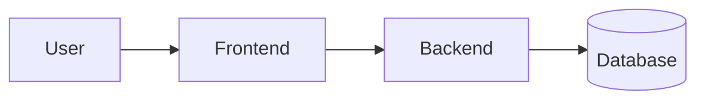

# System Architecture

## Diagram

## Components
| Component | Tech | Owner | Notes |
|-----------|------|-------|-------|
|           |      |       |       |

## Data flow
<!-- How a request moves through the system -->

## External services / APIs
- 

## Deployment
- 
