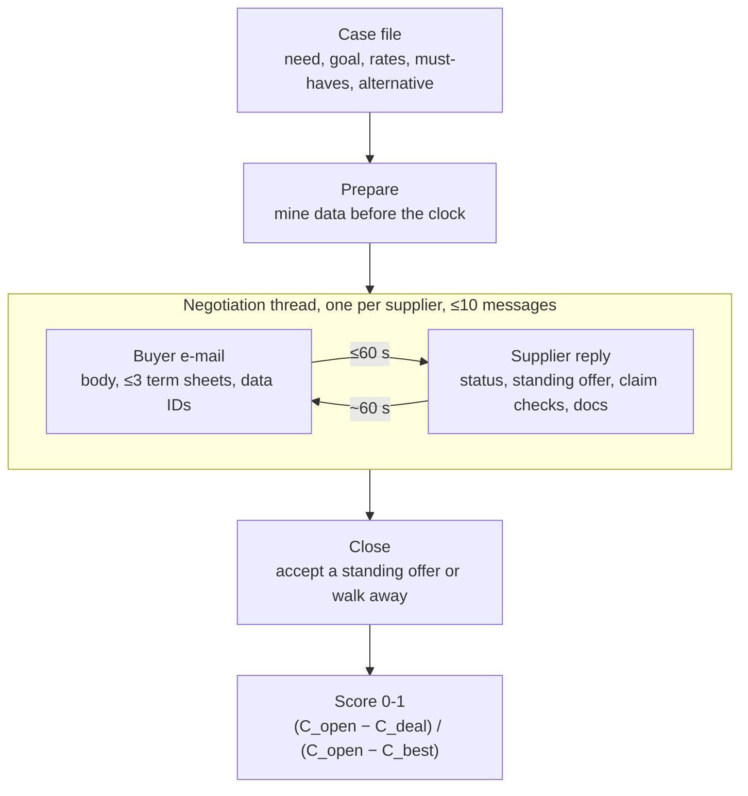

# Challenge workflow

Live Final: 5 waves × 8 min, up to 10 sessions in parallel → realistically 4-6 rounds per thread.

## Practice cases at a glance
- 21 cases (19 practice, 2 sandbox), 10 hosted. 7 types: price_increase, renewal, rfq, bundling, raw_material, capacity, quality.
- Price and payment days are negotiable almost everywhere; the type-specific lever is what differs: effective date (price increase), index clause (raw material, copper), volume and lead time (capacity), ppm and chargeback (quality), tooling and incoterm (RFQ).
- Must-haves only on lead time, volume and ppm → a hard code guard, never the LLM's call.
- 6 cases have no alternative: no deal scores 0, so the agent must close.
- stabilise / secure_supply goals charge for squeezing the supplier below a sustainable margin.

## Orchestration questions for the team
- Router by case type and goal → type-specific strategy?
- What runs offline before the session (dossier, citable claims, target terms) vs. live (reply reading, e-mail writing)?
- Which decisions are code (C, guards, accept/walk) and which are LLM (tone, arguments, reading the supplier)?
- RFQ: one coordinator over 2-3 threads, citing rival offers.

See the case notes in [[Cases]] and the board [[Board]].
