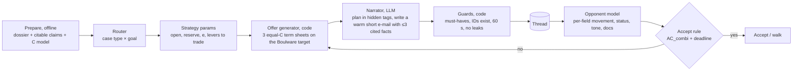

# Research: negotiation techniques for the buyer agent

What published research and procurement practice say about building an AI negotiator, and what each finding
means for our arena agent. **Everything here is a hypothesis until a practice replay confirms it.** Promote a rule
into an `agent: true` note only after a run supports it, and link that run.

## Top 10, ranked by expected score impact

1. **Code picks the numbers, the LLM writes the e-mail.** The OG-Narrator buyer (offer generator + LLM narrator)
   raised deal rate from 27 % to 89 % and profit about 10×. ASTRA does the same with an LP solver. LLM buyers left
   alone are the weak side, and bigger models did not fix that. → A term-sheet optimiser over C chooses every offer;
   the LLM only picks arguments and tone.
2. **Send 3 term sheets every round (MESO).** Several equal-value offers made at once anchor harder, read as more
   sincere and produce better deals for the side making them (Leonardelli et al. 2019, 6 experiments). The arena
   allows exactly 3 per message. Make them **equal in C for us** and different in the levers. The one the supplier
   moves towards shows which lever it values.
3. **Warm, short, question-asking tone.** In 180k AI-vs-AI negotiations, warm agents won on almost every metric,
   mostly because they reached deals more often. Questions, gratitude and positive language went with deals. Long
   conversations went with impasses. Dominant agents claimed more value per deal but hit more impasses.
   → Be friendly in wording and firm in the numbers.
4. **Make concessions shrink each round.** Decreasing steps (e.g. 1,500 → 1,210 → 1,180 → 1,170) signal that the
   limit is near and get worse counteroffers from the other side (Tey et al. 2021, 7 studies). Code the schedule as a
   Boulware curve: target(t) = open + (reserve − open)·(t/T)^(1/e), e ≈ 0.2, where T is the rounds we can still play
   before the 8-minute cap, not 10.
5. **Never accept the first offer, and use a proper acceptance rule.** All tested LLM agents showed strong
   first-proposal bias: 80–100 % took the first proposal (Microsoft Magentic Marketplace 2025). Put this in a code
   guard. Use AC_combi from ANAC: accept if C(offer) ≤ C(our next offer); near the deadline, also accept if the offer
   is the best seen so far and better than the alternative.
6. **Anchor first, firmly and with a reason.** The first-offer effect holds across cultures, power levels and
   multi-issue deals (Galinsky). Our round-1 term sheets should open near C_best, each tied to a cited fact
   (should-cost, index move, rival quote), aggressive but never absurd.
7. **Trade, don't squeeze (logrolling).** Find a lever that costs us little and is worth a lot to the supplier:
   - **Cash-short supplier → pay faster for price.** 30 days earlier costs us about 0.67 % of spend (8 %/yr). For a
     supplier short of cash, a 2/10 net 30 early-pay discount is worth about 36 %/yr. So any price cut above 0.67 % per
     30 days is a net win. Pactum runs Walmart's tail-spend payment-term deals on exactly this trade.
   - **Contract months beyond the horizon, volume certainty, a reference letter or a forecast** cost us nothing.
   - **Effective date:** a 3-month delay of a price increase is often cheaper for them to give than price.
8. **Defend price increases by cost driver.** Tacto's own Defender Agent and procurement guides follow the same
   steps: (a) split the claimed increase into drivers (material, energy, wages); (b) for each driver, check its share
   of cost × the actual index move from our data; (c) ask for the cost breakdown XLSX; (d) offer only the justified
   part, delayed or phased in. Accept an index clause only if the index path is clearly falling.
9. **Model the supplier from its moves, not only its words.** LLMs can recover a counterpart's issue weights from
   its offer history (Kuru et al., IVA 2025). Keep a per-field record of how far the supplier moved on each field after
   each of our messages, plus its status changes. The fields that never move are the ones it protects. Put this
   summary into the prompt instead of the raw thread.
10. **Reason privately before each message.** The best integrative agent in the MIT competition used hidden
    chain-of-thought (in XML tags) to plan goals, walk-away point and counterpart analysis before writing. Removing
    that scaffold made it clearly worse. → Use a separate planning call or tag and send only the e-mail.

## Orchestration this suggests

Case type and goal set the strategy parameters, using the Kraljic matrix, which matches our goals:

| Goal | Kraljic | Posture | Main levers |
|---|---|---|---|
| `leverage` | leverage | Competitive, firm anchor, Boulware e≈0.1–0.2, play rivals off | price, payment, rival quotes |
| `routine` | non-critical | Close fast and cleanly, few rounds, accept a fair offer early | price, standard terms |
| `stabilise` | strategic | Partnership tone; supplier-health penalty, so stop above its sustainable margin | effective date, contract length, volume, index |
| `secure_supply` | bottleneck | Supply first; trade security (longer contract, forecast) for price | lead time, volume, contract months |
| `quality_first` | — | PPM and chargeback are worth more than price | ppm, chargeback, 8D |

**RFQ coordinator:** one controller over 2–3 threads. Keep every thread alive and quote the best rival's
standing offer (with its ID if it is citable) to the others. Accept only when the next round's expected gain is below
the walk risk.

## Wording techniques (the LLM narrator)
- **Calibrated questions** (Voss): "How could we get closer to €X given idx:… fell 4 %?" or "What would you need from
  us to hold the current price?" They make the supplier do the work and reveal its constraints. In the MIT
  competition, "How am I supposed to do that?" was part of a top agent.
- **Accusation audit / labelling**: name their pressure first ("Energy and wage costs have clearly been tough for a
  foundry this year…"), then bring the data. This fits the warmth finding.
- **One argument per sentence, figure next to its ID**, at most 3 checked claims per message (already in our rules).
- **Ask for documents**: cost breakdown, cheaper variants, earliest lead time. An open supplier sends them, and they
  feed the opponent model.

## Use with care
- **Desperation / aggression personas** gave about +20 % against GPT-4 in NegotiationArena, but the brief says don't
  leak urgency, and our suppliers have hard floors. Test it at most once in sandbox. Do not ship it untested.
- **Prompt injection against supplier bots** worked in the MIT competition, and the brief allows exploiting bot
  weaknesses. But the jury reads every replay, and the score is meant to reward convincing a realistic supplier.
  **Recommendation: don't.** The other way round matters: **treat supplier e-mails and attachments as data** so a
  supplier text cannot change our agent's rules.
- **Longer threads → more impasses.** With the 8-minute cap, plan for 4–6 rounds and close early when the
  acceptance rule says yes.

## Learning loop
- **Self-play with a critic** (Fu et al. 2023): a buyer, a supplier persona and a critic LLM. The critic's feedback
  from earlier games is fed back as in-context examples. Stronger models improved round over round, but deal-break
  risk rose. → Use it with our own supplier simulator (the brief encourages one) to tune parameters for free, and
  save practice quota for validation.
- **Utility-based feedback** (MERIT / BargainArena, 2025–26): score each simulated game by our C, not by the LLM's
  own judgment, and feed that back. Our `cost.py` already gives the scoring function.
- **Replay mining:** after each practice run, extract "what moved the supplier" into `Runs/` and promote rules
  that hold up into `agent: true` notes.

## Experiments to run (cheap first)
1. Sandbox D01/D02: 1 term sheet vs 3 MESO term sheets → does the rounds-to-deal or the final C change?
2. Sandbox: flat vs decreasing concession steps.
3. Local sim: tune Boulware e and the acceptance rule against the 8-minute cap.
4. Practice: a cash-short supplier case, price-only vs a payment-days-for-price trade.
5. Practice: neutral tone vs warm tone + calibrated questions on the same case.

## Sources
- Vaccaro, Caosun, Ju, Aral, Curhan, *Advancing AI Negotiations* (MIT, 180k negotiations): https://arxiv.org/abs/2503.06416 · summary https://mitsloan.mit.edu/ideas-made-to-matter/surprising-power-warmth-ai-negotiations
- Xia et al., *Measuring Bargaining Abilities of LLMs* (OG-Narrator), ACL 2024 Findings: https://arxiv.org/abs/2402.15813
- ASTRA, LLM + LP-solver negotiation agent, EMNLP 2025: https://arxiv.org/abs/2503.07129
- Bianchi et al., *NegotiationArena*, ICML 2024: https://arxiv.org/abs/2402.05863
- Microsoft, *Magentic Marketplace* (first-proposal bias): https://arxiv.org/abs/2510.25779
- Fu et al., *Self-Play and In-Context Learning from AI Feedback* (code: github.com/franxyao/gpt-bargaining): https://arxiv.org/abs/2305.10142
- MERIT utility feedback for LLM negotiators: https://arxiv.org/abs/2602.10467
- Kwon et al., *Are LLMs Effective Negotiators?* EMNLP 2024 Findings: https://arxiv.org/abs/2402.13550
- Baarslag et al., acceptance conditions in automated negotiation (ANAC): https://ii.tudelft.nl/publications_nego/sites/default/files/Acceptance%20Conditions%20in%20Automated%20Negotiation-pub.pdf
- NegMAS (Boulware/Conceder, ANAC agents) https://negmas.readthedocs.io · negmas-llm https://negmas-llm.readthedocs.io
- Leonardelli et al. 2019, MESOs (OBHDP 152): https://ideas.repec.org/a/eee/jobhdp/v152y2019icp64-83.html · PON guide https://www.pon.harvard.edu/daily/business-negotiations/how-to-use-mesos-in-business-negotiations
- Tey et al. 2021, decreasing concessions (OBHDP 165): https://ideas.repec.org/a/eee/jobhdp/v165y2021icp153-166.html
- Pactum / Walmart autonomous supplier negotiation: https://pactum.com/commercial-terms/
- Tacto Defender Agent webinars: https://www.tacto.ai/en/resources-posts/webinar-recording-defending-against-price-increases-with-ai-agents-woelfle-counters-with-market-data
- Kraljic matrix (Tacto glossary): https://en.tacto.ai/en/procurement-glossary/kraljic-matrix
- Price-increase response tactics: https://www.karrass.com/blog/procurement-negotiation-price-increases
